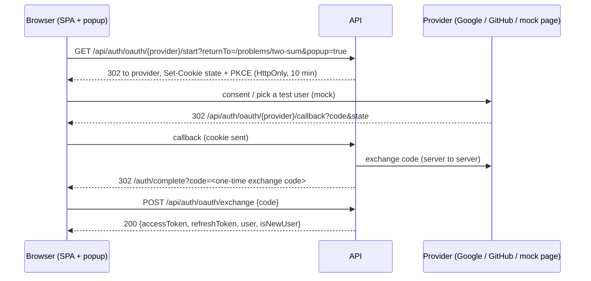

# API Specification — Semicolan

Base path: `/api`. Requirement IDs refer to [PRD.md](PRD.md) §7. The rules under **Conventions** apply to every endpoint; each endpoint section states only what differs.

## Conventions

### Format

- JSON in both directions (`Content-Type: application/json`); field names are camelCase. A request body in any other media type is rejected with `415`.
- Timestamps are RFC 3339 in UTC (`2026-11-01T10:15:30Z`).
- Every non-2xx response has a body of the form `{"error": "<CODE>"}`. Field-level validation failures add `fieldErrors`, a map of field name to code (`REQUIRED`, `INVALID`, `TOO_WEAK`, `TOO_LONG`, `OUT_OF_RANGE`). Clients switch on `error`, never on the status alone: one status carries several codes.

### Authentication modes

| Mode | Meaning |
|---|---|
| **Bearer** | Requires `Authorization: Bearer <accessToken>`. |
| **Optional** | Works for visitors; the response depends on the caller when a token is sent. A token that is present but invalid or expired gets `401` rather than being silently treated as a visitor, so the client refreshes and retries. |
| **None** | Public, or authenticated by something other than a user JWT (named in the endpoint). A bearer token, if sent, is ignored. |

### Status codes

| Status | Used for | `error` codes |
|---|---|---|
| `400 Bad Request` | The request cannot be parsed: invalid JSON, a wrong JSON type, an unparseable parameter (`page=abc`), or a required header missing | `MALFORMED_REQUEST` |
| `401 Unauthorized` | No credentials or an invalid or expired access token (Bearer and Optional endpoints send `WWW-Authenticate: Bearer`), or an invalid refresh token. A visitor who reaches something that needs a signed-in user gets this, not `403` | `AUTH_REQUIRED`, `INVALID_REFRESH_TOKEN` |
| `403 Forbidden` | The request is understood but refused: wrong role, no Premium entitlement, a spent free mock-test attempt, an account too new to post, a provider without a verified email (mock-login), an admin approving a revision they edited, or (webhooks) a bad signature | `FORBIDDEN`, `PREMIUM_REQUIRED`, `FREE_ATTEMPT_USED`, `ACCOUNT_TOO_NEW`, `OAUTH_EMAIL_NOT_VERIFIED`, `SELF_REVIEW_NOT_ALLOWED`, `INVALID_SIGNATURE` |
| `404 Not Found` | Unknown resource, or one the caller may not see (another user's submission) | per endpoint |
| `409 Conflict` | The request conflicts with the current state of a resource, including a mock-test session that has ended | `TEST_SESSION_CLOSED`, `ACTIVE_SESSION_EXISTS`, `SESSION_IN_PROGRESS`, per endpoint |
| `413 Payload Too Large` | The request body exceeds 128 KB | `PAYLOAD_TOO_LARGE` |
| `415 Unsupported Media Type` | The body is not `application/json` | `UNSUPPORTED_MEDIA_TYPE` |
| `422 Unprocessable Entity` | The JSON is well-formed but fails validation or a business rule | `VALIDATION_FAILED`, per endpoint |
| `429 Too Many Requests` | A rate limit or the per-user in-flight cap was exceeded; sent with `Retry-After` | `RATE_LIMITED`, `TOO_MANY_IN_FLIGHT` |
| `503 Service Unavailable` | The execution backlog is over its limit; sent with `Retry-After` | `EXECUTION_BUSY` |

Authentication (`401`) and rate limiting (`429`) are evaluated before anything else, so an unauthenticated or throttled caller learns nothing about the resource.

### Pagination

`GET /api/problems`, `GET /api/submissions`, `GET /api/leaderboard`, `GET /api/community/posts`, `GET /api/community/posts/{id}/comments`, `GET /api/me/community/posts`, `GET /api/me/quiz-attempts`, `GET /api/blog/posts` and the admin lists of §16 are paginated with offset parameters:


| Param | Default | Rules |
|---|---|---|
| `page` | `0` | Zero-based, at least `0` |
| `size` | `20` (leaderboard: `50`) | `1` to `100` |

The response is an envelope, never a bare array:

```json
{"items": [], "page": 0, "size": 20, "totalItems": 134, "totalPages": 7}
```

- A page past the end returns `200` with empty `items`, not `404`.
- A value out of range returns `422 VALIDATION_FAILED` (for example `{"size": "OUT_OF_RANGE"}`); an unparseable one returns `400 MALFORMED_REQUEST`. Values are never silently clamped.
- Each paginated endpoint states a total order that ends in a unique tiebreaker, so unchanged data never repeats or skips an item between pages.
- `GET /api/topics`, `GET /api/languages`, `GET /api/plans`, `GET /api/mock-tests`, the hub topic lists, design question lists, `GET /api/companies` and `GET /api/projects` are bounded by the published catalog and are deliberately not paginated. `GET /api/billing` returns at most the caller's latest 100 payments.

### Rate limiting

| Policy | Applies to | Counted per |
|---|---|---|
| `auth` | `GET /api/auth/oauth/{provider}/start`, `POST /api/auth/oauth/exchange`, `POST /api/auth/refresh` | Client IP |
| `quiz` | `PUT /api/quiz-attempts/{id}/answers/{questionId}` | User |
| `community_post` | `POST` and `PATCH /api/community/posts` | User |
| `community_comment` | `POST` and `PATCH` comments | User |
| `community_vote` | Post and comment votes | User |
| `community_report` | `POST /api/community/reports` | User |
| `run` | `POST /api/submissions` with `mode: RUN` and no `testSessionId` | User |
| `submit` | `POST /api/submissions` with `mode: SUBMIT` and no `testSessionId` | User |
| `run_session` | `POST /api/submissions` with `mode: RUN` and a `testSessionId` | User |
| `submit_session` | `POST /api/submissions` with `mode: SUBMIT` and a `testSessionId` | User |
| `checkout` | `POST /api/payments/checkout` | User |
| `events` | `POST /api/events` | User when signed in, otherwise client IP |
| `admin` | Every `POST`, `PUT`, `PATCH` and `DELETE` under `/api/admin/**` (§7, §13, §16) | User (the admin) |

The limits are configuration (PRD EXE-4); mock-test attempts are configured separately from practice attempts. Attempts that end in `JUDGING_ERROR`, and `5xx` or `503 EXECUTION_BUSY` responses, do not consume the allowance. Separately from these windows, each user may have at most 3 non-terminal attempts at once (`429 TOO_MANY_IN_FLIGHT`, sent with `Retry-After`). The values in force are sent on **every** response from a limited endpoint — successes, errors, and the `429` itself — so a client can pace itself instead of discovering the limit by failing:

| Header | Meaning |
|---|---|
| `X-RateLimit-Limit` | Requests the applicable policy allows per window |
| `X-RateLimit-Remaining` | Requests still available now (`0` on a `429`) |
| `X-RateLimit-Reset` | Whole seconds until the window resets and the full quota is available again (a delay, not a timestamp) |
| `Retry-After` | `429` only: whole seconds until the next request would be accepted |

A throttled request:

```http
HTTP/1.1 429 Too Many Requests
Retry-After: 12
X-RateLimit-Limit: 10
X-RateLimit-Remaining: 0
X-RateLimit-Reset: 12
Content-Type: application/json

{"error": "RATE_LIMITED"}
```

- Behind the reverse proxy, the client IP is taken from the forwarding header that the proxy itself sets and overwrites. A client-supplied `X-Forwarded-For` is never trusted; otherwise the `auth` limit is trivial to evade.
- Webhook endpoints (§4) are outside these policies; their abuse control is signature verification.

### Idempotency

| Endpoint | A repeat of the same request |
|---|---|
| `PUT /api/internal/judge0/callback`, `POST /api/webhooks/razorpay` | Acknowledged with `204` and ignored (§4) |
| `POST /api/me/deletion-request` | `202` again; the original request time is kept |
| `PUT /api/me/bookmarks/{problemId}`, `DELETE /api/me/bookmarks/{problemId}` | `204` again; saving a saved problem or removing an unsaved one changes nothing (§2) |
| `PATCH /api/me` | Same body, same result; the server applies only the fields sent |
| `POST /api/quizzes/{slug}/attempts` | `200` with the attempt in progress (§9) |
| `PUT /api/quiz-attempts/{id}/answers/{questionId}` | `200` with the stored answer and `alreadyAnswered: true`; an answer is final (§9) |
| `PUT /api/me/content-progress/…`, community votes | Same state returned |
| `POST /api/community/reports` | `202` again; one report per user and target |
| `POST /api/dev/payments/{orderId}/simulate` with `duplicate: true` | Exercises the webhook idempotency below (§14) |
| `POST /api/submissions` with a `clientRequestId` | `202` with the original attempt; no new attempt is created and no quota is consumed (§3). Without a `clientRequestId`, every call creates a new attempt |
| `POST /api/mock-tests/{id}/sessions` | `200` with the session already in progress for that test; never a second clock (§6) |
| `POST /api/mock-test-sessions/{id}/finish` | `200` with the already-closed session (§6) |
| `POST /api/payments/checkout` | `200` with the caller's recent unpaid order for the same plan instead of a new one (§7) |
| `POST /api/admin/{collection}/{id}/revisions` | `200` with the item's open revision; never a second open revision (§16) |
| `POST /api/admin/revisions/{id}/validation` | `202` with the gate run already in progress; never a second run (§16) |
| `PUT /api/admin/revisions/{id}/test-cases/{position}` | Same body, same stored test (§16) |

### Caching and CORS

- Responses that depend on the caller or carry user data — `GET /api/me`, `/me/stats` and `/me/activity`, `GET /api/submissions` and `/{id}`, `GET /api/leaderboard/me`, `GET /api/problems/{id}` and `/{id}/editorial`, `GET /api/problems` and `GET /api/topics` whenever a token is sent (they then carry the caller's progress), every `/api/me/**`, `/api/quiz-attempts/**` and `/api/admin/**` endpoint, and the hub, design, company, project and community reads whenever a token is sent, every `/api/mock-tests` and `/api/mock-test-sessions` endpoint, `GET /api/billing`, and `GET /api/payments/orders/{orderId}` — are sent with `Cache-Control: private, no-store`, so no shared cache can hand a Premium statement or a submission to someone else.
- The public blog reads (§15) carry no caller data and are sent with `Cache-Control: public, max-age=60`, so a publish or an archive is visible within a minute even through a shared cache.
- If the SPA is served from a different origin than the API, the server must list `Retry-After`, `X-RateLimit-Limit`, `X-RateLimit-Remaining`, `X-RateLimit-Reset`, and `Location` in `Access-Control-Expose-Headers`. Browsers show scripts only a short list of safelisted response headers, and `Retry-After` is not on it, so without this the UI's "retry in N s" countdown cannot read it.

---

## 1. Auth

Sign-in is **Google or GitHub only** (PRD ACC-1). The provider step sits behind `AuthService` (TRD §2): in `dev` and `test` the same endpoints run against `MockAuthServiceImpl` and its seeded test users, and `POST /api/auth/mock-login` is available; in `staging` and `prod` they run against the real providers, and every development-only endpoint returns `404`. Our own JWT pair is issued the same way in every environment.



### `GET /api/auth/providers`

**Auth**: none

**Response `200 OK`**
```json
{"mode": "OAUTH", "providers": [{"id": "google", "name": "Google"}, {"id": "github", "name": "GitHub"}]}
```
`mode` is `MOCK` in `dev` and `test`, so the sign-in dialog can show a "Development sign-in" badge and the test-user shortcut. The same two buttons are rendered in every mode.

### `GET /api/auth/oauth/{provider}/start`

**Auth**: none · **Rate limit**: policy `auth`

`provider` is `google` or `github`. **Query params**: `returnTo` (optional same-origin relative path, default `/home`; anything else is replaced by the default), `popup` (`true` when opened in a popup window).

**Response**: `302 Found` to the provider's authorization URL (in mock mode, to the SPA page `/dev/mock-oauth?provider=…&state=…`). Sets the `semicolan_oauth` cookie (`HttpOnly; Secure; SameSite=Lax; Path=/api/auth/oauth/; Max-Age=600`) holding the signed and encrypted `state`, PKCE verifier, nonce, `returnTo`, `popup` and intent. Unknown provider → `404 PROVIDER_NOT_FOUND`.

### `GET /api/auth/oauth/{provider}/callback`

**Auth**: none (the `state` cookie and the provider's `code` are the credentials)

**Query params**: `code`, `state` (or the provider's `error`).

**Response**: always a `302 Found` to the SPA, never a JSON body and never our tokens in a URL.

| Outcome | Redirect |
|---|---|
| Signed in (existing user, linked by email, or new user) | `/auth/complete?code=<one-time exchange code>` |
| Linked a provider for a signed-in user (`intent=link`) | `/settings/accounts?linked={provider}` |
| `state` missing, expired, or not matching the cookie | `/auth/complete?error=OAUTH_STATE_INVALID` |
| GitHub account with no verified primary email (or Google with `email_verified=false`) | `/auth/complete?error=OAUTH_EMAIL_NOT_VERIFIED` |
| The user cancelled at the provider | `/auth/complete?error=OAUTH_CANCELLED` |
| Linking an identity that already belongs to another account | `/settings/accounts?error=IDENTITY_IN_USE` |
| Sign-in with a new provider account whose verified email matches a user who already has a **different** account of that provider linked | `/auth/complete?error=IDENTITY_CONFLICT` — nothing is linked; the user signs in with the linked account and relinks from Settings |
| Provider unreachable or returned an error | `/auth/complete?error=OAUTH_PROVIDER_ERROR` |

`/auth/complete` (an SPA route) posts the code or error to its opener with `postMessage` and closes when it is a popup, or exchanges the code and navigates to `returnTo` otherwise (App_Flow §1).

### `POST /api/auth/oauth/exchange`

**Auth**: none · **Rate limit**: policy `auth`

**Request body**: `{"code": "..."}` — the one-time exchange code (single-use, 60-second lifetime).

**Responses**
| Status | Body |
|---|---|
| `200 OK` | `{"accessToken": "...", "refreshToken": "...", "isNewUser": true, "user": {"id": 1, "email": "asha@example.com", "displayName": "Asha K", "avatarUrl": "https://…", "role": "USER", "needsOnboarding": true}}` |
| `422 Unprocessable Entity` | `{"error": "INVALID_OR_EXPIRED_TOKEN"}` — unknown, expired or already used code |

A new account starts as `role = USER` with no Premium entitlement and `needsOnboarding: true`; the client shows onboarding (App_Flow §1) and completes it with `PATCH /api/me`.

### `POST /api/auth/mock-login` — development and test only

**Auth**: none · **Exists only** in the `dev` and `test` profiles with `semicolan.auth.mode=mock`; everywhere else the route is not registered and returns `404` (TRD §2, §5).

One-call sign-in as a seeded test user, for local development, Postman, scripts and E2E tests. It goes through `MockAuthServiceImpl` → `UserAccountService` → `TokenService`, so the tokens are real, signed JWTs that every other endpoint accepts.

**Request body**: `{"userKey": "premium-active"}`. Keys: `free`, `premium-active`, `premium-expired`, `revoked`, `admin`, `new-user` (created on first use, needs onboarding), `github-unverified` (always fails, to exercise the error path). Optional `"provider": "github"` signs in through that mock provider's identity (default `google`), which is how linking is tested.

**Ephemeral test users**: a `userKey` of the form `e2e-` followed by 1 to 40 characters from `a-z0-9-` creates, on first use, a fresh user `<userKey>@semicolan.test` from a `"template"` — one of `free` (default), `premium-active`, `premium-expired`, `revoked`, `admin` or `new-user` — with the template's state and dates relative to the server `Clock`; later calls sign the same user in and ignore `template`. Every template except `new-user` is created onboarded and with `created_at` 30 days before now, so the 24-hour posting rule does not block it; tests of that rule move the `Clock` instead. They let parallel E2E specs each own a user (no shared rate limits, free attempts or purchases) and give four-eyes tests a second admin ([Agent_Testing_Environment.md](Agent_Testing_Environment.md) §7.4). They are never reseeded and never listed by `GET /api/dev/mock-users`.

**Responses**
| Status | Body |
|---|---|
| `200 OK` | Same body as `POST /api/auth/oauth/exchange` |
| `403 Forbidden` | `{"error": "OAUTH_EMAIL_NOT_VERIFIED"}` — `github-unverified` |
| `404 Not Found` | `{"error": "TEST_USER_NOT_FOUND"}` — unknown key; or the route does not exist outside `dev`/`test` |
| `422 Unprocessable Entity` | `{"error": "VALIDATION_FAILED", "fieldErrors": {"template": "INVALID"}}` — an unknown template, or an `e2e-` key outside the allowed pattern |

### `POST /api/auth/refresh`

**Auth**: none (the refresh token is the credential)

**Request body**: `{"refreshToken": "..."}`

**Responses**
| Status | Body |
|---|---|
| `200 OK` | `{"accessToken": "...", "refreshToken": "..."}` — the refresh token is rotated and the old one is consumed. A token consumed within the reuse leeway (10 seconds by default) that is presented again — a second tab, or a retry after a lost response — also receives a fresh pair and revokes nothing |
| `401 Unauthorized` | `{"error": "INVALID_REFRESH_TOKEN"}` — unknown, expired, or already used outside the leeway. Presenting a token that was consumed outside the leeway is treated as theft and revokes all of that user's refresh tokens |
| `422 Unprocessable Entity` | `{"error": "VALIDATION_FAILED", "fieldErrors": {"refreshToken": "REQUIRED"}}` |

The refresh token travels in the JSON body in both directions. Access tokens live 15 minutes by default.

### `POST /api/auth/logout`

**Auth**: none (the refresh token is the credential)

**Request body**: `{"refreshToken": "..."}`. Revokes that refresh token. `204 No Content` always, also for an unknown or already-used token, so the client can log out offline-first and retry blindly.

### `GET /api/me`

**Auth**: Bearer

Returns the caller's profile and entitlement. The client uses it for UI gating and to poll for Premium activation after checkout; the backend enforces entitlement independently on every gated endpoint.

**Response `200 OK`**
```json
{
  "id": 1,
  "email": "student@example.com",
  "displayName": "Asha K",
  "avatarUrl": "https://lh3.googleusercontent.com/…",
  "role": "USER",
  "emailVerified": true,
  "needsOnboarding": false,
  "identities": [{"provider": "GOOGLE", "email": "student@example.com", "linkedAt": "2026-10-01T09:00:00Z"}],
  "segment": "STUDENT",
  "college": "ABC Institute of Technology",
  "graduationYear": 2027,
  "createdAt": "2026-08-14T10:02:11.000Z",
  "canPostFrom": null,
  "deletionRequestedAt": null,
  "entitlement": {
    "plan": "PREMIUM",
    "status": "ACTIVE",
    "expiresAt": "2026-12-01T00:00:00Z"
  },
  "activeTestSession": {
    "sessionId": 77,
    "title": "Placement Warm-up",
    "endTime": "2026-11-01T11:15:30.123Z"
  }
}
```
`emailVerified` is always `true` (only providers that assert a verified email can sign in) and is kept for clients. `needsOnboarding` is `true` until the first `PATCH /api/me` that sets `segment`. `identities` lists the linked providers (`GOOGLE`, `GITHUB`; in development a mock sign-in is recorded under the provider whose button was used). `entitlement.status` is `NONE`, `ACTIVE`, `EXPIRED`, or `REVOKED`; `expiresAt` is `null` if the user never purchased. `entitlement.plan` is `PREMIUM` only while `status` is `ACTIVE` and `expiresAt` is in the future, otherwise `FREE`.

`createdAt` is `users.created_at`, shown as "Member since" on the profile (App_Flow §8.1). `canPostFrom` is `createdAt` plus 24 hours while that instant is still in the future, otherwise `null`; the community composer shows "You can post from {time}" instead of the form while it is set (App_Flow §14), and `POST /api/community/posts` still enforces it with `403 ACCOUNT_TOO_NEW`. `deletionRequestedAt` is `users.deletion_requested_at`, or `null`; Settings shows "Deletion requested on {date}" while it is set.

`activeTestSession` is the caller's mock-test session in progress (§6), or `null`. It is `null` as soon as server time reaches its `endTime`, even if the closer has not run yet. The client uses it to show the "Test in progress" bar and to resume the runner.

### `PATCH /api/me`

**Auth**: Bearer

Edits the caller's profile (PRD ACC-5). Send only the fields that change; omitted fields are untouched, and `null` clears an optional field.

**Request body**
```json
{"displayName": "Asha Kumar", "segment": "STUDENT", "college": null, "graduationYear": 2027}
```
- `displayName` 1 to 50 characters after trimming; `segment` `STUDENT` | `PROFESSIONAL` | `OTHER`; `college` at most 255 characters or `null`; `graduationYear` 1950 to 2100 or `null`.
- **Onboarding** is the first `PATCH` while `needsOnboarding` is `true`: it must include `segment` and `displayName` (`422` otherwise) and sets `needsOnboarding` to `false`. After that, `segment` can be changed but not cleared.
- `email`, `role` and entitlement cannot be changed here; sending one of them returns `422` with `{"email": "INVALID"}` (and so on) rather than being silently ignored.

**Responses**
| Status | Body |
|---|---|
| `200 OK` | The full `GET /api/me` object, updated |
| `422 Unprocessable Entity` | `{"error": "VALIDATION_FAILED", "fieldErrors": {"displayName": "REQUIRED"}}` |

### `GET /api/me/stats`

**Auth**: Bearer

The caller's own numbers, for the dashboard, the profile (PRD HOME-1, PRF-1) and the renewal prompt shown after Premium lapses.

**Response `200 OK`**
```json
{
  "solvedCount": 42,
  "points": 71,
  "mockTestsCompleted": 3,
  "quizzesCompleted": 7,
  "attemptingCount": 4,
  "byDifficulty": {
    "EASY":   {"solved": 25, "published": 40},
    "MEDIUM": {"solved": 14, "published": 55},
    "HARD":   {"solved": 3,  "published": 25}
  }
}
```
- `solvedCount` and `points` are all-time totals over the caller's first solves (the same rows the leaderboard uses); `mockTestsCompleted` counts the caller's sessions with `status` `COMPLETED`.
- `attemptingCount` is the number of published problems with at least one `SUBMIT` and no solve. `quizzesCompleted` counts the caller's `COMPLETED` quiz attempts (any quiz, retakes included).
- `byDifficulty` counts only problems that are published now, so `solved` never exceeds `published`; it can therefore sum to less than `solvedCount` after a problem is archived ([Backend_Schema.md](Backend_Schema.md), Query Patterns).
- Not gated by entitlement.

### `GET /api/me/activity`

**Auth**: Bearer

The activity heatmap and streaks (PRD HOME-1, PRF-1).

**Query params**: `days` — `1` to `366`, default `365`. The window ends today, in Asia/Kolkata days, the same calendar as the weekly leaderboard.

**Response `200 OK`**
```json
{
  "timeZone": "Asia/Kolkata",
  "from": "2025-11-05",
  "to": "2026-11-04",
  "days": [{"date": "2026-11-02", "submissions": 3, "quizzes": 1}, {"date": "2026-11-04", "submissions": 1, "quizzes": 0}],
  "totalSubmissions": 142,
  "activeDays": 38,
  "currentStreak": 1,
  "longestStreak": 11
}
```
- A day counts every `SUBMIT` the caller made on it and every quiz attempt they completed on it; a day is active when either is at least 1. `RUN` attempts are not counted (they are purged after 24 hours). `totalSubmissions` counts submissions only. `days` lists only days with at least one submission, in ascending order; the client fills the gaps.
- `from` and `to` are calendar dates (`YYYY-MM-DD`), not instants, because they name IST days.
- `currentStreak` is the number of consecutive active days ending today, or ending yesterday if today has none yet, so a streak doesn't read as broken in the morning. `longestStreak` is the longest run inside the window.
- `days` outside `1`–`366` returns `422 VALIDATION_FAILED`.

### `PUT /api/me/bookmarks/{problemId}` · `DELETE /api/me/bookmarks/{problemId}`

**Auth**: Bearer

Saves or un-saves a problem (PRD CAT-3). No request body. Both are idempotent.

**Responses**
| Status | Body | Cause |
|---|---|---|
| `204 No Content` | *(empty)* | Saved or removed — also when it already was |
| `404 Not Found` | `{"error": "PROBLEM_NOT_FOUND"}` | Unknown or unpublished problem (`PUT` only; `DELETE` of an unknown id is `204`) |
| `422 Unprocessable Entity` | `{"error": "BOOKMARK_LIMIT_REACHED"}` | The caller already has 1,000 bookmarks (`PUT` only) |

Premium problems can be bookmarked by anyone signed in; the bookmark does not grant access. Saved problems are listed with `GET /api/problems?bookmarked=true`.

### `POST /api/me/identities/{provider}/link`

**Auth**: Bearer · `provider` is `google` or `github` (PRD ACC-6)

Starts linking another provider to the signed-in account. **Response** `200 OK` `{"authorizationUrl": "https://accounts.google.com/o/oauth2/v2/auth?…"}` and the `semicolan_oauth` cookie with `intent=link` bound to the caller. The client opens the URL (popup or redirect); the callback links the identity and redirects to `/settings/accounts?linked={provider}`, or `?error=IDENTITY_IN_USE` when that provider account already belongs to another user. `409 ALREADY_LINKED` if the caller already has that provider.

### `DELETE /api/me/identities/{provider}`

**Auth**: Bearer. Unlinks a provider. `204 No Content`; `409 {"error": "LAST_IDENTITY"}` when it is the only one left (an account always keeps a way to sign in); `404 IDENTITY_NOT_FOUND`.

### `POST /api/me/deletion-request`

**Auth**: Bearer

Records an account-deletion request (PRD ACC-4). Personal data is removed manually within 30 days and leaderboard rows are anonymized.

**Response**: `202 Accepted` (empty body). Repeating the request returns `202` again and keeps the original request time.

---

## 2. Problems

### `GET /api/problems`

**Auth**: optional (visitors can browse the catalog; a signed-in caller also gets their progress)

**Query params**
| Param | Rules |
|---|---|
| `topic` | Topic slug, optional. An unknown slug returns an empty page |
| `difficulty` | `EASY` \| `MEDIUM` \| `HARD`, optional |
| `q` | Optional title search (PRD CAT-2): case-insensitive substring, 1 to 100 characters after trimming |
| `status` | `SOLVED` \| `ATTEMPTED` \| `UNSOLVED`, optional, **signed-in only**. `ATTEMPTED` means at least one `SUBMIT` and no Accepted one; `UNSOLVED` means no Accepted `SUBMIT` (so it includes attempted) |
| `bookmarked` | `true`, optional, **signed-in only** (PRD CAT-3) |
| `page`, `size` | Default `0` and `20`, max `100` — see [Pagination](#pagination) |

**Response `200 OK`**
```json
{
  "items": [
    {
      "id": 101,
      "slug": "two-sum",
      "title": "Two Sum",
      "difficulty": "EASY",
      "topics": ["arrays", "hashing"],
      "isPremiumOnly": false,
      "hasEditorial": true,
      "userStatus": "SOLVED",
      "isBookmarked": true
    }
  ],
  "page": 0,
  "size": 20,
  "totalItems": 134,
  "totalPages": 7
}
```
Only `PUBLISHED` problems are listed, ordered by `id` ascending. Premium-only problems are included and flagged, not filtered out, so visitors and Free users can see what is locked. A `difficulty` or `status` outside its enum, or a `q` over 100 characters, returns `422 VALIDATION_FAILED`.

- `userStatus` is `SOLVED`, `ATTEMPTED` or `null`, and `isBookmarked` is a boolean — both only for a signed-in caller. For visitors the two fields are omitted, not `null`, so the client can tell "not signed in" from "not attempted".
- `status` or `bookmarked` from a visitor returns `401 AUTH_REQUIRED`: progress filters need a user.
- `hasEditorial` says whether the Solution tab has content (PRD SOL-1); it does not say whether the caller may read it.

### `GET /api/problems/{id}`

**Auth**: optional

**Response `200 OK`**
```json
{
  "id": 101,
  "slug": "two-sum",
  "title": "Two Sum",
  "descriptionMarkdown": "## Problem\n...",
  "difficulty": "EASY",
  "isPremiumOnly": false,
  "topics": ["arrays", "hashing"],
  "baseCodeStubs": {
    "c": "int solve(...) { ... }",
    "cpp": "class Solution { ... };",
    "java": "class Solution { ... }",
    "python": "def solve(): ..."
  },
  "sampleTestCases": [
    {"input": "[2,7,11,15], 9", "expectedOutput": "[0,1]"}
  ]
}
```

**Errors**
| Status | Body | Cause |
|---|---|---|
| `401 Unauthorized` | `{"error": "AUTH_REQUIRED"}` | `isPremiumOnly=true` and the request carries no credentials (a visitor). The client shows a sign-up prompt |
| `403 Forbidden` | `{"error": "PREMIUM_REQUIRED"}` | `isPremiumOnly=true` and the caller is signed in but has no active Premium entitlement. The client shows the paywall |
| `404 Not Found` | `{"error": "PROBLEM_NOT_FOUND"}` | Unknown `id`, or the problem is not `PUBLISHED` |

Problems inside a mock test are served through `GET /api/mock-test-sessions/{id}/problems/{problemId}` (§6), which authorizes against the session instead of this rule.

### `GET /api/problems/{id}/editorial`

**Auth**: optional

The Solution tab (PRD SOL-1): the approach write-up, complexity, and the reference solution in every launch language.

**Response `200 OK`**
```json
{
  "problemId": 101,
  "approachMarkdown": "We track two indices as we iterate...",
  "timeComplexity": "O(n)",
  "spaceComplexity": "O(1)",
  "code": {
    "c": "int maxProfit(...) { ... }",
    "cpp": "class Solution { ... };",
    "java": "class Solution { ... }",
    "python": "class Solution: ..."
  },
  "updatedAt": "2026-10-20T08:00:00Z"
}
```
`code` keys are the `baseCodeStubs` language slugs; every launch language is present (the publish gate guarantees it). `approachMarkdown` is rendered through the same sanitizer as the statement.

**Errors**
| Status | Body | Cause |
|---|---|---|
| `401 Unauthorized` | `{"error": "AUTH_REQUIRED"}` | A visitor. Editorials need an account, for free problems too |
| `403 Forbidden` | `{"error": "PREMIUM_REQUIRED"}` | `isPremiumOnly=true` and the caller has no active Premium entitlement |
| `404 Not Found` | `{"error": "PROBLEM_NOT_FOUND"}` | Unknown or unpublished problem |
| `404 Not Found` | `{"error": "EDITORIAL_NOT_FOUND"}` | The problem has no editorial yet |
| `409 Conflict` | `{"error": "EDITORIAL_LOCKED_DURING_TEST"}` | The problem is part of the caller's mock-test session in progress. Available again as soon as the session's `endTime` passes or it is finished |

The checks run in that order, so a visitor learns nothing about whether a premium problem has an editorial. Mock-test sessions never expose editorials: `GET /api/mock-test-sessions/{id}/problems/{problemId}` has no editorial field.

### `GET /api/topics`

**Auth**: optional

**Response `200 OK`**
```json
[
  {"slug": "arrays", "name": "Arrays", "problemCount": 24, "solvedCount": 9},
  {"slug": "hashing", "name": "Hashing", "problemCount": 12, "solvedCount": 0}
]
```
Used to populate the catalog's topic filter and sub-sidebar (PRD CAT-1, CAT-2) and the dashboard's topic tiles (HOME-1). Ordered by `name`. `problemCount` counts published problems; topics with none are omitted. `solvedCount` is present only for a signed-in caller. Not paginated: a small bounded list.

### `GET /api/languages`

**Auth**: none

**Response `200 OK`**
```json
[
  {"id": 50, "slug": "c", "name": "C"},
  {"id": 54, "slug": "cpp", "name": "C++"},
  {"id": 62, "slug": "java", "name": "Java"},
  {"id": 71, "slug": "python", "name": "Python 3"}
]
```
The four launch languages (PRD WRK-3). `id` is the Judge0 language ID resolved from configuration — the values shown are examples; use the IDs of the deployed Judge0 version. `slug` is the key used in `baseCodeStubs`. Not paginated: the four launch languages.

---

## 3. Submissions

### `POST /api/submissions`

**Auth**: Bearer

**Rate limit**: policy `run` or `submit`, chosen by `mode`; `run_session` or `submit_session` when `testSessionId` is set ([Rate limiting](#rate-limiting)). The `X-RateLimit-*` headers are sent on the `202` and on every error. Requests are also bounded by a per-user in-flight cap and by global admission control (see the errors below).

Creates an attempt: `RUN` (sample test cases only) or `SUBMIT` (all test cases).

**Request body**
```json
{
  "problemId": 101,
  "languageId": 62,
  "sourceCode": "class Solution { public static void main(String[] args) { ... } }",
  "mode": "SUBMIT",
  "testSessionId": null,
  "clientRequestId": "6f1c2d9e-8a54-4b0e-9c3a-1d2e3f4a5b6c"
}
```
- `languageId` — Judge0 language identifier; must be one of the launch languages from `GET /api/languages`.
- `sourceCode` — raw submitted source; required, non-empty, and at most 64 KB (`REQUIRED` / `TOO_LONG` in `fieldErrors`). The whole body is limited to 128 KB (`413`).
- `mode` — `RUN` or `SUBMIT` (default `SUBMIT`). A `RUN` executes the sample test cases only, is purged after 24 hours, and never appears in history or the leaderboard (PRD WRK-2). `VALIDATE` exists only inside the publish gate (§16) and is rejected here with `422` (`{"mode": "INVALID"}`).
- `testSessionId` — optional; set when the attempt is made inside an active mock-test session. The session then authorizes access to the problem (the problem's own premium flag is not consulted), and the backend checks the arrival time against the session's `end_time`.
- `clientRequestId` — optional client-generated idempotency key, at most 64 characters from `A-Za-z0-9_-` (a UUID works). The web client always sends one and reuses it for every retry of the same click. A repeat of the same `(caller, clientRequestId)` returns the **original** attempt with `202` and its current status; no new attempt is created and no quota is consumed.

**Response**
```http
HTTP/1.1 202 Accepted
Location: /api/submissions/5821
X-RateLimit-Limit: 10
X-RateLimit-Remaining: 9
X-RateLimit-Reset: 60
Content-Type: application/json

{"submissionId": 5821, "mode": "SUBMIT", "status": "PENDING"}
```
The header values are illustrative; the real limits are configuration. The request returns immediately; judging fans out to one Judge0 job per test case asynchronously (`wait=false`), per [TRD.md](TRD.md) §3.

**Errors** (plus the [common ones](#status-codes))
| Status | Body | Cause |
|---|---|---|
| `403 Forbidden` | `{"error": "PREMIUM_REQUIRED"}` | Premium-only problem, no active Premium entitlement, and no valid `testSessionId` |
| `404 Not Found` | `{"error": "PROBLEM_NOT_FOUND"}` or `{"error": "TEST_SESSION_NOT_FOUND"}` | Unknown or unpublished problem; or a session that does not exist or is not the caller's |
| `409 Conflict` | `{"error": "TEST_SESSION_CLOSED"}` | The session has ended: it is no longer `IN_PROGRESS`, or server time at arrival is past its `end_time`. Decided on the server clock regardless of the client's, and no attempt is created |
| `413 Payload Too Large` | `{"error": "PAYLOAD_TOO_LARGE"}` | The request body exceeds 128 KB |
| `422 Unprocessable Entity` | `{"error": "VALIDATION_FAILED", "fieldErrors": {"sourceCode": "REQUIRED"}}` | A missing or invalid field, including `sourceCode` over 64 KB (`TOO_LONG`) |
| `422 Unprocessable Entity` | `{"error": "UNSUPPORTED_LANGUAGE"}` | `languageId` is outside the launch set |
| `422 Unprocessable Entity` | `{"error": "PROBLEM_NOT_IN_TEST"}` | `problemId` is not part of the given session |
| `429 Too Many Requests` | `{"error": "RATE_LIMITED"}` | Run/Submit fair-use limit exceeded (PRD EXE-4). Sent with `Retry-After` and `X-RateLimit-Remaining: 0` |
| `429 Too Many Requests` | `{"error": "TOO_MANY_IN_FLIGHT"}` | The caller already has 3 non-terminal attempts (default). Sent with `Retry-After` |
| `503 Service Unavailable` | `{"error": "EXECUTION_BUSY"}` | The execution backlog is over its limit. Sent with `Retry-After`. Never returned for attempts inside a mock-test session, which are always admitted |

The order of checks is: authentication, rate limit and in-flight cap, body size, field validation, the `clientRequestId` lookup, access (free problem, Premium entitlement, or the session rule), then admission control. A `5xx`, a `503`, and an attempt that ends in `JUDGING_ERROR` do not consume the rate-limit allowance.

### `GET /api/submissions/{id}`

**Auth**: Bearer

Used by the client to poll for the result (see [App_Flow.md](App_Flow.md)'s Problem Solving Flow) and to view a past attempt with its code.

**Response `200 OK`**
```json
{
  "submissionId": 5821,
  "mode": "SUBMIT",
  "problemId": 101,
  "languageId": 62,
  "sourceCode": "class Solution { ... }",
  "testSessionId": null,
  "status": "WRONG_ANSWER",
  "progress": {"completed": 20, "total": 20},
  "failedTestIndex": 7,
  "executionTimeMs": 42,
  "memoryKb": 15360,
  "compileOutput": null,
  "pointsAwarded": null,
  "testResults": [
    {
      "testCaseIndex": 1,
      "status": "ACCEPTED",
      "input": "[2,7,11,15], 9",
      "expectedOutput": "[0,1]",
      "actualOutput": "[0,1]",
      "stderr": null
    }
  ],
  "submittedAt": "2026-11-01T10:15:30Z"
}
```
- `status` is the current state — `PENDING`, `JUDGING`, or a terminal verdict (`ACCEPTED`, `WRONG_ANSWER`, `TIME_LIMIT_EXCEEDED`, `RUNTIME_ERROR`, `COMPILE_ERROR`, `JUDGING_ERROR`) — matching the `submissions.status` enum. For a `RUN` or `SUBMIT` in progress, the client keeps polling until it is terminal. Python `SyntaxError`, `IndentationError`, and `TabError` are reported as `COMPILE_ERROR`, with the traceback in `compileOutput`.
- `progress` counts finished test jobs against all of the attempt's jobs, so the client can show "Judging… 7 of 20 tests". It is present on every response.
- `pointsAwarded` is non-null only on the response for a `SUBMIT` that was the caller's first `ACCEPTED` solve of the problem; it is the points added to the leaderboard. After a first solve the client reads the new weekly rank from `GET /api/leaderboard/me`.
- `testSessionId` echoes the mock-test session the attempt belongs to, or `null`.
- `testResults` contains **sample test cases only**, with full input, expected output, and actual output. Entries appear as their results land while the attempt is judging: an entry's `status` may be `PENDING`, with `actualOutput` and `stderr` `null`, until it finishes. For a `COMPILE_ERROR` attempt `testResults` is `[]`, and the compiler output is in `compileOutput`. Hidden test cases are never included: a failing hidden test appears only as `failedTestIndex` (its 1-based position), with no input or output.
- Callers can read only their own attempts (`404` `{"error": "SUBMISSION_NOT_FOUND"}` otherwise). A `RUN` is also `404` once purged (24 hours), and a publish-gate `VALIDATE` attempt is always `404` here, even to the admin who started it; its results are read through §16. Attempts and code stay readable after Premium expires (PRD §6.3).

### `GET /api/submissions`

**Auth**: Bearer

The caller's submission history (PRD EXE-3): `SUBMIT` attempts only, newest first. `RUN` attempts never appear.

**Query params**: `problemId` (optional), `page` (default `0`), `size` (default `20`, max `100`) — see [Pagination](#pagination)

**Response `200 OK`**
```json
{
  "items": [
    {
      "submissionId": 5821,
      "problemId": 101,
      "problemTitle": "Two Sum",
      "languageId": 62,
      "status": "ACCEPTED",
      "executionTimeMs": 42,
      "memoryKb": 15360,
      "submittedAt": "2026-11-01T10:15:30Z"
    }
  ],
  "page": 0,
  "size": 20,
  "totalItems": 57,
  "totalPages": 3
}
```
Ordered by `submittedAt` descending, then `submissionId` descending. Not gated by entitlement: history stays readable after Premium expires.

---

## 4. Webhooks

Inbound callbacks from third parties. Neither carries a user JWT; each is authenticated by a signature. Both senders can deliver the same event more than once (Razorpay by design, Judge0 when a response is slow), so a duplicate is a normal event, not an error: it is acknowledged with `204` and changes nothing. Rejecting duplicates is actively harmful — Razorpay treats any non-2xx response as a failed delivery, retries for 24 hours, and then disables the webhook.

### `PUT /api/internal/judge0/callback?resultId={id}&exp={epochSeconds}&kid={keyId}&sig={hmac}`

**Auth**: none (no end-user JWT). The endpoint is also unreachable from the public internet: the reverse proxy rejects `/api/internal/**`, and the firewall admits only the Judge0 hosts ([TRD.md](TRD.md) §5). Authentication is a signature in the URL itself: when the backend creates each Judge0 job, it sets the job's `callback_url` to this path with `resultId` (the `submission_test_results` row for that test case), `exp` (the dispatch time plus the callback TTL, 15 minutes by default), `kid` (the id of the signing key), and `sig = HMAC-SHA256(key[kid], "judge0-callback:v1|" + resultId + "|" + exp)`, hex-encoded. The key is dedicated to callbacks, comes from secret storage, and rotates through `kid`. Judge0 does not sign callbacks, and its own job token only exists after the job is created, so neither can serve as the URL secret. Every re-dispatch of a job gets a fresh URL. The URL is a credential, so access logs, traces, and error reports must not record the query string for this path.

**A callback is an authenticated hint, not a result.** It means "this job is probably finished". Nothing in the request body is stored or used for a decision: not the status, time, or output, and not Judge0's job token. A verified callback makes the backend read the stored job's state from Judge0 over the authenticated backend-to-Judge0 channel, and the verdict always comes from that read. A leaked or replayed URL therefore cannot forge a verdict; at worst it triggers one redundant read, and none at all if the result is already terminal.

**How Judge0 delivers**: one `PUT` per job, as soon as the job finishes. Judge0 treats any HTTP response, even a `5xx`, as delivered; it retries (up to 3 attempts in total, `CALLBACKS_MAX_TRIES`) only when the connection fails or no response arrives within 5 seconds (`CALLBACKS_TIMEOUT`). A callback sent while the backend is restarting is therefore lost for good, which is why correctness never depends on it: a reconciliation job reads overdue jobs from Judge0 and applies them through the same code path ([TRD.md](TRD.md) §3). The handler must answer well inside 5 seconds.

**Request body**: Judge0's submission result object. It is untrusted and ignored, and its text fields (`stdout`, `stderr`, `compile_output`, `message`) arrive Base64-encoded, line-wrapped with a trailing newline. The backend's own authenticated read of the job is the one that is decoded (leniently, since a strict decoder rejects the line breaks) and truncated to 16 KB before it is persisted.
```json
{
  "token": "a1b2c3d4-...",
  "status": {"id": 3, "description": "Accepted"},
  "stdout": "WzAsMV0K\n",
  "time": "0.042",
  "memory": 15360
}
```

**Processing**
1. Verify `kid`, `exp`, and `sig` in constant time, before any database or Judge0 access. An unknown `kid`, an expired `exp`, a bad or missing `sig`, or an unknown `resultId` all produce the same `403`, so the endpoint reveals nothing about which results exist.
2. Load the result row by `resultId`. If it is already terminal, or has no stored Judge0 token yet (the callback beat the dispatcher's bookkeeping), drop the hint and acknowledge; the reconciler recovers anything that matters.
3. Read the job identified by the **stored** token from Judge0 (3-second timeout) and pass it to the result applier.
4. The applier maps the Judge0 `status.id` to a verdict ([TRD.md](TRD.md) §3) and stores the verdict, time, and memory, plus decoded stdout/stderr for sample test cases only. It uses a conditional update that matches only a result that is still `PENDING` and still carries the token that was read. If it matches nothing, this is a duplicate, a late delivery, or a stale job from before a re-dispatch: stop and acknowledge. A stored result is never overwritten.
5. When every result of the attempt is terminal, finalize it once, under the attempt's row lock: aggregate verdict, `failed_test_index`, and max time/memory. A `COMPILE_ERROR` from any job finalizes the attempt at once and marks its other pending results `SKIPPED`. Only the request that finalizes an `ACCEPTED` `SUBMIT` records the user's first solve (the leaderboard read model).

**Responses**
| Status | Body | Cause |
|---|---|---|
| `204 No Content` | *(empty)* | The signature verified. The result was applied (and the attempt finalized if it was the last one), **or** the hint was dropped or ignored as a duplicate or late delivery. The sender cannot tell these apart, by design |
| `403 Forbidden` | `{"error": "INVALID_SIGNATURE"}` | Any verification failure, all answered identically: missing or incorrect `sig`, unknown `kid`, expired `exp`, or unknown `resultId` |

### `POST /api/webhooks/razorpay` (and `POST /api/webhooks/stripe`)

**Auth**: none (no end-user JWT); authenticated by the signature below. Razorpay must reach this endpoint from the public internet, so it lives outside `/api/internal/**`, which [TRD.md](TRD.md) §5 reserves for Judge0. `POST` only, over HTTPS; the proxy may also restrict it to Razorpay's published webhook IP addresses. It is outside the rate-limit policies: signature verification is its abuse control.

*Stripe*, if enabled, uses `POST /api/webhooks/stripe` with the same processing and idempotency rules: the `Stripe-Signature` header verified with the endpoint secret, the event's `id` as the idempotency key, and `checkout.session.completed` (only with `payment_status = paid`; otherwise stored and ignored) or `checkout.session.async_payment_succeeded` / `checkout.session.async_payment_failed` / `charge.refunded` (full) / `charge.dispute.created` mapped onto the four rows of the table below. *Development*: `MockPaymentServiceImpl` feeds simulated events into the same processor (§14).

*Scope*: this section defines only the inbound webhook. Checkout creates the `payments` row (`CREATED`) that this webhook advances ([§7](#7-payments--admin)).

**Request headers**
| Header | Purpose |
|---|---|
| `X-Razorpay-Signature` | Hex HMAC-SHA256 of the **raw request body**, keyed with the webhook secret (the secret configured on the Razorpay webhook, not the API key secret) |
| `X-Razorpay-Event-Id` | Unique per event and identical on every redelivery of it: the idempotency key |

**Request body**: Razorpay's event envelope, here `order.paid` (abridged; amounts are in paise and illustrative)
```json
{
  "entity": "event",
  "account_id": "acc_BFQ7uQEaa7j2z7",
  "event": "order.paid",
  "contains": ["payment", "order"],
  "payload": {
    "payment": {"entity": {"id": "pay_DESlfW9H8K9uqM", "amount": 49900, "currency": "INR", "status": "captured", "order_id": "order_DESlLckIVRkHWj"}},
    "order": {"entity": {"id": "order_DESlLckIVRkHWj", "amount": 49900, "amount_paid": 49900, "status": "paid"}}
  },
  "created_at": 1567674606
}
```

**Idempotency** — two independent layers, because Razorpay both redelivers the same event and sends different events about the same payment:
1. *Event level.* `(provider, gateway_event_id)` is unique in `payment_events` ([Backend_Schema.md](Backend_Schema.md) §15), so an event is stored once and a redelivery is recognized. `processed_at` records that the effect was applied; a stored event whose `processed_at` is still null means an earlier delivery stopped midway, and the redelivery finishes it.
2. *Effect level.* The effect is a guarded state transition on the `payments` row (table below), applied under a row lock. It covers what the event ID cannot: a different event that announces the same payment (Razorpay sends several per payment, in no guaranteed order) and the reconciliation job, which applies the same transition. Whoever arrives second finds the guard unmet and changes nothing, so a term is never granted twice.

**Processing**
1. Read the raw body and verify `X-Razorpay-Signature` in constant time **before parsing it**. While a webhook secret is being rotated, accept the previous secret as well.
2. Require `X-Razorpay-Event-Id`.
3. Insert `(gateway_event_id, event_type, payload)` into `payment_events`. If the ID already exists with `processed_at` set, acknowledge and stop: a duplicate. If it exists with `processed_at` null, continue.
4. In one transaction, lock the `payments` row for the event's `order_id`, apply the transition for the event type, and set `processed_at`.
5. Respond within Razorpay's 5-second limit; send receipts and other slow side effects afterwards.

**Event handling**
| Event | Applies only if `payments.status` is | Effect |
|---|---|---|
| `order.paid` | `CREATED` or `FAILED` | `PAID`; set `gateway_payment_id` and `paid_at`; user `ACTIVE` with the expiry stacked per "Purchases stack" in [Backend_Schema.md](Backend_Schema.md) |
| `payment.failed` | `CREATED` | `FAILED`. Not final: the customer can retry on the same order, and the success then arrives as `order.paid` |
| `refund.processed`, only when the payment is fully refunded (`refund_status` is `full`) | `PAID` | `REFUNDED`; set `refunded_at`; user `REVOKED` |
| `payment.dispute.created` | `PAID` | `DISPUTED`; user `REVOKED` |
| Any other event | — | Stored and acknowledged; no state change |

When the guard is not met the event is stored, acknowledged, and ignored. That covers late events (a `payment.failed` that arrives after `order.paid` cannot undo it) and an event whose `order_id` matches no `payments` row (another environment or product sharing the Razorpay account), which is also logged for review.

**Responses**
| Status | Body | Cause |
|---|---|---|
| `204 No Content` | *(empty)* | The event was applied, **or** it was a duplicate, **or** it was ignored (unmatched order, unhandled event type, unmet guard). All are acknowledged identically |
| `400 Bad Request` | `{"error": "MALFORMED_REQUEST"}` | `X-Razorpay-Event-Id` is missing, or a correctly signed body is not valid JSON |
| `403 Forbidden` | `{"error": "INVALID_SIGNATURE"}` | Signature missing or incorrect. Logged; nothing is written |
| `5xx` | *(any)* | A transient failure while applying (for example the database is down). Razorpay redelivers with exponential backoff for up to 24 hours, and the two idempotency layers make the retry safe. Anything a retry cannot fix is acknowledged and logged instead of failing, because 24 hours of failures disable the webhook |

---

## 5. Leaderboard

### `GET /api/leaderboard`

**Auth**: none — public, and identical for every caller, so paging it never depends on who is asking. The viewer's own position is a separate resource: [`GET /api/leaderboard/me`](#get-apileaderboardme).

**Query params**
- `window` — `WEEKLY` (default; Monday 00:00 Asia/Kolkata until now) or `ALL_TIME`. Any other value returns `422 VALIDATION_FAILED`.
- `page` (default `0`), `size` (default `50`, max `100`) — see [Pagination](#pagination).

Ranking (PRD LB-1 to LB-3): a user's points are the sum of `points` over their first solves inside the window (difficulty-weighted; Easy 1 / Medium 2 / Hard 3 by default); ties go to the user who reached the score first, and a final internal tiebreaker keeps the order total so pages never overlap. Only users with a verified email are ranked, and entries show `displayName` — never the email or an internal ID.

**Response `200 OK`**
```json
{
  "window": "WEEKLY",
  "windowStart": "2026-10-25T18:30:00Z",
  "items": [
    {"rank": 1, "displayName": "Asha K", "points": 34, "solvedCount": 15},
    {"rank": 2, "displayName": "Ravi S", "points": 31, "solvedCount": 14}
  ],
  "page": 0,
  "size": 50,
  "totalItems": 1284,
  "totalPages": 26
}
```
- `rank` is the absolute position on the whole board, not within the page: with `size` `50`, page `1` starts at rank `51`.
- `windowStart` is `null` for `ALL_TIME`.

### `GET /api/leaderboard/me`

**Auth**: Bearer. Visitors get `401`; the client does not call it for them and shows "Sign up to get ranked" instead.

**Query params**: `window` — as above.

The viewer's own rank with up to two ranks above and below, so they see where they stand even when they are far outside the page the board is showing (PRD LB-2).

**Response `200 OK`**
```json
{
  "window": "WEEKLY",
  "windowStart": "2026-10-25T18:30:00Z",
  "rank": 128,
  "points": 9,
  "solvedCount": 5,
  "neighbors": [
    {"rank": 127, "displayName": "Meera P", "points": 9, "solvedCount": 5, "isMe": false},
    {"rank": 128, "displayName": "Dev R", "points": 9, "solvedCount": 5, "isMe": true},
    {"rank": 129, "displayName": "Nina T", "points": 8, "solvedCount": 4, "isMe": false}
  ]
}
```
- For a verified user with no solves in the window, `"rank": null, "points": 0, "solvedCount": 0, "neighbors": []`.
- Both are `200`: being unranked is a state of the viewer, not an error.
- Per-mock-test leaderboards are deferred ([PRD.md](PRD.md) §8).

---

## 6. Mock Tests

Timed, curated tests (PRD §7.4). Every endpoint here is **Bearer**, and every response is sent with `Cache-Control: private, no-store`. The deadline is the server's `endTime`: it never depends on the validity of any token, and a client clock is never consulted. Session timestamps carry millisecond precision (`2026-11-01T10:15:30.123Z`).

### `GET /api/mock-tests`

Lists the active tests with the caller's state on each, which is enough for the list, the lobby, and the paywall. Not paginated: a small, admin-curated list.

**Response `200 OK`**
```json
{
  "items": [
    {
      "id": 1,
      "title": "Placement Warm-up",
      "durationMinutes": 60,
      "problemCount": 3,
      "pointWeights": {"EASY": 1, "MEDIUM": 2, "HARD": 3},
      "isFree": true,
      "state": "AVAILABLE",
      "canStart": true,
      "lockReason": null,
      "activeSessionId": null,
      "lastSessionId": null
    }
  ]
}
```
- `state` is `AVAILABLE`, `LOCKED` (Premium-only and the caller has no Premium entitlement), `IN_PROGRESS` (`activeSessionId` is set), or `COMPLETED` (`lastSessionId` is set; the caller can still view the report).
- `canStart` says whether `POST …/sessions` would create or resume a session. When it is `false`, `lockReason` is `PREMIUM_REQUIRED` or `FREE_ATTEMPT_USED` (a Free user's single attempt on the free test is spent).
- `isFree` is true for the one designated free test. `pointWeights` are the difficulty weights in force (PRD MT-3).

### `POST /api/mock-tests/{id}/sessions`

Starts a session, or resumes the one already running. No request body. Start is serialized per user and idempotent: a double-click, a retry, or a second tab can never create a second clock or burn the free attempt.

Checks run in this order: (1) if the caller already has an `IN_PROGRESS` session **for this test**, return it with `200`, whatever their entitlement, because entitlement is checked only when a session starts; (2) if they have an `IN_PROGRESS` session for a different test, refuse with `409 ACTIVE_SESSION_EXISTS`; (3) check entitlement and eligibility; (4) create the session, with `startTime` and `endTime = startTime + durationMinutes` taken from the server clock.

**Responses**
| Status | Body |
|---|---|
| `201 Created` | The session object below, with `Location: /api/mock-test-sessions/{sessionId}` |
| `200 OK` | The session object of the session already running for this test |
| `403 Forbidden` | `{"error": "PREMIUM_REQUIRED"}` — a non-free test and no active Premium entitlement |
| `403 Forbidden` | `{"error": "FREE_ATTEMPT_USED"}` — a Free user who has already had a session on the free test |
| `404 Not Found` | `{"error": "MOCK_TEST_NOT_FOUND"}` — unknown or inactive test |
| `409 Conflict` | `{"error": "ACTIVE_SESSION_EXISTS", "activeSessionId": 76}` — a session for another test is in progress |

Free users can start only the free test, once. Premium users can start any test, any number of times.

**Session object** (returned by the start, the session read, and the finish)
```json
{
  "sessionId": 77,
  "mockTestId": 1,
  "title": "Placement Warm-up",
  "status": "IN_PROGRESS",
  "startTime": "2026-11-01T10:15:30.123Z",
  "endTime": "2026-11-01T11:15:30.123Z",
  "serverNow": "2026-11-01T10:15:31.456Z",
  "durationMinutes": 60,
  "problems": [
    {"problemId": 101, "slug": "two-sum", "title": "Two Sum", "difficulty": "EASY", "points": 1, "displayOrder": 1, "status": "NOT_ATTEMPTED"}
  ],
  "inFlightAttempt": {"submissionId": 5821, "problemId": 101, "mode": "SUBMIT"}
}
```
- `serverNow` is the server's clock when the response was produced. The client measures its offset to it and renders `endTime` minus the corrected clock.
- `status` is derived on every read: a session whose `endTime` has passed reads as `COMPLETED` immediately, even if the closer job has not run yet.
- `problems[].status` is `NOT_ATTEMPTED`, `ATTEMPTED`, `JUDGING`, or `ACCEPTED`, in `displayOrder`; it comes from the caller's `SUBMIT` attempts inside this session.
- `inFlightAttempt` is the session's non-terminal attempt, or `null`, so a reloaded runner can resume polling it.

### `GET /api/mock-test-sessions/{id}`

Returns the session object. The caller can read only their own sessions (`404` `{"error": "TEST_SESSION_NOT_FOUND"}` otherwise). Reading a session past its `endTime` closes it if it is due.

### `GET /api/mock-test-sessions/{id}/problems/{problemId}`

Returns a problem of the session's test, in the same shape as `GET /api/problems/{id}` (§2). The session authorizes access, so the problem's own `isPremiumOnly` flag is not consulted: a Free user in the free test can read and submit a premium-flagged problem.

| Status | Body | Cause |
|---|---|---|
| `404 Not Found` | `{"error": "TEST_SESSION_NOT_FOUND"}` | The session does not exist or is not the caller's |
| `404 Not Found` | `{"error": "PROBLEM_NOT_FOUND"}` | The problem is not part of this session's test |
| `409 Conflict` | `{"error": "TEST_SESSION_CLOSED"}` | The session is no longer `IN_PROGRESS`; problems are served only while it runs |

### `POST /api/mock-test-sessions/{id}/finish`

Ends the session early. No request body. The server sets `endTime` to `LEAST(endTime, now)`, so a late call can never lengthen the session, and marks it `COMPLETED`. Attempts that reached the server before that instant still count and keep judging.

**Responses**: `200 OK` with the session object (also when the session is already `COMPLETED`, so a repeat is harmless); `404` `{"error": "TEST_SESSION_NOT_FOUND"}`.

### `GET /api/mock-test-sessions/{id}/report`

The final report (PRD MT-4).

**Response `200 OK`**
```json
{
  "sessionId": 77,
  "mockTestId": 1,
  "title": "Placement Warm-up",
  "status": "COMPLETED",
  "startTime": "2026-11-01T10:15:30.123Z",
  "endTime": "2026-11-01T11:15:30.123Z",
  "timeTakenSeconds": 2412,
  "score": 3,
  "maxScore": 6,
  "finalizing": false,
  "problems": [
    {"problemId": 101, "title": "Two Sum", "difficulty": "EASY", "points": 1, "verdict": "ACCEPTED", "bestSubmissionId": 5821}
  ]
}
```
- `timeTakenSeconds` is `endTime − startTime`: the full duration, or the moment of an early finish.
- `score` is the sum of `points` over the test's problems that have an `ACCEPTED` `SUBMIT` in the session (all-or-nothing, no partial credit). It is `null`, with `finalizing: true`, until every attempt received at or before `endTime` is terminal and the settle delay (10 seconds by default) has passed. The client polls every 2 seconds meanwhile. An attempt received before the deadline counts even if its verdict arrives after it.
- `verdict` per problem is `ACCEPTED` if any `SUBMIT` in the session was accepted, otherwise the status of the latest `SUBMIT`, or `NOT_ATTEMPTED`. `bestSubmissionId` is the accepted attempt, or the latest `SUBMIT`, or `null`.

| Status | Body | Cause |
|---|---|---|
| `404 Not Found` | `{"error": "TEST_SESSION_NOT_FOUND"}` | The session does not exist or is not the caller's |
| `409 Conflict` | `{"error": "SESSION_IN_PROGRESS"}` | The session is still running; there is no report yet |

Reports stay readable after Premium expires (PRD §6.3).

---

## 7. Payments & Admin

The provider sits behind `PaymentService` (TRD §2): Razorpay in production, Stripe optional, `MockPaymentServiceImpl` in development (§14). Entitlement changes only through a signed provider webhook ([§4](#post-apiwebhooksrazorpay)), the mock's simulated webhook in development, or the reconciliation job — all through the same transition — never through anything the browser reports.

### `GET /api/plans`

**Auth**: none (the pricing page is public)

**Response `200 OK`**
```json
[
  {"code": "PREMIUM_1M", "name": "1 month", "durationDays": 30, "pricePaise": 49900, "currency": "INR"}
]
```
Active plans only, ordered by `durationDays` ascending. Prices are tax-inclusive integer paise. Plans are configuration rows, so they change without a deploy. Not paginated.

### `POST /api/payments/checkout`

**Auth**: Bearer

**Rate limit**: policy `checkout`

Creates an order with the configured provider through `PaymentService` (Razorpay in production, `MockPaymentServiceImpl` in development; TRD §2) and a `payments` row (`CREATED`) for a plan. If the caller already has a `CREATED` payment for the same plan created within the reuse window (15 minutes by default), that order is returned instead of a new one, so a double-click or a retry after a slow redirect never makes two orders.

**Request body**: `{"planCode": "PREMIUM_1M"}`

**Responses**
| Status | Body |
|---|---|
| `201 Created` | `{"orderId": "order_DESlLckIVRkHWj", "provider": "RAZORPAY", "checkout": {"keyId": "rzp_test_...", "orderId": "order_DESlLckIVRkHWj"}, "amountPaise": 49900, "currency": "INR", "plan": {"code": "PREMIUM_1M", "name": "1 month", "durationDays": 30}}` |
| `200 OK` | The same body, for the reused order |
| `404 Not Found` | `{"error": "PLAN_NOT_FOUND"}` — unknown or inactive plan |
| `422 Unprocessable Entity` | `{"error": "VALIDATION_FAILED", "fieldErrors": {"planCode": "REQUIRED"}}` |
| `429 Too Many Requests` | `{"error": "RATE_LIMITED"}` — policy `checkout` |

`checkout` is the provider-specific payload the client hands to that provider's checkout: Razorpay `{keyId, orderId}`; Stripe `{sessionUrl}`; the mock `{mockCheckoutUrl: "/dev/mock-checkout?orderId=mock_order_…"}`. The client switches on `provider` and nothing else changes. The return URL carries `orderId`, so the Confirming screen can resume in another browser or after a re-login. Buying while already Premium is allowed: the new term stacks onto the current expiry.

### `GET /api/payments/orders/{orderId}`

**Auth**: Bearer

Drives the "Confirming your payment" screen. The client polls it every 2 seconds, and refreshes `GET /api/me` once when `status` becomes `PAID`.

**Response `200 OK`**
```json
{
  "orderId": "order_DESlLckIVRkHWj",
  "status": "PAID",
  "paidAt": "2026-11-01T10:20:11Z",
  "entitlement": {"plan": "PREMIUM", "status": "ACTIVE", "expiresAt": "2026-12-01T10:20:11Z"}
}
```
`status` is `CREATED`, `PAID`, `FAILED`, `REFUNDED`, or `DISPUTED`; `paidAt` is `null` until paid; `entitlement` has the same shape as in `GET /api/me`. A caller can read only their own orders (`404` `{"error": "ORDER_NOT_FOUND"}` otherwise).

### `GET /api/billing`

**Auth**: Bearer

The billing page (PRD PAY-4): the current plan and expiry, and the caller's receipts.

**Response `200 OK`**
```json
{
  "entitlement": {"plan": "PREMIUM", "status": "ACTIVE", "expiresAt": "2026-12-01T10:20:11Z"},
  "payments": [
    {
      "orderId": "order_DESlLckIVRkHWj",
      "planName": "1 month",
      "amountPaise": 49900,
      "currency": "INR",
      "status": "PAID",
      "createdAt": "2026-11-01T10:19:02Z",
      "paidAt": "2026-11-01T10:20:11Z",
      "refundedAt": null
    }
  ]
}
```
`payments` lists only `PAID`, `REFUNDED`, and `DISPUTED` payments, newest first, capped at the latest 100 (a bounded list, not paginated). Each row is a receipt; a receipt email is also sent when a payment is confirmed.

### `POST /api/admin/users/{userId}/grant`

**Auth**: Bearer, role `ADMIN` (re-checked against the database on every request, §16 Conventions) · **Rate limit**: policy `admin`

Grants Premium by hand, for example when a payment was resolved outside the system. The term stacks exactly like a purchase: from the current expiry if the user is `ACTIVE` and unexpired, otherwise from now.

**Request body**: `{"durationDays": 30, "reason": "UPI payment resolved by support, ticket 123"}`. `durationDays` is `1` to `366`; `reason` is required, 1 to 500 characters.

**Responses**
| Status | Body |
|---|---|
| `200 OK` | `{"entitlement": {"plan": "PREMIUM", "status": "ACTIVE", "expiresAt": "2026-12-01T10:20:11Z"}}` |
| `403 Forbidden` | `{"error": "FORBIDDEN"}` — the caller is not an admin |
| `404 Not Found` | `{"error": "USER_NOT_FOUND"}` |
| `422 Unprocessable Entity` | `{"error": "VALIDATION_FAILED", "fieldErrors": {"durationDays": "OUT_OF_RANGE"}}` |

### `POST /api/admin/users/{userId}/revoke`

**Auth**: Bearer, role `ADMIN`

Revokes Premium immediately (`status` becomes `REVOKED`; the expiry value is kept). Refunds are issued from the Razorpay dashboard, and the `refund.processed` webhook revokes access by itself.

**Request body**: `{"reason": "Chargeback confirmed by Razorpay"}` (required, 1 to 500 characters)

**Responses**: `200 OK` with `{"entitlement": {...}}`; `403 FORBIDDEN`; `404 USER_NOT_FOUND`; `422 VALIDATION_FAILED`.

Each grant or revoke writes exactly one `admin_audit_log` row (`GRANT_ACCESS` or `REVOKE_ACCESS`) with the reason and the old and new status and expiry, in the same transaction as the change (PRD OPS-4).

---

## 8. Analytics Events

### `POST /api/events`

**Auth**: optional (visitors send events too; an invalid token still gets `401`)

**Rate limit**: policy `events`

Records the client-originated events that the server cannot see (PRD OPS-5): `paywall_view`, `workspace_opened`, `auth_gate_view`, and `editorial_view` (properties: `problemId`). Every other event is recorded by the server itself.

**Request body**
```json
{
  "anonymousId": "0b9f4c1e-7a5d-4f0e-8d3a-2c6e1b9a7f10",
  "events": [
    {"name": "paywall_view", "properties": {"target": "PROBLEM", "problemId": 101}}
  ]
}
```
- `anonymousId` — a client-generated UUID kept on the device; it ties a visitor's events together before sign-up. Optional when a valid token is sent.
- `events` — 1 to 20 events per call. `name` must be one of the four above, and `properties` is optional and at most 1 KB. The server stamps the time; the client sends none.

**Responses**
| Status | Body |
|---|---|
| `204 No Content` | *(empty)* — accepted |
| `422 Unprocessable Entity` | `{"error": "VALIDATION_FAILED", "fieldErrors": {"events": "INVALID"}}` — an unknown event name, too many events, or oversized `properties` |
| `429 Too Many Requests` | `{"error": "RATE_LIMITED"}` — policy `events` |

Events are written asynchronously and a failure to record one never fails the request.

---

## 9. Knowledge Hubs, Theory and Quizzes

DevOps and Data Science hubs (PRD HUB-1, HUB-2, QZ-1). `{hub}` is `devops` or `data-science`. Lists in this section are bounded by the content packs and are not paginated, except attempt history.

### `GET /api/hubs/{hub}/topics`

**Auth**: optional

**Response `200 OK`**
```json
{
  "hub": "DEVOPS",
  "items": [
    {"slug": "ansible", "name": "Ansible", "icon": "Workflow", "summary": "Configuration management with playbooks", "theoryCount": 150, "learnedCount": 12, "quizCount": 4}
  ]
}
```
Published topics in display order. `learnedCount` is present only for a signed-in caller. Unknown hub → `404 HUB_NOT_FOUND`.

### `GET /api/hubs/{hub}/topics/{slug}`

**Auth**: optional

The topic page: the Theory tab grouped by section, and the Quiz tab's level cards.

**Response `200 OK`**
```json
{
  "slug": "ansible",
  "name": "Ansible",
  "hub": "DEVOPS",
  "sections": [
    {
      "name": "Modules & Plugins",
      "questions": [
        {
          "id": 9001,
          "questionMarkdown": "Can you explain the difference between Ansible modules and playbooks?",
          "difficulty": "EASY",
          "isPremiumOnly": false,
          "locked": false,
          "answerMarkdown": "- A module is a single-purpose unit of work …",
          "sources": [{"title": "Ansible documentation", "url": "https://docs.ansible.com/"}],
          "bookmarked": true,
          "learned": false
        },
        {"id": 9002, "questionMarkdown": "Explain Ansible modules in detail.", "difficulty": "MEDIUM", "isPremiumOnly": true, "locked": true}
      ]
    }
  ],
  "quizzes": [
    {"slug": "ansible-easy", "level": "EASY", "questionCount": 36, "isPremiumOnly": false, "locked": false, "bestScore": {"correct": 30, "total": 36}, "inProgressAttemptId": null}
  ]
}
```
- A `locked` question (premium, caller without entitlement) carries no `answerMarkdown`, `sources`, `bookmarked` or `learned`; the server removes them.
- `bookmarked`, `learned`, `bestScore` and `inProgressAttemptId` appear only for a signed-in caller.
- Unknown hub or topic → `404 TOPIC_NOT_FOUND`.

### `PUT /api/me/content-progress/{type}/{id}`

**Auth**: Bearer

Bookmark and "mark as learned / done" for `type` = `theory`, `design` or `project` (Backend_Schema §36).

**Request body**: `{"bookmarked": true}` or `{"completed": true}` or both; a field that is absent is unchanged.

**Responses**: `200 OK` `{"bookmarked": true, "completed": false}`; `404 CONTENT_NOT_FOUND` (unknown, unpublished, or of another type); `403 PREMIUM_REQUIRED` when marking a locked item as completed (bookmarking a locked item is allowed). Idempotent: sending the same body again returns the same state.

### `GET /api/quizzes/{slug}`

**Auth**: optional

Quiz metadata for the Quiz tab and for design questions: `{"slug", "title", "level", "questionCount", "isPremiumOnly", "locked", "owner": {"type": "HUB_TOPIC" | "DESIGN_QUESTION", "slug": "ansible"}, "bestScore", "inProgressAttemptId"}`. Never contains questions.

### `POST /api/quizzes/{slug}/attempts`

**Auth**: Bearer

Starts an attempt, or returns the one in progress (idempotent; one active attempt per user and quiz, Backend_Schema §30).

**Responses**
| Status | Body |
|---|---|
| `201 Created` | The attempt object below, `Location: /api/quiz-attempts/{id}` |
| `200 OK` | The attempt already in progress |
| `403 Forbidden` | `{"error": "PREMIUM_REQUIRED"}` |
| `404 Not Found` | `{"error": "QUIZ_NOT_FOUND"}` |

**Attempt object**
```json
{
  "attemptId": 4410,
  "quizSlug": "ansible-easy",
  "status": "IN_PROGRESS",
  "questionCount": 36,
  "answeredCount": 1,
  "correctCount": 1,
  "questions": [
    {"questionId": 77001, "order": 1, "promptMarkdown": "What is a task in Ansible?", "options": ["A single unit of action that calls a module", "A group of plays", "A reusable collection of variables", "A file listing managed nodes"]}
  ],
  "answers": [
    {"questionId": 77001, "selectedOption": 0, "isCorrect": true, "correctOption": 0, "explanationMarkdown": "A task calls exactly one module …"}
  ],
  "startedAt": "2026-11-05T09:00:00.000Z",
  "completedAt": null
}
```
`questions` never carries the correct option or the explanation; `answers` carries them only for questions already answered, so a reload resumes where the user stopped.

### `PUT /api/quiz-attempts/{id}/answers/{questionId}`

**Auth**: Bearer · **Rate limit**: policy `quiz`

**Request body**: `{"selectedOption": 2}` — a 0-based option index, or `null` for **Don't know**.

**Responses**
| Status | Body |
|---|---|
| `200 OK` | `{"questionId": 77002, "selectedOption": 2, "isCorrect": false, "correctOption": 1, "explanationMarkdown": "…", "alreadyAnswered": false, "answeredCount": 2, "correctCount": 1, "status": "IN_PROGRESS"}` |
| `404 Not Found` | `{"error": "QUIZ_ATTEMPT_NOT_FOUND"}` (not the caller's) or `{"error": "QUESTION_NOT_IN_QUIZ"}` |
| `409 Conflict` | `{"error": "QUIZ_ATTEMPT_COMPLETED"}` |
| `422 Unprocessable Entity` | `{"error": "VALIDATION_FAILED", "fieldErrors": {"selectedOption": "OUT_OF_RANGE"}}` |

**An answer is final.** Repeating the request — a retry after a lost response, or a different `selectedOption` — returns the stored answer with `alreadyAnswered: true` and changes nothing. The last answer completes the attempt (`status: COMPLETED`).

### `POST /api/quiz-attempts/{id}/finish`

**Auth**: Bearer. Ends the attempt early; unanswered questions count as wrong. `200 OK` with the attempt object; repeating it returns the same completed attempt.

### `GET /api/quiz-attempts/{id}` · `GET /api/me/quiz-attempts?quizSlug=…`

**Auth**: Bearer. The attempt object (review screen), and the caller's attempt history — paginated, newest first: `{"items": [{"attemptId", "quizSlug", "level", "status", "correctCount", "questionCount", "startedAt", "completedAt"}], …}`. Filter by exactly one of `quizSlug` (one quiz) or `hub` + `topic` (every level of a topic, for the Quiz tab's single Attempts list, App_Flow §10); neither or both is `422 VALIDATION_FAILED`.

---

## 10. System Design and Low-Level Design

`{kind}` is `hld` or `lld` (PRD DES-1).

### `GET /api/design/{kind}/questions`

**Auth**: optional · **Query params**: `q` (title search, 1–100 characters), `difficulty`, `company` (slug), `status` (`BOOKMARKED` | `COMPLETED`, signed-in only)

**Response `200 OK`**
```json
{
  "kind": "HLD",
  "items": [
    {"slug": "url-shortener", "title": "URL Shortener", "summary": "Design a service that turns long URLs into short links", "icon": "Link", "difficulty": "MEDIUM",
     "isPremiumOnly": false, "locked": false, "hasEditorial": true, "hasQuiz": true, "bookmarked": false, "completed": false}
  ]
}
```
Ordered by `display_order` (most frequently asked first). The pinned "How to approach a design interview" banner links to a static article built into the SPA from `content/design/guides/` (no API).

### `GET /api/design/questions/{slug}`

**Auth**: optional

**Response `200 OK`** (unlocked)
```json
{
  "slug": "url-shortener", "kind": "HLD", "title": "URL Shortener", "difficulty": "MEDIUM", "isPremiumOnly": false, "locked": false,
  "statementMarkdown": "Design a URL shortening service …",
  "requirements": {"functional": ["Shorten a URL", "Redirect"], "nonFunctional": ["100:1 read/write ratio", "p99 redirect < 50 ms"], "outOfScope": ["Custom domains"]},
  "hasEditorial": true,
  "quizSlug": "url-shortener-mixed",
  "companies": [{"slug": "acme-tech", "name": "Acme Tech"}],
  "myAnswer": {"revision": 3, "updatedAt": "2026-11-04T18:00:00Z"}
}
```
Locked: only `slug`, `kind`, `title`, `summary`, `difficulty`, `isPremiumOnly`, `locked: true`. `myAnswer` is metadata only (signed-in; `null` if none). Unknown or unpublished → `404 DESIGN_QUESTION_NOT_FOUND`.

### `GET /api/design/questions/{slug}/solution`

**Auth**: optional. The editorial, kept out of the question response so a user doesn't download it by accident (spoiler guard) and so `design_editorial_viewed` is recorded server-side.

**Response `200 OK`**: `{"sections": [{"heading": "High-level design", "markdown": "…", "mermaid": "flowchart LR\n  C[Client] --> LB[Load balancer] …", "code": null}]}` — for LLD, sections carry `code` as `{"java": "…", "python": "…", "cpp": "…"}`.

**Errors**: `401 AUTH_REQUIRED` (visitor), `403 PREMIUM_REQUIRED`, `404 EDITORIAL_NOT_FOUND`.

### `GET /api/me/design-answers/{slug}` · `PUT /api/me/design-answers/{slug}`

**Auth**: Bearer

The private **My answer** notepad (Backend_Schema §27). `GET` → `200 {"answerMarkdown": "…", "revision": 3, "updatedAt": "…"}` or `404 ANSWER_NOT_FOUND`. `PUT` body `{"answerMarkdown": "…", "baseRevision": 3}` (`0` for the first save) → `200` with the new revision; `409 {"error": "REVISION_CONFLICT", "current": {"answerMarkdown": "…", "revision": 4, "updatedAt": "…"}}` when another tab saved first, so the client can show both versions and let the user pick; `413` over 64 KB; `403 PREMIUM_REQUIRED` for a locked question.

---

## 11. Companies

### `GET /api/companies`

**Auth**: optional · **Query params**: `q` (name search)

**Response `200 OK`**: `{"items": [{"slug": "acme-tech", "name": "Acme Tech", "codingCount": 13, "hldCount": 1, "lldCount": 2, "experienceCount": 4}]}` — published companies ordered by name; not paginated (a bounded list of a few hundred short rows). There is no logo field (UI_UX_Brief §0.2).

### `GET /api/companies/{slug}`

**Auth**: optional

**Response `200 OK`**: `{"slug", "name", "overviewMarkdown", "overviewReviewedAt", "codingCount", "hldCount", "lldCount", "experienceCount"}`. `overviewMarkdown` is `null` when no guide is written yet. Unknown → `404 COMPANY_NOT_FOUND`.

### `GET /api/companies/{slug}/questions`

**Auth**: optional · **Query params**: `type` — `CODING`, `HLD` or `LLD` (required)

**Response `200 OK`**
```json
{
  "type": "CODING",
  "items": [
    {"rank": 1, "problem": {"id": 101, "slug": "merge-intervals", "title": "Merge Intervals", "difficulty": "MEDIUM", "isPremiumOnly": false, "userStatus": null}, "sourceNote": "Reported in 3 interview experiences", "reviewedAt": "2026-10-01T00:00:00Z"}
  ],
  "lockedCount": 11,
  "signInRequired": true
}
```
- Ordered by `rank` (most frequently reported first). `HLD` and `LLD` items carry `designQuestion` instead of `problem`: `{"slug", "kind", "title", "summary", "difficulty", "isPremiumOnly", "locked"}`.
- **Visitors get the first 2 items** plus `lockedCount` and `signInRequired: true`; the rest are not sent. Signed-in users get the full list; each item keeps its own premium lock.
- The company's interview experiences come from `GET /api/community/posts?category=INTERVIEW_EXPERIENCE&company={slug}` (§13).

---

## 12. Projects

### `GET /api/projects`

**Auth**: optional · **Query params**: `kind` — `TAKE_HOME` (default) or `PORTFOLIO`

**Response `200 OK`**: `{"items": [{"slug": "chat-assistant-clone", "kind": "TAKE_HOME", "title": "Chat assistant clone", "summary": "…", "techStack": ["React", "TypeScript", "Node.js"], "difficulty": "MEDIUM", "estimatedHours": 12, "coverAsset": "/assets/projects/chat-assistant.webp", "isPremiumOnly": true, "locked": true, "bookmarked": false, "completed": false}]}` — in display order; not paginated.

### `GET /api/projects/{slug}`

**Auth**: optional. Unlocked: the list fields plus `briefMarkdown`, `checklist` (array of Markdown strings) and `starterRepoUrl`. Locked: the list fields only. `404 PROJECT_NOT_FOUND`.

---

## 13. Community

Interview experiences and discussions (PRD COM-1 to COM-4). Bodies are Markdown, rendered with the UGC sanitizer (TRD §5). Writes need a Bearer token; reads are public.

### `GET /api/community/posts`

**Auth**: optional

**Query params**
| Param | Rules |
|---|---|
| `category` | `INTERVIEW_EXPERIENCE` (default) or `DISCUSSION` |
| `sort` | `POPULAR` (default) or `RECENT` |
| `company` | Company slug, optional (experiences only) |
| `level` | Repeatable: `INTERN`, `NEW_GRAD`, `JUNIOR`, `MID`, `SENIOR`, `STAFF`, `PRINCIPAL` (experiences only) |
| `problemId` | A coding problem's discussion thread (discussions only) |
| `page`, `size` | See [Pagination](#pagination); default size `20` |

**Response `200 OK`**
```json
{
  "items": [
    {
      "postId": 812, "category": "INTERVIEW_EXPERIENCE",
      "title": "Junior engineer loop: arrays, Spring Boot theory and SOLID",
      "excerpt": "Four rounds. One whiteboard round on arrays, then …",
      "company": {"slug": "acme-tech", "name": "Acme Tech"}, "level": "JUNIOR", "roleTitle": "Software Engineer", "outcome": "OFFER",
      "author": {"displayName": "Asha K"},
      "upvoteCount": 19, "commentCount": 6, "viewerHasUpvoted": false,
      "publishedAt": "2026-09-03T08:00:00Z", "editedAt": null
    }
  ],
  "page": 0, "size": 20, "totalItems": 75, "totalPages": 4
}
```
Only `PUBLISHED` posts. `excerpt` is the first 280 characters of the body as plain text. Order: `POPULAR` = `upvoteCount` desc, then `publishedAt` desc, then `postId` desc; `RECENT` = `publishedAt` desc, then `postId` desc. `viewerHasUpvoted` only for a signed-in caller. Anonymized authors show `"displayName": "Deleted user"`.

### `GET /api/community/facets`

**Auth**: none. Counts for the filter sidebar: `{"levels": {"INTERN": 2, "NEW_GRAD": 5, …}, "companies": [{"slug": "acme-tech", "name": "Acme Tech", "count": 4}]}` over published experiences; served from the same 30-second snapshot style as the leaderboard (TRD §2).

### `GET /api/community/posts/{id}`

**Auth**: optional. The full post: the list fields plus `bodyMarkdown` and `viewerIsAuthor` (`false` for visitors), and for its author also `status` and `moderationNote`. Clients show edit and delete only when `viewerIsAuthor` is `true`, because `displayName` is not unique. A post that is `PENDING_REVIEW`, `REJECTED` or `HIDDEN` is `404 POST_NOT_FOUND` to everyone except its author and admins; `DELETED` is `404` to everyone but admins.

### `POST /api/community/posts`

**Auth**: Bearer · **Rate limit**: policy `community_post`

**Request body**
```json
{
  "category": "INTERVIEW_EXPERIENCE",
  "title": "Junior engineer loop: arrays, Spring Boot theory and SOLID",
  "bodyMarkdown": "…",
  "companySlug": "acme-tech", "level": "JUNIOR", "roleTitle": "Software Engineer", "outcome": "OFFER"
}
```
- Experiences require `companySlug` and `level`; discussions take neither and may carry `problemId`.
- `title` 10–200 characters; `bodyMarkdown` 50 characters to 20 KB; images and raw HTML are rejected (`fieldErrors.bodyMarkdown: "INVALID"`).

**Responses**
| Status | Body |
|---|---|
| `201 Created` | The post, `status: PENDING_REVIEW` (experience) or `PUBLISHED` (discussion) |
| `403 Forbidden` | `{"error": "ACCOUNT_TOO_NEW", "retryAfter": "2026-11-06T09:00:00Z"}` — accounts must be 24 hours old to post |
| `404 Not Found` | `{"error": "COMPANY_NOT_FOUND"}` / `{"error": "PROBLEM_NOT_FOUND"}` |
| `422 Unprocessable Entity` | `VALIDATION_FAILED` with `fieldErrors` |
| `429 Too Many Requests` | `RATE_LIMITED` — policy `community_post` |

### `PATCH /api/community/posts/{id}` · `DELETE /api/community/posts/{id}`

**Auth**: Bearer, the author only (`404 POST_NOT_FOUND` otherwise). `PATCH` takes the same fields as create; editing an experience sends it back to `PENDING_REVIEW` (hidden until re-approved), while a discussion is edited in place and shows "edited". `DELETE` → `204` (status `DELETED`, text blanked; comments stay under "[deleted]"); repeating it is `204`.

### `PUT /api/community/posts/{id}/vote` · `DELETE /api/community/posts/{id}/vote`

**Auth**: Bearer · **Rate limit**: policy `community_vote`. Upvote or remove the upvote; `200 {"upvoteCount": 20, "viewerHasUpvoted": true}`. Idempotent. Authors can't upvote their own post (`422 CANNOT_VOTE_OWN`).

### `GET /api/community/posts/{id}/comments`

**Auth**: optional. Paginated top-level comments, oldest first, each with up to 20 `replies` (oldest first; `replyCount` tells the client whether to page more with `?parentId=`). Item: `{"commentId", "author": {"displayName"}, "isPostAuthor", "viewerIsAuthor", "bodyMarkdown", "status", "upvoteCount", "viewerHasUpvoted", "createdAt", "editedAt", "replies": [], "replyCount"}`. `isPostAuthor` marks a comment by the post's author (the "Author" tag); `viewerIsAuthor` gates edit and delete (`false` for visitors). Neither exposes a user ID. `DELETED` and `HIDDEN` comments come back with `bodyMarkdown: null` and `status`, so the thread keeps its shape.

### `POST /api/community/posts/{id}/comments`

**Auth**: Bearer · **Rate limit**: policy `community_comment`. Body `{"bodyMarkdown": "…", "parentCommentId": null}` (1 character to 4 KB). `201` with the comment; `404 POST_NOT_FOUND` (not published); `422 REPLY_DEPTH_EXCEEDED` (replying to a reply); `403 ACCOUNT_TOO_NEW`.

### `PATCH /api/community/comments/{id}` · `DELETE /api/community/comments/{id}` · `PUT|DELETE /api/community/comments/{id}/vote`

**Auth**: Bearer. Same rules as for posts: author-only edit and delete (`204`), idempotent votes.

### `POST /api/community/reports`

**Auth**: Bearer · **Rate limit**: policy `community_report`

**Request body**: `{"postId": 812}` or `{"commentId": 3321}`, plus `"reason"` (`SPAM`, `ABUSE`, `PERSONAL_INFO`, `COPYRIGHT`, `LEAKED_CONTENT`, `OFF_TOPIC`, `OTHER`) and optional `"details"` (up to 1,000 characters).

**Responses**: `202 Accepted` (empty body) — also when the caller already reported that target, so the endpoint reveals nothing and a double-click is harmless; `404` for an unknown target; `422 VALIDATION_FAILED`.

### `GET /api/me/community/posts`

**Auth**: Bearer. The caller's own posts in every status except `DELETED`, newest first, paginated, with `status` and `moderationNote` — where an author sees "Pending review" or why a post was rejected. Optional `status` (`PUBLISHED`, `PENDING_REVIEW`, `REJECTED`, `HIDDEN`) filters the page; the response always adds `"statusCounts": {"PUBLISHED": 2, "PENDING_REVIEW": 1, "REJECTED": 1, "HIDDEN": 0}` over all of the caller's non-deleted posts, for the status tabs.

### Moderation (admin)

**Auth**: Bearer, role `ADMIN`, under the admin conventions of §16 (database re-check, policy `admin` on writes). The queue is a page of the admin panel (PRD ADM-1). Every action writes one `admin_audit_log` row (`MODERATE_POST`, `MODERATE_COMMENT`, `RESOLVE_REPORT`) in the same transaction (PRD OPS-4).

| Endpoint | Body | Effect |
|---|---|---|
| `GET /api/admin/moderation/queue` | – | `{"pendingPosts": [...], "openReports": [...]}`, oldest first, each with the target's text and the reports' reasons |
| `POST /api/admin/community/posts/{id}/moderation` | `{"action": "APPROVE" \| "REJECT" \| "HIDE" \| "RESTORE", "note": "…"}` | `APPROVE` publishes a pending post (sets `publishedAt`) and emails the author; `REJECT` requires a `note` the author sees; `HIDE` / `RESTORE` toggle a published post |
| `POST /api/admin/community/comments/{id}/moderation` | `{"action": "HIDE" \| "RESTORE", "note": "…"}` | Hide or restore a comment |
| `POST /api/admin/community/reports/{id}/resolve` | `{"resolution": "ACTIONED" \| "DISMISSED"}` | Closes a report; moderating its target does not close it automatically |

Queue item shapes (oldest first; at most 100 of each, with `pendingTotal` and `reportTotal` so the admin sidebar badges stay exact):
- `pendingPosts[]`: `{"postId", "category", "title", "bodyMarkdown", "company": {"slug", "name"} | null, "level", "roleTitle", "outcome", "author": {"id", "displayName", "college"}, "createdAt"}`.
- `openReports[]`, one entry per reported target: `{"target": {"type": "POST" | "COMMENT", "id", "excerpt", "status", "author": {"id", "displayName"}}, "reasons": {"LEAKED_CONTENT": 3, "SPAM": 1}, "reportIds": [41, 42, 45, 47], "oldestAt"}`. Report `details` are listed under the target on the review screen.

Rejection-reason presets in the UI are client-side templates that prefill `note`; nothing new is stored.

A transition that does not apply (approving a published post, restoring one that was never hidden) returns `409 INVALID_MODERATION_TRANSITION`.

---

## 14. Development-only Endpoints

Registered only in the `dev` and `test` profiles with `semicolan.auth.mode=mock` or `semicolan.payments.provider=mock` (TRD §2). Everywhere else every route below returns `404`, and CI asserts it against the production image (TRD §5). They are not rate-limited.

| Endpoint | Purpose |
|---|---|
| `POST /api/auth/mock-login` | One-call sign-in as a seeded test user (§1) |
| `GET /api/dev/mock-users` | The test users for the SPA's mock provider page: `[{"userKey": "free", "displayName": "Free Student", "email": "free@semicolan.test", "plan": "FREE", "role": "USER"}]`. The seven fixed keys only, never ephemeral `e2e-…` users |
| `POST /api/dev/mock-users/reseed` | Runs `MockUserSeeder.reseed()` (Dev_to_Prod_Strategy §1.3): the seven fixed users return to their documented state and lose their refresh tokens and extra linked identities. `204`. No body, no auth. E2E global set-up calls it once per run; ephemeral users are untouched |
| `GET /api/auth/oauth/{provider}/callback?code=mock:<userKey>&state=…` | The normal callback; in mock mode the mock page sends the chosen user's key as the code (§1) |
| `POST /api/dev/payments/{orderId}/simulate` | Drives `MockPaymentServiceImpl` (below) |

### `POST /api/dev/payments/{orderId}/simulate`

**Auth**: Bearer (the order's owner)

**Request body**
```json
{"outcome": "PAID", "delaySeconds": 0, "deliver": true, "duplicate": false}
```
- `outcome`: `PAID`, `FAILED`, `REFUNDED` (after `PAID`), `DISPUTED` (after `PAID`).
- `delaySeconds` (0–120): when the simulated webhook is delivered, to exercise "Still confirming".
- `deliver: false`: the webhook is "lost"; the mock's `fetchOrder` still reports the outcome, so the real reconciliation job recovers it (App_Flow §4 edge cases).
- `duplicate: true`: delivers the same event ID twice, to show idempotency.

**Response**: `202 Accepted` `{"providerEventId": "mock_evt_…", "deliverAt": "2026-11-05T09:00:05Z"}`. The event goes through `PaymentService.verifyAndParse` and the real `PaymentEventProcessor`, exactly like `POST /api/webhooks/razorpay` (§4). Unknown order or one that isn't the caller's → `404 ORDER_NOT_FOUND`; an outcome that does not apply (refunding an unpaid order) → `409 INVALID_SIMULATION`.

---

## 15. Blog

Articles by the Semicolan team (PRD BLOG-1), authored and published in the admin panel (§16). Public, free to everyone, no user data; sent with `Cache-Control: public, max-age=60` (Caching). Only `PUBLISHED` posts exist for these endpoints.

### `GET /api/blog/posts`

**Auth**: none · **Query params**: `page`, `size` ([Pagination](#pagination))

**Response `200 OK`**
```json
{
  "items": [
    {"slug": "how-placement-coding-rounds-work", "title": "How placement coding rounds work",
     "summary": "What to expect from online assessments and how to prepare in four weeks.",
     "byline": "Semicolan Team", "coverAsset": "/assets/blog/placement-rounds.webp",
     "readingMinutes": 7, "publishedAt": "2026-10-28T06:00:00Z", "updatedAt": "2026-11-02T09:10:00Z"}
  ],
  "page": 0, "size": 20, "totalItems": 12, "totalPages": 1
}
```
Ordered by `publishedAt` descending, then by post ID descending. `readingMinutes` is the body's word count ÷ 200, rounded up, computed at publish. `coverAsset` is `null` when the post has none (the client draws a neutral gradient header, UI_UX_Brief §0.2).

### `GET /api/blog/posts/{slug}`

**Auth**: none

**Response `200 OK`**: the list fields plus `bodyMarkdown`, rendered with the statement sanitizer (TRD §5). `updatedAt` equals `publishedAt` until the post is republished. **Errors**: `404 BLOG_POST_NOT_FOUND` — unknown or archived.

---

## 16. Admin Panel

The admin panel's API (PRD ADM-1 to ADM-4; [Admin_Panel_Strategy.md](Admin_Panel_Strategy.md)). Existing admin endpoints keep their sections — grant and revoke (§7) and moderation (§13) — and follow the conventions below.

### Conventions

- **Auth**: Bearer with `role` `ADMIN`. Every request under `/api/admin/**` is authorized in four layers (Admin_Panel_Strategy §4.3): the token's `role` claim, a re-read of `users.role` and `deleted_at` by primary key, method security on the admin services, then the action's own rules. A visitor gets `401 AUTH_REQUIRED`; a signed-in non-admin, or an admin demoted since the token was issued, gets `403 FORBIDDEN`. Authorization runs before any lookup, so nothing reveals whether a resource exists.
- **Rate limit**: every write uses policy `admin`. Reads are not limited.
- **Caching**: `Cache-Control: private, no-store` on every response (Caching).
- **Audit**: every state-changing action writes one `admin_audit_log` row in the same transaction (PRD OPS-4); autosaves of a draft are recorded on the revision instead (Admin_Panel_Strategy §3.2).
- **Bodies**: JSON, as everywhere; the 128 KB limit is raised to 1 MB for `PATCH /api/admin/revisions/{id}` and to 1.5 MB for `PUT …/test-cases/{position}` (both `413 PAYLOAD_TOO_LARGE` above).
- **Hidden test data** is returned only by the test-case and validation endpoints below, to admins. It is never written to logs.
- **Collections**: `{collection}` is `problems`, `mock-tests`, `hub-topics`, `theory-questions`, `quizzes`, `design-questions`, `companies`, `projects` or `blog-posts`. An unknown collection is `404 COLLECTION_NOT_FOUND`.
- **Documents**: an item's content travels as a **document** in its content-pack JSON form, validated by the schema for its type in `content/schemas/` (the problem document is Admin_Panel_Strategy §2.1). Validation failures use `422 VALIDATION_FAILED` with `fieldErrors` keyed by JSON Pointer (`{"/stubs/java": "TOO_LONG", "/topics/2": "INVALID"}`).

**Revision object** (returned by the revision endpoints):
```json
{
  "revisionId": 5521, "contentType": "PROBLEM", "contentId": 101, "revisionNo": 4,
  "status": "DRAFT", "version": 12, "source": "ADMIN_PANEL",
  "document": {"slug": "two-sum", "title": "Two Sum", "…": "…"},
  "liveDocument": {"slug": "two-sum", "title": "Two Sum", "…": "…"},
  "validation": {"ok": false, "fieldErrors": {"/referenceSolutions/python": "REQUIRED"}, "warnings": []},
  "gate": {"status": "PASSED", "current": false, "staleReason": "TEST_DATA_CHANGED", "finishedAt": "2026-11-05T09:12:44Z"},
  "testSet": 3, "testCaseCount": 24,
  "author": {"id": 5, "displayName": "Asha K"}, "editors": [{"id": 5, "displayName": "Asha K"}],
  "reviewer": null, "reviewNote": null, "selfReviewed": false,
  "createdAt": "2026-11-05T08:00:00Z", "updatedAt": "2026-11-05T09:20:13Z",
  "submittedAt": null, "reviewedAt": null, "publishedAt": null
}
```
`liveDocument` is the live version in the same form, for the diff (`null` for a new item). `gate` is present for problems only; `current` is `false` when the fingerprint has changed since the run (`staleReason`: `TEST_DATA_CHANGED`, `SOLUTIONS_CHANGED`, `LIMITS_CHANGED` or `CONFIGURATION_CHANGED`).

### `GET /api/admin/context`

The admin shell's bootstrap: `200 {"environment": "PRODUCTION", "selfReviewAllowed": false, "badges": {"inReview": 4, "moderation": 7}}`. `environment` comes from `APP_ENVIRONMENT` (`LOCAL`, `PREVIEW`, `STAGING`, `PRODUCTION`) and drives the environment badge.

### `GET /api/admin/metrics/overview`

The Overview dashboard (Admin_Panel_Strategy §1.3), served from a 5-minute in-process snapshot.

**Response `200 OK`**
```json
{
  "asOf": "2026-11-07T04:45:00Z",
  "signups": {"last7Days": 412, "students": 377},
  "weeklyActiveSolvers": {"thisWeek": 1203, "lastWeek": 1150},
  "activation": {"cohort": 380, "activatedWithin24h": 141},
  "funnel7d": {"paywallViews": 3200, "checkoutsStarted": 410, "payments": 96},
  "revenue7d": {"paidPaise": 4790400, "refundedPaise": 49900, "currency": "INR"},
  "premiumUsers": 870,
  "judgingErrorRate24h": 0.004,
  "queues": {"inReview": 4, "oldestInReviewAt": "2026-11-05T09:30:00Z", "approvedUnpublished": 1,
             "pendingPosts": 5, "openReports": 2, "oldestModerationAt": "2026-11-06T08:40:00Z",
             "problemHealthFlags": 3, "selfReviewedLast30Days": 0},
  "published": {"problems": 84, "freeProblems": 37, "mockTests": 6, "hubTopics": {"DEVOPS": 6, "DATA_SCIENCE": 5},
                "theoryQuestions": 214, "quizzes": 22, "designQuestions": {"HLD": 11, "LLD": 9},
                "companies": 14, "projects": 4, "blogPosts": 12}
}
```
Weekly figures use the IST week of the leaderboard. Every value is a count or sum over existing tables (`analytics_events`, `submissions`, `payments`, `users`, the content tables).

### `GET /api/admin/{collection}` · `POST /api/admin/{collection}`

**`GET`** lists the collection's items for the content tables (the problem management table, Admin_Panel_Strategy §1.4), paginated, ordered by ID. **Query params**: `status` (`DRAFT`, `PUBLISHED`, `ARCHIVED`), `q` (title or slug, 1–100 characters), `openRevision` (`true`), and per collection: `difficulty`, `topic`, `premium`, `healthFlag` (problems); `hub` (hub topics, theory questions); `kind` (design questions, projects).

```json
{
  "items": [
    {"id": 101, "slug": "two-sum", "title": "Two Sum", "status": "PUBLISHED", "difficulty": "EASY", "isPremiumOnly": false,
     "openRevision": {"revisionId": 5521, "revisionNo": 4, "status": "IN_REVIEW", "gateStatus": "PASSED", "gateCurrent": true},
     "liveTestCount": 24, "submitCount": 1840, "acceptanceRate": 0.46, "healthFlag": false, "activeMockTests": 2,
     "updatedAt": "2026-11-05T09:20:13Z"}
  ],
  "page": 0, "size": 20, "totalItems": 134, "totalPages": 7
}
```
Every collection returns `id`, `slug` (where the type has one), `title` (or `name`), `status`, `openRevision` and `updatedAt`; the extra fields above are the problems'. Items that were never published appear with `status: "DRAFT"` (problem anchors) or, for other types, as their open first revision with `id: null`.

**`POST`** creates a new item and its first revision. **Body**: `{"document": {…}}` — a partial document; problems require `slug`, `title` and `difficulty`, other types `slug` (where they have one) and `title`. For a problem this also creates the `DRAFT` anchor row and test set 1 (Backend_Schema §4, §6).

| Status | Body |
|---|---|
| `201 Created` | The revision object (`status: DRAFT`, `version: 1`), `Location: /api/admin/revisions/{id}` |
| `409 Conflict` | `{"error": "SLUG_TAKEN"}` — a live item or another open revision of this type has the slug |
| `422 Unprocessable Entity` | `VALIDATION_FAILED` with `fieldErrors` |

### `GET /api/admin/{collection}/{id}`

The live item in full — premium fields, answers, editorials and briefs included, whatever the caller's own entitlement — plus `revisions` (every revision: number, status, author, reviewer, dates) and `openRevisionId`. `404 CONTENT_NOT_FOUND`.

### `POST /api/admin/{collection}/{id}/revisions`

Opens a draft revision from the live version: its document is the live document, and for a problem a new test set is created as a copy of the live one. `201` with the revision object; `200` with the existing one if the item already has an open revision (Idempotency). A quiz that has answers opens with `document.slug` set to a new suggested slug (`<slug>-v2`), because publishing it creates a new quiz (Admin_Panel_Strategy §3.3).

### `POST /api/admin/{collection}/{id}/archive` · `POST /api/admin/{collection}/{id}/restore`

**Body**: `{"reason": "…"}` (required for archive, 1–500 characters). `200` with the item's new status; `409 INVALID_CONTENT_TRANSITION` (already archived, or restoring a published item); `409 PROBLEM_IN_ACTIVE_MOCK_TEST` (archiving a problem used by an active mock test); `409 FREE_TEST_EXISTS` (restoring a free mock test while another free test is active). No review is needed: neither action changes content. Audit `CONTENT_ARCHIVE` / `CONTENT_RESTORE`.

### `GET /api/admin/revisions`

The review queue and draft lists. **Query params**: `status` (default `IN_REVIEW`), `type` (a content type), `authorId`, `page`, `size`. `IN_REVIEW` is ordered by `submittedAt` ascending (oldest first), other statuses by `updatedAt` descending; ties by revision ID. Items: `{"revisionId", "contentType", "contentId", "revisionNo", "title", "status", "author", "submittedAt", "updatedAt", "gateStatus", "gateCurrent"}`.

### `GET /api/admin/revisions/{id}` · `PATCH /api/admin/revisions/{id}`

`GET` returns the revision object; `404 REVISION_NOT_FOUND`.

`PATCH` saves a draft. **Body**: `{"baseVersion": 12, "document": {…}}`, where `document` is a JSON merge patch (RFC 7396): fields present replace, `null` removes an optional field, absent fields are untouched.

| Status | Body |
|---|---|
| `200 OK` | `{"version": 13, "updatedAt": "…", "validation": {…}, "gate": {…}}`; the caller is recorded as an editor |
| `409 Conflict` | `{"error": "REVISION_CONFLICT", "current": {"version": 14, "document": {…}}}` — another save landed first |
| `409 Conflict` | `{"error": "REVISION_NOT_EDITABLE"}` — the revision is not a `DRAFT` |
| `413 Payload Too Large` | Over 1 MB |
| `422 Unprocessable Entity` | `VALIDATION_FAILED` — the patch cannot be applied to the document's shape (a wrong JSON type). Content problems such as a missing field are not errors here: the save succeeds and they come back in `validation` |

### Workflow actions

All take an optional or required body as listed, return `200` with the revision object, and answer `409 INVALID_REVISION_TRANSITION` when the revision is not in a state the action applies to (Admin_Panel_Strategy §3.1).

| Endpoint | Body | From → to | Other errors |
|---|---|---|---|
| `POST /api/admin/revisions/{id}/submit` | `{"note": "…"}` (optional, ≤ 2,000 characters) | `DRAFT` → `IN_REVIEW` | `422 VALIDATION_FAILED` (static checks fail); `409 GATE_REQUIRED` (a problem whose gate has not `PASSED` for the current fingerprint) |
| `POST /api/admin/revisions/{id}/review` | `{"decision": "APPROVE"}` or `{"decision": "REQUEST_CHANGES", "note": "…"}` (note required, 1–2,000 characters) | `IN_REVIEW` → `APPROVED` or `DRAFT` | `403 SELF_REVIEW_NOT_ALLOWED` — the caller edited this revision and `CONTENT_SELF_REVIEW_ALLOWED` is off |
| `POST /api/admin/revisions/{id}/reopen` | – | `IN_REVIEW` or `APPROVED` → `DRAFT` (review cleared) | – |
| `POST /api/admin/revisions/{id}/publish` | – | `APPROVED` → `PUBLISHED` | `409 GATE_REQUIRED` (the fingerprint changed, for example after a multiplier change); `409 SLUG_TAKEN`; `409 PARENT_NOT_PUBLISHED`; `409 MOCK_TEST_HAS_SESSIONS` (a changed problem set or duration of a test with sessions); `409 FREE_TEST_EXISTS`; `422 VALIDATION_FAILED` (a static check that now fails, for example a tagged problem archived since review) |
| `POST /api/admin/revisions/{id}/discard` | – | `DRAFT`, `IN_REVIEW` or `APPROVED` → `DISCARDED` | `409 VALIDATION_RUNNING` |

Publish is the transaction of Backend_Schema Rules ("Publishing a revision"); its effect is visible to users as soon as it returns. Audit rows: `CONTENT_SUBMIT`, `CONTENT_REVIEW` (with the decision and whether it was self-reviewed), `CONTENT_REOPEN`, `CONTENT_PUBLISH`, `CONTENT_DISCARD`.

### Problem test cases

A problem revision's tests are the rows of its draft test set (Backend_Schema §6), addressed by **position**, 1-based in display order. Every write is refused with `409 REVISION_NOT_EDITABLE` unless the revision is a `DRAFT`, and with `409 VALIDATION_RUNNING` while its gate run is in flight; every write makes the gate stale.

| Endpoint | Body / response |
|---|---|
| `GET /api/admin/revisions/{id}/test-cases` | `200 {"items": [{"position": 1, "isSample": true, "inputBytes": 18, "expectedOutputBytes": 6, "inputSha256": "9f2c…", "expectedOutputSha256": "51ab…", "duplicateOf": null}]}` — metadata only, in order; not paginated (at most 200) |
| `GET /api/admin/revisions/{id}/test-cases/{position}` | `200 {"position": 1, "isSample": true, "input": "…", "expectedOutput": "…"}`; `404 TEST_CASE_NOT_FOUND` |
| `PUT /api/admin/revisions/{id}/test-cases/{position}` | Body `{"isSample": false, "input": "…", "expectedOutput": "…"}`. Replaces the test at `position`, or appends when `position` is the count + 1. Payloads are normalized as in Admin_Panel_Strategy §2.3. `200` with the metadata row; `422` with `fieldErrors` `{"input": "INPUT_TOO_LARGE"}`, `{"expectedOutput": "EXPECTED_OUTPUT_TOO_LARGE"}`, `{"input": "INVALID_ENCODING"}` or `{"position": "OUT_OF_RANGE"}`; `422 TOO_MANY_TEST_CASES` beyond 200 |
| `DELETE /api/admin/revisions/{id}/test-cases/{position}` | `204`; later tests move up one position |
| `PUT /api/admin/revisions/{id}/test-cases/order` | Body `{"order": [3, 1, 2]}` — the current positions in their new order, a full permutation. `200` with the list; `422 VALIDATION_FAILED` (`{"order": "INVALID"}`) otherwise |

### Problem publish gate

| Endpoint | Behavior |
|---|---|
| `POST /api/admin/revisions/{id}/validation` | Starts a gate run (PRD OPS-2): the static checks, then four reference `VALIDATE` attempts and the negative control at dispatch priority 3 (Admin_Panel_Strategy §2.6). `202 {"gate": {"status": "RUNNING", "current": true}}`; repeating it while the run is in flight returns the same run. `422 VALIDATION_FAILED` when a static check fails (nothing is dispatched); `409 REVISION_NOT_EDITABLE` for a `PUBLISHED` or `DISCARDED` revision |
| `GET /api/admin/revisions/{id}/validation` | The latest run's report (below); poll it every 2 s while `RUNNING`. `404 VALIDATION_NOT_RUN` before the first run |

```json
{
  "status": "FAILED", "current": true, "startedAt": "2026-11-05T09:10:02Z", "finishedAt": "2026-11-05T09:12:44Z",
  "staticChecks": [{"check": "STUBS", "ok": true}, {"check": "TESTS", "ok": true}, {"check": "LIMITS", "ok": true}],
  "attempts": [
    {"kind": "REFERENCE", "language": "java", "status": "WRONG_ANSWER", "failedTestIndex": 7,
     "maxTimeMs": 812, "maxMemoryKb": 48200, "effectiveLimits": {"cpuTimeMs": 4000, "wallTimeMs": 8000, "memoryKb": 262144},
     "tests": [{"position": 7, "isSample": false, "status": "WRONG_ANSWER", "timeMs": 120, "memoryKb": 20480,
                "expectedOutputPreview": "42\n", "actualOutputPreview": "41\n", "stderrPreview": null}]},
    {"kind": "NEGATIVE_CONTROL", "language": "python", "status": "WRONG_ANSWER", "rejected": true}
  ],
  "warnings": [{"code": "SLOW_REFERENCE", "language": "python", "maxTimeMs": 1650, "cpuTimeLimitMs": 2000}]
}
```
`tests` lists only the tests that did not pass (all of them on request with `?tests=all`); previews are the first 1 KB. `status` is `RUNNING`, `PASSED`, `FAILED` or `ERROR`, with `current` as in the revision object.

### `GET /api/admin/users` · `GET /api/admin/users/{userId}`

**List** (paginated, ordered by user ID descending). **Query params**: `q` (an email prefix or part of a display name, 1–100 characters), `role`. Items: `{"id", "displayName", "email", "role", "segment", "entitlement": {…}, "createdAt", "deletedAt"}`.

**Detail**: the list fields plus `identities` (provider and linked date), `college`, `graduationYear`, `stats` (as `GET /api/me/stats`), `payments` (as `GET /api/billing`, latest 100) and `recentAudit` (the latest 20 `admin_audit_log` rows that target the user). `404 USER_NOT_FOUND`. There is no endpoint that changes a role (Admin_Panel_Strategy §4.4).

### `GET /api/admin/audit-log`

Paginated, newest first (then by ID descending). **Query params**: `adminUserId`, `targetUserId`, `action`, `from`, `to` (RFC 3339; a half-open range). Items: `{"id", "admin": {"id", "displayName"}, "targetUser": {"id", "displayName"} | null, "action", "details": {…}, "createdAt"}`. Read-only: the table is append-only (Backend_Schema §16).
