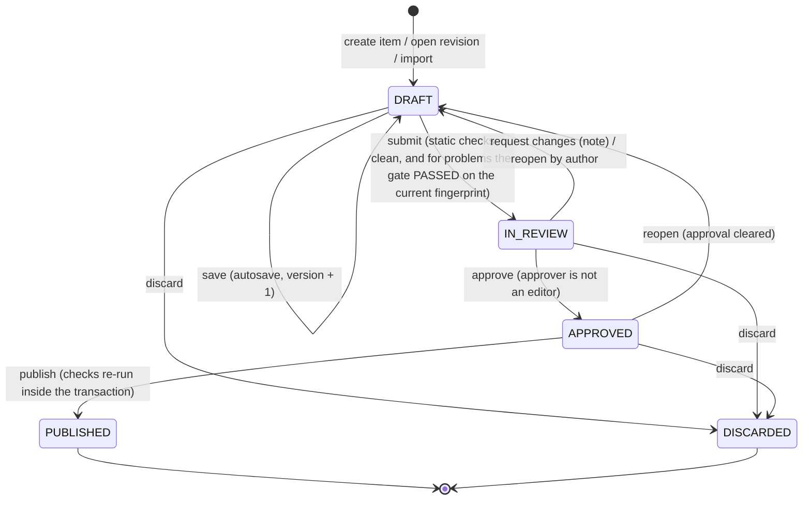

# Admin Panel and Content Operations — Semicolan

This document covers how admins run Semicolan from inside the product: what the admin panel looks like, how a coding problem and every other kind of content goes from a draft to the live site, and how the system tells an admin apart from everyone else.

It explains and expands the normative specs; it does not override them.
- Requirements: PRD ADM-1 to ADM-4, BLOG-1 and OPS-1 to OPS-4 ([PRD.md](PRD.md) §7.7).
- Tables: [Backend_Schema.md](Backend_Schema.md) §4, §6, §10, §11 and §42–§45.
- Endpoints: [API_Contract.md](API_Contract.md) §15 (blog) and §16 (admin panel).
- Build order: [Implementation_Plan.md](Implementation_Plan.md) 7.4–7.7.
- Testing: [Agent_Testing_Environment.md](Agent_Testing_Environment.md) §7.12.

When this document and a spec disagree, the spec wins and this document is fixed.

---

## 0. Principles

1. **Live content changes only when a reviewed revision is published.** Every edit goes into a *revision*, which is a draft copy of one content item. Nobody edits the live rows directly. Users see a change at the instant its revision is published, and they see all of it at once.
2. **One writer.** `ContentPublisher` is the only code that writes the live content tables (§5). The admin panel, the content-pack importer and the development seed all go through it. This mirrors `PaymentEventProcessor`, which is the only writer of payment state.
3. **The publish gate is bound to exactly what it tested.** A problem revision can be published only if OPS-2 passed against its *current* test data, limits and reference solutions. Changing any of those makes the result stale (§2.6).
4. **Four eyes.** The admin who approves a revision must not have edited it (§3.2).
5. **The UI is a convenience, not a security boundary.** The API enforces every rule in this document. Hiding a button never replaces a server-side check (§4).
6. **Content written by admins is still treated as untrusted markup.** It renders through the same sanitizers as everything else (TRD §5). A pasted `<script>` or a compromised admin account therefore cannot reach users' browsers.
7. **Content packs keep working.** They become an import and export format that goes through the same workflow (§3.6). Bulk authoring, backups and moving content between environments therefore need no second code path.

## 1. Admin UI Layout

### 1.1 Where it lives

- The admin panel is a set of routes under `/admin/*` in the same React SPA, built as a separate lazy-loaded chunk. The client requests the chunk only when `GET /api/me` reports `role: "ADMIN"`. A non-admin who types an admin URL gets the normal "Page not found" page.
  - The chunk contains no data and no secrets; the API makes every decision (§4).
- **Desktop only (1024 CSS px and wider).** In a narrower window the panel shows "The admin panel needs a wider window" and a link back to the site.
- It uses the product's own tokens, type scale, components and accessibility rules (UI_UX_Brief §1–§2, §6, §8–§9) and adds no colors. Every status chip uses the badge component with both an icon and a text label.
- **Own shell.** An admin sidebar replaces the product sidebar. The top bar carries an **environment badge** (`LOCAL`, `PREVIEW`, `STAGING` or `PRODUCTION`, from `GET /api/admin/context`) so no one confuses production with a test copy. The badge is an `error`-outlined pill in production and neutral everywhere else (UI_UX_Brief §10.4). A **View site** link opens the public site in a new tab.
- The product sidebar shows a single **Admin** entry (`ShieldCheck`) to admins only. It replaces the earlier **Moderation** entry, because moderation now lives inside the admin panel (§1.8).

```
┌───────────────────┬─────────────────────────────────────────────────────────────────┐
│ ; Semicolan Admin │ [PRODUCTION]            [Search content  Ctrl K]  View site  [A▾]│ 48 px
│───────────────────│─────────────────────────────────────────────────────────────────│
│ Overview          │ Overview                                     as of 10:15 IST  ⟳ │
│ CONTENT           │ ┌──────────┐┌──────────┐┌──────────┐┌──────────┐┌─────────────┐ │
│  Problems         │ │Signups 7d││WAS (week)││Activation││Paid 7d   ││Judging error│ │
│  Mock tests       │ │ 412      ││ 1,203    ││ 37.1 %   ││ ₹47,904  ││ 0.4 % (24 h)│ │
│  Hubs             │ └──────────┘└──────────┘└──────────┘└──────────┘└─────────────┘ │
│  Design (HLD/LLD) │ ┌─ Work queues ─────────────────┐┌─ Published content ────────┐ │
│  Companies        │ │ In review            4 · 2 d  ││ Problems   84 (37 free)    │ │
│  Projects         │ │ Approved, unpublished 1       ││ HLD 11 · LLD 9             │ │
│  Blog             │ │ Moderation           7 · 20 h ││ DevOps 6 topics · DS 5     │ │
│ WORKFLOW          │ │ Problem health flags 3        ││ Companies 14 · Projects 4  │ │
│  Review queue  4  │ └───────────────────────────────┘└────────────────────────────┘ │
│  Moderation    7  │ ┌─ Funnel, last 7 days ─────────────────────────────────────┐  │
│ PEOPLE            │ │ paywall_view 3,200 → checkout_started 410 → paid 96       │  │
│  Users            │ └───────────────────────────────────────────────────────────┘  │
│  Audit log        │ Ops dashboards (latency, Judge0 queue) ↗                        │
└───────────────────┴─────────────────────────────────────────────────────────────────┘
```

### 1.2 Navigation

| Group | Entry | Page |
|---|---|---|
| — | **Overview** | Metrics and work queues (§1.3) |
| Content | **Problems** | Problem management table (§1.4) and problem editor (§2) |
| | **Mock tests** | Tests, their problem sets and the free-test flag (§2.10) |
| | **Hubs** | DevOps and Data Science topics, theory questions and quizzes (§3.3) |
| | **Design (HLD/LLD)** | Design questions, requirements, editorial solutions and quizzes (§3.3) |
| | **Companies** | Overviews and sourced company tags (§3.3) |
| | **Projects** | Project briefs (§3.3) |
| | **Blog** | Blog posts and their editor (§3.3) |
| Workflow | **Review queue** (count badge) | Revisions in review, oldest first (§1.7) |
| | **Moderation** (count badge) | The community queue of App_Flow §14 |
| People | **Users** | Search, user detail, Premium grant/revoke (§1.9) |
| | **Audit log** | Every admin action (§1.10) |

The top-bar search (Ctrl/Cmd + K) finds content by title or slug across every type and opens the item's admin page.

### 1.3 Overview (metrics dashboard)

Every tile comes from data the platform already stores, through one bounded endpoint (`GET /api/admin/metrics/overview`, API_Contract §16). The endpoint is served from a 5-minute in-process snapshot, so opening the dashboard never runs a population-wide query per request. Each tile loads and fails independently, like the Home dashboard (App_Flow §7).

| Tile | Definition (same as the PRD §9 metric and the 9.3 reports) |
|---|---|
| Signups, last 7 days | `signup` events, with the Student share (ACC-3) |
| Weekly Active Solvers | Distinct users with an Accepted `SUBMIT` in the current IST week, and last week for comparison |
| Activation | Share of the last 7 days' signups with a first Accepted submission within 24 hours |
| Paid, last 7 days | Sum of `PAID` payments minus refunds, in ₹; the paywall → checkout → paid funnel below the tiles |
| Premium users | Users with Premium access now (the entitlement rule, Backend_Schema §1) |
| Judging Error rate | `JUDGING_ERROR` ÷ judged `SUBMIT`s over 24 hours; red at the PRD §9 guardrail of 1% |
| Work queues | Revisions in review (and the age of the oldest), approved but unpublished revisions, pending community posts and open reports (age against the 24-hour SLA), problem-health flags (PRD §9) |
| Published content | Published items per module, with free counts where a free sample exists. The PRD §7.10 launch targets appear next to them as static text |

Operational signals (P95 submit-to-verdict time, Judge0 queue depth, disk) stay on the monitoring dashboards of Implementation_Plan 9.1. The overview only links to them and never recomputes them.

### 1.4 Problem management table

```
Problems                                                       [+ New problem]
[Search title or slug] [Status ▾] [Difficulty ▾] [Topic ▾] [Premium ▾] [☐ Health flag] [☐ Open revision]
┌─────┬───────────────────────────┬──────┬─────────┬──────────────────────────┬─────────┬───────┬───────┬───────┐
│ ID  │ Title · slug              │ Diff │ Access  │ Status                   │ Gate    │ Acc.  │ Tests │ Upd.  │
├─────┼───────────────────────────┼──────┼─────────┼──────────────────────────┼─────────┼───────┼───────┼───────┤
│ 101 │ Two Sum · two-sum         │ Easy │ Free    │ Published · r4 in review │ Passed  │ 46 %  │ 24    │ 2 d   │
│ 214 │ LRU Cache · lru-cache     │ Med  │ Premium │ Draft · r1               │ Failed  │ –     │ 31    │ 1 h   │
│ 188 │ Coin Change · coin-change │ Med  │ Free    │ Published  ⚠ health      │ –       │ 1.6 % │ 18    │ 3 w   │
│ 77  │ Max Gap · max-gap         │ Hard │ Premium │ Archived                 │ –       │ 39 %  │ 22    │ 2 mo  │
└─────┴───────────────────────────┴──────┴─────────┴──────────────────────────┴─────────┴───────┴───────┴───────┘
                                                                     ‹ 1 2 3 … 7 ›  20 per page
```

- **Columns:**
  - ID; title and slug; difficulty; Free or Premium.
  - Status: the live status (`Draft`, `Published`, `Archived`), plus the open revision and its state if there is one.
  - **Gate**: the open revision's OPS-2 result: `Passed`, `Failed`, `Stale`, `Running`, `Error` or `Not run`.
  - Acceptance: Accepted ÷ all `SUBMIT`s.
  - The problem-health flag (below 2% acceptance after at least 50 attempts).
  - Tests: the live test count.
  - The mock tests that use the problem (shown in a tooltip).
  - Last update.
- Filters live in the URL. The server paginates and sorts by ID; any column can be sorted on the client within the current page only.
- **Row actions:** Open, which goes to the editor on the open revision, or opens a new revision from the live version; Preview; Archive or Restore (§2.9).

The other content types use the same table pattern with their own columns: for example, the quiz count for hub topics, the number of answered attempts for quizzes, or the tag count for companies.

### 1.5 Editors

Every content type is edited in the same frame:

```
← Problems    Two Sum · revision 4 · Draft                Saved · v12     [Validate] [Submit for review]
┌──────────────────────────────────────────────────────────────────────────┬──────────────────────────────┐
│ Statement │ Settings │ Stubs │ Test cases (24) │ Solutions │ Editorial │ Preview ▾ │ Checklist                    │
│                                                                          │ ✓ Statement                  │
│  [Write │ Preview]                                                       │ ✓ 4 stubs                    │
│  ## Problem                                                              │ ✓ 2 samples · 22 hidden      │
│  Given an array of integers …                                            │ ✓ 4 reference solutions      │
│                                                                          │ ✗ Gate stale — tests changed │
│                                                                          │   after the last run  [Run]  │
│                                                                          │──────────────────────────────│
│                                                                          │ Reviewer notes (1)           │
│                                                                          │ Revision history             │
└──────────────────────────────────────────────────────────────────────────┴──────────────────────────────┘
```

- **Header:** the item title, revision number, status chip and autosave state ("Saving…", "Saved · v12", "Conflict").
  - Edits autosave about 1 second after typing stops.
  - Each save sends only the changed fields, together with the version it was based on (`PATCH /api/admin/revisions/{id}`). A `409 REVISION_CONFLICT` means another tab or admin saved first; the editor shows both versions and lets the user choose.
- **Markdown fields** use the product's Markdown editor (UI_UX_Brief §9.20) with Write and Preview tabs. The preview renders with the production sanitizer and, for design content, Mermaid.
- **Code fields** (stubs, reference solutions, LLD code) use Monaco, with one tab per language.
- **Right rail:**
  - the live validation checklist, built from the `validation` object that every save returns;
  - reviewer notes;
  - the revision history: every revision of the item with its author, reviewer and dates.
- **Preview ▾** renders the item exactly as a visitor, a Free user or a Premium user would see it, using the production page components fed from the revision document. Drafts never go through the public endpoints, and there are no shareable preview links in the MVP.
- An **approved** or **in-review** revision opens read-only. **Reopen** (by its author) turns it back into a draft and clears the approval.

### 1.6 Blog editor

The blog editor has these fields:
- title;
- slug (generated from the title, editable until the first publish);
- summary (shown in the list, and used as the page's meta description);
- byline (default "Semicolan Team");
- an optional cover asset;
- the body, in a split Write | Preview Markdown editor with a live word count and reading time.

It follows the same frame, workflow and review as every other type (§3).

### 1.7 Review screen

The review screen is opened from the **Review queue** (revisions `IN_REVIEW`, oldest first; filters for type and author).
- **Diff against the live version**, field by field:
  - Markdown and text as a line diff;
  - code as a per-language diff;
  - JSON documents (design solutions, requirements, checklists, quiz options) as a structured diff;
  - test cases as a list of added, removed and changed positions with byte sizes and SHA-256 digests. Payloads open on demand, so a 256 KB hidden test does not flood the page.

  A new item shows its full content instead.
- **The validation report** (§2.6) for problems, and the static checklist for every type.
- **Preview**, as in §1.5.
- **Decision:** **Approve**, or **Request changes**, which needs a note the author sees in the right rail. The review checklist of §3.5 sits next to the buttons.

### 1.8 Moderation

This is the community queue of App_Flow §14 and API_Contract §13, unchanged except that it now renders inside the admin shell at `/admin/moderation`.

### 1.9 Users

- **Search** by email prefix or display name. Results show the role, the entitlement state, the segment and the sign-up date.
- **User detail:**
  - profile and linked providers;
  - entitlement with its expiry;
  - payments and receipts (from Phase 8);
  - solved and submission counts;
  - the audit entries that target this user;
  - the actions **Grant Premium** and **Revoke Premium** (API_Contract §7), each with a required reason.
- **There is no role editor.** Admin rights change only through the audited script of §4.4.

### 1.10 Audit log

A newest-first list of `admin_audit_log`, filterable by admin, target user, action and date range. Each row expands to show its `details` JSON. The page is read-only, because the table is append-only (Backend_Schema §16).

### 1.11 States and safety

- **Destructive or public actions ask for confirmation in a dialog that says exactly what will change:**
  - *Publish:* "Two Sum will change for all users: statement, 3 test cases added, time limit 2 s → 3 s".
  - *Archive:* "Two Sum will disappear from the catalog; history and points are kept".
  - *Discard*.
- Errors from the API are shown with their `error` code mapped to plain text, for example "Another admin is reviewing this revision". Field errors anchor to their field.
- Leaving an editor with a save still in flight asks "Leave? The last change is still saving".

## 2. Data Ingestion: Creating a Coding Problem

### 2.1 The problem revision document

Everything about a problem except its test data is one JSON document stored on the revision (`content_revisions.document`, Backend_Schema §42). It has the same shape as a content-pack problem (`content/problems/<slug>/`, Implementation_Plan 2.1), and the same JSON Schema in `content/schemas/problem.schema.json` validates both.

```json
{
  "slug": "two-sum",
  "title": "Two Sum",
  "difficulty": "EASY",
  "points": 1,
  "timeLimitMs": 2000,
  "memoryLimitKb": 131072,
  "isPremiumOnly": false,
  "topics": ["arrays", "hashing"],
  "contentSource": "ORIGINAL",
  "descriptionMarkdown": "## Problem\nGiven an array of integers …\n\n## Input\n…\n\n## Output\n…\n\n## Constraints\n…",
  "stubs": {
    "c": "#include <stdio.h>\n\nint main(void) {\n    /* read input, print output */\n    return 0;\n}\n",
    "cpp": "#include <bits/stdc++.h>\nusing namespace std;\n\nint main() {\n    return 0;\n}\n",
    "java": "import java.util.*;\n\npublic class Main {\n    public static void main(String[] args) {\n    }\n}\n",
    "python": "import sys\n\ndef main():\n    data = sys.stdin.read().split()\n\nmain()\n"
  },
  "referenceSolutions": {"c": "…", "cpp": "…", "java": "…", "python": "…"},
  "editorial": {
    "approachMarkdown": "We keep a hash map from value to index …",
    "timeComplexity": "O(n)",
    "spaceComplexity": "O(n)"
  }
}
```

| Field | Rules |
|---|---|
| `slug` | `[a-z0-9-]`, 3–120 characters, unique among problems. It is reserved when the problem is created and can be changed only until the first publish, because content packs and company tags refer to it |
| `title` | 1–255 characters |
| `difficulty`, `points` | `EASY`, `MEDIUM` or `HARD`. `points` defaults from the difficulty (`POINTS_EASY` / `_MEDIUM` / `_HARD`, so 1 / 2 / 3), must be greater than 0, and is editable. A change affects only future solves, because solves snapshot their points (Backend_Schema §12) |
| `timeLimitMs`, `memoryLimitKb` | Base limits, both greater than 0. Every launch language's effective limit (base × multiplier) must fit Judge0's caps (TRD §3). The editor shows the effective limits next to the inputs |
| `isPremiumOnly` | Free or Premium (PRD §5). The editorial follows the same flag (Backend_Schema §20) |
| `topics` | Topic slugs. A topic that does not exist yet is created, with the name typed in the picker, when the revision is published |
| `contentSource` | Required provenance: `ORIGINAL`, or the licence and source reference (PRD §10) |
| `descriptionMarkdown` | 1 byte to 64 KB; rendered with the statement sanitizer (TRD §5) |
| `stubs` | **Exactly** the four launch-language keys (`c`, `cpp`, `java`, `python`); each 1 byte to `STUB_MAX_BYTES` (16 KB) |
| `referenceSolutions` | Exactly the four launch languages; each 1 byte to 64 KB (the source cap) |
| `editorial` | Optional (PRD SOL-1). When present, the approach can be up to 64 KB and both complexity strings are required. Its code is not entered separately: the published editorial shows the reference solutions that the gate ran (Backend_Schema §21) |

**"JSON code stubs"** are the authoring and transport format: a map from language slug to source, which is also `baseCodeStubs` in `GET /api/problems/{id}`. The database stores them as one `problem_code_stubs` row per language, never as a JSON column (Backend_Schema §17), so a missing or misspelled language cannot be stored.

The test cases are **not** in the document. They are rows in the revision's own **test set** (§2.3), because each payload can be 256 KB and the judge reads them as rows.

### 2.2 Step by step

| # | Admin does | API | Server effect and checks |
|---|---|---|---|
| 1 | **Problems → New problem**: enters a title; the slug is generated from it and can be edited; picks a difficulty | `POST /api/admin/problems` `{"document": {"slug", "title", "difficulty"}}` | One transaction: the **anchor** `problems` row (`DRAFT`, `live_test_set NULL`) reserves the slug and gives test data and validation attempts something to reference; revision 1 (`DRAFT`) with the document and test set 1; the creator recorded as author and editor; a `CONTENT_CREATE` audit row. `409 SLUG_TAKEN`, `422 VALIDATION_FAILED`. The editor opens |
| 2 | **Statement** tab: writes the Markdown statement (problem, input format, output format, constraints, a narrative for the examples) with a live preview | `PATCH /api/admin/revisions/{id}` `{"baseVersion": 1, "document": {"descriptionMarkdown": "…"}}` (JSON merge patch) | Saved if the revision is still `DRAFT` and `baseVersion` matches (otherwise `409 REVISION_CONFLICT`, with the current version). Returns the new `version` and the `validation` checklist. The caller is added to the revision's editors |
| 3 | **Settings** tab: points, base time and memory limits (the effective limit per language is shown), Free/Premium, topics, provenance | `PATCH` as above | Limits over a Judge0 cap for any language are reported in `validation` and block submission (step 9) |
| 4 | **Stubs** tab: one Monaco tab per language, or **Paste JSON** to fill all four from `{"c": "…", "cpp": "…", "java": "…", "python": "…"}` | `PATCH` with `{"document": {"stubs": {…}}}` | The JSON must have exactly the four keys. An unknown key, a missing key or an oversized stub is a field error (`/stubs/java: TOO_LONG`) |
| 5 | **Test cases** tab: adds each case (input and expected output text areas or file pickers, plus a **Sample** toggle), reorders by drag, or uses **Bulk import** (§2.3) | `PUT /api/admin/revisions/{id}/test-cases/{position}` `{"isSample": false, "input": "…", "expectedOutput": "…"}`; `DELETE …/test-cases/{position}`; `PUT …/test-cases/order` | Each payload is normalized and checked (§2.3) and stored in the revision's test set with its SHA-256 digests. Any change to test data makes the gate stale. Refused with `409 VALIDATION_RUNNING` while a gate run is in flight |
| 6 | **Solutions** tab: the reference solution in C, C++, Java and Python 3 | `PATCH` with `{"document": {"referenceSolutions": {…}}}` | All four are required before validation can start |
| 7 | **Editorial** tab (optional): approach Markdown and complexity | `PATCH` | Optional; when present, both complexities are required |
| 8 | **Validate**: runs the publish gate | `POST /api/admin/revisions/{id}/validation`, then the editor polls `GET …/validation` | The static checks, then OPS-2 on Judge0 at the lowest dispatch priority (§2.6). The report fills the right rail and the Validation panel: one row per language, one column per test, and the negative control |
| 9 | **Submit for review** with an optional note to the reviewer | `POST /api/admin/revisions/{id}/submit` | Allowed only when the static checklist is clean and the gate `PASSED` for the **current** fingerprint (`409 GATE_REQUIRED` otherwise). The revision becomes `IN_REVIEW` and read-only; `CONTENT_SUBMIT` audit row |
| 10 | **Review** (another admin): the diff, the validation report, a preview as Free and as Premium | `POST /api/admin/revisions/{id}/review` `{"decision": "APPROVE"}` or `{"decision": "REQUEST_CHANGES", "note": "Add a test with n = 1"}` | The reviewer must not be one of the revision's editors (`403 SELF_REVIEW_NOT_ALLOWED`, §3.2). Approve leads to `APPROVED`; request changes leads back to `DRAFT` with the note. `CONTENT_REVIEW` audit row |
| 11 | **Publish** (any admin, once approved), after a confirmation dialog listing the changes | `POST /api/admin/revisions/{id}/publish` | The publish transaction of §2.7. The problem is in the catalog the moment it commits |
| 12 | Afterwards: the problem table shows `Published`, health metrics start counting, and the problem can be added to mock tests and company tags | — | `ContentPublished` (after commit) evicts the catalog, topic and company caches |

### 2.3 Test cases: rules and bulk import

- **Positions.** Tests are numbered 1..N in display order inside the revision's test set; the number is the `failedTestIndex` users see. `PUT` at N + 1 appends. `DELETE` shifts the later tests down. `PUT …/order` with a full permutation reorders them in one transaction.
- **At least one sample and at least one hidden test.** Samples are shown on the problem page and used by Run; hidden tests never leave the admin API (TRD §3, §5).
- **Encoding and normalization** (the same in the admin API and the content-pack importer):
  - valid UTF-8 only;
  - no NUL or other control characters except tab, line feed and carriage return;
  - CRLF and lone CR are converted to LF;
  - nothing else is changed: trailing spaces and the final newline are kept as given (Judge0 trims trailing whitespace when it compares, TRD §3).
- **Size.** Each input and each expected output is capped at `TEST_PAYLOAD_MAX_BYTES` (256 KB) after normalization, giving `422` with `INPUT_TOO_LARGE` or `EXPECTED_OUTPUT_TOO_LARGE`. The route accepts bodies up to 1.5 MB, because JSON escaping can double a payload. `422 TOO_MANY_TEST_CASES` above 200 tests per problem keeps one `SUBMIT` within a sane number of jobs.
- **Digests.** The server stores the SHA-256 of each payload (Backend_Schema §6). The test list shows them, flags exact duplicate inputs as a warning, and uses them for the gate fingerprint and the review diff.
- **Bulk import** runs in the browser and sends one `PUT` per test, so the API stays JSON-only:
  - Accepted forms: a `.zip` or folder of `NN.in` / `NN.out` pairs, where `sample-NN.in` / `sample-NN.out` mark samples; or a `tests.yaml` manifest listing files and sample flags.
  - Pairs are sorted by number. A file without its partner is listed as an error before anything is uploaded.
  - Progress is shown per test, and a failed upload can be retried for that test alone.
- **Hidden data stays in the admin panel.** It is shown only on demand and is never written to logs, analytics or error reports.

### 2.4 Reference solutions and the editorial

Reference solutions are required in every launch language, because OPS-2 runs all of them. They belong to the revision document, not to the editorial. A problem without an editorial still has them, and the published revision keeps them as the record that later gate runs reuse (for example after a Judge0 upgrade). When an editorial exists, `ContentPublisher` writes its `problem_editorial_code` rows from the same four solutions the gate just ran, so the Solution tab can never show code that fails the problem's tests (Backend_Schema §21).

### 2.5 Limits

The editor shows, for each language, the effective CPU, wall-clock and memory limits: base × `LANGUAGE_MULTIPLIERS`, wall time = max(1 s, 2 × CPU), clamped to Judge0's caps (TRD §3).
- A base limit that would exceed a cap for any language is a validation error. The server clamps limits only as a safety net and never relies on clamping.
- The gate copies the revision's base limits onto its validation attempts (Backend_Schema §10). It therefore tests the limits being proposed, not the live ones.

### 2.6 The publish gate (OPS-2) for a revision

`PublishGateService` runs the gate. The admin panel's **Validate** button and `scripts/publish-problem` both call it (Implementation_Plan 3.3).

**Static checks** (instant, and repeated at submit and publish):

| Check | Fails when |
|---|---|
| Document schema | The document fails `problem.schema.json`, for example a missing title, an unknown stub language or a bad slug |
| Stubs | Not exactly four stubs, or one over `STUB_MAX_BYTES` |
| Reference solutions | Not exactly four, or one over 64 KB |
| Tests | No sample, no hidden test, more than 200 tests, or a payload over the cap |
| Limits | Any language's effective limit over a Judge0 cap |
| Provenance | `contentSource` empty |
| Editorial | Present but missing a complexity |

**Judge0 checks** (OPS-2):
- One `VALIDATE` attempt per language with the reference solution against **every** test of the revision's test set. Each must finish `ACCEPTED` on every test.
- One **negative control**: a Python 3 program that reads standard input and prints nothing. It must **not** finish `ACCEPTED`. A pipeline that accepts everything, or a problem whose every expected output is empty, therefore cannot pass.
- Attempts use the real execution path (TRD §3) with `mode = 'VALIDATE'` and the revision's base limits.
  - They are dispatched at **priority 3**, below `RUN`, within their own in-flight budget (`VALIDATION_MAX_INFLIGHT_JOBS`).
  - They are never counted against the backlog limit that answers users with `503 EXECUTION_BUSY` (TRD §6). Validation therefore never slows or refuses a student's attempt; when users are busy it simply takes longer.
  - A 50-test problem costs 250 jobs.
- `VALIDATE` attempts record no solve, emit no analytics, never appear in a user's history and are invisible through `/api/submissions`.
  - Their results keep stdout and stderr (truncated to 16 KB) for hidden tests too, so the report can show "expected `42`, got `41` on test 17". This is visible only through the admin API.

**Result** (`gate_status` on the revision):

| Status | Meaning | What the admin does |
|---|---|---|
| `PASSED` | Every reference attempt `ACCEPTED` on every test and the negative control rejected | Submit for review |
| `FAILED` | A reference attempt failed a test (the report names the language, the test, the verdict, time and memory and, for wrong answers, the expected and actual output), or the negative control was accepted | Fix the solution or the test, then validate again |
| `ERROR` | Infrastructure: a `JUDGING_ERROR` or a timeout. It says nothing about the problem | Validate again later |
| `RUNNING` | Attempts in flight. Test-data edits are refused (`409 VALIDATION_RUNNING`), but document edits still save and only make the result stale | Wait; the panel polls |

**The fingerprint.** When a run starts, the server stores `gate_fingerprint`, a SHA-256 over these inputs (and only these, because they are everything that decides a verdict):
- each language's effective limits;
- the four reference solutions;
- the ordered list of tests, each as (sample flag, input digest, expected-output digest).

Submit and publish recompute the fingerprint and require `PASSED` for the same value. If it differs, the panel shows **Stale** with the reason ("tests changed after the last run").

Editing the statement, stubs, editorial, topics or the Free/Premium flag does not make the gate stale, because none of them affects a verdict. A change to `LANGUAGE_MULTIPLIERS` does make every open revision's gate stale, and that is intended.

**Warnings** (non-blocking) appear in the report and on the review screen:
- `SLOW_REFERENCE`: a reference solution used more than half of its effective time limit. Contention on Judge0 could later fail correct solutions, so consider raising the limit.
- `DUPLICATE_INPUT`: two tests have the same input digest.

### 2.7 The publish transaction for a problem

`ContentPublisher.publish(revisionId)` runs in one transaction, taking locks in this order:
1. Lock the revision row (`FOR UPDATE`). Require `APPROVED`, then recompute the fingerprint and require `gate_status = 'PASSED'` for it; otherwise return `409 GATE_REQUIRED`.
2. Lock the problem row (`FOR UPDATE`).
3. Apply the document:
   - Write the `problems` columns: title, statement, difficulty, points, limits, premium flag, provenance, and the slug if the problem was never published.
   - Replace the `problem_topics` rows, creating missing topics.
   - Upsert the four `problem_code_stubs` rows.
   - If the document has an editorial, upsert `problem_editorials` and replace `problem_editorial_code` from `referenceSolutions`. If it has none, delete them.
   - Set `live_test_set = revision.test_set` and `status = 'PUBLISHED'`.
4. Mark the revision `PUBLISHED` with `published_at`, and write one `CONTENT_PUBLISH` audit row with the revision, the old and new test set, and the fingerprint.
5. After commit, `ContentPublished` evicts the caches that hold the problem (catalog, topic counts, company tag lists).

Attempts that were already created keep the test set and limits they were created with (Backend_Schema §10). From the commit onward, new `RUN` and `SUBMIT` attempts use the new test set.

### 2.8 Editing a published problem

- **Open revision** creates revision N + 1 from the live version: the live document, plus a **new test set** that copies the live set's rows. All later test edits go into that copy.
- **Published test sets are frozen.** Rows of a set whose number is at or below `live_test_set` are never updated or deleted. Fixing a wrong expected output means a new set, so every historical verdict stays reproducible against the data it was judged on (TRD §4).
  - Old verdicts are not re-judged automatically.
  - The audited re-judge script exists only for `JUDGING_ERROR` (TRD §2).
- **Statement-only fixes** (a typo, a clearer constraint) still go through review, but the gate result stays valid because the fingerprint is unchanged (§2.6). Publishing them flips the test set to an identical copy, which costs nothing and keeps one code path.
- **A problem used in running mock tests can be published.** Attempts already created keep their tests. The publish dialog warns: "3 mock-test sessions in progress include this problem; their new attempts will use the new tests."

### 2.9 Archiving and restoring

- **Archive** (`POST /api/admin/problems/{id}/archive` with a reason) sets `ARCHIVED`.
  - The problem leaves the catalog, search, company tags and topic counts.
  - Submission history, solves, points and reports stay readable (Backend_Schema §0.3). Bookmarks stay in the table but stop being shown.
  - A problem that belongs to an **active** mock test cannot be archived (`409 PROBLEM_IN_ACTIVE_MOCK_TEST`); deactivate or replace the test first.
- **Restore** sets `PUBLISHED` again with the same live test set.
- Both write a `CONTENT_ARCHIVE` or `CONTENT_RESTORE` audit row. Neither needs review, because no content changes.

### 2.10 Mock tests

- A mock test revision holds:
  - title;
  - duration in minutes;
  - Free or Premium;
  - an ordered list of 1 to 10 published problem slugs.
- Publishing inserts or updates `mock_tests` and `mock_test_problems`.
- **Once a test has sessions**, its problem set and duration are frozen, so past reports stay reproducible (Backend_Schema §8): publishing such a change returns `409 MOCK_TEST_HAS_SESSIONS`. The editor offers **Publish as a new test**, which copies the document into a new item, and **Deactivate** for the old one. The title can still change.
- **At most one active free test** (`uq_mock_tests_one_free`): publishing a second one returns `409 FREE_TEST_EXISTS`, which names the current free test to deactivate first.
- Extending one user's running session stays an audited script (PRD §6.4); the admin panel does not do it in the MVP.

## 3. Content Management: Draft, Review, Publish

### 3.1 Lifecycle



The live item has its own status:
- `PUBLISHED`, or `ARCHIVED` (from Archive and Restore, which change no content);
- `DRAFT` only for a problem's anchor row before its first publish.

Every other type gets its live row at its first publish.

### 3.2 Rules

| Rule | Detail |
|---|---|
| One open revision per item | At most one revision in `DRAFT`, `IN_REVIEW` or `APPROVED` per item (`uq_revisions_one_open`). **Open revision** when one exists returns that one (`200`) instead of creating another, so two admins never fork the same item |
| Who edits | Any admin can edit a `DRAFT`, and everyone who saves a change is recorded in `content_revision_editors`. `IN_REVIEW` and `APPROVED` revisions are read-only; **Reopen** makes them editable again and clears the review |
| Four eyes | The approver must not appear in the revision's editors (`403 SELF_REVIEW_NOT_ALLOWED`). Taking over someone's draft therefore makes the newcomer an editor too, and neither of them can approve it |
| Single-admin deployments | With `CONTENT_SELF_REVIEW_ALLOWED=true` an editor may approve their own revision. The revision is then marked `self_reviewed`; the overview shows a "self-reviewed in last 30 days" count and the audit row says so. The default is `false` in every environment, including development, so tests exercise the real rule (Agent_Testing_Environment §7.12) |
| Concurrency | Every save carries `baseVersion`. A stale base gets `409 REVISION_CONFLICT` with the current document, never a silent overwrite |
| Validation | Static checks run on every save and come back as `validation`; they are re-run at submit and inside the publish transaction. Problems also need the gate (§2.6) |
| Who publishes | Any admin, once `APPROVED` |
| Discard | Allowed from any open state, except while a gate run is in flight (`409 VALIDATION_RUNNING`). Discarding deletes the revision's draft test set and validation attempts; the revision row is kept as `DISCARDED` |
| Audit | `CONTENT_CREATE`, `CONTENT_SUBMIT`, `CONTENT_REVIEW` (with the decision), `CONTENT_PUBLISH`, `CONTENT_DISCARD`, `CONTENT_REOPEN`, `CONTENT_ARCHIVE`, `CONTENT_RESTORE` and `CONTENT_IMPORT`: one `admin_audit_log` row each, with `details` naming the content type, the content ID and the revision ID (PRD OPS-4). Autosaves are not audited; the revision row and its editor list record them |
| Parents before children | A theory question, quiz or design quiz can be published only after its topic or design question is published; a company tag only after the tagged item is published (`409 PARENT_NOT_PUBLISHED`). Archiving a parent hides its children, because every read filters on the parent's status |
| Slugs | Unique per type, reserved at create time against live rows and other open revisions, enforced by the live table's unique key at publish (`409 SLUG_TAKEN`). Fixed after the first publish |
| Rate limit | Every admin write uses the `admin` policy (`RATE_LIMIT_ADMIN`, per admin), which bounds the damage of a stolen token or a runaway script |

### 3.3 Content types

| Type (collection) | Document holds (live tables) | Validation beyond the schema | Publish effect and special rules |
|---|---|---|---|
| Problem (`problems`) | §2.1, plus the test set (§4–§6, §17, §20–§21) | §2.6 static checks and the gate | §2.7 |
| Mock test (`mock-tests`) | Title, duration, premium flag, ordered problem slugs (§7–§8) | Problems exist and are published; 1–10 problems | §2.10: frozen problem set once sessions exist; one active free test |
| Hub topic (`hub-topics`) | Hub, slug, name, Lucide icon, summary, display order (§24) | Icon is in the Lucide allowlist (no product logos, UI_UX_Brief §0.2); display order unique per hub | Can be published before it has questions; the hub grid shows it with a count of 0, so publish topics together with their first questions |
| Theory question (`theory-questions`) | Topic, section, question and answer Markdown, sources, difficulty, premium flag, order, provenance (§25) | Sources are `https` and at most 60; answer ≤ 64 KB | Edited in place: question IDs stay stable, so bookmarks and "learned" marks survive |
| Quiz (`quizzes`) | Owner (topic or design question), level, premium flag, ordered questions with options, correct option and explanation (§28–§29) | 2–6 options; `correctOption` in range; one quiz per owner and level | **A quiz that has any answers is immutable** (Backend_Schema §28). Opening a revision of one gives a draft that must use a new slug (default `<slug>-v2`); publishing it creates a new quiz and archives the old one in the same transaction, so past attempts stay readable |
| Design question (`design-questions`) | Kind (HLD/LLD), slug, title, summary, icon, difficulty, statement, requirements, solution sections (Markdown, Mermaid, LLD code), premium flag, order, provenance (§26) | The solution validates against its schema and `DESIGN_SOLUTION_MAX_BYTES`; each Mermaid block must render in the editor preview, which blocks submission if it does not, with the source kept as the text alternative; LLD code in Java, Python and C++ | In place. The optional quiz is its own revision (a Quiz with the design question as owner) |
| Company (`companies`) | Slug, name, overview Markdown, coding/HLD/LLD tags with rank, `source_note` and review date (§32–§34) | Every tag has a source and a unique rank (PRD CMP-2); tagged items exist; name only, never a logo | Publishing a changed overview sets `overview_reviewed_at` to the publish time; tags are replaced as a set |
| Project (`projects`) | Kind, slug, title, summary, brief, checklist, tech stack, difficulty, hours, starter repository, cover asset, premium flag, order, provenance (§35) | `starter_repo_url` is `https`; `cover_asset` is a path under `/assets/projects/` shipped with the SPA build (no uploads in the MVP); hours 1–200 | In place |
| Blog post (`blog-posts`) | Slug, title, summary, byline, cover asset, body Markdown, provenance (§45) | Body ≤ `BLOG_BODY_MAX_BYTES` (128 KB); statement sanitizer (no raw HTML, no inline images); Mermaid and code blocks allowed, because the blog is editor-authored (TRD §5); cover under `/assets/blog/` | First publish sets `published_at`; later publishes keep it and show "Updated {date}". Archived posts return `404`. Free to everyone (PRD BLOG-1) |

**DevOps and Data Science content** is hub topics, theory questions and quizzes. The Data Science hub has no coding tab (PRD §4). **System Design content** is design questions, their quizzes and the static "How to approach a design interview" guides; the guides stay files in `content/design/guides/`, built into the SPA (API_Contract §10).

### 3.4 Preview

The preview renders the revision document through the same React page components and the same sanitizer as the live page, as a visitor, a Free user or a Premium user. Locked views strip exactly what the server strips: answers, sources, editorials, briefs. A reviewer therefore sees what each kind of user will see. The preview is assembled in the admin chunk from the document; nothing unpublished is ever served by a public endpoint, and there is no unauthenticated preview URL.

### 3.5 Review checklist

Shown next to **Approve** (it guides the reviewer; nothing enforces it):
- **Originality and provenance:** the item is original or licensed, and `contentSource` says which (PRD §10). Nothing is copied from another platform. Interview experiences are not reproduced verbatim (`LEAKED_CONTENT`).
- **Correctness:** the statement matches the tests and the reference solution, the constraints match the largest test, and an editorial's complexity is right.
- **Test strength:** edge cases (minimum and maximum sizes, empty or duplicate values), at least one large test near the constraints, and samples that teach the format without giving the solution away.
- **Access:** the Free/Premium choice matches the free-tier plan (PRD §5), and free samples exist in each module.
- **Claims:** every company tag has a real source and date (CMP-2); no logos, no third-party marks (UI_UX_Brief §0.2).
- **Rendering:** the preview reads well as Free and as Premium; diagrams render; links are `https`.

### 3.6 Content packs: import and export

- **Import.** `scripts/content-import <path>` runs the backend in command-line mode against the target database.
  - It parses a content pack (Implementation_Plan 2.1, 5.1, 6.1, 6.2), validates every file against the same schemas, and creates one `DRAFT` revision per item with `source = CONTENT_PACK`. The importing admin is recorded as the editor.
  - From there the normal workflow applies (gate, review, publish). Under `staging` and `prod` there is no way around it.
  - In `dev` and `test` only, `--publish` auto-approves and publishes after running the static checks and, for problems, the gate. This is how the development seed loads: through `ContentPublisher`, like everything else.
- **Export.** `scripts/content-export <dir>` writes the live content back out in the same format: a round trip that changes nothing.
  - Use it for backups that can be diffed, for copying production content into preview for testing, and for bulk edits done in files and re-imported.
  - Exports contain hidden test data, so treat them like the database: never commit an export to the public repository.
- **Single path.** Import and the admin panel produce the same revisions and the same live rows, and an item exported and re-imported produces an empty diff in review.

### 3.7 Propagation

- The MVP runs a single backend instance (Implementation_Plan working agreement 8), so the `ContentPublished` after-commit event evicts every in-process cache that holds the item: catalog, topic counts, hub grids, design lists, company pages, project lists, blog list and community facets.
- Users see the new version on their next read. There is no CDN or browser cache to purge, because personalized responses are `no-store` (API_Contract, Caching) and public content responses have short lifetimes.

## 4. Access Control

### 4.1 Roles and entitlement

- **Role and entitlement are two independent axes (PRD §5).**
  - `users.role` is `USER` or `ADMIN` (Backend_Schema §1). There are no other roles; granular admin roles are deferred (PRD §8).
  - Premium is an entitlement read from the subscription columns on every request, never from the role.
- **On the public site an admin is an ordinary user.** An admin without Premium sees locked content there like any Free user. Admins read and preview everything through the admin API and the admin preview (§3.4), which is how the PRD §5 "Admin: Yes" column is met without a role-based bypass in `EntitlementService`.

### 4.2 The JWT claims

The access token carries exactly these claims (TRD §2, Dev_to_Prod_Strategy §1.6):

```json
{"iss": "http://localhost:8080", "aud": "semicolan-spa", "sub": "5", "role": "ADMIN", "iat": 1793869200, "exp": 1793870100}
```

- `role` is the only authorization claim. There is no `is_admin`, no plan, no permissions list and no email.
- The resource server validates the token (pinned algorithm, `kid`, `iss`, `aud`, `exp` with 30 seconds of skew), and a converter maps `role` to one Spring authority: `ROLE_USER` or `ROLE_ADMIN`.
- `GET /api/me` echoes the role. The SPA uses it only to show the Admin entry and to load the admin chunk.

### 4.3 How the server differentiates an admin

Four layers, all applied to every `/api/admin/**` request:

| # | Layer | Fails with |
|---|---|---|
| 1 | URL rule in the security filter chain: `/api/admin/**` requires `ROLE_ADMIN` from the token | `401 AUTH_REQUIRED` without a valid token; `403 FORBIDDEN` with a `USER` token |
| 2 | `AdminAccessFilter` re-reads `users.role` and `deleted_at` by primary key for the token's `sub`. The request proceeds only if the row still says `ADMIN` and is not erased. This closes the window in which a demoted admin's unexpired token (up to `ACCESS_TOKEN_TTL`, 15 minutes) still says `ADMIN` | `403 FORBIDDEN`, logged as `admin_access_denied` with the user ID |
| 3 | Method security (`@PreAuthorize("hasRole('ADMIN')")`) on every admin application service, so an admin operation reached through a mis-mapped controller or a future internal caller is still refused | `403 FORBIDDEN` |
| 4 | Per-action rules: four eyes (§3.2), the gate, valid state transitions | The action's own error code |

```java
http.authorizeHttpRequests(a -> a
        .requestMatchers("/api/internal/**").permitAll()      // the callback signature is the credential (TRD §5)
        .requestMatchers("/api/admin/**").hasRole("ADMIN")     // layer 1
        .anyRequest().permitAll())                             // public and Bearer endpoints decide per route
    .oauth2ResourceServer(o -> o.jwt(j -> j.jwtAuthenticationConverter(roleClaimConverter())))  // role → ROLE_*
    .addFilterAfter(adminAccessFilter, BearerTokenAuthenticationFilter.class);                 // layer 2
```

The error codes follow the existing admin endpoints (API_Contract §7, §13): a visitor gets `401`, a signed-in non-admin gets `403 FORBIDDEN`, and the existence of a resource is never revealed before authorization.

### 4.4 Granting and removing admin rights

- **No endpoint changes a role.** A stolen admin session therefore cannot mint more admins.
- Admin rights change only through `scripts/set-user-role --email <email> --role ADMIN|USER --reason "<text>"`. The script:
  - runs with database credentials;
  - writes the role and a `SET_ROLE` audit row with the old and new role in one transaction;
  - revokes the user's refresh tokens, so the next sign-in carries the new claim.
  
  Layer 2 makes a demotion effective on the very next admin request, not after the access token expires.
- **The first admin** of an environment is bootstrapped with the same script after that person signs in once.
- **Development and test:** the seeded `admin` user (Dev_to_Prod_Strategy §1.2). A second admin for four-eyes tests is an ephemeral mock user with the `admin` template (API_Contract §1, `POST /api/auth/mock-login`).
- **Launch** needs at least two admin accounts, an author and a reviewer, unless the single-admin setting of §3.2 is deliberately enabled (PRD §7.10).

### 4.5 Frontend gating

- The SPA shows the Admin entry and mounts `/admin/*` only for `role: "ADMIN"`. Every admin page is built from `/api/admin/**` data. A user who edits the bundle to reach an admin page gets `403` on every call and no data.
- The admin chunk is excluded from the public pages' bundles and loaded on demand. This keeps the public bundle small; it is not a secret.
- The admin shell calls `GET /api/admin/context` once on load to get the environment badge, the self-review setting and the queue counts.

### 4.6 Hardening

- Every write is audited (§3.2), every admin response is `Cache-Control: private, no-store`, and admin writes are rate-limited (`admin` policy).
- **Hidden test data is returned only by the admin test-case and validation endpoints.** Every user-facing endpoint still strips it (TRD §3). Its contents are never logged.
- Admin-authored Markdown renders through the statement sanitizer everywhere, inside the admin panel too. Stored XSS through admin content is part of the Implementation_Plan 9.4 security pass.
- Admins sign in with the same Google or GitHub OAuth as everyone else. Admin accounts should have two-step verification turned on at their provider. Semicolan cannot verify this, so it is an operating rule in the launch checklist.
- Step-up re-authentication for admin actions and granular roles are Future Scope (§8).

## 5. Data Model Summary

| Table or column | Purpose | Backend_Schema |
|---|---|---|
| `content_revisions` | One row per revision of any content item: the JSON document, status, version, author, reviewer, gate status and fingerprint, and the draft test set for problems; one open revision per item | §42 |
| `content_revision_editors` | Everyone who changed a revision, which drives the four-eyes rule | §43 |
| `problem_validation_attempts` | Links a problem revision to its latest gate attempts (four reference attempts and the negative control) | §44 |
| `blog_posts` | Live blog posts (PRD BLOG-1) | §45 |
| `problems.live_test_set`, `test_cases.test_set` and the payload digests | Versioned, frozen test data | §4, §6 |
| `submissions.mode = 'VALIDATE'`, `submissions.time_limit_ms` / `memory_limit_kb` | Gate attempts on the real execution path, with limits snapshotted per attempt | §10 |
| `submission_test_results.dispatch_priority = 3` | Validation dispatched after every user attempt | §11 |

## 6. API Summary

| Group | Endpoints (API_Contract §16) |
|---|---|
| Shell and dashboard | `GET /api/admin/context`, `GET /api/admin/metrics/overview` |
| Content items | `GET` and `POST /api/admin/{collection}`; `GET /api/admin/{collection}/{id}`; `POST …/{id}/revisions`, `…/{id}/archive`, `…/{id}/restore` |
| Revisions | `GET /api/admin/revisions` (review queue), `GET` and `PATCH /api/admin/revisions/{id}`, `POST …/submit`, `…/review`, `…/reopen`, `…/publish`, `…/discard` |
| Problem test data and gate | `GET …/test-cases`, `GET`, `PUT` and `DELETE …/test-cases/{position}`, `PUT …/test-cases/order`, `POST` and `GET …/validation` |
| Users and audit | `GET /api/admin/users`, `GET /api/admin/users/{userId}`, the existing grant/revoke (§7), `GET /api/admin/audit-log` |
| Moderation | Unchanged (§13) |
| Public blog | `GET /api/blog/posts`, `GET /api/blog/posts/{slug}` (§15) |

`{collection}` is one of `problems`, `mock-tests`, `hub-topics`, `theory-questions`, `quizzes`, `design-questions`, `companies`, `projects` or `blog-posts`.

## 7. Build Order and Testing

- [Implementation_Plan.md](Implementation_Plan.md):
  - 7.4: admin access, the revision workflow and problem authoring, including the gate.
  - 7.5: editors for the other modules, mock tests and the blog API.
  - 7.6: the admin panel frontend.
  - 7.7: the public blog pages.
- Earlier milestones prepare for them:
  - 1.1: the admin re-check and `scripts/set-user-role`.
  - 2.1: test sets, and loaders that already write through `ContentPublisher`.
  - 3.3: `PublishGateService` on `VALIDATE` attempts.
- [Agent_Testing_Environment.md](Agent_Testing_Environment.md) §7.12 covers the admin E2E flows (two admins, the gate on the fake executor) and §4 covers the integration-test fixtures for revisions and validation attempts.

## 8. Future Scope

| Item | Why not MVP | Gate to start |
|---|---|---|
| Granular admin roles (author, reviewer, moderator, support) and step-up re-authentication | One `ADMIN` role, four eyes and the audit log cover a small team (PRD §8) | More than one admin function or an external content team |
| Scheduled publishing, content calendars, per-line review comments | Manual publish is enough at launch volume | Review queue regularly holds more than a day of work |
| Image and file uploads (blog images, project covers, test archives on the server) | Needs object storage (TRD §7) | Object storage exists for test data |
| Blog comments, newsletters, RSS | The community module already hosts discussion | Blog traffic justifies it |
| Server-side Mermaid validation, link checking of sources | Client preview and `https` checks catch most problems | Broken diagrams or links reach users |
| Admin UI for mock-session extension or void | Audited script (PRD §8) | Support volume for session incidents |
