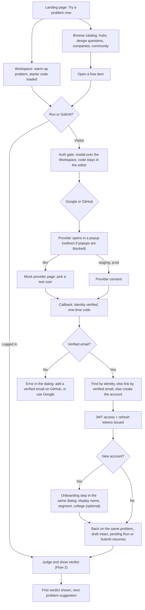
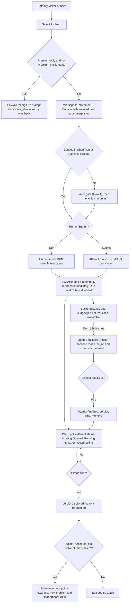
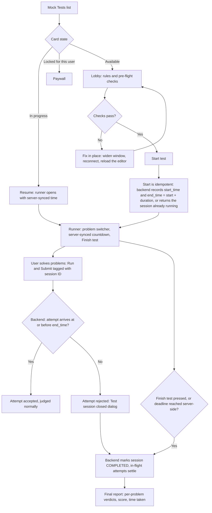
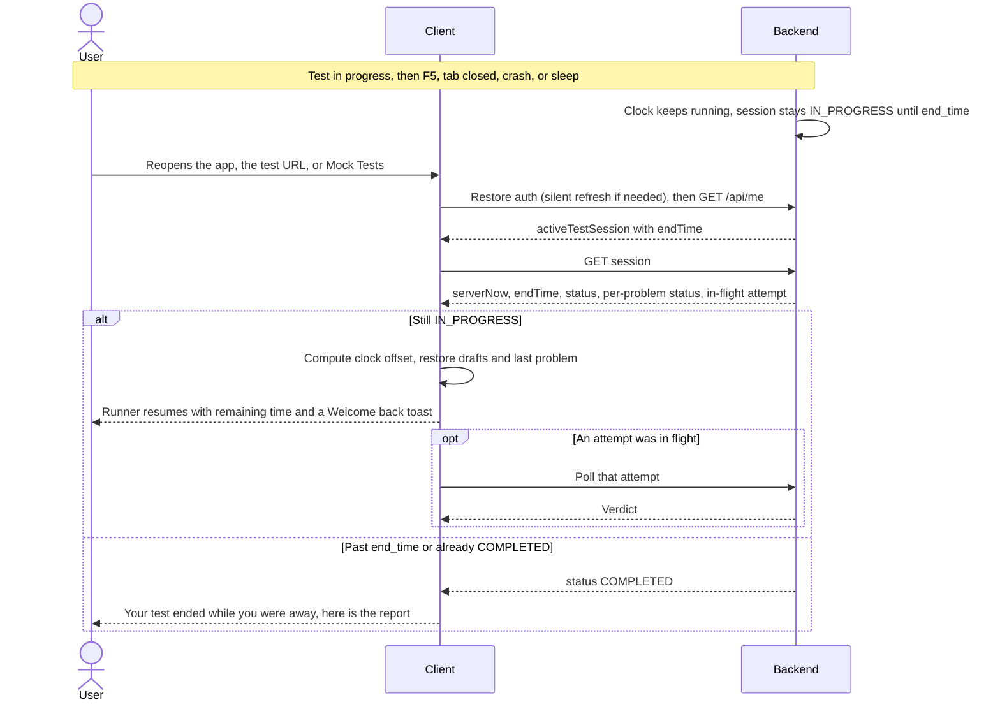
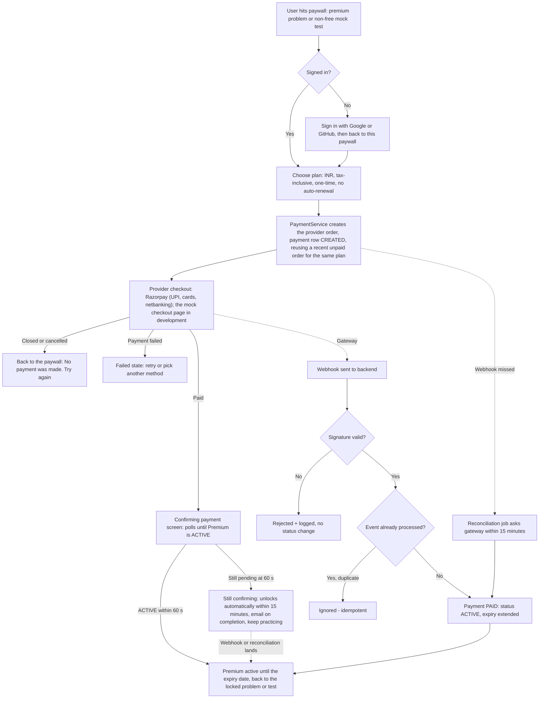
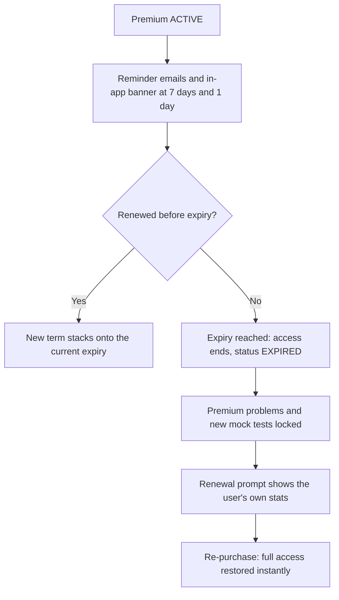
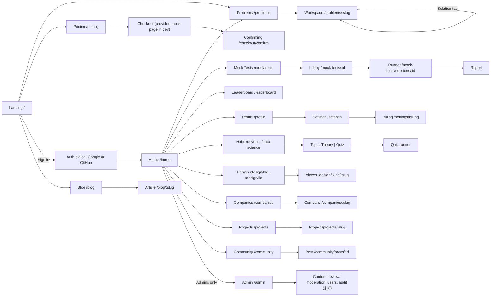
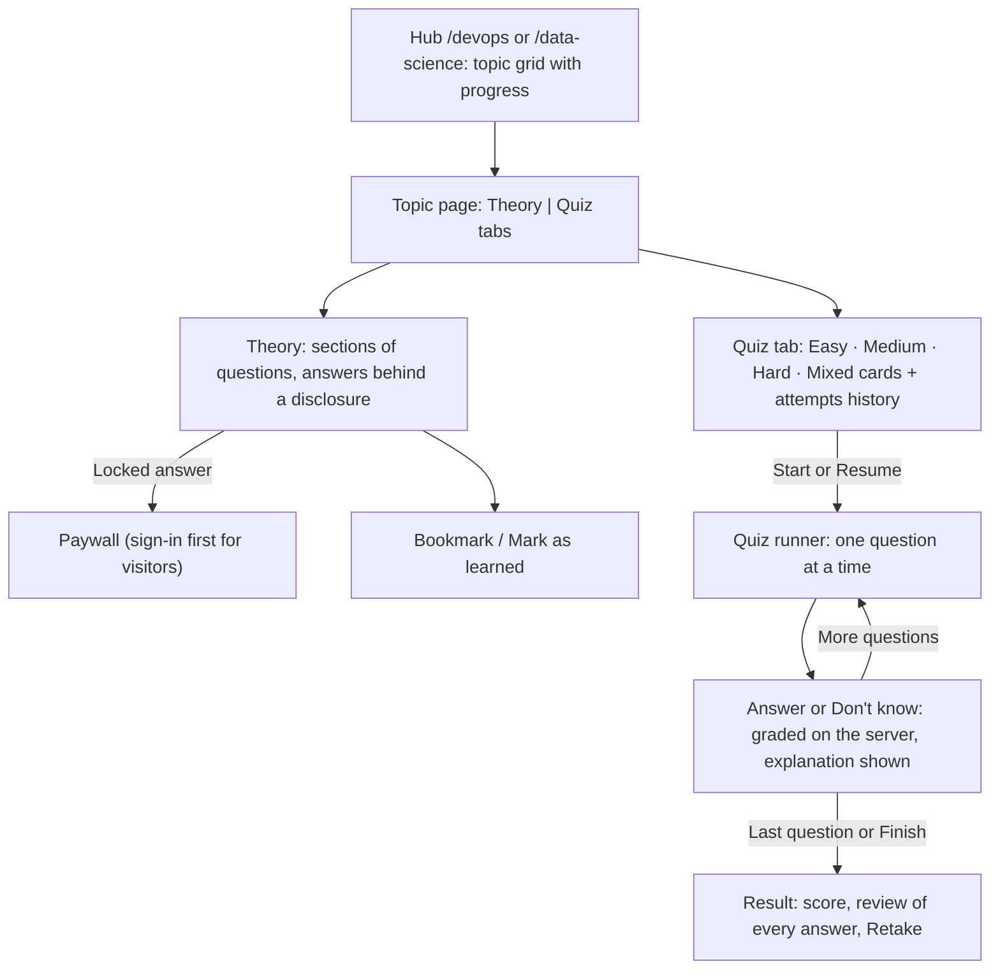
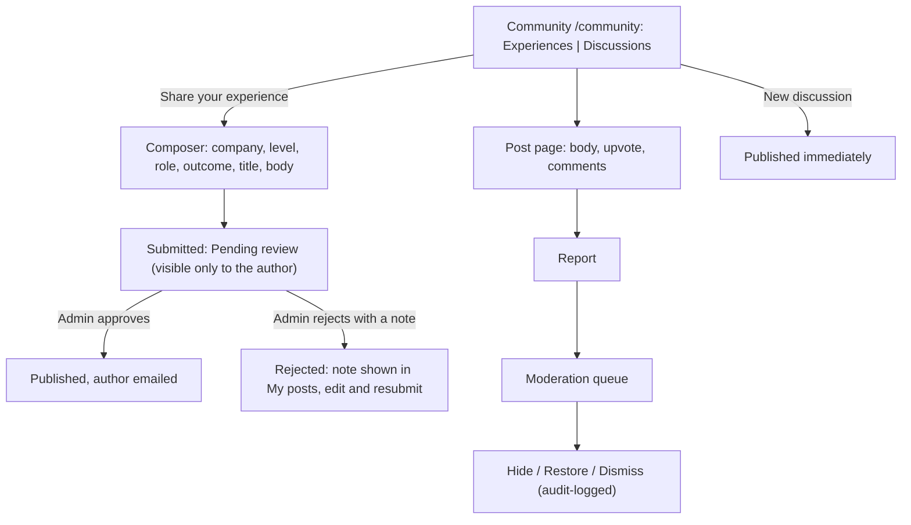

# Application Flow Document — Semicolan

## 0. UX Principles

These apply to every flow below and settle anything a flow leaves unspecified.

1. **Code is never lost.** Drafts autosave locally; no gate, error, redirect, or logout may discard editor content.
2. **Intent survives gates.** Sign-in, onboarding, paywall, and re-login return the user to the same screen and resume the action they attempted.
3. **Every wait has a state and an exit.** No bare spinner: show what is happening, how long it has taken, and what the user can do meanwhile.
4. **The server owns time and entitlement.** The client is optimistic, then reconciles (timer offset, `GET /api/me`).
5. **Our failures are not the user's cost.** Judging Errors and network failures are labeled as ours and never consume the Run/Submit allowance.
6. **Repeat-safe by default.** Anything a user may double-click, retry after a dropped connection, or repeat after a refresh (Run/Submit, Start test, Buy, Resend) must not create duplicates.
7. **Friction budget.** Landing to first verdict takes at most 3 clicks and one form, without leaving the problem. Measure it as the time from the `workspace_opened` event to the user's first `run` event.
8. **Results never steal focus.** Panels, toasts, and dialogs update around the editor; keyboard focus leaves it only when the user moves it. Modals trap focus and restore it on close.

## 1. Onboarding & Authentication Flow

Sign-in is **Continue with Google** or **Continue with GitHub** (PRD ACC-1); there is no password. In local development the same two buttons open a mock provider page with seeded test users (§15), so every screen below is built and tested before the real providers are connected in the last phase.



1. **Entry.** The landing page's primary action is **Try a problem now**, which opens a designated warm-up problem (free, Easy, solvable in under a minute; its slug lives in frontend configuration) in the Workspace with starter code loaded. Secondary actions browse the catalog and the modules. A logged-out **visitor** can browse the catalog, read free statements, hub theory samples, design statements, company overviews, project summaries and the community, and view the leaderboard. A returning user with a valid session skips Landing and goes to **Home**, the dashboard (§7; PRD HOME-1), whose first card is "Continue where you left off" (latest draft or attempt) and which shows the "Test in progress" bar when a test runs.
2. **Auth gate.** Trying to Run or Submit, start a quiz, save a design answer, bookmark, vote or post as a visitor opens a modal over the current page — no navigation, so the editor stays visible and intact. It shows the wordmark, a one-line reason ("Sign in to run your code — it stays in the editor"), **Continue with Google** and **Continue with GitHub** (a "Last used" tag on the provider this device used before), and the Terms and Privacy line. The attempted action (for example mode, problem, language) is held as a pending action. Visitors cannot execute code in MVP: the first Run or Submit always passes through this gate, and the pending action resumes right after sign-in.
3. **Provider step.** The button opens the provider in a popup started from the click (`GET /api/auth/oauth/{provider}/start?popup=true`), so the page underneath — editor, draft, pending action — is never unloaded. The popup ends on `/auth/complete`, hands a one-time code to the opener and closes; the opener exchanges it (`POST /api/auth/oauth/exchange`) for the token pair. If the browser blocks the popup, the same button falls back to a full-page redirect with `returnTo`: the draft is already in local storage and the pending action in `sessionStorage`, so both survive and resume on return. While waiting, the dialog shows "Waiting for Google…" with **Cancel**; closing the popup returns the dialog to its buttons without an error.
4. **Account resolution** (server): an identity seen before signs in to its account; a new identity whose verified email matches an existing account is linked to it (both sides verified) and signs in; otherwise a new account is created with role `USER`, no Premium, and the provider's name and avatar prefilled.
5. **Onboarding** (new accounts only, PRD ACC-3) happens inside the same dialog, as its second step: display name (prefilled, editable, "Shown on the leaderboard — never your email"), segment as one-tap chips (Student / Working professional / Other), and a collapsed "Add college (optional)". **Continue** sends `PATCH /api/me`. The dialog then closes on the same page and the pending action runs, so the first thing a new user sees is their first verdict. Leaving onboarding unfinished (closing the dialog) keeps the user signed in; the next page load shows the onboarding step again until it is done, and pending actions wait for it.
6. **Return and resume.** When sign-in starts anywhere other than an action (Landing, the top-bar **Sign in**, a paywall), the user returns to where they were, falling back to Home — never to an empty page.
7. **Connected accounts** (PRD ACC-6): Settings → Accounts shows Google and GitHub with their linked email and **Link** / **Unlink**. Linking runs the same provider step with a link intent; unlinking the last provider is refused ("You need at least one way to sign in").
8. **Session restore and refresh.** On app start the client restores the session (a silent refresh if the access token expired, then `GET /api/me`) behind a neutral skeleton, never the logged-out UI, which would look like a logout. Authenticated requests carry the access token; when it expires, the client silently calls the refresh endpoint, which rotates the refresh token, and retries the original request. **Log out** revokes the refresh token (`POST /api/auth/logout`), clears drafts on shared machines (§2.2) and logs out other tabs.
9. **Account deletion** — the user can request deletion from account settings. A confirmation states what is lost (history, reports, quiz attempts, design notes, community posts become "[deleted]", any remaining Premium time) and the removal deadline. It is handled manually within 30 days (personal data removed, leaderboard entry anonymized); cancelling a request is a support-email action in MVP.

**Edge cases**
- GitHub account with no verified primary email → the dialog shows "Your GitHub account has no verified email. Add one in GitHub settings, or continue with Google." with both buttons still available.
- The user cancels at the provider → the dialog returns to its buttons with a quiet "Sign-in cancelled".
- `state` expired (the consent screen was left open over 10 minutes) or mismatched → "That sign-in link expired — try again", and one click restarts it.
- Popup blocked → automatic fallback to the redirect (step 3); the user sees one full-page hop and lands back on the same page.
- A second click while the popup is open focuses the existing popup instead of opening another.
- Provider down or slow → "Google isn't responding. Try again or continue with GitHub." Neither provider failing locks a user out who has linked both.
- Linking a GitHub account that already belongs to another Semicolan account → "That GitHub account is linked to a different Semicolan account" (`IDENTITY_IN_USE`); nothing is merged automatically.
- Signing in with a second GitHub account whose verified email matches an account that already has a different GitHub account linked (the email moved between GitHub accounts) → "Your Semicolan account is linked to another GitHub account. Sign in with it, then relink in Settings" (`IDENTITY_CONFLICT`); nothing is linked.
- Access token expired → silent refresh using the refresh token, original request retried transparently.
- Refresh token expired, invalid, or already used (outside the 10-second leeway) → refresh fails and the sign-in dialog opens over the current screen; after sign-in the user resumes in place with the draft intact. Reuse of a consumed token outside the leeway is treated as theft and revokes all of that user's sessions.
- Two tabs refresh at once, or a refresh response is lost to a network drop → the same token is presented twice. Only one tab refreshes at a time (the others wait for its result), and the server answers a just-rotated token presented again within a 10-second leeway with a fresh pair instead of treating it as theft, so neither case logs the user out.
- A network error or `5xx` during refresh never ends the session — only an explicit `401` does. The app shows an offline state and retries.
- Auth endpoints return `429` (a college lab behind one public IP can hit per-IP limits) → "Too many attempts from your network. Try again in N seconds", with a countdown. Limits are keyed so one lab does not lock out a class.
- Wrong email on the provider account → there is no in-app correction in MVP: the user links the other provider or contacts support.

## 2. Problem Solving Flow



### 2.1 Opening a problem

1. Visitors, Free users, and Premium users all see the full catalog, filterable by difficulty and topic; premium problems show a lock. Filters and page live in the URL, so Back and shared links restore the same view.
   - **Search** (PRD CAT-2): the catalog's search field filters by title as the user types (debounced, `q` in the URL); the global Ctrl/Cmd + K palette searches the same way and opens a problem directly.
   - **Status** (signed in): every row shows Solved, Attempted or nothing, and a Status filter narrows to Solved / Attempted / Unsolved. Visitors do not see the filter; a "Sign up to track progress" hint replaces it.
   - **Grouped view**: a Flat / Grouped toggle. Grouped shows one collapsible section per topic with "solved / total" and a progress bar; a problem with two topics appears in both. The topic sub-sidebar jumps to a topic; the header shows an overall progress ring.
   - **Bookmarks** (PRD CAT-3): the bookmark icon on a row toggles at once (optimistic, rolled back with a toast if the request fails); a **Saved** filter shows bookmarked problems. A visitor who clicks it gets the auth dialog, and the bookmark is applied after sign-up (intent survives gates, §0).
2. Opening a locked problem shows a paywall (visitors are asked to sign up first). It is never a dead end: it shows the title, difficulty, and topics (not the statement), the plan summary, and "Try a free problem instead" suggestions from the same topic, and closing it returns to the catalog where the user was.
3. Opening an unlocked problem loads the Workspace: the problem statement plus a Monaco editor pre-seeded with the user's saved draft, or the stub for the selected language (C, C++, Java, or Python 3). The language defaults to the one last used on this device. The statement and editor show skeletons while loading.
4. Load failures are specific: unknown or unpublished problem (`404`) → "Problem not found" with a link to the catalog; network error → "Couldn't load the problem" with Retry (a statement already loaded stays visible); `401 AUTH_REQUIRED` (visitor) → sign-up prompt; `403 PREMIUM_REQUIRED` (signed in, no Premium) → paywall.
5. If Monaco has not loaded within 10 seconds or fails (a slow campus network, a blocked asset), the Workspace falls back to a plain text editor with a "Basic editor — Retry full editor" notice, so the user can still write, Run, and Submit.

### 2.2 Editor and drafts

- **Autosave**: code is saved to local storage as the user types (debounced to about 1 second) and flushed on `pagehide`, when the tab is hidden, and before every Run or Submit, so a closed tab loses at most a moment of typing. Drafts are keyed by user ID (`anonymous` for visitors), problem, and language, so a shared lab PC never shows one student's code to the next.
- **One buffer per language**: switching language swaps to that language's draft (or its stub); the other draft is kept, never overwritten.
- **Reset to starter code** asks for confirmation and offers Undo for 10 seconds.
- **Anonymous drafts follow the user** into their account at the auth gate; if the account already has a draft for that problem and language, the newer one wins.
- **Autosave unavailable** (storage full or blocked) → non-blocking warning: "Autosave is off — copy your code before leaving."
- **Same problem in two tabs** → the tab that did not edit last shows "Edited in another tab" and asks which version to keep; nothing is overwritten silently.
- **Guards**: with an empty editor, Run and Submit are disabled with "Write some code first"; oversized source is refused client-side with a specific message (the server also validates: `422`, or `413` for an oversized request body).
- **Shortcuts**: Ctrl/Cmd + Enter runs and Ctrl/Cmd + Shift + Enter submits, overriding Monaco's defaults and listed in a shortcuts popover.
- **First visit** shows three dismissible coach marks: the language selector, "Run checks the sample tests; Submit judges every test and is saved", and the results panel.

### 2.3 Run and Submit: what the user sees

1. **Run** executes the code against the problem's sample test cases only. Results appear in the Test Cases tab; a Run is never stored in history and never affects the leaderboard. **Submit** judges against all test cases, is stored in history, and counts toward the leaderboard.
2. The backend creates the attempt and one Judge0 job per test case (`wait=false`), returning `202 Accepted` with the attempt ID immediately — no request thread is blocked on execution.
3. While an attempt is in flight **both** Run and Submit are disabled, so results never interleave; the editor stays editable. Each result is labeled with its mode, language, and time, and a "Code changed since this run" marker appears if the user edits afterward, so a verdict is never mistaken for newer code.
4. The client polls the attempt status — every 1 s for the first 15 s, every 2 s up to 60 s, then every 5 s (defaults, tuned in the pre-launch load test), slowing in a hidden tab and polling at once when the tab returns. As each job's result is applied (from a Judge0 callback, or by the backend's reconciler if a callback is lost), it is recorded and `progress` advances; when all are in, the attempt is finalized: Accepted if every test passed, a compile error finalizes it at once, otherwise the first failing test (by order) decides the verdict.
5. The panel opens the right tab by itself — Test Cases for a Run, Submission Result for a Submit, Console for a compile error — without taking focus from the editor. Before any attempt it shows an empty state ("Run your code to see results here"). In a hidden tab, the browser tab title shows the verdict when it arrives.

| State | Trigger | What the user sees | User can |
|---|---|---|---|
| Sending | Click until the `202` (target under 1 s) | Button reads "Sending…"; the result panel opens with skeleton rows | Edit |
| Queued | `PENDING` | "Queued — waiting for a free runner", with elapsed seconds | Edit, browse |
| Running | `JUDGING` | Run: each sample row moves Queued → Running → Passed or Failed as results land. Submit: "Judging… 7 of 20 tests" | Edit, browse |
| Slow | 15 s with no verdict | Adds "Taking longer than usual — your attempt is safe, keep editing" | Edit, browse |
| Long wait | 60 s with no verdict | Adds **Stop waiting**, which ends polling but not the attempt; a Submit still lands in Submissions | Stop waiting |
| Reconnecting | Send or poll fails | "Connection lost — reconnecting. Your code is saved on this device." Retries back off (1, 2, 4, 8 s, then every 15 s, with jitter) and fire at once on `online` | Edit |
| Verdict | Terminal status | See §2.4 | Next action |
| Judging Error | `JUDGING_ERROR` (unrecoverable Judge0 failure, or the judging timeout: 5 minutes, 30 for mock-test attempts) | "Something went wrong on our side, not with your code. This attempt didn't count against your limit." **Try again** · **Report a problem** | Try again |

### 2.4 Verdicts

Sample test cases show input, expected output, and actual output; a failing hidden test shows only "Wrong Answer on test N", with no input or output.

| Verdict | Where | What the user sees | Next |
|---|---|---|---|
| Accepted (Run) | Test Cases | Every sample passed, with time and memory | **Submit** |
| Accepted (Submit) | Submission Result | Time and memory; on a first solve, "+N points" (`pointsAwarded`) and, for verified users, the new weekly rank (read from `GET /api/leaderboard/me`) | Next problem · Leaderboard |
| Wrong Answer on a sample test | Test Cases | Input, expected output, and actual output side by side, with whitespace made visible | Edit |
| Wrong Answer on a hidden test | Submission Result | Only "Wrong Answer on test N", plus a one-line note on why hidden tests stay hidden | Edit |
| Compile Error | Console | Compiler output as text (Python syntax errors included). No per-test results | Edit |
| Runtime Error | Console and Test Cases | `stderr` for a sample test; "Runtime Error on test N" for a hidden one | Edit |
| Time Limit Exceeded | Test Cases or Submission Result | "Time Limit Exceeded on test N" in the `warning` color | Edit |
| Judging Error | Submission Result | The our-side message from §2.3 | Try again |

Toasts ([UI_UX_Brief.md](UI_UX_Brief.md) §4) supplement the result panel and never replace it: they auto-dismiss, so every outcome stays readable in the panel.

### 2.5 After the verdict

- On the user's first Accepted `SUBMIT` for a problem, a solve is recorded and its points are added to the leaderboard. Later accepted submissions of the same problem add nothing.
- Every verdict ends in a next step: Accepted → a next-problem suggestion (same topic, next difficulty), the leaderboard link and, when the problem has one, **Compare with the editorial** (opens the Solution tab past its spoiler guard); anything else → edit and retry.
- A **Submissions** tab (the former History tab, renamed to match the reference UI) lists the user's past Submits for this problem. The user can open one read-only or restore its code into the editor (after confirmation; the current draft stays recoverable).

### 2.6 Failures and connectivity

| When | What the user sees | What happens |
|---|---|---|
| Offline before clicking | The click shows "You're offline — your code is saved on this device" | Nothing is sent or queued |
| Connection drops while sending (no response) | "Checking whether your submission went through…" | The client retries the same request with the same `clientRequestId`; the server returns the original attempt instead of creating a duplicate |
| Connection drops after the `202` | The "Reconnecting" state from §2.3; the last known state stays on screen | The attempt keeps judging server-side; polling resumes and the verdict appears |
| Page refreshed or tab closed while judging | On return, the Workspace finds the in-flight attempt (its ID is kept per problem on this device) and resumes polling; a Submit is also in Submissions | No attempt is lost or duplicated |
| `401` while polling | Nothing: a silent refresh, then the poll continues. If refresh fails, a login modal opens over the Workspace; the draft stays and polling resumes after login | See Flow 1 |
| `5xx` on send | "Our servers hit a problem. Try again." with Retry | Does not count against the Run/Submit limit |
| `429 RATE_LIMITED` | A warning toast, and the buttons show "Retry in 12 s" and re-enable when it elapses | Per EXE-4 |
| `429 TOO_MANY_IN_FLIGHT` | "You already have attempts judging — wait for one to finish" | Per-user in-flight cap (default 3); no attempt is created |
| `503 EXECUTION_BUSY` | "Runners are busy — try again in N s", with the same button countdown as `429` | Outside mock tests only; does not count against the allowance; mock-test attempts are always admitted |
| `413` | "Your code is too large to submit" | Nothing is created; the editor is untouched |
| A Judge0 callback is lost | At most a short delay (the backend's reconciler re-reads the job within about 25 s); the Slow state may show | The verdict still arrives. Only if recovery is exhausted or the judging timeout (5 minutes; 30 for mock-test attempts) passes does the attempt become "Judging Error" |

**Edge cases**
- A Judge0 callback is lost → the backend's reconciler recovers the result, so the user sees at most a short delay; only after the judging timeout (default 5 minutes; 30 for mock-test attempts) does the attempt become "Judging Error", and the user can retry.
- Run/Submit rate limit exceeded → `429` with a retry hint; the buttons show "Retry in N s" and re-enable when it elapses.
- Premium-only problem without Premium entitlement → paywall (sign-up prompt for visitors).
- Premium expires while the user is working → the next Run/Submit on a premium problem shows the paywall; the code stays in the editor (local autosave), and history already earned stays readable.
- Compile error → the compile output is shown in the Console and no per-test results are produced.
- Duplicate or late Judge0 callback → ignored, with no effect on the recorded result.
- Window between 768 and 1023 px (a snapped window, browser zoom, a 1366 px laptop at 150% scaling) → the compact Workspace: the problem pane collapses to a rail and opens as an overlay drawer, while the editor and results stay usable. A desktop window under 768 px → the Workspace shows the current width and "Widen the window or reset zoom (Ctrl/Cmd + 0)" instead of a bare "use a larger screen"; the draft is untouched. Phones and tablets: §6.3.
- Language switched while an attempt is judging → the attempt keeps its original language label and the new language's draft loads.
- Very large output → the Console truncates it with "Show more".

### 2.7 Solution tab (editorial)

1. The left pane's third tab, **Solution** (PRD SOL-1). Opening it shows a spoiler guard — "Try it yourself first? The editorial shows a full solution." — with **Show solution**; the choice is remembered per problem on this device, and Accepted skips it.
2. Past the guard: the approach write-up, time and space complexity, and the reference code with a language row (defaulting to the editor's language) and Copy. Copying never touches the editor; there is no "load editorial into editor".
3. Access follows the problem: visitors get the sign-up prompt in the tab (`401 AUTH_REQUIRED`); a Free user on a premium problem gets the paywall in the tab (`403 PREMIUM_REQUIRED`) — never a modal they did not ask for.
4. A problem without an editorial shows "No editorial for this problem yet" (`404 EDITORIAL_NOT_FOUND`); the tab stays, so the layout never shifts between problems.
5. Inside a mock test the tab is not rendered, and the API refuses the editorial of any problem in the caller's running test (`409 EDITORIAL_LOCKED_DURING_TEST`), so a second tab can't be used to look it up. It becomes available again the moment the session closes.

## 3. Mock Test Flow



### 3.1 Choosing and starting a test

1. The Mock Tests list shows each test with the user's state on it: **Available**, **Locked** (Premium, with a lock icon), **Free test — 1 attempt**, **In progress — 41:12 left — Resume**, or **Completed — View report**. A completed test offers **Retake** to Premium users and "Upgrade to retake" to Free users.
2. **Opening a test is not starting it.** A test opens to a **lobby** showing the duration, the number of problems, the point weights, and the rules: the timer runs on our server and cannot be paused, leaving does not stop it, only Accepted problems score (no partial credit), unsubmitted code is not scored, and a free attempt cannot be repeated. Nothing is recorded until the user presses **Start test — N min**.
3. **Pre-flight checks run in the lobby, before the clock can start:** signed in; window at least 768 px wide; online; editor assets loaded. A failed check is fixable in place and re-checks by itself, and Start stays disabled until every check passes, so a test is never burned on a phone, a bad connection, or an unverified account.
4. Entitlement is checked once, when the session starts. Premium users can start any mock test, any number of times. Free users can start only the single designated free test, once. Anyone else is refused before the clock starts: a paywall (`403 PREMIUM_REQUIRED`), "Free attempt used — upgrade to retake" (`403 FREE_ATTEMPT_USED`).
5. **Start is idempotent and one-at-a-time**. The backend records `start_time` and computes `end_time = start_time + duration` — the backend clock is the sole source of truth, never the client's. If the user already has a session in progress for that test, starting returns **that** session — never a second clock, and never a paywall, even for the free test whose single attempt it is using. Starting a different test while one is running is refused (`409 ACTIVE_SESSION_EXISTS`), with a link to resume the active one. Double-clicking Start is therefore harmless.

### 3.2 Inside the test

1. A **test header** sits above the Workspace: the test title, a problem switcher (one chip per problem, in order, showing not attempted, attempted, judging, or Accepted — all derived from the server), the countdown, and **Finish test**.
2. Problems inside the test are served through the session, which authorizes access (the problem's own premium flag is not consulted). The Solution tab is not shown during the test (§2.7). Each Run and Submit during the test carries the `testSessionId`, and the backend checks its arrival time against `end_time` before accepting it. The Workspace behaves exactly as in Flow 2 — drafts (kept per session, problem, and language), loading states, and failure handling included.
3. **Countdown.** The client shows `end_time` minus the server's clock: it measures an offset (`serverNow` from the session response minus the local clock at receipt) and counts down from timestamps rather than by decrementing, so a throttled background tab cannot drift. It re-syncs on load, every 60 seconds, when the tab becomes visible, on `online`, and after any `409` or `5xx` — often enough to correct a laptop that slept. Until the first sync completes it shows "Syncing time…", never `00:00`. The display turns `warning` at 10 minutes and `error` at 1 minute; screen readers are told at 10, 5, and 1 minutes, not every second.
4. **Warnings.** At 5 minutes and at 1 minute a toast says "Unsubmitted code is not scored."
5. **Finish test** asks for confirmation ("Finish now? 2 of 3 problems unsolved, 38:10 left. You can't resume after finishing."), then closes the session (the backend moves `end_time` to now) and opens the report. Without it, a user who is done early must wait out the clock to see their result.
6. **Leaving.** While the test runs, the page registers a `beforeunload` guard (the browser's generic "Leave site?" dialog) and an in-app blocker ("Leave the test? Your timer keeps running"), and every other page shows a persistent "Test in progress — mm:ss left" bar. Guards only prevent accidents; recovery (§3.3) does not depend on them.

### 3.3 Interruptions: refresh, closed tab, crash, or sleep



1. **Before anything goes wrong**: drafts flush to local storage on `pagehide` and about once a second while typing, so even a hard crash loses at most a moment of typing.
2. **While the user is away** the server does nothing special: `end_time` is fixed, the status stays `IN_PROGRESS`, and any attempt already sent keeps judging. Nothing is paused or reset.
3. **On return** the app restores the session and reads `activeTestSession` from `GET /api/me`. Opening the test URL lands straight in the runner; any other page shows a persistent **Test in progress — 41:12 left — Resume** bar, and the Mock Tests card says **Resume**, not **Start**.
4. **The runner rebuilds itself from the server**: it fetches the session (`serverNow`, `endTime`, per-problem status, in-flight attempt), computes the clock offset, restores the last-viewed problem and the local drafts, and re-attaches polling to any attempt still judging, so its verdict appears as if nothing happened. A toast confirms: "Welcome back — 41:12 left. Your code is restored."
5. **If the user returns after `end_time`**, the session reads as `COMPLETED` as soon as server time passes `end_time`, even if the closer job has not run yet. The user sees "Your test ended at 14:30 while you were away" and the report (with the "Finalizing" state of §3.4 if needed). A Free user sees "Free attempt used — upgrade to retake" instead of an unexplained paywall.
6. **Starting again never creates a second session** (§3.1 step 5): the same request resumes the one in progress.

| Interruption | Server | User sees | Recovery |
|---|---|---|---|
| Refresh (F5) | Clock runs | The browser's "Leave site?" dialog; after a confirmed reload, the runner is back in about 2 s | Automatic |
| Tab closed, browser crash, power loss | Clock runs | On return: the Resume bar and card; the test URL opens the runner | One click |
| Back button or in-app link | Clock runs | "Leave the test? Your timer keeps running" | Stay or Leave |
| Laptop sleep, long background tab | Clock runs | On wake the timer re-syncs and corrects itself | Automatic |
| Network drop | Clock runs; Run/Submit cannot reach the server | "Offline — your timer is still running on our server. Code is saved on this device." The countdown continues; Run and Submit are disabled | On reconnect: re-sync, buttons return |
| Access token expires or refresh fails | Clock runs | A silent refresh; if it fails, a login modal over the runner with the timer visible | After login the runner resumes in place |
| Same test open in two tabs or devices | One session | The older tab shows "This test is open in another tab — Use this tab" and goes read-only | One click |
| System clock changed on the device | Clock runs | Nothing: the countdown derives from the server offset | Corrects at the next sync |
| Premium expires or is revoked | Session continues | Nothing; entitlement is checked at start only | None |

### 3.4 The deadline, closing, and the report

1. When the server-side deadline passes, the backend automatically marks the session `COMPLETED`, independent of any client action. The client mirrors this by locking the editor when its local countdown hits zero, but this is a UX convenience only — the backend enforcement is authoritative.
2. At local zero the client does one final sync before locking: if the server says time remains (the client's clock ran ahead), the countdown simply continues with the corrected value; if the session is closed, the editor locks (read-only; Run and Submit disabled).
3. Closing is a blocking **"Time's up"** dialog with **View report** and **Copy my code** — not a toast, because the user has just lost the ability to act. A Run or Submit rejected with `TEST_SESSION_CLOSED` opens the same dialog with "Your last submission arrived after the test ended and was not counted."
4. **In-flight attempts at the deadline.** An attempt that reached the server before `end_time` still counts and keeps judging; its verdict appears in the panel. The score is computed once all such attempts are terminal, so until then the report shows "Finalizing your results…" (session `COMPLETED`, score not yet set) and polls every 2 seconds; the in-session judging timeout (30 minutes) bounds the wait.
5. After the session closes, a final report is generated: per-problem verdicts, the score (points of every problem with an Accepted submission, weighted by difficulty; no partial credit), and time taken. Time taken is `end_time` minus `start_time`; an early finish shortens it to the moment of finishing.
6. The report ends with a next step: Premium users get **Retake**; a Free user sees what Premium adds ("All mock tests, unlimited retakes") with the paywall one click away.

### 3.5 Edge cases

- **A submission arrives after the server-side deadline has passed (even if the client's local countdown still showed time remaining, e.g. due to clock drift or network latency) — the backend rejects it as "test session closed," regardless of what the client believed the remaining time to be.**
- Page refresh mid-test → session resumes using the backend's remaining time, not reset (§3.3).
- Network drop → on reconnect, the client re-syncs remaining time from the backend rather than trusting its own elapsed local timer.
- Free user tries the designated free test a second time **after it has completed** → "Free attempt used — upgrade to retake" (`403 FREE_ATTEMPT_USED`) with the paywall one click away; only Premium users can retake tests. While it is still in progress, Start resumes it (§3.1).
- Premium expires or is revoked mid-test → the session in progress can still finish, because entitlement is checked only at start.
- Start double-clicked → one session; the second request returns it.
- Another test is already running → the start is refused (`409 ACTIVE_SESSION_EXISTS`) with "Finish or resume your current test first" and a Resume link.
- The runner cannot load the problems right after Start → "Couldn't load your problems — retrying" with the countdown still visible; automatic retries with backoff plus a Retry button. The clock is not paused automatically; an admin can extend the session through an audit-logged script after a support request.
- Submit pressed in the last seconds → it counts if it reaches the server before `end_time`; the panel shows "Submitted at 00:02 — judging…" even after the editor locks.
- A problem from the running test is opened from the catalog → a banner says "This problem is part of your running test. Submissions made here are not scored — Go to the test."
- Platform incident during a test → no self-serve extension in MVP; an admin can extend the session through an audit-logged script after a support request.

## 4. Subscription Flow



1. **Paywall triggers** (PRD PAY-1): opening a premium problem, or starting a mock test that is not the free one. Visitors are asked to sign up first and then see the paywall; the intended destination is kept through both steps.
2. **The paywall** shows what is locked, what Premium adds ("all premium problems, unlimited mock tests"), the plans with INR prices, "One-time payment, no auto-renewal", and the refund-policy link. **Not now** returns the user to where they were.
3. The user picks a plan — fixed-term, prepaid, priced in INR, no auto-renewal in MVP. Choosing a plan calls `POST /api/payments/checkout`: the backend creates the provider order through `PaymentService` and a `payments` row (`CREATED`), and the user is taken to the provider's checkout — Razorpay (UPI, cards, netbanking) in production, the mock checkout page in development (§15) with a return URL that carries the `orderId`. The Buy button disables on click, and a second click or a retry reuses the caller's unpaid order for the same plan created within the last 15 minutes instead of making another.
4. After paying, the app shows a **Confirming your payment** screen — an optimistic "processing" state that polls `GET /api/payments/orders/{orderId}` every 2 seconds until the order is `PAID` (then refreshes `GET /api/me` once to read the new entitlement) or `FAILED`. Razorpay's client-side success callback is never trusted: only the webhook or reconciliation changes entitlement. The screen never blocks navigation: the user can keep practicing free content while a "Confirming payment" chip stays in the header.
5. The provider sends a webhook (the mock provider a simulated one, through the same processor); the backend verifies its signature, drops duplicates by gateway event ID, marks the payment `PAID`, sets the status to `ACTIVE`, and extends `subscription_expires_at` (from the current expiry if the user is still `ACTIVE`, otherwise from now).
6. Premium access is derived server-side on each request from the status and expiry — there are no role claims to refresh — so features unlock as soon as the webhook is processed, within 60 seconds of payment confirmation. The user lands back where they were (the problem they tried to open, or the test lobby) with a one-line confirmation: "Premium is active until 12 Dec 2026."
7. **Refund or chargeback**: the gateway event sets the status to `REVOKED`, which denies access immediately. The user is told why on their next visit ("Your Premium access ended because the payment was refunded") and by email, so it never looks like a bug.
8. **Admin grant or revoke** (support actions, e.g. a payment resolved by hand) is limited to admins, goes through the admin API (grant and revoke only), and is audit-logged. Refunds are issued from the Razorpay dashboard in MVP; the refund webhook then revokes access.

### Expiry and renewal



When the expiry passes, access ends at that timestamp. Premium problems and new mock tests lock, while history, mock-test reports, and earned leaderboard points stay viewable — nothing is deleted ([PRD.md](PRD.md) §6.3).

**Edge cases**
- Webhook delayed → the app stays in "Confirming" and keeps polling; if the webhook never arrives, the reconciliation job completes the purchase within 15 minutes, so the user never has to contact support.
- Still pending after 60 seconds → a calm "Still confirming" state: "You don't need to stay on this page — Premium unlocks automatically (up to 15 minutes) and we'll email you." It never reads as an error and never invites a second payment, which would stack another term.
- Payment failed → the payment is marked `FAILED` and the user is offered a retry.
- Checkout closed or cancelled → back at the paywall with "No payment was made", without alarming copy; a UPI debit that settles later is still caught by the webhook or reconciliation.
- The user returns from a UPI app in a different browser, or with an expired session → login, then the Confirming screen resumes from the order ID in the return URL.
- Invalid webhook signature → request rejected and logged; no status change.
- Duplicate webhook delivery (gateway retry) → deduplicated by gateway event ID, processed only once.
- Purchase while already Premium → the new term stacks onto the current expiry; there is no overlap or double entitlement.
- Premium expires or is revoked during a mock test → the session in progress can finish (entitlement is checked only at start).
- Premium expires while code is open in the Workspace → the code stays in the editor; the next Run/Submit on a premium problem shows the paywall.

## 5. Leaderboard Flow

1. Anyone can open the leaderboard; **This week** is the default view and **All-time** is one click away. The header shows when the weekly board resets (Monday 00:00 IST), so an empty board on Monday morning is expected rather than alarming.
2. The viewer's own rank and neighbors are always shown, even outside the top N.
3. After a first-solve Accepted, the verdict card shows the points earned and, for a verified user, the new weekly rank (read from `GET /api/leaderboard/me`).

| Viewer | "Me" panel |
|---|---|
| Visitor | No panel; "Sign up to get ranked" |
| Signed in, no solves in this window | "Solve a problem to get on this week's board", linking to a suggested problem |
| Signed in, with solves | Rank, points, solved count, and neighbors |

**Edge cases**
- A deleted (anonymized) account appears to others as "Deleted user".
- Ties go to the user who reached the score first; a tooltip on the rank explains it.
- Premium expiry removes nothing: points already earned stay on the board.

## 6. Cross-Cutting States

### 6.1 Connectivity and session rules

- A connection indicator in the header turns on when requests fail or the browser reports `offline`. It never implies the user was logged out.
- Only an explicit `401` from the refresh endpoint ends a session; network errors and `5xx` never do.
- Retries use the backoff in §2.3 (1, 2, 4, 8 s, then every 15 s, with jitter) and fire at once on `online`. A write is retried only when it is repeat-safe, such as a Run or Submit that carries a `clientRequestId`.
- Logging out in one tab logs out the others, and only one tab refreshes tokens at a time.
- Dialogs trap focus and restore it on close; changes are announced politely (`aria-live`) without per-second chatter.

### 6.2 Rage-click hotspots

| Hotspot | What users do | Countermeasure |
|---|---|---|
| Run or Submit while judging | Click again, refresh, give up | Both buttons disable; elapsed time and the Slow state are visible; a refresh resumes the same attempt; **Stop waiting** appears at 60 s |
| Continue with Google / GitHub | Double-click the button | One popup; a second click focuses it |
| Quiz answer, upvote, report | Double-click | Idempotent on the server: the first answer is final, a vote is a toggle, a report is counted once |
| Share your experience | Submit twice | The button disables; the composer shows the pending post |
| Buy | Double-click, retry after a slow redirect | The button disables; the recent unpaid order is reused |
| Start test | Double-click or mis-click | Lobby with an explicit Start; Start is idempotent |
| Finish test | Accidental click | Confirmation that names what is unsolved |
| Locked problem | Open it repeatedly | One paywall with a way back; no stacked history entries |
| Catalog to problem and Back | Lose filters and page | Filters and page live in the URL |

### 6.3 Small screens

The Workspace is fully laid out from 1024 px, switches to a compact layout from 768 px, and below 768 px the app is read-only for coding ([PRD.md](PRD.md) §4).

- **Phone or tablet**: the statement stays readable with a prompt to switch to a larger screen, plus **Copy link** and **Share** (the device share sheet), so a student who finds a problem on a phone can send it to their laptop. Sign-in works on mobile (the provider's own mobile flow), so discovery on a phone can turn into a laptop session later.
- **Narrow desktop window** (snapped window, zoom, DevTools): 768–1023 px gets the compact Workspace; below 768 px, an actionable message with the current width (§2 edge cases).
- **Mock tests** cannot be started below 768 px; the lobby pre-flight says so before the clock starts (§3.1).

## 7. Home Dashboard

Home (`/home`, PRD HOME-1) is where a signed-in user lands. Every card is built from data the platform already records; nothing on it is editorial or social.

| Card | Source | States |
|---|---|---|
| Greeting — "How's it going, ‹display name›?" | `GET /api/me` | – |
| **Getting started** — 1 Solve your first problem · 2 Take a quiz · 3 Take the free mock test | `solvedCount`, `quizzesCompleted` and `mockTestsCompleted` (`GET /api/me/stats`) | Each step shows done (check icon and "Done") or its action button; "2 of 3 complete". The card disappears for good once all three are done |
| **Continue where you left off** | Latest local draft on this device, else the latest `SUBMIT` (`GET /api/submissions?size=1`) | Problem title, difficulty, language and "edited 2 h ago"; **Resume**. Empty: a suggested free Easy problem |
| **Topics** | `GET /api/topics` (with `problemCount`, and `solvedCount` when signed in) | Tiles with "9 / 24 solved"; each opens the catalog filtered to that topic |
| **Your activity** | `GET /api/me/activity` | Heatmap of the last 365 days with current and longest streak (IST days). Empty: "Submit a solution to start your streak" |
| Side column: **Premium** (Free users only) | `GET /api/me` | What Premium adds and **See plans**; Premium users see "Premium until 12 Dec 2026" instead, and an expiry reminder in the last 7 days |
| Side column: **Mock tests** | `GET /api/mock-tests` | The free test's state (Available, In progress — Resume, Completed — View report) and a link to all tests |
| Side column: **This week** | `GET /api/leaderboard/me` | Rank, points and solved count, or the "me" panel state of §5 (no solves) |
| **Explore** | Static | Tiles for System Design, Low-Level Design, DevOps, Data Science, Companies and Projects, each with the user's progress where it exists |
| **Companies** | `GET /api/companies` (first 6 by experience count) | Company tiles with question counts; "All companies ›" |
| Side column: **Latest interview experiences** | `GET /api/community/posts?sort=RECENT&size=3` | Three experience cards; "Share your experience" |

- Each card loads on its own with a skeleton of its final size, and a failed card shows its own Retry; one slow endpoint never blanks the page.
- A visitor who opens `/home` is sent to the landing page; the catalog stays public.

## 8. Profile and Account Settings

### 8.1 Profile (`/profile`, PRD PRF-1)

1. Identity column: avatar (the display name's initial on a generated color), display name, segment, college and graduation year, "Member since", weekly rank (or the reason there is none, §5), and **Edit profile**.
2. Main column: the difficulty ring — solved / published per difficulty (`GET /api/me/stats`) — then the activity heatmap with streaks (`GET /api/me/activity`), then **Recent submissions** (`GET /api/submissions?size=10`) with verdict, language, runtime and relative time, and "View all".
3. The profile is private to its owner in MVP; there is no public profile URL and no share button.

### 8.2 Account settings (`/settings`, PRD ACC-5)

1. **Profile** tab: display name, segment, college, graduation year; **Save** sends `PATCH /api/me` with only the changed fields. Field-level errors as in sign-up; success is a toast and the new name appears in the shell at once. Email is shown read-only with "From your Google or GitHub account" (in-app change is Future Scope, §16).
2a. **Accounts** tab: connected providers (§1 step 7), with **Link** and **Unlink**.
2. **Billing** tab: the billing page (PRD PAY-4; `GET /api/billing`).
3. **Account** tab: **Request account deletion** (Flow 1 step 9), styled as a destructive action with its confirmation dialog.
4. Leaving the Profile tab with unsaved changes asks "Discard changes?"; nothing is saved implicitly.

## 9. Navigation Map



- The sidebar (UI_UX_Brief §10.1) groups the destinations: **Practice** (Home, Problems, Mock Tests, Leaderboard), **Interview skills** (System Design, Low-Level Design), **Domains** (DevOps, Data Science), **Career** (Companies, Projects), and **Community** and **Blog**; Upgrade for Free users; the account menu holds Profile, Settings, Billing and Log out. Admins also see **Admin**, which opens the admin panel (§18), where the moderation queue now lives.
- Public routes: `/`, `/pricing`, `/problems`, free problem statements, `/leaderboard`, the hubs and topic pages, design lists and free statements, company directory and overviews, projects, the community feed and posts, `/blog` and its articles, and `/auth/complete`. Everything else needs a session and opens the auth dialog in place, then continues to the requested page (§1 step 4). `/admin/*` is mounted only for admins; anyone else gets "Page not found".
- Unknown routes show a "Page not found" page inside the shell with links to Home and Problems.

## 10. Knowledge Hubs: Theory and Quizzes



1. **Hub** (PRD HUB-1): a grid of topic tiles (icon, name, "150 questions", and for signed-in users a "12 / 150 learned" progress bar), with a search field and an A–Z / Most-learned sort. Data Science shows only Theory and Quiz; there is no Coding tab (SQL is Future Scope, PRD §4).
2. **Topic page — Theory tab** (PRD HUB-2): sections as labelled groups; each question is a row with its difficulty badge, a bookmark and a "learned" check. Opening a row reveals the answer (Markdown, inline code, lists) and a collapsed **Sources** row of external links that open in a new tab. A locked row shows the question, a Premium lock and, when opened, the paywall inline in the row — never a modal the user didn't ask for. Filters: Status (All / Learned / Not learned / Saved) and search within the topic; an expand-all / collapse-all toggle.
3. **Quiz tab**: one card per level with its question count and the user's best score; Easy is free, the others need Premium (PRD §5). Below, **Attempts** lists past attempts with score and date; empty: "No quiz attempts yet — try a quiz and see your progress here."
4. **Quiz runner** (PRD QZ-1): a back button, the topic title, a progress bar and "7 / 36". The question card shows the prompt, "Select the correct answer" and 2–6 options in a two-column grid (one column below 768 px), numbered 1–6; number keys select an option only while the quiz card has focus (no global single-key shortcuts). Choosing an option, or **Don't know**, sends the answer at once: the chosen option turns `success` or `error` with an icon and the words "Correct" / "Incorrect", the correct option is marked, and the explanation appears below with **Next question**. An answer cannot be changed.
5. **Resume**: leaving and returning resumes the attempt in progress at the first unanswered question; a reload never regrades or loses an answer. **Finish** ends early (confirmation: "3 questions unanswered will count as wrong").
6. **Result**: score as "30 / 36 correct" with a ring, a review list (each question with the user's and the correct answer and the explanation), **Retake** (a new attempt) and **Back to topic**. Quiz scores never touch the leaderboard (PRD QZ-2).

**Edge cases**: a visitor who starts a quiz gets the auth gate and the quiz starts after sign-in; Premium ending mid-attempt lets the attempt finish (checked at start, like mock tests); a quiz retired while an attempt is open stays answerable and its result stays readable; an answer sent twice (double-click, retry after a lost response) returns the stored result (`alreadyAnswered`).

## 11. System Design and Low-Level Design

1. **List** (`/design/hld`, `/design/lld`; PRD DES-1): a pinned banner "How to approach a design interview" (a static guide); "Ordered by most frequently asked"; a two-column grid of question cards (icon tile, title, meta "Statement · Editorial · Quiz", bookmark and done icons, or a lock for premium). Search, difficulty, company and status filters, as in the catalog.
2. **Viewer** (`/design/{kind}/{slug}`): a two-pane layout like the Workspace, without the editor:
   - **Left — Problem**: tabs **Problem** (statement, then Functional / Non-functional / Out-of-scope requirement lists), **Solution** (spoiler guard as in §2.7, then the editorial sections: Markdown, Mermaid diagrams rendered as SVG with a text alternative, and for LLD a code block with Java / Python / C++ tabs) and **Quiz** (the question's quiz, §10).
   - **Right — My answer**: a Markdown notepad with Write / Preview tabs and a toolbar (heading, list, code, table), autosaved to local storage as the user types and to the server (`PUT /api/me/design-answers/{slug}`) after 2 seconds of inactivity and on blur. Status text: "Saved", "Saving…", "Saved on this device — reconnecting". A `409 REVISION_CONFLICT` (another tab saved) asks which version to keep and shows both.
   - **Mark as done** and bookmark in the header; done items show a check in the list.
3. Locked question: the list shows it with a lock; opening it shows the title, summary and the paywall in place of the statement.

**Edge cases**: a visitor who types in My answer gets the auth gate on the first save, and the local text is adopted after sign-in; a note over 64 KB is refused with a counter in the toolbar; a diagram that fails to render shows its Mermaid source as text.

## 12. Company Preparation

1. **Directory** (`/companies`; PRD CMP-1): a searchable grid of company tiles — a monogram (the initial on a color derived from the name), the name, "13 coding · 2 design" — sorted A–Z. No logos.
2. **Company page** (`/companies/{slug}`): a left sidebar listing all companies (searchable, current one highlighted) and the main area with the company name, a search field and tabs:
   - **Overview**: the original interview-process guide with a "Reviewed {month year}" line, an on-this-page table of contents on the right (≥ 1280 px) and a "Practice" box with counts per tab.
   - **Coding**, **System Design**, **Low-Level Design**: the company-tagged items in "most frequently reported" order, each row showing its source on hover ("Reported in 3 interview experiences"). Visitors see the first two rows and, below them, a blurred placeholder list with **Sign in to see all 13 questions** (PRD §5); signed-in users see the full list, with each item's own Premium lock.
   - **Experiences**: the community's interview experiences for this company (§14), newest first.
3. Empty tab: "No reported design questions for this company yet."

## 13. Projects

1. **List** (`/projects`; PRD PRJ-1): tabs **Take-home** and **Portfolio**; a three-column grid of project cards (a cover image, title, one-line summary, tech-stack chips, difficulty and "~12 h", a lock when premium).
2. **Detail** (`/projects/{slug}`): the brief (Markdown), an acceptance **checklist** the user can tick locally as personal progress (stored on the device), "Suggested stack", an **Open starter repository** link (opens GitHub in a new tab), bookmark and **Mark as done**. Locked: the summary and stack, with the paywall in place of the brief.
3. Semicolan never hosts, runs or reviews the user's project (PRD §8).

## 14. Community



1. **Feed** (`/community`; PRD COM-1, COM-2): tabs **Interview experiences** and **Discussions**. Experience cards show the company (monogram + name) · level · role, the title, a two-line excerpt, the author and date, and upvote and comment counts. The right column has the primary **Share your experience** button with "Experiences are reviewed within 24 hours", then filters: Sort (Most popular / Most recent), Level (checkboxes with counts) and Company (search + checkboxes with counts). Filters live in the URL.
2. **Post page** (`/community/posts/{id}`): the full post, an upvote toggle (a visitor gets the auth gate), share-link copy, **Report**, and the author's **Edit** / **Delete**. Comments below, oldest first, with one level of replies, a composer with Write / Preview, and upvotes on comments.
3. **Composer** (`/community/new?category=…`): for experiences, company (searchable select), level, role title, outcome, title and body, with a short guideline panel ("No confidential question text, no personal data about interviewers") and Write / Preview. Accounts younger than 24 hours see "You can post from {time}" instead of the form. Submit shows "Submitted for review — we'll email you when it's published" and the post appears under **My posts** with a "Pending review" chip.
4. **Discussions** publish immediately; a problem's discussion thread is reached from the Workspace header ("Discuss") and pre-fills the problem.
5. **Moderation** (admins, `/admin/moderation`, a page of the admin panel, §18): a queue of pending experiences and open reports, oldest first; actions Approve, Reject (note required), Hide, Restore, Dismiss report. Each action is audit-logged (PRD OPS-4).
6. **Safety** (PRD COM-4): rate limits explain themselves ("You can post again in 12 minutes"); edits to an approved experience send it back to review; deleted content stays as "[deleted]" so threads keep their shape; links are marked as user content; no images in MVP.

## 15. Development Mode: Mock Sign-in and Mock Payments

What a developer, tester or E2E run sees with `semicolan.auth.mode=mock` and `semicolan.payments.provider=mock` (`dev` and `test` profiles only; TRD §2). The screens are the production screens, plus two development pages that never exist in a production build.

1. **Sign-in**: the auth dialog shows the same **Continue with Google** / **Continue with GitHub** buttons and a small "Development sign-in" badge. A button opens the popup on `/dev/mock-oauth?provider=google`, a page listing the test users (Free Student, Premium Active, Premium Expired, Revoked, Admin, New User, GitHub Unverified) with their plan and role. Choosing one completes the normal callback and exchange, so onboarding, linking, the "unverified email" error and the pending-action resume all behave as in production. Scripts and E2E tests skip the UI with `POST /api/auth/mock-login`, which also creates ephemeral `e2e-…` users from those templates — how a second admin is obtained to try the review flow of §18 (API_Contract §1).
2. **Checkout**: choosing a plan creates a real `payments` row through `MockPaymentServiceImpl` and sends the browser to `/dev/mock-checkout?orderId=…`, a page that looks like a provider sheet with **Pay ₹{amount}**, **Fail payment**, **Cancel**, and an "Advanced" section: deliver the webhook after N seconds, lose it, or send it twice. Pay returns to the normal **Confirming your payment** screen (§4), which polls exactly as in production; with "lose it", the reconciliation job completes the purchase. Refunds and disputes are simulated from the Billing page's development menu, ending in `REVOKED` as in §4 step 7.
3. **Switching to the real providers** (Implementation_Plan Phase 10) changes configuration only; this section's two pages and the badge disappear from the build.
4. **Code execution without Judge0**: unless the compose stack runs with the `judge0` profile, Run and Submit go to the in-process fake executor, so every verdict screen of §2 can be reached on any laptop; a `semicolan-fake:` comment in the code picks the verdict (Agent_Testing_Environment §5.2). The screens are unchanged, and the fake cannot start under `staging` or `prod` (TRD §2).

## 16. Future Scope (not built in MVP)

| Item | Why not MVP | Gate to start |
|---|---|---|
| Guest Run for visitors (Run, never Submit, on the warm-up and free problems) | Anonymous execution needs per-device limits and abuse controls | Activation target missed and the auth gate is the measured drop-off |
| In-app email change | Email comes from the identity provider; support can fix it | Support volume for email changes |
| Email + password sign-in | OAuth covers the target users (PRD §8) | Sign-in drop-off traced to users without Google or GitHub |
| SQL problems and Data Science coding | Judge0 cannot evaluate them (PRD §4) | A second execution engine |
| Community notifications, follows, reputation, rewards for posting, image uploads | PRD §8 | Community weekly posters > 100 |
| Admin void or reset of a mock session, self-serve extension, an admin UI for sessions | MVP can only extend a session through an audit-logged script | Incidents or accommodation requests exceed what support handles |
| Push of verdicts (SSE/WebSocket) instead of polling | Polling is a primary-key read and meets the P95 guardrail | Polling load or latency becomes a problem |
| Extra client analytics events (`signup_started`, `signup_error`, `attempt_slow`, `attempt_stopped_waiting`, `test_resumed`) | MVP records the OPS-5 events plus `workspace_opened`, `auth_gate_view` and `test_finished_early` | A funnel question the existing events cannot answer |
| Compile-error locations in the editor | See [UI_UX_Brief.md](UI_UX_Brief.md) §7 | Console text proves insufficient |
| Reference-site features still cut: custom test input, AI hints and AI whiteboard, visualizer, curated lists, public profiles, notifications, coupons | See [UI_UX_Brief.md](UI_UX_Brief.md) §0.3 and §7 | Gates in [PRD.md](PRD.md) §8 |
| Blog comments, image uploads, newsletters; scheduled publishing and per-line review comments in the admin panel | PRD §8 | PRD §8 |

## 17. Blog

1. **List** (`/blog`; PRD BLOG-1): public, in the shell for signed-in users and with the marketing navigation for visitors. Newest first, ten per page, each card showing the cover image or a neutral gradient header (no logos, UI_UX_Brief §0.2), the title, the summary, the byline, the date and the reading time. Empty: "No posts yet."
2. **Article** (`/blog/{slug}`): the title, byline, date ("Updated {date}" after a republish) and reading time, then the body rendered like a problem statement (headings, lists, tables, code blocks with copy, Mermaid diagrams rendered lazily with the source as a text alternative), and links back to the list and to Problems. The page title and meta description come from the post's title and summary.
3. An unknown or archived slug shows "Page not found" with a link to `/blog`. There are no comments, reactions or share counters; the discussion lives in Community.

## 18. Admin Panel

What an admin does in the panel ([Admin_Panel_Strategy.md](Admin_Panel_Strategy.md); PRD ADM-1 to ADM-4). Desktop-class only (≥ 1024 px); every page shows the environment badge.

```mermaid
flowchart TD
    A["Admin /admin: Overview"] --> T["Content tables /admin/{collection}"]
    T -->|New| E["Editor: draft revision (autosave)"]
    T -->|Open| E
    E -->|Problems: Validate| G["Publish gate on Judge0 (priority 3)"] --> E
    E -->|Submit for review| Q["Review queue /admin/review"]
    Q --> R["Review screen: diff, gate report, preview"]
    R -->|Request changes + note| E
    R -->|Approve (another admin)| P["Approved"]
    P -->|Publish| L["Live for all users at once"]
    A --> M["Moderation /admin/moderation (§14)"]
    A --> U["Users /admin/users: detail, grant/revoke Premium"]
    A --> AL["Audit log /admin/audit"]
```

1. **Entry**: the **Admin** item in the sidebar (admins only) opens `/admin`, the Overview: metric tiles, work queues with ages, published-content counts, and a link to the operational dashboards. Each tile loads and fails on its own.
2. **Create a problem**: Problems → **New problem** (title, slug, difficulty) opens the editor on a draft. The admin works through Statement, Settings, Stubs (one tab per language, or **Paste JSON**), Test cases (add one by one or **Bulk import** a zip of `NN.in` / `NN.out` files; mark samples; reorder), Solutions and the optional Editorial. Every change autosaves ("Saving…", "Saved"); the right rail's checklist shows what is still missing.
3. **Validate**: **Validate** runs the publish gate; the panel shows a matrix of languages × tests filling in, the negative control, and any warning ("Python used 82% of its time limit"). A failure names the language, the test and expected against actual output. Editing a test afterwards marks the result **Stale** and **Submit for review** is disabled until the gate runs again; editing only the statement keeps it valid.
4. **Submit and review**: **Submit for review** (with an optional note) freezes the draft and puts it in the review queue. Another admin opens it, sees a field-by-field diff against the live version (or the full content for a new item), the gate report and a preview as Visitor, Free and Premium, and either approves or requests changes with a note, which reopens the draft for its author. An admin who edited the revision has no **Approve** button.
5. **Publish**: once approved, **Publish** shows what will change for users and applies it at once; the table then shows **Published**. Editing later opens a new revision from the live version; the live item stays unchanged until that revision is published.
6. **Other content** follows the same draft → review → publish path in its own editor: mock tests (problem picker, duration, free flag; a test with sessions offers **Publish as a new test**), hub topics, theory questions, quizzes (one with answers is republished under a new slug), design questions (statement, requirements, solution sections with live Mermaid preview), companies (overview and sourced tags), projects and blog posts (§17).
7. **Archive and restore** an item from its table row, with a reason; history is kept and users simply stop seeing it.
8. **Users**: search by email or name; the detail shows the profile, entitlement, payments and the audit entries about the user, with **Grant Premium** and **Revoke Premium** (reason required). Roles cannot be changed here.
9. **Edge cases**: two admins editing one draft get a conflict dialog showing both versions; an approved revision whose gate went stale (a multiplier change) cannot be published until the gate runs again; leaving with a save in flight asks first; a non-admin who opens `/admin` sees "Page not found".
