# Architecture Diagrams — Semicolan

Diagrams of the MVP, drawn from the specification documents. They are views, not a second source of truth: when a diagram and a spec disagree, the spec wins and the diagram is fixed.

| Diagram | Source of truth |
|---|---|
| §1 Entity-relationship | [Backend_Schema.md](Backend_Schema.md) (45 tables) |
| §2 System architecture | [TRD.md](TRD.md) §1–§3, §5 |
| §3 Application flow | [App_Flow.md](App_Flow.md) §1–§2, §7 |
| §4 Class diagram (Dependency Inversion) | [TRD.md](TRD.md) §2, [Dev_to_Prod_Strategy.md](Dev_to_Prod_Strategy.md) |

All blocks are standard Mermaid (`erDiagram`, `flowchart`, `sequenceDiagram`, `classDiagram`) and render on GitHub, GitLab and in VS Code with a Mermaid preview.

---

## 1. Entity-Relationship Diagrams

A single diagram of 45 tables is unreadable, so the schema is drawn as five domain views (§1.1–§1.4 and §1.6). `users` and `problems` appear in several views; that is where the domains join. Each entity lists its keys and the columns that explain the relationship, not every column.

**Notation**: `||--o{` one to zero-or-more · `||--|{` one to one-or-more · `|o--o{` optional parent (nullable foreign key) · `||--o|` one to zero-or-one · dotted lines (`..`) are logical links with **no** foreign key.

### 1.1 Identity, billing and operations

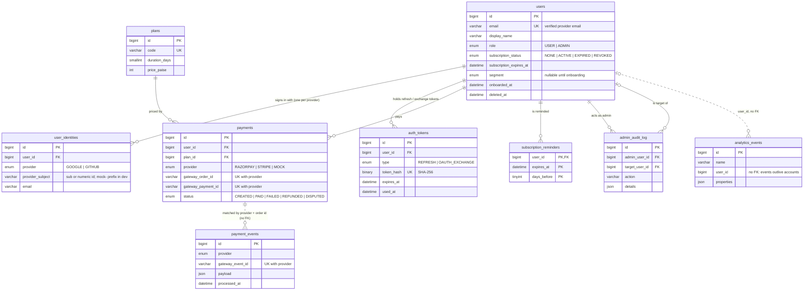

### 1.2 Practice, execution and mock tests

```mermaid
erDiagram
    problems ||--o{ test_cases : "has"
    problems ||--o{ problem_code_stubs : "starts from (per language)"
    problems ||--o| problem_editorials : "explained by"
    problem_editorials ||--o{ problem_editorial_code : "per language"
    problems ||--o{ problem_topics : "tagged"
    topics ||--o{ problem_topics : "groups"
    users ||--o{ user_problem_bookmarks : "bookmarks"
    problems ||--o{ user_problem_bookmarks : "is bookmarked"
    users ||--o{ submissions : "submits"
    problems ||--o{ submissions : "receives"
    mock_test_sessions |o--o{ submissions : "in-test attempts (FK id + user_id)"
    submissions ||--|{ submission_test_results : "fans out to one job per test"
    test_cases ||--o{ submission_test_results : "judged by"
    users ||--o{ user_problem_solves : "first solve (read model)"
    problems ||--o{ user_problem_solves : "solved"
    submissions |o--o| user_problem_solves : "first accepted SUBMIT"
    mock_tests ||--|{ mock_test_problems : "contains"
    problems ||--o{ mock_test_problems : "appears in"
    users ||--o{ mock_test_sessions : "takes"
    mock_tests ||--o{ mock_test_sessions : "instantiated as"

    users {
        bigint id PK
    }
    problems {
        bigint id PK
        varchar slug UK
        enum difficulty "EASY | MEDIUM | HARD"
        boolean is_premium_only
        enum status "DRAFT | PUBLISHED | ARCHIVED"
        smallint live_test_set "test set used by new attempts"
    }
    topics {
        bigint id PK
        varchar slug UK
    }
    problem_topics {
        bigint problem_id PK, FK
        bigint topic_id PK, FK
    }
    test_cases {
        bigint id PK
        bigint problem_id FK
        smallint test_set "UK with problem_id, display_order; frozen once live"
        boolean is_sample
        int display_order
        binary input_sha256
    }
    problem_code_stubs {
        bigint problem_id PK, FK
        enum language PK "c | cpp | java | python"
    }
    problem_editorials {
        bigint problem_id PK, FK
        text approach_markdown
    }
    problem_editorial_code {
        bigint problem_id PK, FK
        enum language PK
    }
    user_problem_bookmarks {
        bigint user_id PK, FK
        bigint problem_id PK, FK
    }
    submissions {
        bigint id PK
        bigint user_id FK
        bigint problem_id FK
        bigint test_session_id FK "nullable"
        varchar client_request_id "UK with user_id"
        enum mode "RUN | SUBMIT | VALIDATE"
        int time_limit_ms "base limits copied at creation"
        enum status "PENDING ... ACCEPTED ... JUDGING_ERROR"
    }
    submission_test_results {
        bigint id PK
        bigint submission_id FK
        bigint test_case_id FK
        enum status
        varchar judge0_token UK
        datetime next_dispatch_at "queue lease"
    }
    user_problem_solves {
        bigint user_id PK, FK
        bigint problem_id PK, FK
        bigint submission_id FK "SET NULL on purge"
        smallint points
        datetime first_accepted_at
    }
    mock_tests {
        bigint id PK
        smallint duration_minutes
        boolean is_premium_only
    }
    mock_test_problems {
        bigint mock_test_id PK, FK
        bigint problem_id PK, FK
        smallint display_order
    }
    mock_test_sessions {
        bigint id PK
        bigint user_id FK
        bigint mock_test_id FK
        datetime start_time
        datetime end_time "deadline, server-owned"
        enum status "IN_PROGRESS | COMPLETED"
        bigint active_user_id UK "generated: one live session per user"
    }
```

### 1.3 Learning modules: hubs, quizzes, design, companies, projects

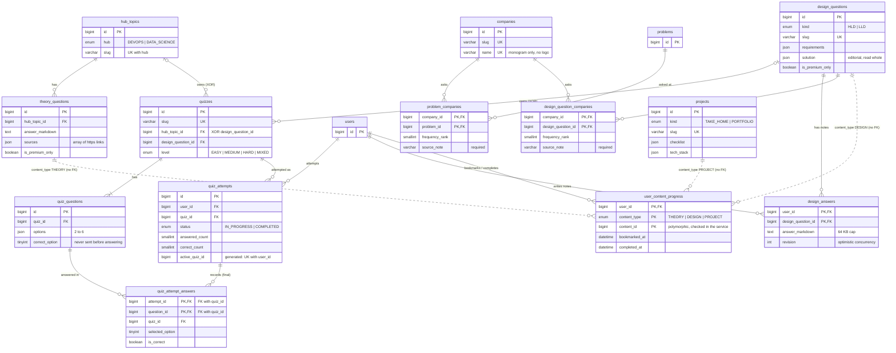

`quizzes` has exactly one owner, a hub topic **or** a design question (`chk_quizzes_owner`). `quiz_attempt_answers` carries `quiz_id` in both composite foreign keys, so the database itself refuses an answer to a question from another quiz. `user_content_progress` is the schema's one deliberate polymorphic reference (Backend_Schema §36).

### 1.4 Community

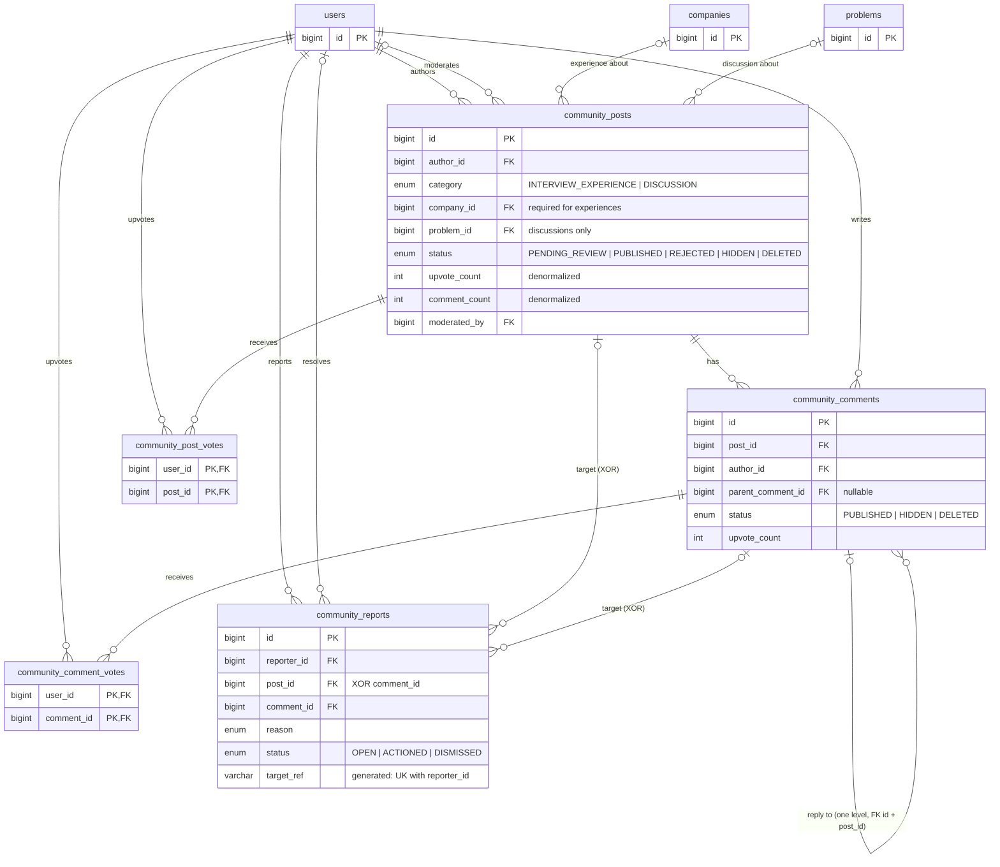

### 1.5 Many-to-many relationships

| M:N relationship | Junction table | Extra columns on the link |
|---|---|---|
| Problems ↔ Topics | `problem_topics` | — |
| Mock tests ↔ Problems | `mock_test_problems` | `display_order` |
| Companies ↔ Problems | `problem_companies` | `frequency_rank`, `source_note`, `reviewed_at` |
| Companies ↔ Design questions | `design_question_companies` | `frequency_rank`, `source_note`, `reviewed_at` |
| Users ↔ Problems (bookmarks) | `user_problem_bookmarks` | `created_at` |
| Users ↔ Problems (first solves) | `user_problem_solves` | `points`, `first_accepted_at`, `submission_id` |
| Users ↔ Design questions (notes) | `design_answers` | `answer_markdown`, `revision` |
| Users ↔ Posts / Comments (votes) | `community_post_votes`, `community_comment_votes` | `created_at` |
| Users ↔ Theory / Design / Projects (progress) | `user_content_progress` | `bookmarked_at`, `completed_at` (polymorphic, no FK to content) |
| Test cases ↔ Submissions (judging) | `submission_test_results` | verdict, time, memory, `judge0_token`, queue lease |
| Users ↔ Content revisions (editors) | `content_revision_editors` | `first_edited_at` |

### 1.6 Content operations and blog

The admin panel's workflow ([Admin_Panel_Strategy.md](Admin_Panel_Strategy.md); Backend_Schema §42–§45). A revision points at its live item with no foreign key (`content_type` + `content_id`), like `user_content_progress`; only `ContentPublisher` writes the live tables.

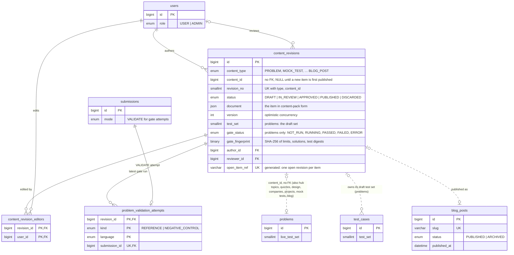

---

## 2. System Architecture

### 2.1 Components and trust zones

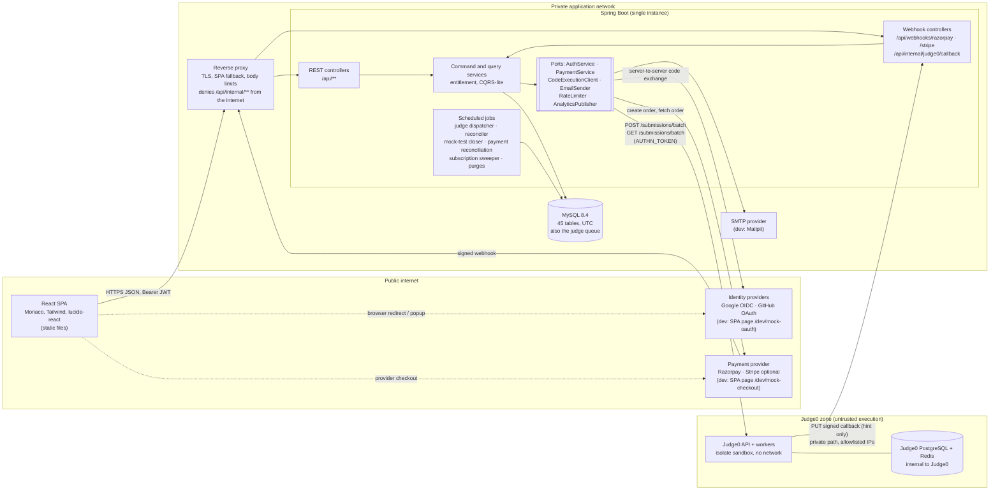

- The SPA talks only to the REST API. The only browser-to-third-party traffic is the provider sign-in page and the provider checkout.
- Judge0 is an untrusted boundary. It has no route to MySQL or the internet, and the backend never trusts a callback body: a callback only prompts an authenticated read (TRD §3, §5).
- MySQL is both the system of record and the judge queue: there is no message broker in the MVP (TRD §7).

### 2.2 Asynchronous judging (database as queue, callbacks as hints)

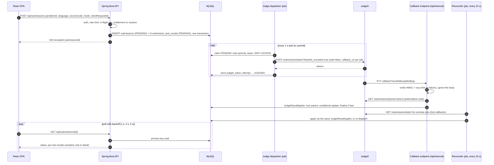

---

## 3. Application Flow

The main journey from sign-in through the dashboard and Workspace to a verdict. Hubs, design, companies, projects and community branch off the dashboard and are detailed in App_Flow §10–§14.

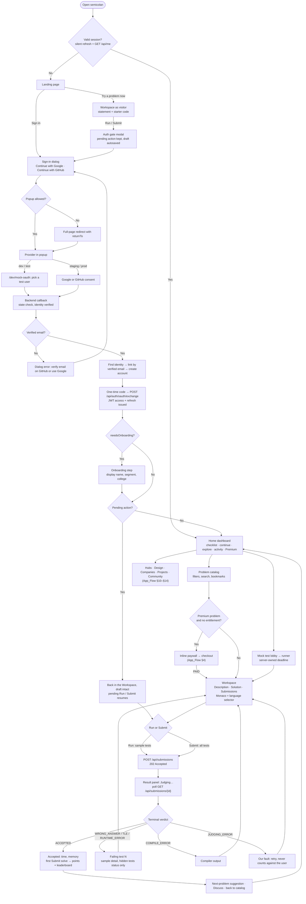

---

## 4. Class Diagram — Dependency Inversion for Authentication and Payments

The domain owns two ports, `AuthService` and `PaymentService`. Controllers and services depend only on those interfaces. Implementations are chosen by configuration (`semicolan.auth.mode`, `semicolan.payments.provider`), and the mock implementations exist only in the `dev` and `test` profiles.

**Naming**: the request called the real adapters `OAuth2ServiceImpl` and `RazorpayServiceImpl`. The specification splits OAuth into one adapter per provider, because Google (OpenID Connect, ID token) and GitHub (plain OAuth 2.0 plus REST calls) verify identity differently. The names follow TRD §2, which the plan's working agreement 6 makes binding:

| Requested name | Name in the spec |
|---|---|
| `OAuth2ServiceImpl` | `GoogleAuthServiceImpl` and `GitHubAuthServiceImpl` |
| `RazorpayServiceImpl` | `RazorpayPaymentServiceImpl` |

### 4.1 Authentication

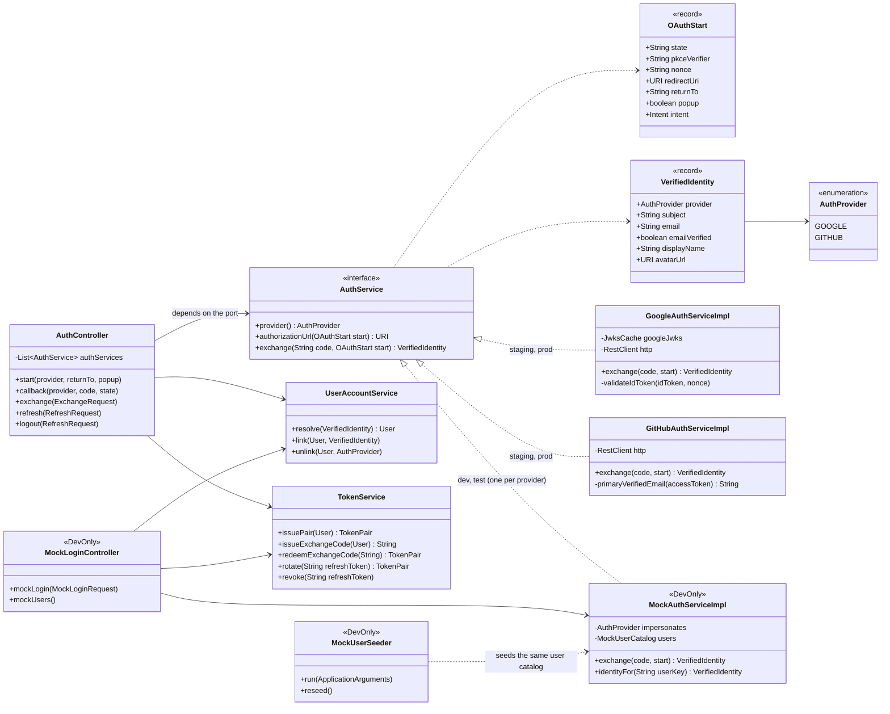

`TokenService` and `UserAccountService` are never mocked. A mock sign-in produces a real, signed JWT through the same code as production (Dev_to_Prod_Strategy §1.5).

### 4.2 Payments

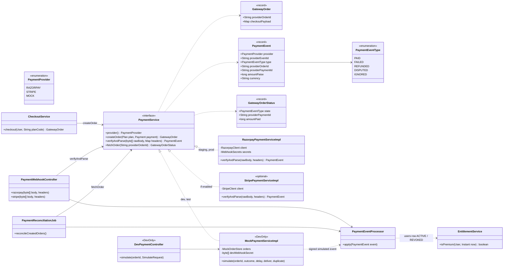

`PaymentEventProcessor` is the only writer of payment state and entitlement. It receives events that `verifyAndParse` has already verified, from the webhook, from reconciliation or from the mock simulator, and applies the same guarded transitions in every case.

### 4.3 Wiring and the production guard

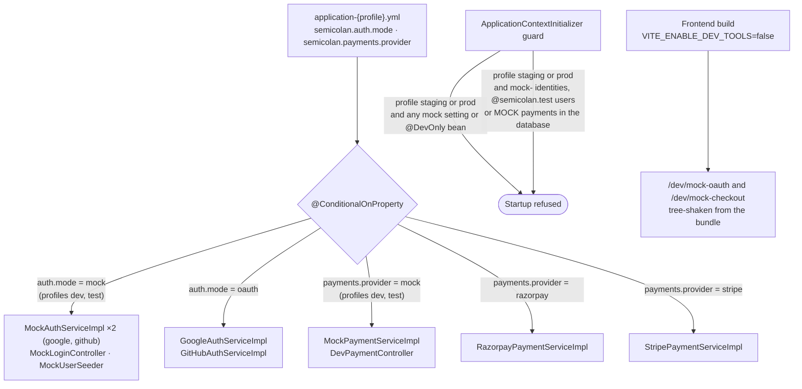
