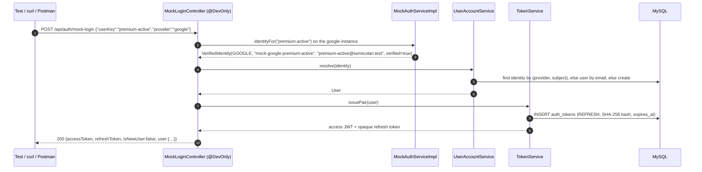
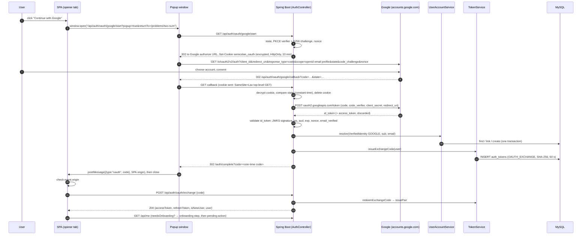
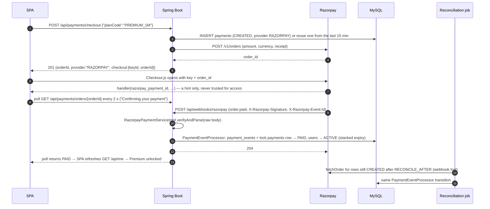

# Development to Production Strategy — Authentication and Payments

How Semicolan signs users in and takes payments in each environment, and how the system moves from mock providers in development to Google, GitHub and Razorpay in production without changing domain code.

This document explains and expands the normative specs; it does not override them. Endpoint shapes and error codes are in [API_Contract.md](API_Contract.md) §1, §4, §7 and §14; the design and the production guard are in [TRD.md](TRD.md) §2 and §5; tables are in [Backend_Schema.md](Backend_Schema.md); the schedule is [Implementation_Plan.md](Implementation_Plan.md) (Phases 1, 8 and 10). Diagrams of the classes involved are in [Architecture_Diagrams.md](Architecture_Diagrams.md) §4.

---

## 0. The principle: mock the edge, never the core

Each external integration is split into two parts:

- **The edge adapter** is the one class that talks to the provider: `AuthService` and `PaymentService` implementations. This is the only part that is mocked.
- **The core** is everything that decides who a user is, what they may access and what a payment means: `UserAccountService`, `TokenService`, the Spring Security filter chain, entitlement checks, `PaymentEventProcessor`, and the reconciliation job. The core is real in every environment, development included.

| Component | Local (`dev`) | CI (`test`) | Preview (`dev`, gated) | Staging (`staging`) | Production (`prod`) |
|---|---|---|---|---|---|
| `AuthService` | `MockAuthServiceImpl` ×2 | Mock | Mock | Google + GitHub, test apps | Google + GitHub, production apps |
| `PaymentService` | `MockPaymentServiceImpl` | Mock | Mock | Razorpay **test mode** | Razorpay **live mode** |
| `UserAccountService`, `TokenService`, JWT filter | Real | Real | Real | Real | Real |
| `PaymentEventProcessor`, reconciliation | Real | Real | Real | Real | Real |
| JWT signing key | Local dev key | Per-run test key | Preview key | Staging key | Production key (secret store) |
| Test users | `MockUserSeeder` | `MockUserSeeder.reseed()` | `MockUserSeeder` | Real Google test accounts, a GitHub test organization | Real users only |
| `/api/auth/mock-login`, `/api/dev/**`, `/dev/*` pages | Present | Present | Present | **404** | **404** |
| Who can reach it | The developer | CI runner | IP allowlist + basic auth | Public but unlisted | Public |

The consequence: any test that passes in development has exercised the same authorization rules, token rotation, entitlement checks and payment state machine that production runs. Phase 10 adds two adapters and changes configuration. It does not touch the core (Implementation_Plan working agreement 7, *Mock parity*).

---

## 1. Authentication in Development and Test

### 1.1 Configuration

```yaml
# application-dev.yml (also the base for application-test.yml)
semicolan:
  auth:
    mode: mock                     # SEMICOLAN_AUTH_MODE
    issuer: ${APP_PUBLIC_BASE_URL}  # per-environment iss, e.g. http://localhost:8080
    audience: semicolan-spa
  jwt:
    signing-key: ${JWT_SIGNING_KEY}   # dev value from .env; never reused in another environment
    key-id: dev-local
```

With `semicolan.auth.mode=mock` and the `dev` or `test` profile, Spring registers:

| Bean | Annotation | Role |
|---|---|---|
| `MockAuthServiceImpl` (google) and `MockAuthServiceImpl` (github) | `@DevOnly`, `@ConditionalOnProperty(auth.mode=mock)` | Stand in for the two providers: one instance per sign-in button |
| `MockLoginController` | `@DevOnly` | `POST /api/auth/mock-login`, `GET /api/dev/mock-users` |
| `MockUserSeeder` | `@DevOnly`, `ApplicationRunner` | Upserts the test users into MySQL at startup |

`@DevOnly` is a meta-annotation:

```java
@Target({ElementType.TYPE, ElementType.METHOD})
@Retention(RetentionPolicy.RUNTIME)
@Profile({"dev", "test"})
public @interface DevOnly {}
```

Outside `dev` and `test` these beans are never registered, so their routes return `404`, not `403`: a production server does not even admit they exist. §1.7 covers what happens if someone misconfigures that.

### 1.2 The test users

Seven fixed keys, the same everywhere in the docs (TRD §2, API_Contract §1 and §14, App_Flow §15):

| `userKey` | Email | Display name | State in MySQL | Seeded? | Exercises |
|---|---|---|---|---|---|
| `free` | `free@semicolan.test` | Free Student | `role USER`, `subscription_status NONE` | Yes | Free paths, paywalls, the buyer in payment tests |
| `premium-active` | `premium-active@semicolan.test` | Premium Active | `ACTIVE`, expires **now + 30 days** | Yes | Premium content, editorials, all mock tests |
| `premium-expired` | `premium-expired@semicolan.test` | Premium Expired | `EXPIRED`, expired **now − 1 day** | Yes | Renewal prompt, locked content with readable history |
| `revoked` | `revoked@semicolan.test` | Revoked | `REVOKED` (refunded mid-term) | Yes | Immediate loss of access after refund or dispute |
| `admin` | `admin@semicolan.test` | Admin | `role ADMIN`, no plan | Yes | Moderation queue, grant/revoke, admin-only routes |
| `new-user` | `new-user@semicolan.test` | New User | No row until the first sign-in | No | Account creation and the onboarding step |
| `github-unverified` | `github-unverified@semicolan.test` | GitHub Unverified | Never gets a row | No | The `OAUTH_EMAIL_NOT_VERIFIED` error path |

The `.test` top-level domain is reserved (RFC 6761), so these addresses can never belong to a real person. That makes "any `@semicolan.test` user exists" a reliable production alarm (§1.7).

Besides the seven fixed keys, `mock-login` accepts **ephemeral** keys `e2e-…` with a `template` (one of the first five rows, or `new-user`): the first call creates `<key>@semicolan.test` in that template's state, onboarded and 30 days old unless the template is `new-user`, and later calls sign it in again (API_Contract §1). Parallel E2E specs use them so they never share a user's rate limits, free mock-test attempt or purchases, and four-eyes tests of the admin panel use one with the `admin` template as the second admin ([Agent_Testing_Environment.md](Agent_Testing_Environment.md) §7.4, §7.12). They are not seeded or reseeded, are not listed by `GET /api/dev/mock-users`, and trip the same `mock-` and `@semicolan.test` production checks as every other mock row.

### 1.3 How the test users get into MySQL

Test users are **not** inserted by a Flyway migration. A migration runs once, so `premium-active`'s expiry would be fixed at the date it first ran, and a month later "premium-active" would quietly be expired. Instead `MockUserSeeder`, an `@DevOnly` `ApplicationRunner`, upserts them on every `dev` startup with dates computed from the injected `Clock`. (Flyway's `db/seed-dev` location, enabled only for `dev` and `test`, is for static development data; content packs come from the loaders, Implementation_Plan 5.1.)

Each seeded user is two rows, a `users` row and its Google mock identity, written in one transaction. The SQL equivalent of what the seeder does for `premium-active`:

```sql
-- :now comes from the application Clock (UTC); never NOW() (Backend_Schema R1–R5)
INSERT INTO users (email, display_name, segment, role,
                   subscription_status, subscription_expires_at,
                   email_verified_at, onboarded_at, created_at)
VALUES ('premium-active@semicolan.test', 'Premium Active', 'STUDENT', 'USER',
        'ACTIVE', :now + INTERVAL 30 DAY,
        :now, :now, :now) AS seed
ON DUPLICATE KEY UPDATE                       -- uq_users_email
    display_name            = seed.display_name,
    role                    = seed.role,
    subscription_status     = seed.subscription_status,
    subscription_expires_at = seed.subscription_expires_at,
    deletion_requested_at   = NULL;

INSERT INTO user_identities (user_id, provider, provider_subject, email, linked_at, last_login_at)
SELECT id, 'GOOGLE', 'mock-google-premium-active', email, :now, :now
  FROM users WHERE email = 'premium-active@semicolan.test'
ON DUPLICATE KEY UPDATE provider_subject = provider_subject;   -- already seeded: no-op
```

- **Idempotent**: running it twice changes nothing but the relative dates (Implementation_Plan 1.1 acceptance criterion).
- **Relative dates** keep every state true whatever the calendar says. The cost, which is intended, is that a restart resets the five seeded users' plans: buy Premium as `free`, restart, and `free` is free again. Payment tests that need a durable result use `new-user`, or call the simulator again.
- **Only the Google identity is seeded.** A first sign-in through the mock *GitHub* button therefore exercises link-by-verified-email, exactly as a real user adding GitHub would.
- **`new-user` is never seeded.** Its first sign-in walks the real creation path in `UserAccountService` (§2.4) and gets `needsOnboarding: true`.
- **Tests reseed.** Integration suites call `MockUserSeeder.reseed()` (wrapped by `AbstractIntegrationTest`, Agent_Testing_Environment §4.3) in setup; the E2E global set-up calls the same method through `POST /api/dev/mock-users/reseed` (API_Contract §14) once per run. Reseeding restores the table above and also deletes the seeded users' refresh tokens and any extra mock identities that earlier tests linked. Tests that move the `Clock` reseed after moving it.

### 1.4 Flow A — `POST /api/auth/mock-login` (scripts, Postman, E2E)

A one-call sign-in that skips the browser dance but not the core.



```bash
# Sign in as premium-active and call a protected route
TOKEN=$(curl -s -X POST http://localhost:8080/api/auth/mock-login \
          -H 'Content-Type: application/json' \
          -d '{"userKey":"premium-active"}' | jq -r .accessToken)
curl -s http://localhost:8080/api/me -H "Authorization: Bearer $TOKEN" | jq .entitlement
# {"plan":"PREMIUM","status":"ACTIVE","expiresAt":"2026-12-05T09:00:00.000Z"}

# Test linking: sign in as free through the mock GitHub identity
curl -s -X POST http://localhost:8080/api/auth/mock-login \
     -H 'Content-Type: application/json' -d '{"userKey":"free","provider":"github"}' | jq .user.id
# Same user id as the Google sign-in: the GitHub mock identity was linked by verified email
```

| Input | Result |
|---|---|
| A seeded key | `200`, the seeded user |
| `new-user` (first time) | `200`, `isNewUser: true`, `needsOnboarding: true`; finish with `PATCH /api/me` |
| `github-unverified` | `403 OAUTH_EMAIL_NOT_VERIFIED`; no row is written |
| An unknown key | `404 TEST_USER_NOT_FOUND` |
| Any request in `staging` or `prod` | `404`: the route does not exist |

The endpoint is not rate-limited (API_Contract §14), because E2E suites call it constantly; it exists only where rate limits protect nothing real.

**Playwright** signs in once per role in global setup and saves the browser state, so individual tests start already signed in:

```ts
// e2e/global-setup.ts
for (const userKey of ['free', 'premium-active', 'premium-expired', 'admin']) {
  const res = await request.post(`${API}/api/auth/mock-login`, { data: { userKey } });
  const { accessToken, refreshToken } = await res.json();
  // Write the tokens where the SPA's API client keeps them (TRD §1), then save storageState
  await saveStorageState(`e2e/.auth/${userKey}.json`, { accessToken, refreshToken });
}
```

These saved states are for specs that change nothing; any spec that runs code, pays, posts or edits content signs in as its own ephemeral user through the `signIn(template)` fixture (Agent_Testing_Environment §7.4). E2E tests of the sign-in screens themselves (Implementation_Plan 1.2) use Flow B instead, through the real buttons.

### 1.5 Flow B — the real OAuth endpoints against the mock provider (UI)

The sign-in dialog renders the same **Continue with Google** and **Continue with GitHub** buttons in every environment. In mock mode the "provider" is an SPA page, but the backend runs the *production* OAuth endpoints: start, `state` cookie, callback, one-time exchange code.

1. The user clicks **Continue with Google**. The SPA opens a popup on `GET /api/auth/oauth/google/start?popup=true&returnTo=/problems/two-sum`.
2. The backend generates `state`, a PKCE verifier and a nonce, stores them with `returnTo`, `popup` and the intent in the encrypted `semicolan_oauth` cookie, and asks the google `MockAuthServiceImpl` for `authorizationUrl(start)`. The mock returns `/dev/mock-oauth?provider=google&state=<state>` instead of `accounts.google.com`. The backend responds `302` there.
3. The mock page lists `GET /api/dev/mock-users`. The user picks **Free Student**.
4. The page navigates to `GET /api/auth/oauth/google/callback?code=mock:free&state=<state>`, the same callback a real provider uses.
5. The callback validates `state` against the cookie: a missing, expired or mismatched value gives `OAUTH_STATE_INVALID`, so development tests the CSRF defence too. It then calls `exchange("mock:free", start)`, which returns the fixed `VerifiedIdentity` for `free` on Google.
6. `UserAccountService.resolve` and `TokenService.issueExchangeCode` run as in production (§2.4–§2.5). The backend responds `302 /auth/complete?code=<one-time code>`.
7. `/auth/complete` posts the code to the opener (origin-checked); the opener calls `POST /api/auth/oauth/exchange` and receives the token pair. Onboarding, the pending-action resume and linking all run exactly as in production.

### 1.6 How the development JWTs are minted

They are not "dummy" tokens. `TokenService` mints them with the same code, claims and validation as production. Only the key and the issuer differ, and both are per environment.

**Access token** (stateless JWT, default lifetime 15 minutes, `ACCESS_TOKEN_TTL`):

```json
// header
{"alg": "HS256", "typ": "JWT", "kid": "dev-local"}
// payload
{"iss": "http://localhost:8080", "aud": "semicolan-spa", "sub": "3", "role": "USER",
 "iat": 1793869200, "exp": 1793870100}
```

- **Claims**: only `iss`, `aud`, `sub` (user ID), `role` (`USER` or `ADMIN`), `iat` and `exp`. There is no email, plan or entitlement in the token. Premium is checked against the `users` row on every gated request (TRD §2), so a refund takes effect immediately and no token goes stale.
- **Algorithm**: pinned, never negotiated, and `none` is rejected. HS256 with a 256-bit key is the MVP default, because the same service signs and verifies. Move to RS256 or ES256 only when another service has to verify tokens without holding the signing key.
- **Validation** (Spring Security resource server): signature with the key named by `kid`; `iss` and `aud` must equal this environment's values; `exp` with at most 30 seconds of clock skew.
- **Why a development token can never work in production**: production has a different signing key, a different `kid` and a different `iss`, so the token fails three independent checks. Development keys live in `.env` and in CI secrets; the production key exists only in the secret store.

**Refresh token** (opaque, single-use, rotated):

```text
raw    = base64url(32 bytes from SecureRandom)          -- sent to the client once
stored = SHA-256(raw) in auth_tokens.token_hash, type REFRESH, expires_at = now + REFRESH_TOKEN_TTL
```

Refresh marks the presented row `used_at` and issues a new pair. Presenting a consumed token inside the 10-second `REFRESH_REUSE_LEEWAY` returns a fresh pair (two tabs, or a lost response); outside it, the reuse is treated as theft and revokes all of that user's refresh tokens (TRD §2). The **one-time exchange code** of Flow B uses the same table with type `OAUTH_EXCHANGE` and a 60-second lifetime, redeemed with a conditional update so it works exactly once:

```sql
UPDATE auth_tokens
   SET used_at = :now
 WHERE token_hash = :sha256 AND type = 'OAUTH_EXCHANGE'
   AND used_at IS NULL AND expires_at > :now;     -- 1 row: redeem; 0 rows: 422 INVALID_OR_EXPIRED_TOKEN
```

### 1.7 Safety rails: keeping mocks out of production

Five independent layers. Any one of them is enough to stop a mock reaching real users.

| # | Layer | Fails when | Where |
|---|---|---|---|
| 1 | `@DevOnly` = `@Profile({"dev","test"})` | — (beans simply aren't registered) | Every mock class |
| 2 | Startup guard (`ApplicationContextInitializer`) | Profile `staging` or `prod` **and** any of: `auth.mode=mock`, `payments.provider=mock`, `execution.client=fake` (the in-process fake Judge0 of Agent_Testing_Environment §5.2), any `@DevOnly` bean present (this catches `SPRING_PROFILES_ACTIVE=prod,dev`) | TRD §2 |
| 3 | Startup data check | `staging`/`prod` database contains a `mock-` identity subject, an `@semicolan.test` user (fixed or ephemeral `e2e-…`), or a `MOCK` payment | TRD §2 |
| 4 | Frontend build flag | `VITE_ENABLE_DEV_TOOLS=false` statically removes `/dev/mock-oauth`, `/dev/mock-checkout`, the component gallery `/dev/gallery` and the E2E editor hook `window.__semicolan_e2e__` from the bundle | Implementation_Plan 1.2, 3.4 |
| 5 | CI guard job | Starts the production image with `prod` against a throwaway database: startup must fail with a mock setting; with the real settings every development route must be `404`; the bundle must contain no `/dev/` route and no `__semicolan_e2e__` | TRD §5, Implementation_Plan 10.4 |

Sketch of layer 2:

```java
public final class MockIntegrationGuard
        implements ApplicationContextInitializer<ConfigurableApplicationContext> {
    @Override
    public void initialize(ConfigurableApplicationContext ctx) {
        ConfigurableEnvironment env = ctx.getEnvironment();
        if (!env.acceptsProfiles(Profiles.of("staging | prod"))) return;
        if ("mock".equals(env.getProperty("semicolan.auth.mode"))
                || "mock".equals(env.getProperty("semicolan.payments.provider"))
                || "fake".equals(env.getProperty("semicolan.execution.client"))) {
            throw new IllegalStateException("Mock auth/payments and the fake executor are forbidden under staging/prod");
        }
        ctx.addBeanFactoryPostProcessor(bf -> {
            if (bf.getBeanNamesForAnnotation(DevOnly.class).length > 0) {
                throw new IllegalStateException("@DevOnly beans present under staging/prod");
            }
        });
    }
}
```

Layer 3, run once at startup under `staging` and `prod`:

```sql
SELECT (SELECT COUNT(*) FROM user_identities WHERE provider_subject LIKE 'mock-%')
     + (SELECT COUNT(*) FROM users           WHERE email LIKE '%@semicolan.test')
     + (SELECT COUNT(*) FROM payments        WHERE provider = 'MOCK') AS mock_rows;
-- any value > 0 → refuse to start
```

The **preview** environment is the deliberate exception: it runs the `dev` profile on a server, so anyone who reaches it can sign in as `admin`. It is therefore never public. Every request needs the IP allowlist and basic auth at the proxy, and preview has its own database and signing key (Implementation_Plan, Environments).

---

## 2. Authentication in Production — Google and GitHub OAuth

### 2.1 What changes, and what doesn't

| Changes in Phase 10 | Does not change |
|---|---|
| New classes `GoogleAuthServiceImpl`, `GitHubAuthServiceImpl` | `AuthController` and its four endpoints |
| `SEMICOLAN_AUTH_MODE=oauth` | `UserAccountService` (find, link, create) |
| `GOOGLE_CLIENT_ID/SECRET`, `GITHUB_CLIENT_ID/SECRET`, `OAUTH_REDIRECT_ALLOWLIST` | `TokenService`, JWT claims, refresh rotation |
| Registered redirect URIs at each provider | The schema (`user_identities` already has `GOOGLE`, `GITHUB`) |
| The production frontend build (`VITE_ENABLE_DEV_TOOLS=false`) | The sign-in dialog, `/auth/complete`, onboarding and linking UI |

Implementation_Plan 10.2 makes this a reviewed claim: the diff between the last preview build and the OAuth milestone may touch only the two adapters and configuration.

### 2.2 Provider setup (workstream B, long lead time)

**Google** (Google Cloud Console → APIs & Services):
- An OAuth client of type *Web application* for each environment, so staging and production have separate clients and secrets.
- Authorized redirect URIs, exact match: `https://staging.<domain>/api/auth/oauth/google/callback` and `https://<domain>/api/auth/oauth/google/callback`.
- OAuth consent screen: app name, support email, privacy and terms URLs, authorized domain. Scopes `openid email profile` only; all three are non-sensitive, so no sensitive-scope review is needed. The app must be **published**: in "Testing" status only listed test users can sign in. Adding a logo to the consent screen triggers Google's brand verification, which can take days, so do it early.

**GitHub** (Settings → Developer settings → OAuth Apps):
- **One OAuth app per environment.** An OAuth app has a single callback URL, so staging and production cannot share one.
- Callback URL: `https://<domain>/api/auth/oauth/github/callback`.
- Scopes requested at runtime: `read:user user:email`.

### 2.3 The exact flow, click to JWT



Step by step, with the details that matter:

1. **Click → popup.** `window.open` is called synchronously inside the click handler; anything asynchronous first, even one `await`, gets the popup blocked. If `window.open` returns `null`, the SPA falls back to a full-page navigation to the same `start` URL without `popup=true`. The draft is already autosaved, and the pending action is in `sessionStorage`.
2. **`start`.** `GoogleAuthServiceImpl.authorizationUrl(start)` builds the authorize URL from Google's discovery document (`https://accounts.google.com/.well-known/openid-configuration`, cached): `response_type=code`, `scope=openid email profile`, `state`, `code_challenge=BASE64URL(SHA256(verifier))` with `code_challenge_method=S256`, `nonce`, the exact `redirect_uri` from the allowlist, and `prompt=select_account` so a lab-machine user can pick the right account. `returnTo` is accepted only as a same-origin relative path, so it is not an open redirect.
3. **The `semicolan_oauth` cookie** holds `state`, the PKCE verifier, the nonce, `returnTo`, `popup` and the intent (`signin` or `link`), signed and encrypted with `OAUTH_STATE_COOKIE_KEY`: `HttpOnly; Secure; SameSite=Lax; Path=/api/auth/oauth/; Max-Age=600`. `Lax` is right here, because the provider's redirect back is a top-level `GET`, which carries `Lax` cookies.
4. **Consent at Google.** Nothing of ours runs here.
5. **Callback.** The cookie is decrypted and `state` compared in constant time; the cookie is cleared whatever happens. An error parameter from Google (`access_denied`) becomes `OAUTH_CANCELLED`.
6. **Code exchange (server to server).** `POST https://oauth2.googleapis.com/token` with `code`, `code_verifier`, `client_id`, `client_secret`, `redirect_uri`, `grant_type=authorization_code`. The response's ID token is validated: signature against Google's JWKS (cached, refreshed on an unknown `kid`); `iss` ∈ {`https://accounts.google.com`, `accounts.google.com`}; `aud` = our client ID; `exp` in the future; `nonce` = the cookie's nonce; `email_verified = true`, otherwise `OAUTH_EMAIL_NOT_VERIFIED`. The Google access token is discarded; we never call Google again for this user.
7. **`VerifiedIdentity`**: `provider = GOOGLE`, `subject = sub` (stable; never the email), `email`, `displayName = name`, `avatarUrl = picture`.
8. **Account resolution**: §2.4.
9. **One-time exchange code**: 32 random bytes, stored as a SHA-256 hash with a 60-second lifetime (§1.6). The redirect carries this code, never our tokens, so no JWT ever appears in a URL, browser history, a proxy log or a `Referer` header.
10. **`/auth/complete`** (an SPA route): in a popup, it posts `{type: "oauth", code}` to `window.opener` with the SPA origin as `targetOrigin`, then closes. Without an opener it exchanges the code itself and navigates to `returnTo`. Errors arrive as `?error=CODE` and are shown in the dialog (App_Flow §1).
11. **Exchange**: the opener verifies `event.origin === location.origin`, then `POST /api/auth/oauth/exchange`. The response holds the JWT pair and the user (`isNewUser`, `needsOnboarding`).
12. **After sign-in**: the API client stores the tokens (TRD §1), `GET /api/me` drives the UI, onboarding runs if needed (`PATCH /api/me`), and the pending action resumes.

**GitHub differs only inside `GitHubAuthServiceImpl`:**

| Step | GitHub |
|---|---|
| Authorize | `https://github.com/login/oauth/authorize?client_id&redirect_uri&scope=read:user user:email&state` plus `code_challenge` (S256) — GitHub's PKCE support for OAuth apps should be confirmed against current docs in 10.2; `state` is mandatory regardless |
| Token | `POST https://github.com/login/oauth/access_token` with `Accept: application/json` (otherwise the response is form-encoded) |
| Identity | No ID token (GitHub is OAuth 2.0, not OpenID Connect): `GET https://api.github.com/user` (numeric `id`, `login`, `name`, `avatar_url`) and `GET https://api.github.com/user/emails` |
| Email | The entry with `primary: true` **and** `verified: true`; none → `OAUTH_EMAIL_NOT_VERIFIED` |
| Subject | The numeric `id`, never `login`, which users can rename |
| Token handling | The GitHub access token is used for these two calls and discarded; it is never stored |

### 2.4 User creation and lookup (`UserAccountService.resolve`)

Identical for mock, Google and GitHub identities, in one transaction:

```java
@Transactional
public ResolvedUser resolve(VerifiedIdentity id, Intent intent, Optional<User> signedIn) {
    if (!id.emailVerified()) throw new OAuthException(EMAIL_NOT_VERIFIED);

    // 1. Known identity → that account (subject is stable; email may have changed)
    Optional<UserIdentity> known = identities.findByProviderAndSubject(id.provider(), id.subject());
    if (known.isPresent()) {
        if (intent == LINK && !known.get().userId().equals(signedIn.get().id()))
            throw new OAuthException(IDENTITY_IN_USE);
        known.get().touch(id.email(), clock.instant());          // last_login_at, informational email
        return ResolvedUser.existing(known.get().user());
    }

    // 2. Linking from Settings → attach to the signed-in user
    if (intent == LINK) return ResolvedUser.existing(attach(signedIn.get(), id));

    // 3. Same verified email as an existing account → link (both sides verified, TRD §5)
    Optional<User> byEmail = users.findActiveByEmail(id.email());
    if (byEmail.isPresent()) {
        if (identities.existsByUserAndProvider(byEmail.get(), id.provider()))
            throw new OAuthException(IDENTITY_CONFLICT);           // a different account of that provider is linked
        return ResolvedUser.existing(attach(byEmail.get(), id));
    }

    // 4. New account: role USER, no plan, onboarding pending
    User user = users.insert(User.newFrom(id, clock.instant()));   // segment NULL → needsOnboarding
    attach(user, id);
    return ResolvedUser.created(user);
}
```

- **Concurrency**: two simultaneous first sign-ins (a double-click, or two tabs) race on `uq_user_identities_subject` and `uq_users_email`. The loser gets a duplicate-key error, rolls back, and retries `resolve` once, now finding the winner's rows. The database constraints are the arbiter; there is no application lock.
- **Profile prefill**: `display_name` is the provider's name (GitHub: `name`, falling back to `login`), trimmed to 50 characters; `avatar_url` is stored only if it is an `https` URL of at most 500 characters. The user confirms both during onboarding.
- **Deleted accounts**: erasure deletes the user's identities and rewrites the email (Backend_Schema rules), so a returning person starts a fresh account.
- **Events**: `signup` on creation, `login` with the provider on every sign-in (PRD OPS-5).

### 2.5 JWT issuance to the frontend

The exchange endpoint returns:

```json
{"accessToken": "eyJhbGciOiJIUzI1NiIsImtpZCI6InByb2QtMjAyNi0xMSJ9…",
 "refreshToken": "kq3…(43 chars)",
 "isNewUser": false,
 "user": {"id": 42, "email": "asha@example.com", "displayName": "Asha K",
          "avatarUrl": "https://lh3.googleusercontent.com/…", "role": "USER", "needsOnboarding": false}}
```

Production differs from development only in the key (`kid` names the production key from the secret store) and in `iss`. From here the shared API client (TRD §1) owns the session: it sends `Authorization: Bearer`, refreshes proactively at about 75% of the token's lifetime, uses single-flight refresh across tabs, and opens the sign-in dialog only on `401 INVALID_REFRESH_TOKEN`. **Signing-key rotation**: add the new key with a new `kid`, sign with it, keep verifying the old `kid` for one access-token lifetime, then remove it. Nobody is logged out, because refresh tokens are opaque and unaffected.

### 2.6 Failure handling

| What happens | Code | User sees (App_Flow §1) |
|---|---|---|
| Cookie missing, expired (> 10 min on the consent screen) or `state` mismatch | `OAUTH_STATE_INVALID` | "That sign-in link expired — try again" |
| User cancels at the provider | `OAUTH_CANCELLED` | "Sign-in cancelled", neutral |
| Google `email_verified=false`, or GitHub with no primary verified email | `OAUTH_EMAIL_NOT_VERIFIED` | Add and verify an email, or use the other provider |
| ID token fails any check, token endpoint error, timeout | `OAUTH_PROVIDER_ERROR` | "Google isn't responding…", other provider offered |
| Linking an identity owned by another account | `IDENTITY_IN_USE` | Banner on Settings → Accounts |
| Email matches an account already linked to a different account of that provider | `IDENTITY_CONFLICT` | Sign in with the linked account, then relink |
| Exchange code reused or older than 60 s | `422 INVALID_OR_EXPIRED_TOKEN` | Dialog restarts sign-in |
| Too many starts or exchanges from one IP | `429` + `Retry-After` | Countdown |

### 2.7 Browser details that break OAuth popups

- **Cross-Origin-Opener-Policy.** Serving the SPA with `Cross-Origin-Opener-Policy: same-origin` severs `window.opener` once the popup navigates to Google, and the code can never be posted back. Use `same-origin-allow-popups` at most on the SPA shell, and serve `/auth/complete` without a restrictive COOP. As a second line, `/auth/complete` with `popup=true` but no opener exchanges the code itself, stores the tokens and announces the sign-in on the `BroadcastChannel` the tabs already share (TRD §1), so the original tab picks up the session. Verify in Chrome, Firefox and Safari during 10.2.
- **Content-Security-Policy.** Avatars are remote images, so add `img-src https://lh3.googleusercontent.com https://avatars.githubusercontent.com`. No provider script is loaded for sign-in.
- **Third-party cookies** are not involved: the `state` cookie is first-party on our API origin, so browsers that block third-party cookies do not affect this flow.

### 2.8 Cut-over sequence (Implementation_Plan Phase 10)

1. **Staging (10.1)**: deploy the same image with `staging`, `SEMICOLAN_AUTH_MODE=oauth` and staging client IDs and secrets. Confirm the guard: startup refuses `mock`, and `/api/auth/mock-login` returns `404`.
2. **Adapters (10.2)**: contract tests against recorded fixtures run in CI on every PR, with WireMock playing Google (JWKS, token responses, forged ID tokens with the wrong signature, `aud`, expiry or nonce) and GitHub (user, emails, unverified cases). The Phase 1 acceptance criteria are rerun with the real adapters in front of WireMock.
3. **Staging drills (L5)**: real sign-in with Google and GitHub via popup and redirect; GitHub with the same email links to the Google account; link and unlink from Settings.
4. **Production (10.4–10.5)**: promote the **same image** with production config and production OAuth apps. Do one real sign-in with each provider, and check the security review (state, PKCE, redirect allowlist, `returnTo`, `postMessage` origin, no tokens in URLs or logs).

---

## 3. Payment Integration and Testing

### 3.1 Provider plan

| Provider | Role | Notes |
|---|---|---|
| **Razorpay** | Primary, production | INR with UPI, cards, netbanking and wallets; Orders API, Checkout.js, signed webhooks. KYC and live activation take time (workstream A) |
| **Stripe** | Optional adapter, disabled by default | Only if international cards are needed. Confirm first that an Indian merchant account can be opened (workstream A); otherwise the adapter stays contract-tested and switched off |
| **Mock** | Development, CI, preview | `MockPaymentServiceImpl` and the `/dev/mock-checkout` page |

### 3.2 The `PaymentService` seam

```java
public interface PaymentService {
    PaymentProvider provider();                                          // RAZORPAY, STRIPE or MOCK
    GatewayOrder createOrder(Plan plan, Payment payment);                // provider order + checkout payload
    PaymentEvent verifyAndParse(byte[] rawBody, Map<String, String> headers); // signature first, then parse
    GatewayOrderStatus fetchOrder(String providerOrderId);               // reconciliation
}
```

| Method | Razorpay | Stripe (optional) | Mock |
|---|---|---|---|
| `createOrder` | `POST /v1/orders` `{amount: paise, currency: "INR", receipt: <payments.id>}` with key ID and secret; payload `{keyId, orderId}` | Create a Checkout Session (`mode=payment`, INR line item, `client_reference_id`, success and cancel URLs with our `orderId`); payload `{sessionUrl}` | `mock_order_<uuid>`; payload `{mockCheckoutUrl: "/dev/mock-checkout?orderId=…"}` |
| `verifyAndParse` | `X-Razorpay-Signature` = hex HMAC-SHA256 of the **raw body** with the webhook secret; event ID from `X-Razorpay-Event-Id` | `Stripe-Signature: t=…,v1=…`, HMAC-SHA256 of `"{t}.{raw body}"` with the endpoint secret, timestamp within 5 minutes; event ID from `id` | HMAC with `MOCK_PAYMENT_WEBHOOK_SECRET`, same shape as Razorpay |
| Event mapping | `order.paid` → PAID · `payment.failed` → FAILED · `refund.processed` (full) → REFUNDED · `payment.dispute.created` → DISPUTED | `checkout.session.completed` with `payment_status=paid`, or `checkout.session.async_payment_succeeded` → PAID · `…async_payment_failed` → FAILED · `charge.refunded` (full) → REFUNDED · `charge.dispute.created` → DISPUTED | The simulator's outcome |
| `fetchOrder` | `GET /v1/orders/{id}` (+ its payments) | Retrieve the Checkout Session | The simulated state |

Everything after `verifyAndParse` is provider-neutral. `PaymentEventProcessor` stores the event under `(provider, gateway_event_id)` for idempotency, locks the `payments` row, checks that order ID, amount and currency match our row, takes the user from our row (never from webhook metadata), applies the guarded transition, and stacks the Premium expiry (API_Contract §4).

### 3.3 End-to-end purchase (production, Razorpay)



The SPA switches on `provider` in the checkout response and nothing else. The one provider-specific piece of frontend code is a small checkout launcher per provider: load `checkout.razorpay.com/v1/checkout.js` and open it, redirect to the Stripe `sessionUrl`, or navigate to the mock page. The production CSP must allow Razorpay's checkout script and frame hosts.

### 3.4 Testing webhooks: from unit test to live

| Level | Where | How | What it proves |
|---|---|---|---|
| **L1 Mock simulator** | Local, CI, preview | `MockPaymentServiceImpl` + `POST /api/dev/payments/{orderId}/simulate` | The whole state machine with no network: paid, failed, refund, dispute, delayed (`delaySeconds`), lost (`deliver:false` → reconciliation), duplicate (`duplicate:true`) |
| **L2 Recorded fixtures** | CI, every PR | Real Razorpay (and Stripe) webhook bodies recorded once in 10.3, re-signed in the test with a test secret, posted to `/api/webhooks/razorpay` | The real adapter's signature check and event mapping; the same `PaymentEvent` expectations as the mock (contract tests) |
| **L4 Tunnel to a laptop** | Local, Phase 10 debugging | Provider test mode → public tunnel → local backend with `payments.provider=razorpay` | Real provider signatures, real event order and timing |
| **L5 Staging** | Staging | Provider test-mode webhooks registered to the staging URL | The Phase 10 drills, end to end |

**L1: the simulator** (development default):

```bash
# As free: create an order, then simulate a payment whose webhook arrives after 5 s
ORDER=$(curl -s -X POST localhost:8080/api/payments/checkout -H "Authorization: Bearer $TOKEN" \
          -H 'Content-Type: application/json' -d '{"planCode":"PREMIUM_1M"}' | jq -r .orderId)
curl -s -X POST localhost:8080/api/dev/payments/$ORDER/simulate -H "Authorization: Bearer $TOKEN" \
     -H 'Content-Type: application/json' -d '{"outcome":"PAID","delaySeconds":5}'
# Lost webhook: {"outcome":"PAID","deliver":false}  → recovered by the reconciliation job
# Redelivery:   {"outcome":"PAID","duplicate":true} → one payment_events row, one term granted
```

The simulator builds a provider-shaped event, signs it with the dev secret, and passes it through `verifyAndParse` and the real `PaymentEventProcessor`. That is the same path `/api/webhooks/razorpay` takes, so idempotency, guards and stacking are proven before any provider account exists.

**L4: Razorpay against a laptop.** Razorpay delivers webhooks only to a publicly reachable HTTPS URL, so a local backend needs a tunnel. **Never tunnel the whole backend**: `/api/internal/**` (the Judge0 callback) and every other route must stay private (TRD §5). Put a two-route proxy in front of the tunnel:

```caddyfile
# Caddyfile — only the webhook paths are reachable through the tunnel
:8090 {
    handle /api/webhooks/razorpay { reverse_proxy localhost:8080 }
    handle /api/webhooks/stripe   { reverse_proxy localhost:8080 }
    handle { respond 404 }
}
```

```bash
caddy run --config Caddyfile &
ngrok http 8090                                  # or: cloudflared tunnel --url http://localhost:8090
# Razorpay Dashboard (Test mode) → Webhooks → Add:
#   URL     https://<tunnel-host>/api/webhooks/razorpay
#   Secret  a fresh value → export RAZORPAY_WEBHOOK_SECRET=<it>
#   Events  order.paid, payment.failed, refund.processed, payment.dispute.created
SEMICOLAN_PAYMENTS_PROVIDER=razorpay RAZORPAY_KEY_ID=rzp_test_… RAZORPAY_KEY_SECRET=… \
SEMICOLAN_AUTH_MODE=mock ./mvnw spring-boot:run -Dspring-boot.run.profiles=dev
```

- Auth stays mocked while payments are real: the two ports are configured independently, and the guard objects to mocks only under `staging` and `prod`.
- Pay in Checkout with Razorpay's test instruments: the test UPI IDs `success@razorpay` and `failure@razorpay`, or the test cards in Razorpay's docs. Issue a refund from the dashboard to exercise `refund.processed`.
- Webhooks in a shared test account go to every registered URL, so one developer's tunnel receives other developers' orders. The processor finds no matching `payments` row, logs the event and acknowledges it (API_Contract §4), which is harmless and shows the unmatched-order path working.
- To prove idempotency, capture one delivery (raw body and headers) and replay it with `curl`. The second request returns `204` and changes nothing. Change one byte and it returns `403 INVALID_SIGNATURE`.
- Commit one recorded `order.paid`, `payment.failed` and `refund.processed` as L2 fixtures, with the account ID scrubbed (this replaces the old Phase 0 spike).

**L4: Stripe, if enabled.** The Stripe CLI forwards test-mode events without a tunnel:

```bash
stripe login
stripe listen --forward-to localhost:8080/api/webhooks/stripe \
  --events checkout.session.completed,checkout.session.async_payment_succeeded,checkout.session.async_payment_failed,charge.refunded,charge.dispute.created
# prints "Your webhook signing secret is whsec_…" → export STRIPE_WEBHOOK_SECRET=whsec_…
```

- `stripe listen` signs every forwarded event with its own `whsec_` secret, which differs from the dashboard endpoint's secret. Use the CLI's secret locally.
- `stripe trigger checkout.session.completed` creates fixture objects that match no `payments` row. That tests signature verification and the unmatched-order path only. For a full purchase, start checkout through the app and pay on the hosted page with test card `4242 4242 4242 4242`.
- `stripe events resend evt_…` redelivers the same event ID, which is the idempotency check.

**L5: staging and production.**
- Staging: test-mode keys, the webhook URL `https://staging.<domain>/api/webhooks/razorpay` registered in the test-mode dashboard, `SEMICOLAN_PAYMENTS_PROVIDER=razorpay`. Implementation_Plan 10.3 drills: unlock within 60 seconds; block the webhook path at the proxy and watch reconciliation activate the order within 15 minutes; replay and tamper; refund leads to `REVOKED`; buying while `ACTIVE` stacks the expiry.
- Production: live keys after KYC activation, a live webhook with its own secret, the same four events. One real ₹ purchase and a refund verified end to end (10.5).
- **Webhook secret rotation**: set the new secret in the dashboard and as the current secret, keep the previous one accepted (API_Contract §4 processing step 1) until no delivery has used it for 24 hours, then remove it.
- **Monitoring**: alert on any `403 INVALID_SIGNATURE` burst, on `payment_events` rows with `processed_at` null older than 5 minutes, and on any `payments` row still `CREATED` and paid at the gateway after reconciliation. Razorpay disables a webhook after about a day of failures, and reconciliation is the safety net that keeps paid users from losing access in the meantime.

### 3.5 Why the swap is seamless

1. **One interface, chosen by configuration.**

   ```java
   @Configuration
   class PaymentWiring {
       @Bean @ConditionalOnProperty(name = "semicolan.payments.provider", havingValue = "razorpay")
       PaymentService razorpay(RazorpayProperties p, RestClient.Builder http) {
           return new RazorpayPaymentServiceImpl(p, http.build());
       }
       @Bean @ConditionalOnProperty(name = "semicolan.payments.provider", havingValue = "stripe")
       PaymentService stripe(StripeProperties p) { return new StripePaymentServiceImpl(p); }

       @Bean @DevOnly @ConditionalOnProperty(name = "semicolan.payments.provider", havingValue = "mock")
       PaymentService mock(MockPaymentProperties p, PaymentEventProcessor processor, Clock clock) {
           return new MockPaymentServiceImpl(p, processor, clock);
       }
   }
   ```

2. **Consumers depend on the port, not on a provider.** `CheckoutService` calls `createOrder`; the webhook controller calls `verifyAndParse`; the reconciliation job calls `fetchOrder`. None imports a Razorpay or Stripe type.
3. **One writer of payment state.** `PaymentEventProcessor` is the only code that changes `payments` and the user's subscription. The mock, the webhook and reconciliation all feed it, so the logic proven on the mock in Phase 8 is the logic that runs on Razorpay.
4. **The schema already knows every provider.** `payments.provider` and `payment_events.provider` are `ENUM('RAZORPAY','STRIPE','MOCK')`, with gateway IDs unique **per provider**, so mock orders, test-mode and live orders can never collide.
5. **The API is provider-neutral.** The checkout response is `{provider, checkout:{…}}`, and the SPA picks a launcher from `provider`. Order status, billing and `GET /api/me` never mention a provider.
6. **Contract tests pin the equivalence.** The same `PaymentEvent` expectations run against the mock, the Razorpay fixtures and the Stripe fixtures (TRD §2), and Implementation_Plan 10.3 requires the Phase 8 backend criteria to pass unchanged with Razorpay fixtures in place of simulated events.

What does change in Phase 10: the adapter class, its secrets, the webhook registration at the provider, the frontend checkout launcher and the CSP entries for the provider's checkout. Nothing in entitlement, the state machine or the schema.

---

## 4. Environment Promotion Checklist

| Step | Local → Preview (Phases 1–9) | Preview → Staging (Phase 10.1–10.3) | Staging → Production (10.4–10.5) |
|---|---|---|---|
| Profile | `dev` | `staging` | `prod` |
| Auth mode | `mock` | `oauth` (staging Google client, staging GitHub app) | `oauth` (production client and app) |
| Payments | `mock` | `razorpay` test mode | `razorpay` live mode |
| Execution client | `fake` locally without the `judge0` profile; `judge0` on preview | `judge0` | `judge0` |
| Admin accounts | Seeded `admin` plus ephemeral `e2e-…` admins | Real accounts promoted with `scripts/set-user-role` | At least two real accounts promoted with `scripts/set-user-role` (Implementation_Plan 10.5) |
| Frontend build | `VITE_ENABLE_DEV_TOOLS=true` | `false` | `false` (same bundle as staging) |
| Database | Preview's own; mock users seeded | Fresh; never restored from preview; no mock rows (guard) | Fresh production database; no mock rows (guard) |
| Keys | Preview JWT key, dev webhook secret | Staging JWT key, OAuth and Razorpay test secrets | Production JWT key, live secrets, secret store only |
| Access | IP allowlist + basic auth | Public, unlisted, `robots` disallowed | Public |
| Gate to move on | Phase 1–9 acceptance criteria | 10.2 and 10.3 drills signed off | 10.4 CI guard job + security review, 10.5 launch gate |
| Rollback | Redeploy | Previous image | Previous image + fresh backup. There is no "switch back to mocks": the guard forbids it by design. An outage at one OAuth provider leaves the other working; a payment outage is absorbed by reconciliation once the provider recovers |
