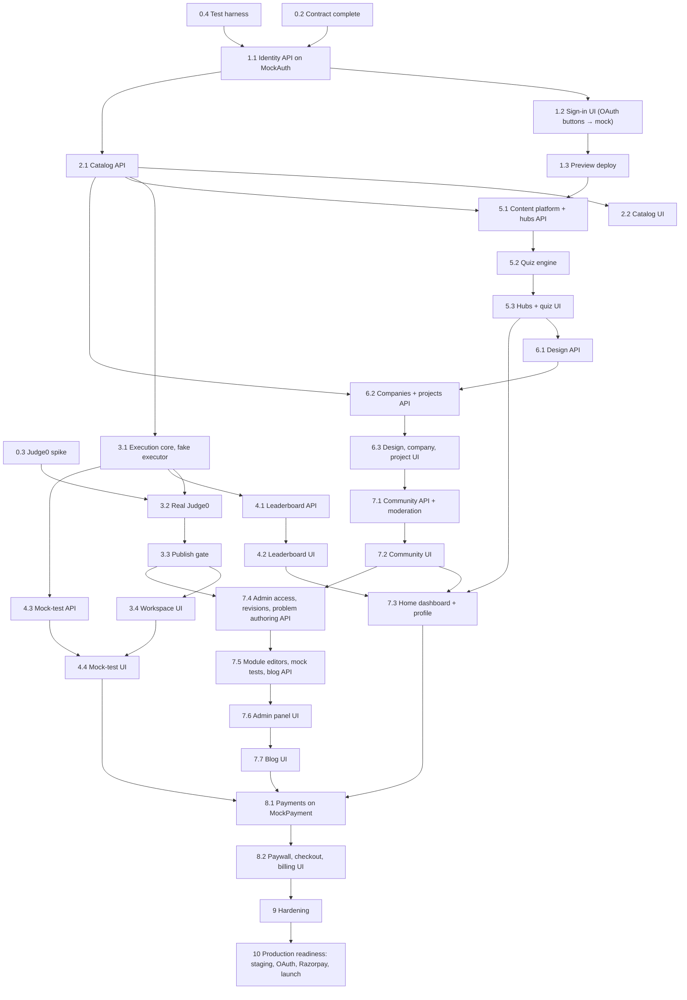

# Implementation Plan — Semicolan

Strictly ordered milestones for an AI coding agent. Requirement IDs (`ACC-1`, `MT-2`, …) refer to [PRD.md](PRD.md) §7; endpoint and error names come from [API_Contract.md](API_Contract.md). Diagrams of the schema, infrastructure, journeys and the auth/payment ports are in [Architecture_Diagrams.md](Architecture_Diagrams.md); how mock and real providers are run, tested and swapped is in [Dev_to_Prod_Strategy.md](Dev_to_Prod_Strategy.md); the test harness, its commands and the rules for running it are in [Agent_Testing_Environment.md](Agent_Testing_Environment.md); the admin panel and content workflow are in [Admin_Panel_Strategy.md](Admin_Panel_Strategy.md). A milestone starts only when the previous one's acceptance criteria are all met — in CI, or, for DRILL items, signed off in the PR.

**Verification tags** (tools and commands per level: Agent_Testing_Environment §2): **UT** unit · **IT** integration (Spring, Testcontainers MySQL, MockMvc, WireMock) · **E2E** Playwright against the compose stack or the preview environment · **DRILL** scripted manual run with a checklist · **LOAD** k6 · **SCRIPT** committed script that exits 0 · **CI/CD** pipeline run.

**Shape of the plan.** Phases 1–9 build the whole product against **mock identity and payment providers** behind the `AuthService` and `PaymentService` interfaces (TRD §2, Dependency Inversion). The new learning and community modules sit in the middle (Phases 5–7), and Phase 7 ends with the admin panel and the blog (7.4–7.7), once every content type it edits exists. The test harness is built first (0.4) and grows with the milestones that need it (Agent_Testing_Environment §11). The real Google and GitHub OAuth and the real payment provider (Razorpay; Stripe optional) are integrated only in **Phase 10, Production Readiness**, where switching them on is configuration plus two adapters.

## Environments

| Environment | Profile | Identity / payments | Purpose |
|---|---|---|---|
| Local | `dev` | `MockAuthServiceImpl` / `MockPaymentServiceImpl` | Development; compose stack with MySQL, Mailpit, optional Judge0 |
| CI | `test` | Mocks | Unit, integration and E2E tests |
| **Preview** | `dev` (deployed) | Mocks | The shared environment for Phases 1–9: demos, E2E against a deployed stack, the Judge0 host. Behind an access gate at the proxy (IP allowlist plus basic auth), with its own database and signing keys. **Never public** — the mock sign-in lets anyone in as any test user |
| Staging | `staging` | Real providers, test mode | Created in Phase 10; production-like; the app refuses to start with any mock |
| Production | `prod` | Real providers, live | Phase 10 |

## Dependency map

## Working agreements (every milestone)

1. **Contract first.** No endpoint is built until it is in `API_Contract.md`. If a task needs one that is missing, propose the contract change and wait for approval.
2. **Backend before frontend.** Inside a phase, the backend milestones must be green before the frontend milestone starts. Frontend tasks call only endpoints that already return real data.
3. **Definition of done.** Code and tests merged with CI green; every acceptance criterion shown by its tagged verification; new config keys added to `.env.example` and the table below; schema changes shipped as a new Flyway migration (never edit an applied one); docs updated where behavior changed.
4. **Time.** UTC in the JVM, JDBC and MySQL; one injectable `Clock`; only the weekly leaderboard window and the activity heatmap's day buckets convert to Asia/Kolkata. Time-based criteria move the `Clock` or backdate rows — they never wait. The exception is mock-test sessions: `start_time` cannot be back-dated (trigger), so a session is created under the simulated `Clock` and its attempts are inserted before it is closed or scored; expiry is simulated by shortening `end_time`, never by back-dating `start_time`.
5. **Fixtures.** `dev` and `test` seed (through `MockUserSeeder`, with `Clock`-relative dates) the mock test users of TRD §2 — `free`, `premium-active`, `premium-expired`, `revoked`, `admin`, plus `new-user` (no account until first sign-in) and `github-unverified` (always refused). Tests sign in with `POST /api/auth/mock-login`. Premium-path criteria in Phases 2–7 use them because payments do not exist until Phase 8. Tests that change state — and every parallel E2E spec that runs code, pays, posts or edits content — use **ephemeral** `e2e-…` users created from those templates, and four-eyes criteria use an ephemeral second admin (API_Contract §1). On staging (Phase 10) equivalent accounts are real Google test accounts; mock users never exist there.
6. **Interfaces first, TRD names win.** `AuthService`, `TokenService`, `PaymentService`, `CodeExecutionClient`, `LeaderboardQueryService`, `RateLimiter`, `EmailSender`, `AnalyticsPublisher` are defined before their implementations and named as in the TRD and this plan. Mock implementations (`MockAuthServiceImpl`, `MockPaymentServiceImpl`) carry `@DevOnly` and the `dev`/`test` profiles.
7. **Mock parity.** Anything a mock does must go through the same domain code as the real provider (TRD §2): the mock replaces only the edge call. A criterion that passes with a mock and would need code outside the adapter to pass with the real provider is a defect.
8. **Single backend instance.** The MVP runs one backend replica with a recreate deploy. Scheduled jobs still claim work with `SELECT … FOR UPDATE SKIP LOCKED`, but multi-instance operation is out of scope (see Future Scope).
9. **One harness, one set of rules.** Tests use the harness of [Agent_Testing_Environment.md](Agent_Testing_Environment.md) — real MySQL through Testcontainers, the `MutableClock`, jobs driven by `runOnce()`, `FakeCodeExecutionClient` or real Judge0, never H2 or sleeps — and are named after the criterion they prove (`"3.1: …"`). The `make` targets of its §8 are the only entry points, for people, agents and CI alike. A level that could not run is reported as not run, never as passed.
10. **Live content has one writer.** From 2.1 on, every write to the live content tables goes through `ContentPublisher` (Backend_Schema, Rules); loaders, the publish script, the importer and the admin panel are its clients (Admin_Panel_Strategy §0).

## Parallel non-code workstreams (start now)

These have external lead times and must not wait for the code phases, even though the integrations themselves are built last.

| Stream | Work | Needed by |
|---|---|---|
| A. Payments | Razorpay merchant activation (KYC); test-mode keys and webhook secret; decide whether Stripe is needed (only for international cards; confirm an Indian merchant account is possible); Terms, Privacy and Refund pages | Test keys and pages: 10.3 · live activation: 10.5 |
| B. Identity | Google Cloud project with an OAuth client (consent screen: app name, logo, privacy and terms URLs, authorized domains; scopes `openid email profile`), GitHub OAuth app; redirect URIs for staging and production | 10.2 |
| C. Infrastructure | Domain and TLS; preview host with the access gate; Linux host for Judge0 (Docker, privileged containers, the cgroup mode its release requires); transactional-email provider with SPF/DKIM/DMARC; later a staging host | Preview: 1.3 · Judge0 host: 3.2 · email: 7.1 · staging: 10.1 |
| D. Content | Original or licensed content in content-pack formats, provenance recorded: problems (≥ 3 with reference solutions by 3.3, ≥ 20 by 4.3, ≥ 100 / ≥ 40 free by 10.5); per PRD §7.10 targets: hub topics with theory and Easy quizzes (2 topics by 5.1, all by 10.5), HLD/LLD questions with editorials (3 by 6.1), company overviews and sourced tags (3 by 6.2), project briefs (2 by 6.2) | Each milestone |
| E. Community operations | Community guidelines, moderation SLA and rota, grievance contact (PRD §10), moderator accounts | 7.1 (guidelines), 10.5 (staffed) |
| F. Validation | ≥ 15 student interviews and two beta price points (PRD §10) | Before plans are seeded in 8.1 |
| G. Reporting | Agree the report set the founder needs (Weekly Active Solvers, activation, funnel, repeat purchase, Student split, module engagement) and who gets the read-only MySQL user | 9.3 |

## Configuration inventory

| Group | Keys | Introduced |
|---|---|---|
| App | `SPRING_PROFILES_ACTIVE`, `APP_PUBLIC_BASE_URL` (email links, redirect URIs), `CORS_ALLOWED_ORIGINS`, `APP_ENVIRONMENT` (`local` \| `preview` \| `staging` \| `production`: the admin panel's environment badge and log tags) | 0.1 |
| Database | `DB_URL`, `DB_USER`, `DB_PASSWORD` | 0.1 |
| Auth (all modes) | `SEMICOLAN_AUTH_MODE` (`mock` \| `oauth`), `JWT_SIGNING_KEY` (with `kid`), `ACCESS_TOKEN_TTL` (15 min), `REFRESH_TOKEN_TTL`, `REFRESH_REUSE_LEEWAY` (10 s), `OAUTH_EXCHANGE_CODE_TTL` (60 s), `OAUTH_STATE_COOKIE_KEY`, `OAUTH_REDIRECT_ALLOWLIST` | 1.1 |
| Auth (real providers) | `GOOGLE_CLIENT_ID`, `GOOGLE_CLIENT_SECRET`, `GITHUB_CLIENT_ID`, `GITHUB_CLIENT_SECRET` | 10.2 |
| Email | `SMTP_HOST`, `SMTP_PORT`, `SMTP_USER`, `SMTP_PASSWORD`, `MAIL_FROM` | 7.1 |
| Rate limits | `RATE_LIMIT_AUTH`, `RATE_LIMIT_EVENTS` (1.1) · `RATE_LIMIT_RUN`, `RATE_LIMIT_SUBMIT`, `RATE_LIMIT_RUN_SESSION`, `RATE_LIMIT_SUBMIT_SESSION` (3.1) · `RATE_LIMIT_QUIZ` (5.2) · `RATE_LIMIT_COMMUNITY_POST`, `_COMMENT`, `_VOTE`, `_REPORT`, `COMMUNITY_MIN_ACCOUNT_AGE` (24 h) (7.1) · `RATE_LIMIT_ADMIN` (7.1, every admin write) · `RATE_LIMIT_CHECKOUT` (8.1); count per window | 1.1–8.1 |
| Judge0 | `JUDGE0_BASE_URL`, `JUDGE0_AUTH_TOKEN`, `JUDGE0_CALLBACK_BASE_URL`, `JUDGE0_CALLBACK_HMAC_KEYS` (`kid` → secret map), `JUDGE0_CALLBACK_TTL` (15 min), `JUDGE0_BATCH_SIZE` (≤ Judge0's `MAX_SUBMISSION_BATCH_SIZE`), `LANGUAGE_IDS`, `LANGUAGE_MULTIPLIERS`, `JUDGE0_RETENTION` (2 h) | 0.3, 3.1–3.2 |
| Execution control | `SEMICOLAN_EXECUTION_CLIENT` (`fake` \| `judge0`; `fake` is `@DevOnly` and refused under `staging`/`prod`), `JUDGING_TIMEOUT` (5 min), `JUDGING_TIMEOUT_SESSION` (30 min), `RUN_PURGE_AFTER` (24 h), `JUDGE0_MAX_INFLIGHT_JOBS`, `EXECUTION_MAX_BACKLOG_JOBS`, `INFLIGHT_CAP_PER_USER` (3) · `VALIDATION_MAX_INFLIGHT_JOBS` (publish-gate jobs in flight, a share of `JUDGE0_MAX_INFLIGHT_JOBS`; 3.3) | 3.1, 3.3 |
| Content | `TEST_PAYLOAD_MAX_BYTES` (256 KB after normalization; enforced at ingestion by the loader, importer and admin API), `STUB_MAX_BYTES` (16 KB), `DESIGN_SOLUTION_MAX_BYTES` (256 KB), `DESIGN_NOTE_MAX_BYTES` (64 KB), `BLOG_BODY_MAX_BYTES` (128 KB) · `CONTENT_SELF_REVIEW_ALLOWED` (`false`; `true` only for a deliberately single-admin deployment, Admin_Panel_Strategy §3.2) | 2.1, 3.3, 6.1, 7.4–7.5 |
| Scoring | `POINTS_EASY`, `POINTS_MEDIUM`, `POINTS_HARD` (1 / 2 / 3) | 2.1 |
| Mock tests | `MOCK_CLOSER_INTERVAL` (15 s), `MOCK_CLOSE_SETTLE` (10 s) | 4.3 |
| Payments (all modes) | `SEMICOLAN_PAYMENTS_PROVIDER` (`mock` \| `razorpay` \| `stripe`), `MOCK_PAYMENT_WEBHOOK_SECRET` (dev only), `RECONCILE_INTERVAL`, `RECONCILE_AFTER`, `CHECKOUT_REUSE_WINDOW` (15 min), `REMINDER_DAYS` (7,1) | 8.1 |
| Payments (real providers) | `RAZORPAY_KEY_ID`, `RAZORPAY_KEY_SECRET`, `RAZORPAY_WEBHOOK_SECRET`; optional `STRIPE_SECRET_KEY`, `STRIPE_WEBHOOK_SECRET` | 10.3 |
| Frontend (build time) | `VITE_API_BASE_URL`, `VITE_ENABLE_DEV_TOOLS` (`true` only for local and preview builds; tree-shakes `/dev/*` routes otherwise) | 1.2 |

Secrets come only from the environment or secret store, one set per environment; non-secret defaults live in `application-*.yml`; the app fails at startup when a required key is missing — and when `SEMICOLAN_AUTH_MODE` or `SEMICOLAN_PAYMENTS_PROVIDER` is `mock` under the `staging` or `prod` profile (TRD §2).

## Testing async callbacks and webhooks

| Level | Setup | Callback path | Proves | Used in |
|---|---|---|---|---|
| L1 In-process | MockMvc sends signed `PUT`s straight to the controller; `MockPaymentServiceImpl` feeds simulated events into the processor | None | Signature and `exp` checks, hint dropped for a terminal row or a row with no stored token, out-of-order arrival, two concurrent last results; payment idempotency and guarded transitions | 3.1, 8.1, every PR |
| L2 Fake Judge0 | `FakeCodeExecutionClient` / WireMock accepts the batch, then fires callbacks with configurable delay, order and duplicates, can fire one before the batch response, can lose callbacks entirely, can answer `503` queue-full, reject one item of a batch, or lose a job | HTTP inside the test JVM | Callback lost (reconciler recovers it), hint dropped, stale token after re-dispatch, `503` queue-full backoff, per-item rejection, enqueue failure; replays the 0.3 fixtures | 3.1–3.2, every PR |
| L3 Real Judge0, no tunnel | Compose Judge0. Backend on the host: `JUDGE0_CALLBACK_BASE_URL=http://host.docker.internal:8080` plus `extra_hosts: ["host.docker.internal:host-gateway"]` on Linux. Backend in compose: `http://backend:8080` | Docker network | Real payloads, four-language correctness, multipliers and limits | 3.2–3.3, locally and on the preview Judge0 host |
| L4 Public tunnel (ngrok, cloudflared) | Only when Judge0 is remote while the backend is local, and for provider sandbox webhooks in Phase 10. Tunnel a proxy port that forwards just the one webhook path, never the whole backend — `/api/internal/**` must not be public (TRD §5) | Public HTTPS | Real Razorpay (and Stripe) signatures and events | 10.3 debugging |
| L5 Staging | Full stack deployed; provider test-mode webhook URLs and OAuth redirect URIs point at staging | Public HTTPS | The Phase 10 drills | Phase 10 |

Judge0 is only supported on Linux, so contributors on other systems rely on L1–L2. The callback HMAC keys are per environment, so a tunnelled dev backend never shares a key with preview or staging. How each level is built — the `FakeCodeExecutionClient` scripting API and source directives, `CallbackSigner`, the WireMock `Judge0Simulator` and `CallbackDriver` — is in Agent_Testing_Environment §5.

---

## Phase 0: Foundations & De-risking

**Goal**: A repository where every later phase can be built, tested and deployed; the API contract complete; the riskiest integration (Judge0) proven before feature work starts. Identity and payment providers are deliberately mocked until Phase 10, so no spike is needed for them now.
**Depends on**: nothing.

### 0.1 Skeleton, local stack, CI

- Monorepo: `backend/` (Spring Boot 3, Java 17+, layered Controller → Service → Repository), `frontend/` (React, Vite, Tailwind, `@monaco-editor/react`), `infra/`, `content/`, `scripts/`.
- `docker-compose.yml`: `mysql:8.4` (pinned — the leaderboard needs window functions; `default-time-zone='+00:00'`, `log_timestamps=UTC`; utf8mb4; `log_bin_trust_function_creators=1` so the migration account can create the two triggers; healthcheck), Mailpit (SMTP sink with an HTTP API), and Judge0 under a `judge0` compose profile (pinned release; its own Postgres and Redis are Judge0-internal, not part of our stack; `AUTHN_TOKEN` set). Without that profile the fake executor (3.1) is the default.
- Backend skeleton: health endpoint; profiles `dev`, `test`, `staging`, `prod`; `@ConfigurationProperties` + `@Validated`; Flyway wired (versioned `db/migration`; a `db/seed-dev` location enabled only for `dev` and `test`; `ddl-auto=validate`). Flyway is the chosen tool — do not add Liquibase.
- CI on every PR: backend `mvn verify` (UT + IT), frontend lint + test + build, container image builds, dependency vulnerability scan; `main` is protected by it.
- `.env.example` and the configuration inventory above; no secret is committed.

### 0.2 Contract completion (done)

`API_Contract.md` now contains §6 Mock tests, §7 Payments and admin, and §8 Analytics events, plus `GET /api/me/stats`. The decisions that closed the contract:

- **Mock tests**: list with per-user state and `canStart`/`lockReason`; start is idempotent, serialized per user, and checks in this order — resume the same test, refuse a different one (`409 ACTIVE_SESSION_EXISTS`), entitlement (`403 PREMIUM_REQUIRED`, `403 FREE_ATTEMPT_USED`); sessions return `serverNow` and `endTime`; early finish via `POST /api/mock-test-sessions/{id}/finish`; "time taken" is `end_time − start_time`, so an early finish ends at the finish instant; `score` is `null` (the report is `finalizing`) until every attempt received at or before `end_time` is terminal and `MOCK_CLOSE_SETTLE` has passed.
- **Payments and admin**: plans, checkout (reuses the caller's recent unpaid order for the same plan), an order-status endpoint for the Confirming screen, billing (receipts), admin grant/revoke; the Razorpay event → state mapping lives in contract §4. Refunds are issued from the Razorpay dashboard and arrive as webhooks.
- **Cross-cutting**: pagination envelope with totals; an expired token on an optional-auth endpoint returns `401` so silent refresh runs; compile errors are Console text only (no structured line/column); frontend analytics go through `POST /api/events` with an allowlist of names; reminder idempotency is the `subscription_reminders` table; error codes follow the contract (`409 TEST_SESSION_CLOSED`, `422 PROBLEM_NOT_IN_TEST`, `422 UNSUPPORTED_LANGUAGE`, `422 INVALID_OR_EXPIRED_TOKEN`).
- **Identity and payments behind ports** (contract §1, §7, §14; TRD §2): OAuth start / callback / exchange, `POST /api/auth/mock-login`, provider-neutral checkout, the mock payment simulator.
- **Learning modules and community**: contract §9 to §13.
- Optionally generate OpenAPI from the contract and a typed frontend client from it.

**Acceptance criteria**
- [ ] Every PRD §7 ID maps to an endpoint, job, script or "UI only" (Appendix A is the starting point). [product-owner review]

### 0.3 Integration spikes (throwaway code allowed; fixtures kept)

- **Judge0**: `scripts/judge0-smoke.sh` creates a 2-job batch (`wait=false`, a `callback_url` per job) against the compose Judge0, with a stub HTTP receiver. Record: callback verb and body shape (Base64-encoded fields), status IDs, language IDs for C / C++ / Java / Python 3 on the pinned release, how a Python `SyntaxError` is reported (status and stderr), the batch-size cap (`MAX_SUBMISSION_BATCH_SIZE`, default 20), the `MAX_*` limit caps, the queue cap (`MAX_QUEUE_SIZE`, default 100), the auth header, `DELETE /submissions/{token}` with `ENABLE_SUBMISSION_DELETE=true`, the behavior of a job with no `expected_output`, and how the container reaches the host (L3). Commit the captured JSON as test fixtures. Document the staging host prerequisites: Linux, privileged containers, and the cgroup mode the pinned release requires (the 1.13.1 notes call for cgroup v1 on Ubuntu 22.04).

**Acceptance criteria**
- [ ] `docker compose up --wait` exits 0 with MySQL and Mailpit healthy; with `--profile judge0`, Judge0 answers requests carrying the token and rejects requests without it. [SCRIPT]
- [ ] CI is green on the skeleton and turns red when a deliberately failing test is added. [CI/CD]
- [ ] The backend refuses to start when a required secret is absent and names the missing key. [IT]
- [ ] The Judge0 smoke run delivers exactly one callback per job to the stub within 30 s, matching the committed fixture shape. [SCRIPT]

### 0.4 Test harness

The environment of [Agent_Testing_Environment.md](Agent_Testing_Environment.md), so that every later criterion has a level to run at. Later milestones extend it (its §11).

- `Makefile` entry points (`doctor`, `test-unit`, `test-it`, `e2e`, `e2e-down`, `lint`, `bundle-guard`, `verify`) and `scripts/test/doctor.sh`.
- Backend: Surefire for `*Test`, Failsafe for `*IT` with `-DskipUTs`; JVM in UTC; `MySqlTestContainer` (`mysql:8.4` with the server flags and JDBC parameters of Backend_Schema "Operations", on tmpfs); `AbstractIntegrationTest` with `MutableClock`, `DatabaseCleaner` and `Jobs`; `application-test.yml` with scheduling off, synchronous executors and mock providers.
- Frontend: Vitest, React Testing Library and MSW, with handlers built from the contract's examples.
- E2E: the Playwright project in `e2e/` with the configuration of Agent_Testing_Environment §7.3 and `docker-compose.e2e.yml` (backend and frontend images on the base compose file). The environment guard and the user fixtures join in 1.2, once mock sign-in exists.
- CI jobs of Agent_Testing_Environment §9 (`backend`, `frontend`, `e2e`, `dependency-scan`) uploading their reports.

**Acceptance criteria**
- [ ] `make doctor` names each missing prerequisite and exits non-zero; with everything present it exits 0. [SCRIPT]
- [ ] An integration test against `MySqlTestContainer` reads `@@session.time_zone = '+00:00'` and a zero session offset (Backend_Schema §0.2 query 2), and a second test sees no rows left by the first. [IT]
- [ ] A test that advances `MutableClock` by one hour observes it through the injected `Clock`; with scheduling off, no scheduled job runs unless `Jobs` calls it. [IT]
- [ ] `make e2e` builds both images, starts the stack, waits until the backend's readiness check passes, and runs a smoke spec that loads the SPA; a failing spec leaves a trace and the HTML report in `e2e/`. [E2E]
- [ ] `./mvnw -pl backend test -Dtest=…`, `./mvnw -pl backend verify -DskipUTs -Dit.test=…` and `npx playwright test <file>:<line>` each run exactly one test. [SCRIPT]

---

## Phase 1: Identity on Mock Auth

**Goal**: Users sign in through the real OAuth endpoints and UI — **Continue with Google / GitHub** — backed by `MockAuthServiceImpl`, receive real JWTs, complete onboarding, and link providers; deployed to the preview environment. No real provider is contacted until Phase 10.
**Depends on**: Phase 0.

### 1.1 Backend

- Flyway `V1__baseline.sql`: all 45 tables exactly as `Backend_Schema.md` (including the two mock-test triggers, `analytics_events`, the test-set columns and the content-workflow tables §42–§45, which the admin panel fills from 7.4). Reference data such as `plans` arrives later as versioned migrations; content arrives through the loaders.
- Time pinning (Backend_Schema R5): server, Connector/J, Hibernate and JVM settings as specified; the readiness check fails if the session time-zone offset is not zero.
- `TokenService` + Spring Security (TRD §2): stateless access JWT (`ACCESS_TOKEN_TTL`, default 15 min) carrying `iss`, `aud`, `sub`, `role`, `iat`, `exp` only (no email, plan or other personal data), with a pinned algorithm, `iss`/`aud` validation and a `kid` header; opaque single-use refresh tokens stored as SHA-256 hashes in `auth_tokens`, rotated on every refresh with a `REFRESH_REUSE_LEEWAY` (10 s). `POST /api/auth/refresh`, `POST /api/auth/logout`.
- **`AuthService` port and `MockAuthServiceImpl`** (TRD §2): `authorizationUrl` → the SPA's `/dev/mock-oauth` page; one instance per provider; `exchange` maps `mock:<userKey>` to a fixed `VerifiedIdentity` for the provider in the callback path (subject `mock-<provider>-<userKey>`); `github-unverified` returns `emailVerified = false`. `MockUserSeeder` (`@DevOnly`) upserts the five stateful test users with `Clock`-relative dates at startup (TRD §2). `UserAccountService` (find by identity → link by verified email → create with `needsOnboarding`) and the OAuth endpoints of contract §1 — `GET /api/auth/providers`, `…/oauth/{provider}/start` (state + PKCE + nonce + `returnTo` in the encrypted `semicolan_oauth` cookie), `…/callback`, `POST /api/auth/oauth/exchange` (one-time `OAUTH_EXCHANGE` code) — written once and used unchanged by the real adapters in Phase 10.
- `POST /api/auth/mock-login` (with ephemeral `e2e-…` users created from a template, API_Contract §1), `GET /api/dev/mock-users` and `POST /api/dev/mock-users/reseed`, annotated `@DevOnly` and registered only for `dev`/`test`.
- **Production guard**: an `ApplicationContextInitializer` refuses to start under `staging` or `prod` when `SEMICOLAN_AUTH_MODE=mock`, `SEMICOLAN_EXECUTION_CLIENT=fake` or any `@DevOnly` bean is present; a `staging`/`prod` startup check fails if `user_identities` contains a `mock-` subject or `payments` a `MOCK` row.
- **Admin authorization** (TRD §5; Admin_Panel_Strategy §4.3): `/api/admin/**` requires `ROLE_ADMIN` from the token's `role` claim, and `AdminAccessFilter` re-reads `users.role` and `deleted_at` on every admin request; method security is enabled for the admin services that later phases add. `scripts/set-user-role` changes a role with a `SET_ROLE` audit row and revokes the user's refresh tokens; no endpoint changes a role.
- `GET /api/me` (with `needsOnboarding`, `identities`, `activeTestSession` `null` until 4.3), `PATCH /api/me` (onboarding and profile edits), `POST /api/me/identities/{provider}/link`, `DELETE /api/me/identities/{provider}`, `GET /api/me/stats`, `POST /api/me/deletion-request`.
- `RateLimiter` interface + in-memory Bucket4j implementation applied to the `auth` policy and `POST /api/events`; limits from config; `429` with `Retry-After`; client IP only from the trusted proxy hop.
- `AnalyticsPublisher` interface + MySQL-backed asynchronous implementation; `POST /api/events` (contract §8) with its allowlist; emit `signup` and `login` (with provider).
- CORS from config; redirect URIs from `OAUTH_REDIRECT_ALLOWLIST`.

**Acceptance criteria**
- [ ] On a fresh MySQL 8.4, migrate creates exactly the 45 tables in `Backend_Schema.md`; `flyway validate` and Hibernate `validate` pass; a second run changes nothing; the schema lint query (Backend_Schema §0.2) returns zero rows. [IT]
- [ ] The readiness check fails when the session time-zone offset is not zero. [IT]
- [ ] The full flow start → callback (`code=mock:free`) → exchange returns a token pair whose access token passes the security filter on a protected route; the callback response never contains a token, only a `302` to `/auth/complete?code=…`. [IT]
- [ ] `start` sets the `state` cookie; a callback with a missing, expired (moved `Clock`) or mismatched `state` redirects with `OAUTH_STATE_INVALID` and creates nothing; an exchange code works once and is `422 INVALID_OR_EXPIRED_TOKEN` after 60 s or a second use. [IT]
- [ ] `new-user` creates a user with `needsOnboarding: true`, `role = USER`, `subscription_status = NONE`; `PATCH /api/me` without `segment` returns `422`, with it sets `onboarded_at`. `github-unverified` creates nothing and redirects with `OAUTH_EMAIL_NOT_VERIFIED`. [IT]
- [ ] Signing in as `free` with the mock GitHub identity links to the existing `free` account (same verified email); unlinking the last identity returns `409 LAST_IDENTITY`; linking an identity owned by another user redirects with `IDENTITY_IN_USE`. [IT]
- [ ] A decoded access token contains only `iss`, `aud`, `sub`, `role`, `iat`, `exp`, and its header names the pinned algorithm and a `kid`; a token signed with another environment's key is rejected. [UT]
- [ ] After a restart with the `Clock` moved 60 days forward, `premium-active` is still Premium and `premium-expired` still reports `EXPIRED`; seeding twice leaves the same rows. [IT]
- [ ] Refresh rotates the token; replaying a consumed one within the leeway returns a fresh pair without revoking; after the leeway (moved `Clock`) it returns `401 INVALID_REFRESH_TOKEN` and the user's newest refresh token stops working; logout revokes the token. [IT]
- [ ] A protected route returns `401` without a token and `200` with one; a test-only route under `/api/admin/` returns `403` for `free` and `200` for `admin`. [IT]
- [ ] After `scripts/set-user-role --role USER` on `admin`, the still-unexpired access token minted before it gets `403 FORBIDDEN` on that route, the user's refresh token is revoked, and one `SET_ROLE` audit row records the old and new role. [IT]
- [ ] `mock-login` with `{"userKey": "e2e-alpha", "template": "premium-active"}` creates an `ACTIVE` user on first use and signs the same user in on the second; `{"template": "nope"}` returns `422`; `GET /api/dev/mock-users` lists only the seven fixed keys; `POST /api/dev/mock-users/reseed` restores the fixed users and leaves `e2e-alpha` untouched. [IT]
- [ ] With the auth limit at 3 per window, the 4th `start` or `exchange` from one IP returns `429` with `Retry-After`. [IT]
- [ ] **Guard**: starting the application with the `prod` profile and `SEMICOLAN_AUTH_MODE=mock`, or with `SEMICOLAN_EXECUTION_CLIENT=fake`, fails with a clear message; with `oauth`, `judge0` and no `@DevOnly` beans it starts, and `POST /api/auth/mock-login`, `GET /api/dev/mock-users` and `POST /api/dev/mock-users/reseed` return `404`. [IT]
- [ ] `POST /api/events` accepts the allowlisted names with `204` and rejects others with `422`; a failing analytics write never fails the request; first sign-in writes one `signup` row and every sign-in one `login` row with its provider. [IT]

### 1.2 Frontend (after 1.1 is green)

- Tailwind theme from UI_UX_Brief §1–2 and §8: dark tokens, Inter for UI, Fira Code / JetBrains Mono for code; fonts self-hosted (WOFF2). Monaco is self-hosted too (`loader.config`), never fetched from a CDN.
- Routing: public vs authenticated routes (App_Flow §9). One shared API client owns every token decision: **single-flight** silent refresh (tabs coordinate through `navigator.locks` or `BroadcastChannel`), proactive refresh at about 75% of the token lifetime on the monotonic clock, retry with backoff for network errors and `5xx` (never a logout), and the sign-in dialog over the current page only on `401 INVALID_REFRESH_TOKEN`. Editor buffers are never discarded on an auth failure. Logout in one tab logs out the others.
- **Sign-in dialog** (UI_UX_Brief §9.19): Continue with Google / Continue with GitHub, "Last used" tag, the popup flow with the redirect fallback, `/auth/complete` (`postMessage` to the opener with an origin check), error states, the onboarding step, the pending-action mechanism (`sessionStorage`). The "Development sign-in" badge from `GET /api/auth/providers`.
- **Mock provider page** `/dev/mock-oauth` (only when `VITE_ENABLE_DEV_TOOLS=true`): lists `GET /api/dev/mock-users` and completes the callback with the chosen key.
- App shell (UI_UX_Brief §10.1) with the grouped sidebar — module entries render "Coming soon" placeholders until their phase — Landing, Home shell, Settings → Profile and Accounts (link / unlink), account deletion request.

**Acceptance criteria**
- [ ] From the landing page: Continue with Google → mock page → `new-user` → onboarding → Home; Continue with GitHub as `free` → Home without onboarding; `github-unverified` shows the unverified-email message with both buttons still usable. [E2E]
- [ ] With popups blocked, the same buttons complete sign-in through the redirect fallback and return to the starting page. [E2E]
- [ ] The `body` computed background is `rgb(28, 28, 28)` (`bg-base`) and code areas use the monospace stack. [E2E]
- [ ] Two parallel requests with an expired access token cause one `POST /api/auth/refresh` and both succeed; a failed refresh opens the sign-in dialog over the current page; a `5xx` on refresh does not log the user out. [E2E]
- [ ] A production build (`VITE_ENABLE_DEV_TOOLS=false`) contains no `/dev/` route, no reference to `mock-login` and no `__semicolan_e2e__` hook (`make bundle-guard`). [SCRIPT]
- [ ] E2E global set-up reseeds the fixed users and saves their storage states; pointed at a stack whose `GET /api/auth/providers` is not `MOCK`, it refuses to run; two specs that each `signIn('free')` in parallel get different ephemeral users. [E2E]

### 1.3 Preview deploy

- CD: a merge to `main` builds images and deploys backend and static frontend to the **preview** environment (the `dev` profile, mocks on); Flyway runs against the preview database; one backend replica, recreate strategy (working agreement 8).
- Reverse proxy: TLS; SPA fallback; **an access gate on the whole host** (IP allowlist plus basic auth); **`/api/internal/**` denied from the public internet** (only Judge0's address allowed).

**Acceptance criteria**
- [ ] A merge to `main` reaches preview with no manual step and the migration is applied. [CI/CD]
- [ ] A request to preview from outside the allowlist, or without the gate credentials, is rejected by the proxy; a request from outside to any `/api/internal/**` path is rejected. [SCRIPT]

---

## Phase 2: Catalog & Entitlement

**Goal**: Visitors and users browse a seeded catalog through a public API; Premium access is decided by one rule.
**Depends on**: Phase 1.

### 2.1 Backend

- `EntitlementService` (injected `Clock`): Premium = `subscription_status = 'ACTIVE' AND subscription_expires_at > :now`. Every gated endpoint uses it; nothing reads a role or token claim for plan decisions.
- Test cases live in MySQL (`MEDIUMTEXT`) as numbered **test sets** (Backend_Schema §6) and are read in batch through the repository (`TestCaseRepository.findAllByProblemIdAndTestSet`; the problem page reads the live set's samples); no caller reads columns outside it.
- `ProblemQueryService` and the public endpoints `GET /api/problems` (with `q`, `status`, `bookmarked`, `userStatus`, `isBookmarked`, `hasEditorial`; PRD CAT-2, CAT-3), `GET /api/problems/{id}`, `GET /api/problems/{id}/editorial` (SOL-1; refused during the caller's running test once 4.3 exists), `GET /api/topics` (with counts), `GET /api/languages` (IDs from config, matching the 0.3 spike); bookmarks `PUT`/`DELETE /api/me/bookmarks/{problemId}`; optional-auth behavior and pagination envelope per the contract.
- **Content pack** (OPS-1): `content/problems/<slug>/` with `problem.yaml` (title, difficulty, points, limits, premium flag, topics, `content_source`), `statement.md`, `stubs/{c,cpp,java,python}`, ordered tests with sample/hidden flags, and `solutions/` reference solutions in all four languages, plus an optional `editorial.md` with complexity front matter; the publish gate (3.3) writes the editorial code rows from the same reference solutions. The loader is idempotent (upsert by slug), writes one `problem_code_stubs` row per launch language, normalizes and checks test payloads as the admin API will (UTF-8, CRLF → LF, digests, nothing larger than `TEST_PAYLOAD_MAX_BYTES`; Admin_Panel_Strategy §2.3), writes a problem's tests as test set 1 and sets `live_test_set` when it publishes, and loads `prod` as `DRAFT` only; other profiles may load as `PUBLISHED` until 3.3, after which staging publishes through the gate too. It is built as parse → document (the content-pack JSON form validated by `content/schemas/`) → `ContentPublisher`, the single writer of live content (working agreement 10), so 7.4 turns it into the importer front end without rewriting it.
- Dev seed: ≥ 8 problems (5 free, 3 premium; every difficulty; ≥ 3 topics; ≥ 1 `DRAFT`) with stubs, sample and hidden tests, and reference solutions for ≥ 3 of them.

**Acceptance criteria**
- [ ] Anonymous `GET /api/problems` returns only `PUBLISHED` problems with correct `isPremiumOnly` and topics. [IT]
- [ ] `difficulty` and `topic` together return exactly the seeded intersection; paging follows the contract envelope. [IT]
- [ ] `GET /api/problems/{id}` on a premium problem returns `401 AUTH_REQUIRED` for anonymous, `403 PREMIUM_REQUIRED` for `free`, `revoked` and `premium-expired`, `200` for `premium-active`; a `DRAFT` or unknown ID returns `404`. [IT]
- [ ] With the `Clock` at `expires_at − 1 s` access is `200`; at `expires_at` it is `403` — no sweeper exists yet. [IT]
- [ ] No response contains hidden test cases (only `sampleTestCases`). [IT]
- [ ] Running the loader twice leaves identical row counts (including four stub rows per problem), it refuses to write `PUBLISHED` under `prod`, it rejects a test payload over the cap or with a NUL byte, and a payload with CRLF line endings is stored with LF and the digest of the normalized text. [IT]
- [ ] `GET /api/languages` returns C, C++, Java and Python 3 with the Judge0 IDs recorded in 0.3. [IT]
- [ ] `q` matches titles case-insensitively and escapes `%` and `_`; `status=SOLVED` from a visitor returns `401 AUTH_REQUIRED`; a bookmark `PUT` twice stores one row and the 1,001st returns `422 BOOKMARK_LIMIT_REACHED`. [IT]
- [ ] The editorial is `401` for a visitor, `403 PREMIUM_REQUIRED` for `free` on a premium problem, `404 EDITORIAL_NOT_FOUND` when absent. [IT]

### 2.2 Frontend (after 2.1 is green)

- Catalog (public, UI_UX_Brief §9.7): search, difficulty / topic / status / saved filters (kept in the URL), Flat and Grouped views, topic sub-sidebar, progress ring, bookmarks, difficulty badges, lock indicators.
- Problem page at `/problems/:id` — **statement pane only** (statement, constraints, examples, tags); the editor pane is 3.4. The locked state is one reusable component: visitors get a sign-up prompt, signed-in users a Premium-required panel with a placeholder CTA (wired in 8.2).

**Acceptance criteria**
- [ ] Logged out, the catalog renders live data with ≥ 1 locked and ≥ 1 unlocked card; opening a locked problem shows the sign-up prompt; as `free` it shows the Premium-required panel. [E2E]

---

## Phase 3: Execution & Workspace

**Goal**: A user can Run and Submit C, C++, Java or Python 3 code and see a correct verdict, with no request thread waiting on execution and no verdict depending on a single network message.
**Depends on**: Phase 2 and the 0.3 fixtures.

### 3.1 Execution core on a fake executor (no Docker needed)

Rules (TRD §3): the database is the queue; callbacks are hints, never facts; one code path (`JudgeResultApplier`) applies results; fail closed and never blame the user for infrastructure.

- `CodeExecutionClient` interface (dispatch jobs in a batch, fetch outcomes by opaque handle; vendor-neutral outcome) and a scriptable `FakeCodeExecutionClient` (L2): `@DevOnly`, selected by `SEMICOLAN_EXECUTION_CLIENT=fake`, scripted from Java in integration tests and by `semicolan-fake:` source directives in development and E2E, with callbacks sent to the real callback endpoint (Agent_Testing_Environment §5.2). It is also the executor of the compose stack without the `judge0` profile.
- Each attempt copies the problem's base time and memory limits (`submissions.time_limit_ms`, `memory_limit_kb`) and creates its result rows from the problem's live test set; the dispatcher builds job limits from the attempt, never from the problem row (Backend_Schema §10).
- `SubmissionCommandService` and `POST /api/submissions`, in this order: auth; `RateLimiter` (`run`/`submit`, or `run_session`/`submit_session` when `testSessionId` is present); body ≤ 128 KB (`413`) and `sourceCode` ≤ 64 KB (`422 TOO_LONG`); language check (`422 UNSUPPORTED_LANGUAGE`); per-user in-flight cap (`INFLIGHT_CAP_PER_USER`, `429 TOO_MANY_IN_FLIGHT`); `clientRequestId` idempotency (read first; a duplicate-key race returns the winner; a repeat returns the original attempt with `202`); a `SubmissionAccessPolicy` seam (free problem or Premium entitlement; any non-null `testSessionId` returns `404 TEST_SESSION_NOT_FOUND` until 4.3 swaps in the session rule); admission control (below); then, in one transaction, the attempt plus one result row per test (`RUN` → samples only) with `dispatch_priority` and `next_dispatch_at` from the `Clock`; `202`. Judging Errors, `5xx` and `503` do not consume the rate allowance.
- **Admission control**: when `PENDING` jobs exceed `EXECUTION_MAX_BACKLOG_JOBS`, attempts outside a mock session get `503 EXECUTION_BUSY` with `Retry-After`; session attempts are always admitted.
- **Dispatcher** (1-second tick, plus an after-commit wake-up): claims rows with `SELECT … FOR UPDATE SKIP LOCKED` in the order of `idx_str_dispatch` (priority `0` in-session, `1` `SUBMIT`, `2` `RUN`; oldest first), up to `JUDGE0_MAX_INFLIGHT_JOBS`, then priority `3` (`VALIDATE`, from 3.3) up to `VALIDATION_MAX_INFLIGHT_JOBS` (Backend_Schema "Gate claim"); the claim is a short transaction that leases the rows by pushing `next_dispatch_at` forward, and no lock is held while calling the executor. Sends batches of up to `JUDGE0_BATCH_SIZE` with `wait=false` and a signed `callback_url` per job. Stores each returned token with `dispatched_at` (the attempt becomes `JUDGING` on its first acknowledged job). A connection error, timeout, `5xx` or `503` queue-full backs off (1 s up to 30 s, capped) and leaves the rows `PENDING`; a per-item validation rejection makes that row `JUDGING_ERROR` at once and raises an alert.
- **`JudgeResultApplier`**: the only writer of verdicts. After any network read, one short transaction: lock the parent `submissions` row (`FOR UPDATE`; locks always parent first, then results, and in ascending attempt ID across attempts), update the result with `UPDATE … WHERE status = 'PENDING' AND judge0_token = <token that was read>` (0 rows = duplicate, late, or stale after a re-dispatch: stop), then finalize if due.
- **Finalize**: a `COMPILE_ERROR` from any job finalizes the attempt immediately, stores the compile output, and sets the attempt's other `PENDING` result rows to `SKIPPED` (with `judged_at`) in the same transaction. Otherwise, once no result is `PENDING`: `ACCEPTED` if all passed, else the first failing test by `display_order` (a genuine failure outranks `JUDGING_ERROR`); time and memory are the maximum. A `SUBMIT` that finalizes `ACCEPTED` inserts its `user_problem_solves` row in the same transaction as a duplicate-key no-op (`ON DUPLICATE KEY UPDATE user_id = user_id`, never `INSERT IGNORE`); `SubmissionFinalized` and `SolveRecorded` are published after commit.
- `PUT /api/internal/judge0/callback` (`permitAll`; the signature is the credential): verify `sig` over `resultId|exp` with the key named by `kid`, in constant time and before any database or Judge0 access; every failure is the same `403 INVALID_SIGNATURE`. Then, if the row is non-terminal and has a stored token, ask `JudgeResultApplier` to read that job from the executor (3-second timeout) and apply it; otherwise drop the hint. Respond `204`. The callback body is never read for a decision.
- **Reconciler** (every 10 s, and once at startup): reads `PENDING` jobs dispatched more than 15 s ago in batches of 20 and applies finished ones; `In Queue` is left alone; a job the executor no longer knows, reports as Internal Error (`13`), or has held in `Processing` over 60 s is re-dispatched with a fresh token, at most twice. It also performs the stuck-attempt sweep: attempts past `JUDGING_TIMEOUT` (`JUDGING_TIMEOUT_SESSION` for in-session attempts) become `JUDGING_ERROR`, after one last read of any dispatched job. Alert when an in-session attempt stays non-terminal for more than 2 minutes.
- `GET /api/submissions/{id}` (with `progress`, `pointsAwarded`, sample `testResults` as they land) and `GET /api/submissions` (`SUBMIT` only).
- 24-hour `RUN` purge in batches (for example 1,000 rows per transaction).
- Micrometer metrics for the PRD §9 guardrails (submit→verdict latency, verdict counts, `JUDGING_ERROR` ratio) and for capacity (dispatch backlog, oldest pending age, in-flight jobs, dispatch failures by reason, callbacks received against reconciler recoveries, rejected callbacks); structured logs carry `attemptId`, `resultId` and `userId`, never source code, hidden data, tokens or callback query strings. Analytics `run`, `submit`, `verdict`, `first_accepted`.

**Acceptance criteria**
- [ ] While the fake withholds every callback for 10 s, `POST /api/submissions` still returns `202` with `PENDING` in < 500 ms; `RUN` creates result rows for sample tests only, `SUBMIT` for all. [IT]
- [ ] Repeating a request with the same `clientRequestId` returns the original attempt with `202` and creates no second attempt or quota use, including when two identical requests race. [IT]
- [ ] All tests pass → `ACCEPTED`. With tests 2 and 5 failing and results arriving 5 then 2, the verdict and `failedTestIndex` come from test 2 (by `display_order`, not arrival); time and memory are the maximum. [IT]
- [ ] A `COMPILE_ERROR` result finalizes the attempt at once with `compileOutput`, the other result rows become `SKIPPED`, `testResults` is `[]`, and a late result for a skipped row changes nothing. [IT]
- [ ] A missing or wrong `sig`, an unknown `kid`, an expired `exp` and an unknown `resultId` all return the same `403 INVALID_SIGNATURE` and touch neither the database nor the executor. [IT, L1]
- [ ] A valid callback whose body claims `ACCEPTED` while the fake reports `WRONG_ANSWER` results in `WRONG_ANSWER`: the body is ignored. [IT, L1]
- [ ] A callback for an already-terminal row, for a row with no stored token (it beat the dispatcher's bookkeeping), or a duplicate returns `204` and changes nothing; the reconciler later applies the result in the second case. [IT, L1/L2]
- [ ] With every callback lost, the reconciler applies the results within its interval plus the 15-second horizon, and the attempt finalizes. [IT, L2]
- [ ] A job the fake loses (or reports as Internal Error) is re-dispatched with a fresh token at most twice; a result later read for the old token is dropped (stale token after re-dispatch). [IT, L2]
- [ ] Two results for the last two pending rows applied concurrently finalize the attempt exactly once and create one `user_problem_solves` row. [IT]
- [ ] A batch-create failure (connection error, timeout, `5xx`) and a `503` queue-full leave the rows `PENDING`, back off, and the attempt dispatches after recovery; a per-item rejection makes only that row `JUDGING_ERROR` at once, and an alert counter increments. [IT, L2]
- [ ] An attempt that stays unresolved past the test-configured timeout becomes `JUDGING_ERROR` after one reconciler run, and a dispatched job is read from the executor one last time before it is failed. [IT]
- [ ] With the backlog over `EXECUTION_MAX_BACKLOG_JOBS`, a non-session attempt returns `503 EXECUTION_BUSY` with `Retry-After`; with the per-user cap at 3, the 4th concurrent attempt returns `429 TOO_MANY_IN_FLIGHT`. [IT]
- [ ] An attempt created before a change to the problem's limits or live test set is dispatched with the limits and tests it was created with. [IT]
- [ ] Hidden-test rows have `NULL` stdout and stderr, and no submission endpoint returns hidden input, expected output or output. [IT]
- [ ] Repeated `ACCEPTED` submits of one problem create one solve row and `pointsAwarded` is set only on the first; a `RUN` or a failed `SUBMIT` creates none; a `RUN` is absent from history and is purged once its `submitted_at` is over 24 h old (backdated). [IT]
- [ ] With the limit at 3 per window, the 4th Run/Submit returns `429 RATE_LIMITED` with `Retry-After`; the auth limiter is unaffected; an attempt that ends in `JUDGING_ERROR` does not consume the allowance. [IT]
- [ ] A premium-only problem without entitlement returns `403 PREMIUM_REQUIRED`; a non-launch language returns `422 UNSUPPORTED_LANGUAGE`; a body over 128 KB returns `413`. [IT]

### 3.2 Real Judge0

- `Judge0CodeExecutionClient` (the Judge0 adapter behind `CodeExecutionClient`; the domain sees only a vendor-neutral outcome):
  - `POST /submissions/batch` with `wait=false`, chunked to `JUDGE0_BATCH_SIZE` (Judge0's default cap is 20 per call), one job and one signed `callback_url` per test case, auth header. Always `base64_encoded=true` on create and read; decode leniently and truncate stdout, stderr and compile output to 16 KB before persisting.
  - Limits: `cpu_time_limit` = problem base × language multiplier; `wall_time_limit` = max(1 s, 2 × CPU); `memory_limit` = base × multiplier, clamped to Judge0's `MAX_*` caps. Startup validation fails if any configured problem and language combination could exceed a cap.
  - `expected_output` is never absent (an empty expectation is sent as an empty string); the adapter refuses to build a job without it.
  - Status mapping: `1`/`2` not terminal; `3` → `ACCEPTED` (only with time and memory present); `4` → `WRONG_ANSWER`; `5` → `TIME_LIMIT_EXCEEDED`; `6` → `COMPILE_ERROR`; `7`–`12` and `14` → `RUNTIME_ERROR`; `13` → lost job (retry, then `JUDGING_ERROR`); anything else → `JUDGING_ERROR`; never a default of `ACCEPTED`. A Python status-`11` result whose last stderr line is a `SyntaxError`, `IndentationError` or `TabError` is reclassified as `COMPILE_ERROR`, with the traceback as `compile_output`.
- **Judge0 hardening** (deployment checklist, TRD §5): a release with the 2024 sandbox-escape fixes (≥ 1.13.1) pinned by digest; `ENABLE_NETWORK=false`, `ALLOW_ENABLE_NETWORK=false`, `ENABLE_COMPILER_OPTIONS=false`, `ENABLE_COMMAND_LINE_ARGUMENTS=false`, `ENABLE_ADDITIONAL_FILES=false`, `ENABLE_WAIT_RESULT=false`; `AUTHN_TOKEN` and `ALLOW_IP` (backend hosts only); default PostgreSQL and Redis passwords changed; `MAX_FILE_SIZE` lowered; `MAX_QUEUE_SIZE` raised so `JUDGE0_MAX_INFLIGHT_JOBS` plus one batch fits (the default of 100 is only about three 30-test attempts); the Judge0 zone has no route to MySQL, secrets or the internet and its egress admits only the backend.
- **Judge0 retention purge** (moved up from the hardening phase, because load tests fill Judge0's disk and hidden data and user code sit there until purged): after a result is applied the backend deletes the finished job through `DELETE /submissions/{token}` (needs `ENABLE_SUBMISSION_DELETE=true` and the auth token), and a scheduled purge deletes any finished job older than `JUDGE0_RETENTION` using the stored tokens.
- Judge0 retries a failed callback at most `CALLBACKS_MAX_TRIES` times (default 3, 5 s timeout) and treats any HTTP response as delivered, so the reconciler is the correctness mechanism, not a backstop for rare cases.
- Add the real-Judge0 E2E (L3) and the **canary suite** to the preview CD smoke stage on the Judge0 host (it moves to staging in 10.1). The canary submits, through the real pipeline, a known-correct and a known-wrong program per language plus one case with an empty expected output, and asserts the verdicts and the latency; it gates every deploy and every Judge0 upgrade.

**Acceptance criteria**
- [ ] A 45-test problem produces 3 batch requests (20 / 20 / 5), and every job has its own `callback_url` with a valid `sig`, `exp` and `kid`. [IT, WireMock]
- [ ] The outbound payload for each language carries limits equal to base × that language's multiplier, clamped to the Judge0 caps, and always carries an `expected_output`; startup fails for a configuration that would exceed a cap. [IT]
- [ ] Against real Judge0 with no tunnel, the 3 reference problems are `ACCEPTED` in C, C++, Java and Python 3; an infinite loop returns `TIME_LIMIT_EXCEEDED`; a syntax error returns `COMPILE_ERROR` with `compileOutput` in every language, including Python. [E2E, L3]
- [ ] With the callback path blocked, the same submissions still reach their verdicts through the reconciler. [E2E, L3]
- [ ] After a finished attempt, no job for it remains in Judge0 beyond the retention window. [SCRIPT]
- [ ] The 0.3 fixtures replayed through the fake produce the same verdicts as the real run. [IT]
- [ ] The canary suite passes on preview, and fails when the Judge0 mapping is deliberately broken so that everything is `ACCEPTED`. [CI/CD]

### 3.3 Publish gate & content pipeline

- `PublishGateService` (OPS-2; Admin_Panel_Strategy §2.6) and `scripts/publish-problem`, its command-line client: runs the reference solution **in all four languages** through the real execution path as `VALIDATE` attempts — priority 3, within `VALIDATION_MAX_INFLIGHT_JOBS`, excluded from the user backlog count, no solves, no analytics, invisible to `/api/submissions` (Backend_Schema §10–§11) — and publishes only if every test passes in every language; also runs a **negative control** (a trivial wrong solution must be rejected, so a broken pipeline cannot publish problems that accept anything); checks statically that the problem has four stubs, at least one sample and one hidden test, no test payload above `TEST_PAYLOAD_MAX_BYTES`, and limits within Judge0's caps for every language; records the run's fingerprint (effective limits, reference solutions, test digests); prints per-language, per-test verdicts; non-zero exit otherwise. Editing a published problem's tests creates a new test set that goes back through this gate (Backend_Schema §6). The admin panel calls the same service in 7.4.
- "Report a problem" (OPS-3): a link (mailto or form) prefilled with problem and submission IDs; no new endpoint.

**Acceptance criteria**
- [ ] A problem whose Java reference fails one hidden test exits non-zero, stays `DRAFT`, and the output names the language and test; a fully passing problem becomes `PUBLISHED`. [E2E, L3]
- [ ] A problem with a missing stub row, no hidden test, or an over-size test payload exits non-zero; with the executor deliberately returning `ACCEPTED` for everything, the negative control makes the script exit non-zero. [E2E, L3]
- [ ] While a 100-job gate run is queued, a user's `SUBMIT` is dispatched first and no user attempt gets `503 EXECUTION_BUSY` because of gate jobs; `VALIDATE` attempts create no `user_problem_solves` row, no analytics event, and are `404` on `GET /api/submissions/{id}`. [IT]
- [ ] Changing one test's expected output after a passing run changes the fingerprint, and the script refuses to publish until the gate runs again; changing only the statement leaves the fingerprint unchanged. [IT]
- [ ] Publishing an edited published problem flips `live_test_set` to the new set in one transaction; a `SUBMIT` judged on the old set keeps its verdict and its result rows still reference the old set. [IT]
- [ ] ≥ 3 problems are published through the script. [SCRIPT]

### 3.4 Frontend Workspace (after 3.1–3.3 are green)

- Resizable three-pane layout (UI_UX_Brief §3) built on `react-resizable-panels`, with min/max sizes and persisted sizes; its keyboard and collapse behavior is checked against UI_UX_Brief §3.2 and a thin wrapper fills any gap. Monaco is self-hosted and seeded from `baseCodeStubs`; a language switch swaps the model without refetching the statement; debounced localStorage autosave keyed by user, problem and language. With `VITE_ENABLE_DEV_TOOLS=true` the Workspace registers the E2E editor hook `window.__semicolan_e2e__` (`getEditorValue`, `setEditorValue`; Agent_Testing_Environment §7.6), which production builds tree-shake. A plain `<textarea>` fallback ("Basic editor — Retry full editor") replaces Monaco if it has not loaded within 10 seconds.
- Viewport tiers: ≥ 1024 px full Workspace; 768–1023 px compact Workspace (the problem pane collapses to a rail and opens as an overlay drawer); under 768 px the read-only fallback with the actionable notice, **Copy link** and **Share**.
- Run/Submit generate a `clientRequestId` per user action (reused on retries) → `POST /api/submissions` → poll `GET /api/submissions/{id}` with the App_Flow §2.3 cadence until terminal; both buttons disable while an attempt is in flight; the execution-state catalog of App_Flow §2.3 (Sending, Queued, Running with `progress`, Slow, Long wait with **Stop waiting**, Reconnecting, Judging Error); the in-flight attempt ID is kept per problem so a refresh resumes polling. Test Cases (sample input / expected / actual), Console (compile output, stderr), Submission Result (`Wrong Answer on test N` for hidden tests; `+N points` from `pointsAwarded`, and the weekly rank from `GET /api/leaderboard/me`); toasts as UI_UX_Brief §4.3; `429` handling from `Retry-After`; `503 EXECUTION_BUSY` shows a retry message; the Phase 2 locked component as a dialog on `403 PREMIUM_REQUIRED`; the auth gate as a modal for visitors, with the pending action resuming after login.
- Compile errors appear as text in the Console only; there are no squiggles, gutter icons or clickable locations in the MVP.
- **Submissions** tab (EXE-3) with code and verdict and **Load into editor**; the **Solution** tab (SOL-1) with its spoiler guard (hidden during a mock test); a "Discuss" link once 7.2 exists; "Report a problem" link on problems and verdicts. Analytics: `workspace_opened` and `auth_gate_view` through `POST /api/events`.

**Acceptance criteria**
- [ ] As `free`: Run shows a loading state and then per-sample results; a wrong Submit shows "Wrong Answer on test N" with no input or output; a correct Submit shows Accepted and a success toast; history lists only the Submit. [E2E]
- [ ] While an attempt is in flight both Run and Submit are disabled; a page refresh resumes polling the same attempt. [E2E]
- [ ] With the limit at 1, the second click shows a warning toast with the `Retry-After` seconds and the buttons stay disabled until it elapses. [E2E]
- [ ] `403 PREMIUM_REQUIRED` opens the paywall dialog and keeps the editor content. [E2E]
- [ ] A Python syntax error and a C compile error both select the Console and show the compiler output as text. [E2E]
- [ ] Switching language swaps the stub with no new `GET /api/problems/{id}`; a reload restores unsaved code. [E2E]
- [ ] At 1280 px the panes resize within limits and persist across reload; at 1000 px the compact Workspace is shown with the problem pane as a rail and a drawer; at 700 px the Workspace is read-only with the notice. [E2E]
- [ ] With Monaco blocked, the textarea fallback appears within 10 s and Run and Submit still work. [E2E]
- [ ] A 20-submission run on preview records the submit→verdict P95 as a baseline (the pass/fail threshold is the 9.1 load test). [SCRIPT]

---

## Phase 4: Leaderboard & Mock Tests

**Goal**: The leaderboard reflects real solves, and Mock Tests are timed with the backend as the only authority.
**Depends on**: 3.1 for 4.1 and 4.3; 3.4 for 4.4; the contract for 4.3.

### 4.1 Leaderboard backend

- `LeaderboardQueryService` and `GET /api/leaderboard` using the `Backend_Schema.md` query patterns: weekly (Monday 00:00 Asia/Kolkata, converted to UTC) and all-time, difficulty-weighted points, verified users only, display names, viewer rank and neighbors (`GET /api/leaderboard/me`). Reads are served from a 15–30 second in-process snapshot with a single-flight refresh, so anonymous traffic never runs the aggregate per request.
- Fixture solves for the mock test users plus ≥ 10 extra users.

**Acceptance criteria**
- [ ] Solves at Sunday 23:59:59 and Monday 00:00:00 IST fall in the previous and current week respectively; all-time counts both. [IT, moved `Clock`]
- [ ] Points equal the sum of `points`; equal scores rank the earlier `reached_at` first; re-solving or repeating an accepted submit adds nothing. [IT]
- [ ] An anonymized fixture row shows as "Deleted user"; `me` returns rank and neighbors when the viewer is outside the page and is `401` for visitors. [IT]
- [ ] The viewer at rank 1 gets neighbors without error. [IT]
- [ ] Concurrent requests inside one snapshot interval run the aggregate once; a request after the interval refreshes it. [IT]

### 4.2 Leaderboard frontend (after 4.1 is green)

- Public leaderboard page: weekly/all-time toggle, "my rank" panel (states per App_Flow §5), tie-break tooltip.

**Acceptance criteria**
- [ ] Logged out, the weekly board loads and the toggle changes the list; as `free` the panel shows rank and neighbors; as `new-user` with no solves it shows the "Solve a problem" prompt. [E2E]

### 4.3 Mock tests backend

- Content pack extension (`content/mock-tests/*.yaml`: title, duration, premium flag, ordered problem slugs) and loader (MT-1). Seeds: one free test (≥ 2 problems), one premium test, and a 1-minute test for E2E.
- Endpoints per contract §6 (list, start, session, session-scoped problem, finish, report) and `activeTestSession` on `GET /api/me`. `MockTestSessionService`:
  - **Start** is idempotent and serialized per user (`SELECT … FROM users WHERE id = :me FOR UPDATE`; `uq_mts_one_active_per_user` is the backstop), and runs `closeIfDue` on the user's existing `IN_PROGRESS` session first. Order: resume the same test (`200`) → refuse a different one (`409 ACTIVE_SESSION_EXISTS`) → entitlement, checked once here (Premium: any test, any number of times; Free: only the free test, once → `403 PREMIUM_REQUIRED`, `403 FREE_ATTEMPT_USED`) → create (`201`) with `start_time` from the `Clock` and `end_time = start_time + duration`.
  - **Early finish** sets `end_time = LEAST(end_time, :now)` and closes the session; repeating it is a no-op.
  - Reads derive the effective state from `end_time` (a session past its deadline reads `COMPLETED` at once) and return `serverNow`.
- Replace the 3.1 stub with the session rule in `SubmissionAccessPolicy`: the session must be the caller's and `IN_PROGRESS`, the problem must be in the test (`422 PROBLEM_NOT_IN_TEST`), and the attempt's arrival time `≤ end_time` or `409 TEST_SESSION_CLOSED` — decided from `end_time` itself, never from the closer's status. Arrival is stamped when the request enters the server. The attempt-creation transaction reads the session row `FOR SHARE`.
- **Closer**: an idempotent `closeIfDue(session)` called by the scheduled job (`MOCK_CLOSER_INTERVAL`) and lazily on session and report reads; it takes the session row `FOR UPDATE` only when the session is actually due. Reaching `end_time` marks the session `COMPLETED` with `score = NULL`; the score is written once every attempt received at or before `end_time` is terminal and `MOCK_CLOSE_SETTLE` has passed. An attempt received before the deadline counts even if its verdict arrives after it.
- Score (MT-3) = sum of `points` of problems with an `ACCEPTED` `SUBMIT` in the session (all-or-nothing); final report (MT-4) with `timeTakenSeconds = end_time − start_time`. Analytics `mock_started`, `mock_completed`, `test_finished_early`. The problem editorial endpoint starts refusing problems of the caller's running test (`409 EDITORIAL_LOCKED_DURING_TEST`).
- `scripts/extend-mock-session`: an audit-logged admin script (sets `@semicolan_allow_extension` for its transaction and writes an `EXTEND_MOCK_SESSION` row) for platform incidents and approved accommodations.

**Acceptance criteria**
- [ ] `premium-active` can start any test repeatedly; each session has `end_time = start_time + duration` from the `Clock`. [IT]
- [ ] `free` can start the free test once (`201`); a second start after completion returns `403 FREE_ATTEMPT_USED`; a non-free test and `premium-expired` return `403 PREMIUM_REQUIRED`. [IT]
- [ ] Two concurrent starts for the same test create one session (`201` and `200`, the same ID) and a start for a different test while one runs returns `409 ACTIVE_SESSION_EXISTS` with `activeSessionId`; resuming never returns a paywall error, even after Premium lapsed. [IT]
- [ ] With the `Clock` at `end_time + 1 s` and no closer run yet, `POST /api/submissions` with that `testSessionId` returns `409 TEST_SESSION_CLOSED`, whatever the client sends; a problem outside the test returns `422 PROBLEM_NOT_IN_TEST`. [IT]
- [ ] Within one closer interval after `end_time` the session is `COMPLETED` with no client call, and a session read before that already reports `COMPLETED` and no remaining time. [IT]
- [ ] A session read after a simulated refresh returns `endTime` and `serverNow`, not a reset timer. [IT]
- [ ] Premium lapsing mid-session does not block Run/Submit until `end_time`; a `free` user in the free test can submit a problem whose own `isPremiumOnly` is true. [IT]
- [ ] An attempt created at `end_time − 1 s` and finalized `ACCEPTED` at `end_time + 30 s` counts toward the score, and the report shows `score: null` and `finalizing: true` until it finalizes and the settle delay has passed. [IT]
- [ ] Early finish shortens `end_time` to now, later attempts return `409 TEST_SESSION_CLOSED`, and `timeTakenSeconds` equals the finish time minus the start; repeating finish changes nothing. [IT]
- [ ] Score counts only problems with an `ACCEPTED` `SUBMIT` in the session (all-or-nothing, difficulty-weighted); `RUN` attempts never count. [IT]
- [ ] `GET /api/me` returns `activeTestSession` while a session runs and `null` after its `endTime`. [IT]
- [ ] An ordinary `UPDATE` that moves `end_time` later is rejected by the trigger; `scripts/extend-mock-session` succeeds and writes one `EXTEND_MOCK_SESSION` audit row. [IT]

### 4.4 Mock tests frontend (after 4.3 is green; reuses the 3.4 Workspace)

- Mock Tests list with per-user states and the paywall prompt; the lobby with pre-flight checks (signed in, window ≥ 768 px, online, editor loaded) and an explicit **Start test — N min**; the runner with the test header, problem switcher and **Finish test** confirmation; countdown computed from `serverNow` and `endTime` (offset re-synced on load, every 60 s, on `visibilitychange`, `focus`, `online` and after any `409` or `5xx`; "Syncing time…" until the first sync); the editor locks at zero after one final sync; at the deadline and on `409 TEST_SESSION_CLOSED` a blocking **"Time's up"** dialog (View report, Copy my code), not a toast; "Test in progress" bar and the Resume card from `activeTestSession`; reload resumes; token refresh forced about 6 minutes before `endTime`; report view with the "Finalizing your results…" state.

**Acceptance criteria**
- [ ] With the 1-minute test: a reload mid-test continues the countdown from the server's remaining time (± 2 s); at expiry the editor locks and the "Time's up" dialog opens; a submit sent after expiry opens the dialog with "arrived after the test ended"; the report lists per-problem verdicts, score and time taken. [E2E]
- [ ] Pressing Start twice quickly yields one session; **Finish test** after confirmation opens the report; with a second tab open, the older tab goes read-only with "Use this tab". [E2E]
- [ ] At 700 px the lobby's Start stays disabled and names the failed check; at 1000 px the test runs in the compact layout. [E2E]

---

## Phase 5: Knowledge Hubs — Theory and Quizzes

**Goal**: The DevOps and Data Science hubs ship with theory and server-graded quizzes, loaded from content packs, with entitlement applied on the server.
**Depends on**: 2.1 (entitlement, loaders), 1.3.

### 5.1 Content platform and hubs API

- **Content pack formats** (PRD OPS-1, extended): `content/hubs/<hub>/<topic>/topic.yaml` (name, icon, order, summary), `theory.yaml` (sections → questions: question, answer Markdown file, difficulty, premium flag, sources, `content_source`), `quizzes/<level>.yaml`. One idempotent `ContentLoader` framework (upsert by slug; writes through `ContentPublisher`; refuses `PUBLISHED` under `prod`, where from 7.4 every import becomes a revision that needs review; validates every file against a JSON Schema committed in `content/schemas/`, the same schemas that validate admin-panel revisions) that the design, company and project loaders of Phase 6 reuse.
- `HubQueryService`; endpoints of contract §9 for topics and topic pages; server-side stripping of locked answers and sources; `PUT /api/me/content-progress/{type}/{id}` (`user_content_progress`, validation that the target exists and is published).
- Markdown sanitizer allowlist shared with problem statements (TRD §5); source URLs must be `https`.
- Dev seed: 2 DevOps and 2 Data Science topics, 10 theory questions each (some locked), one Easy and one Medium quiz per topic.

**Acceptance criteria**
- [ ] Loading the seed twice leaves identical row counts; a theory file with an `http://` source, a malformed sources array, or a quiz question with `correct_option` outside its options is rejected with the file and field named. [IT]
- [ ] `GET /api/hubs/devops/topics/{slug}` as a visitor and as `free` returns locked questions without `answerMarkdown` or `sources` (asserted on the raw JSON); as `premium-active` they are present. [IT]
- [ ] `learnedCount` reflects `PUT …/content-progress/theory/{id} {"completed": true}`; marking a locked item completed returns `403 PREMIUM_REQUIRED`, bookmarking it succeeds; clearing both flags deletes the row. [IT]
- [ ] An unknown hub or topic returns `404`; there is no Data Science coding endpoint (SQL stays Future, PRD §4). [IT]

### 5.2 Quiz engine

- `QuizAttemptService` (TRD §2): start (idempotent per user and quiz via `uq_quiz_attempts_one_active`), answer (Backend_Schema Query Patterns, assignment order pinned by a test), finish, review, history; entitlement checked at start; rate policy `quiz`. Analytics `quiz_started`, `quiz_completed`.
- The quiz loader refuses to change a published question that has answers (a correction ships as a new quiz).

**Acceptance criteria**
- [ ] Starting twice returns the same attempt (`201` then `200`); after completion a new start creates a new attempt. [IT]
- [ ] No response before an answer contains `correctOption` or `explanationMarkdown` for that question (asserted for start, attempt read and quiz metadata). [IT]
- [ ] Answering returns correctness and the explanation; answering the same question again — same or different option, or two concurrent requests — returns the stored answer with `alreadyAnswered: true`, and `answered_count` increments once. [IT]
- [ ] Answering the last question sets `COMPLETED` and `completed_at`; `finish` with 3 unanswered counts them wrong; a question from another quiz returns `404 QUESTION_NOT_IN_QUIZ` and is also impossible at the database (composite foreign key). [IT]
- [ ] `free` can attempt an Easy quiz and gets `403 PREMIUM_REQUIRED` for Medium; Premium lapsing mid-attempt does not block finishing it. [IT]
- [ ] Quiz completions appear in `GET /api/me/activity` and `quizzesCompleted`; they never change leaderboard points. [IT]

### 5.3 Hubs and quiz frontend (after 5.1–5.2 are green)

- Hub page (topic tile grid, search, sort), topic page with **Theory** (UI_UX_Brief §9.13) and **Quiz** (§9.14) tabs, quiz runner and result screen (App_Flow §10); bookmarks and learned toggles with optimistic updates; the paywall inline in locked rows; the auth gate for visitors who start a quiz.

**Acceptance criteria**
- [ ] As `free`: open a theory answer and its sources, mark it learned (tile progress updates), open a locked answer and see the inline paywall; take an Easy quiz to the end, reload mid-way and resume at the first unanswered question, see the result and review. [E2E]
- [ ] Keyboard only: theory rows expand with Enter/Space, quiz options are reachable and selectable, the correct/incorrect state is announced and shown with icon and text. [E2E + axe]

---

## Phase 6: Design Modules, Company Pages and Projects

**Goal**: System Design and LLD questions with editorials and a saved notepad; company pages with sourced tags; project briefs.
**Depends on**: 5.1 (content platform), 2.1 (problems, for company tags).

### 6.1 Design API

- Content pack `content/design/<kind>/<slug>/` (`question.yaml`, `statement.md`, `requirements.yaml`, `solution.json` validated against its schema, optional quiz), the static guides in `content/design/guides/`; loader on the Phase 5 framework.
- `DesignQueryService` and contract §10: lists with filters, question, solution (separate endpoint; `design_editorial_viewed`), the **My answer** endpoints with `revision` optimistic concurrency and the 64 KB cap.

**Acceptance criteria**
- [ ] A locked question returns only the summary fields; its solution returns `403 PREMIUM_REQUIRED`, and `401 AUTH_REQUIRED` for a visitor. [IT]
- [ ] Saving an answer with `baseRevision` 0 creates it; two saves from the same base revision produce one `200` and one `409 REVISION_CONFLICT` carrying the current text; a 65 KB answer returns `413`. [IT]
- [ ] A `solution.json` that fails its schema, or exceeds `DESIGN_SOLUTION_MAX_BYTES`, is rejected by the loader with the path of the bad field. [IT]

### 6.2 Companies and projects API

- Content packs `content/companies/<slug>/` (`company.yaml`, `overview.md` with a review date, `tags.yaml` listing problem and design slugs with `rank`, `source_note`, `reviewed_at`) and `content/projects/<slug>/`; loaders; contract §11 and §12, including the visitor preview (first two items, the rest withheld) and locked projects.

**Acceptance criteria**
- [ ] A tag without `source_note` or with a rank collision is rejected by the loader; tags for unpublished problems are not returned. [IT]
- [ ] As a visitor, `GET /api/companies/{slug}/questions?type=CODING` returns exactly 2 items, `lockedCount` and `signInRequired: true`, and the JSON contains no other item; as `free` it returns all items with each problem's own `isPremiumOnly`. [IT]
- [ ] No company or project response contains a logo or remote image URL; project covers are static asset paths. [IT]

### 6.3 Design, company and project frontend (after 6.1–6.2 are green)

- Design list and viewer (UI_UX_Brief §9.15; Mermaid lazy-loaded with `securityLevel: 'strict'`, the source as a text alternative), My answer notepad (§9.20) with local autosave and server save on idle/blur and the conflict prompt; company directory and company page (§9.16) with the sidebar, tabs, table of contents and the blurred sign-in preview; project list and detail (§9.18).

**Acceptance criteria**
- [ ] As `premium-active`: open an HLD question, reveal the editorial past the spoiler guard and see the rendered diagram; type notes, reload, and the notes are back; editing the same notes in a second tab and saving shows the conflict prompt. [E2E]
- [ ] As a visitor, a company's Coding tab shows two rows and the "Sign in to see all" preview; after mock sign-in it shows the full list. [E2E]
- [ ] Every company appears as a monogram; the page contains no third-party logo images (DOM check). [E2E]

---

## Phase 7: Community, Home Dashboard, Profile, Admin Panel and Blog

**Goal**: Interview experiences and discussions with pre-moderation, reports and an admin queue; the Home dashboard and profile that tie every module together; then the admin panel in which every content type is authored, reviewed and published (PRD ADM-1 to ADM-4), and the blog it publishes (BLOG-1).
**Depends on**: 6.3, 4.2; for 7.4, also 3.3 (the publish gate) and 7.2 (the moderation page moves into the admin shell).

### 7.1 Community API and moderation

- `CommunityCommandService` / `CommunityQueryService` and contract §13: feeds (both sorts, filters, facets snapshot), post detail with visibility rules, create/edit/delete (experiences → `PENDING_REVIEW`, edits of approved experiences back to review), comments with one reply level, votes with counter maintenance (Backend_Schema §39–§40), reports, "my posts"; the account-age rule; the UGC sanitizer; rate policies `community_*`.
- Admin moderation endpoints with `admin_audit_log` rows; moderation emails through `EmailSender` (Mailpit in dev, log-only in tests). Analytics `post_submitted`, `post_published`.

**Acceptance criteria**
- [ ] An experience is created `PENDING_REVIEW`, is `404` to others and visible to its author; `APPROVE` publishes it, sets `publishedAt`, writes one audit row and one email; `REJECT` without a note returns `422`. [IT]
- [ ] An account younger than 24 hours (moved `Clock`) gets `403 ACCOUNT_TOO_NEW` with `retryAfter`; with the limit at 2, the 3rd post in a window returns `429`. [IT]
- [ ] Concurrent upvotes from 20 users leave `upvote_count = 20`; repeating a vote or un-vote is idempotent and the count equals the vote rows; an author can't upvote their own post. [IT]
- [ ] A reply to a reply returns `422 REPLY_DEPTH_EXCEEDED`; a reply pointing at another post's comment is rejected by the composite foreign key. [IT]
- [ ] Reporting the same target twice returns `202` both times and stores one row; the moderation queue lists pending posts and open reports oldest first. [IT]
- [ ] A body containing `<script>`, an ``, a `javascript:` link or raw HTML renders inert: the sanitizer output contains none of them and links carry `rel="nofollow ugc noopener"`. [UT]
- [ ] Feeds use their index: `EXPLAIN` on the recent and popular queries shows `idx_posts_recent` / `idx_posts_popular` and no filesort. [IT]

### 7.2 Community frontend (after 7.1 is green)

- Feed with filters in the URL, post page, comments, composer with the guidelines panel, "My posts" with status chips, the Workspace "Discuss" link, and the admin moderation page (UI_UX_Brief §9.17; App_Flow §14).

**Acceptance criteria**
- [ ] An ephemeral `free` user (templates are created 30 days old, so past the 24-hour rule) submits an experience, sees "Pending review"; `admin` approves it in the moderation page; it appears in the feed and on the company's Experiences tab. [E2E]
- [ ] A visitor's upvote opens the sign-in dialog and the vote is applied after sign-in. [E2E]

### 7.3 Home dashboard and profile (after 7.1)

- Home dashboard (App_Flow §7: checklist, continue, explore, topics, companies, activity heatmap with quizzes, Premium, mock tests, this week, latest experiences — each card loading and failing on its own), profile and settings (App_Flow §8). Endpoints already exist; `GET /api/me/activity` and `GET /api/me/stats` gain the quiz fields of contract §1.

**Acceptance criteria**
- [ ] A fresh `new-user` sees the three-step checklist; after one Accepted submit, one completed quiz and the free mock test it shows 3 of 3 and then disappears. [E2E]
- [ ] Activity days bucket on IST midnight: a submission at 18:29:59 UTC and one at 18:30:00 UTC fall on different days. [IT, moved `Clock`]
- [ ] With the activity endpoint failing, the rest of the dashboard renders and that card shows Retry. [E2E]

### 7.4 Admin access, revisions and problem authoring API

[Admin_Panel_Strategy.md](Admin_Panel_Strategy.md) §2–§4; contract §16; Backend_Schema §4, §6, §42–§44.
- `ContentRevisionService`: create (`POST /api/admin/{collection}`, for problems with the `DRAFT` anchor and test set 1), open a revision from the live version (copying the live test set into a new one), `PATCH` with JSON merge patch and `baseVersion` (`409 REVISION_CONFLICT`), editors recorded in `content_revision_editors`, one open revision per item, `validation` returned on every save; the workflow actions submit, review (four eyes, `CONTENT_SELF_REVIEW_ALLOWED`), reopen, publish and discard with their audit rows; archive and restore.
- Problem test-case endpoints (normalization, digests, positions, reorder, 1.5 MB route limit, `409 VALIDATION_RUNNING`) and the gate endpoints over the 3.3 `PublishGateService`, with fingerprint staleness reported on the revision and the report of contract §16.
- `ContentPublisher.publish` for problems as in Backend_Schema Rules ("Publishing a revision"), `ContentPublished` cache eviction; the 2.1 loader and `scripts/publish-problem` become front ends of `scripts/content-import` (`--publish` in `dev`/`test` only; revisions needing review under `staging` and `prod`), plus `scripts/content-export`.
- `GET /api/admin/context`, `GET /api/admin/metrics/overview` (5-minute snapshot), `GET /api/admin/users`, `GET /api/admin/users/{userId}`, `GET /api/admin/audit-log`; policy `admin` on every admin write, including the moderation endpoints of 7.1.

**Acceptance criteria**
- [ ] `POST /api/admin/problems` as `admin` creates a `DRAFT` anchor, revision 1 and test set 1; as `free` it returns `403 FORBIDDEN`, as a visitor `401`; a second create with the same slug returns `409 SLUG_TAKEN`. [IT]
- [ ] Two `PATCH`es from the same `baseVersion` produce one `200` and one `409 REVISION_CONFLICT` carrying the current document; a `PATCH` to an `IN_REVIEW` revision returns `409 REVISION_NOT_EDITABLE`. [IT]
- [ ] Opening a revision of an item that already has one returns the open revision (`200`), never a second (`uq_revisions_one_open`). [IT]
- [ ] A test payload with CRLF line endings is stored with LF; one over 256 KB returns `422 INPUT_TOO_LARGE`; a test-case write while a gate run is in flight returns `409 VALIDATION_RUNNING`; the 201st test returns `422 TOO_MANY_TEST_CASES`. [IT]
- [ ] Submit is refused with `409 GATE_REQUIRED` until the gate passes, and again after any test edit (stale fingerprint); a statement-only edit after a pass does not make it stale. [IT]
- [ ] The author's own approve returns `403 SELF_REVIEW_NOT_ALLOWED`; an ephemeral second admin approves; an admin who saved a change to the revision cannot approve it; with `CONTENT_SELF_REVIEW_ALLOWED=true` the author may approve and the revision and audit row say `self_reviewed`. [IT]
- [ ] Publish applies the document, flips `live_test_set`, writes the editorial code from the reference solutions and one `CONTENT_PUBLISH` row in one transaction; the catalog serves the new statement on the next request; a failure injected before commit leaves the live problem unchanged. [IT]
- [ ] Hidden test payloads appear in the admin test-case and validation responses only; no user-facing response and no log line contains them (log capture). [IT]
- [ ] An exported problem re-imported produces a revision whose diff against the live version is empty; under `prod`, `--publish` is refused. [IT]
- [ ] Archiving a problem used by an active mock test returns `409 PROBLEM_IN_ACTIVE_MOCK_TEST`; archiving it otherwise removes it from the catalog while its submissions and leaderboard points stay. [IT]
- [ ] The metrics overview runs its aggregates at most once per snapshot interval under concurrent requests, and its counts match the 9.3 report definitions on a seeded dataset. [IT]

### 7.5 Module editors, mock tests and the blog API

- The same workflow for `mock-tests`, `hub-topics`, `theory-questions`, `quizzes`, `design-questions`, `companies`, `projects` and `blog-posts`, with each type's validation and publish rules (Admin_Panel_Strategy §3.3): parents before children, a quiz with answers republished as a new quiz that archives the old one, a mock test's problem set frozen once it has sessions, at most one active free test, company tags with sources and review dates, `https` sources and repositories, static cover assets.
- Public blog endpoints `GET /api/blog/posts` and `GET /api/blog/posts/{slug}` (contract §15), `blog_posts` written only by `ContentPublisher`.

**Acceptance criteria**
- [ ] Publishing a theory question whose topic is unpublished returns `409 PARENT_NOT_PUBLISHED`; after the topic is published it succeeds and the topic page shows it. [IT]
- [ ] A revision of a quiz with answers must take a new slug; publishing it creates the new quiz and archives the old one in one transaction, and past attempts of the old quiz stay readable. [IT]
- [ ] Changing the problem set of a mock test that has sessions returns `409 MOCK_TEST_HAS_SESSIONS`; publishing a second active free test returns `409 FREE_TEST_EXISTS`. [IT]
- [ ] A company tag without `source_note` fails validation with the JSON Pointer of the field; publishing a changed overview sets `overview_reviewed_at` to the publish time. [IT]
- [ ] A blog post is absent from `GET /api/blog/posts` until published; after publishing it is listed newest first with `Cache-Control: public, max-age=60`; republishing keeps `publishedAt` and moves `updatedAt`; archived, it returns `404 BLOG_POST_NOT_FOUND`. [IT]
- [ ] A body with `<script>`, raw HTML or an inline image renders inert in the blog and in every admin preview (same sanitizer as statements). [UT]

### 7.6 Admin panel frontend (after 7.4–7.5 are green)

- The admin shell and pages of Admin_Panel_Strategy §1 as a lazy-loaded chunk for `role: "ADMIN"`: environment badge, Overview, the problem management table and the tables of the other types, the editors (Markdown with preview, Monaco for stubs and solutions, Paste JSON, the test-case manager with bulk import, the gate matrix), Preview as Visitor / Free / Premium, the review queue and review screen with diffs, the moderation queue moved from 7.2, Users (with grant/revoke from 8.2), Audit log. The product sidebar's **Moderation** entry becomes **Admin**.

**Acceptance criteria**
- [ ] The admin E2E specs of Agent_Testing_Environment §7.12 pass: create and publish a problem end to end with bulk-imported tests and a passing gate on the fake executor; four-eyes; gate failure and staleness; editing a published problem's tests; blog draft to publish to archive; access refused for `free` and visitors. [E2E]
- [ ] Editing the same draft in two tabs shows the conflict dialog with both versions; leaving with a save in flight asks first. [E2E]
- [ ] A user-role session never downloads the admin chunk (network log), and the public bundle grows by less than 5 KB for the admin route stubs. [E2E + SCRIPT]
- [ ] The admin pages pass axe at WCAG 2.2 AA, and every status chip has an icon and a text label. [E2E + axe]

### 7.7 Blog frontend (after 7.5 is green)

- `/blog` (newest-first list with cover or gradient header, summary, byline, reading time) and `/blog/{slug}` (article with the statement renderer, Mermaid lazy-loaded, "Updated {date}" when republished, page title and meta description from the post); links from the marketing navigation, the footer and the sidebar.

**Acceptance criteria**
- [ ] As a visitor, the blog list shows the seeded posts newest first and an article renders headings, code blocks and a Mermaid diagram; an archived slug shows "Page not found". [E2E]
- [ ] The article page sets `document.title` and the meta description from the post. [E2E]

---

## Phase 8: Monetization on the Mock Payment Provider

**Goal**: Free users can buy a fixed-term Premium pass end to end against `MockPaymentServiceImpl`; access is driven only by verified payment events through the processor the real provider will use, and no paid user is left without access. The real provider is Phase 10.
**Depends on**: Phases 4–7 (paywall triggers in every module) and the contract.

### 8.1 Backend on `MockPaymentServiceImpl`

- Migration seeding `plans` (prices from stream D; plans are rows, not code).
- `PaymentService` interface (TRD §2) and `MockPaymentServiceImpl` (`@DevOnly`): `createOrder` returns `mock_order_…` and the mock checkout payload; `verifyAndParse` checks the mock's HMAC with `MOCK_PAYMENT_WEBHOOK_SECRET`; `fetchOrder` reports the simulated state. `POST /api/dev/payments/{orderId}/simulate` (contract §14) with `outcome`, `delaySeconds`, `deliver` and `duplicate`. The guard of 1.1 also covers `SEMICOLAN_PAYMENTS_PROVIDER=mock`.
- Endpoints per contract §7: `GET /api/plans`; `POST /api/payments/checkout` (policy `checkout`; creates the order and a `payments` row `CREATED`, or returns the caller's most recent `CREATED` order for the same plan created within `CHECKOUT_REUSE_WINDOW`); `GET /api/payments/orders/{orderId}`; `GET /api/billing`; admin `POST /api/admin/users/{userId}/grant` and `/revoke`.
- `PaymentEventProcessor` (used unchanged by the real webhook controllers in Phase 10): the event arrives already verified and parsed by `PaymentService.verifyAndParse` (raw body, constant-time signature check, previous secret accepted during rotation, provider event ID required); insert into `payment_events` (unique gateway event ID, so duplicates are no-ops); then, in one transaction, lock the `payments` row for the event's order and apply the guarded transition — the order ID must match a row, amount and currency must equal that row's, the user comes from our row, and access is granted only on the gateway's terminal paid event: paid → `PAID`, `ACTIVE`, stacked expiry; failed → `FAILED`; full refund or dispute → `REVOKED`; set `processed_at` only after the effect. Duplicates and unmet guards answer `204`.
- Refunds arrive as provider events (the mock's `REFUNDED` outcome here, the Razorpay dashboard in production) and revoke access. There is no refund endpoint.
- Reconciliation job (interval and age threshold from config) calls the same apply method as the webhook; subscription sweeper relabels lapsed `ACTIVE` as `EXPIRED` and sends the 7-day and 1-day reminders, claimed with an `INSERT` into `subscription_reminders`.
- Admin grant/revoke writes one `admin_audit_log` row per action (OPS-4) with the old and new status and expiry. Analytics `checkout_started`, `payment_success`.

**Acceptance criteria**
- [ ] A simulated paid event sets the payment `PAID` and the user `ACTIVE` with `expires_at = now + plan.duration_days`, sets `processed_at`, and `GET /api/me` shows `PREMIUM`; `GET /api/payments/orders/{orderId}` reports `PAID`. [IT]
- [ ] Simulating with `duplicate: true` processes once and does not extend again (one `payment_events` row). [IT]
- [ ] A missing or invalid signature is rejected with `403` and logged with zero database changes; an event whose amount, currency or order does not match our row changes nothing. [IT]
- [ ] Stacking: `ACTIVE` with 10 days left plus a 30-day plan → old expiry + 30 days; `EXPIRED` → now + 30 days. [IT, moved `Clock`]
- [ ] Two checkout calls for the same plan within the reuse window return one order (`201` then `200`); after the window a new order is created; an unknown plan returns `404 PLAN_NOT_FOUND`. [IT]
- [ ] Simulated refund and dispute events set `REVOKED`, and a premium problem is `403` immediately. [IT]
- [ ] A failure injected after the event row is stored leaves `processed_at` null; the next delivery or reconciliation completes it exactly once. [IT]
- [ ] A simulated payment with `deliver: false` (the mock reports the order paid, no webhook arrives): one reconciliation tick (interval 1 s in test config) activates the user through the shared apply method. [IT]
- [ ] With the `Clock` past expiry and the sweeper disabled, premium problems and new mock tests are `403` while history, mock reports and leaderboard points stay readable; a new purchase restores access immediately. [IT]
- [ ] Reminders go out once per term at 7 and 1 days, however often the job runs. [IT]
- [ ] Admin endpoints return `403` for `free` and `200` for `admin`; each action writes exactly one audit row with old and new expiry; `GET /api/billing` lists the user's `PAID`, `REFUNDED` and `DISPUTED` payments newest first. [IT]

### 8.2 Frontend (after 8.1 is green)

- Paywall (PAY-1): wire the Phase 2/3 locked component's CTA to plan selection (`GET /api/plans`; refund policy shown per PRD §6.4) → `POST /api/payments/checkout` → the provider checkout chosen by the response's `provider` (the mock checkout page `/dev/mock-checkout` in this phase, Razorpay in 10.3; the return URL carries the `orderId`) → a **Confirming your payment** state polling `GET /api/payments/orders/{orderId}` every 2 s (and `GET /api/me` once on `PAID`), which never blocks navigation, shows a calm "Still confirming" state after 60 s, and resumes from the `orderId` after a login or a different browser; retry on `FAILED`; the Buy button disables on click. Client-side provider success callbacks are not trusted for entitlement. A development menu on the Billing page simulates a refund or a dispute. `paywall_view` through `POST /api/events`.
- Billing page (PAY-4): plan, expiry, receipts from `GET /api/billing`.
- Admin panel Users page (7.6): payments and receipts in the user detail, and **Grant Premium** / **Revoke Premium** with a required reason, calling the 8.1 endpoints.
- Expiry UX: in-app banner at ≤ 7 and ≤ 1 day; expired users see locked premium content, readable history and reports, and a renewal prompt with their own stats from `GET /api/me/stats`.

**Acceptance criteria**
- [ ] A visitor on a premium problem sees the sign-up prompt; `free` sees the paywall, pays on the mock checkout page, sees "Confirming", then unlocked content, and the billing page lists the receipt. [E2E]
- [ ] Closing checkout without paying returns to the paywall with "No payment was made"; a double-click on Buy creates one order. [E2E]
- [ ] `premium-expired` sees the renewal prompt with their own stats, locked premium content, and readable history and reports. [E2E]
- [ ] `premium-active` with ≤ 7 days left sees the in-app banner. [E2E]
- [ ] In the admin panel, granting 30 days to an ephemeral `free` user with a reason unlocks a premium problem for that user and shows one `GRANT_ACCESS` row in the audit log; submitting without a reason is blocked. [E2E]
- [ ] On the mock checkout page, **Fail** shows the failed state with retry, a 70-second delay shows "Still confirming", and a lost webhook is recovered by reconciliation and unlocks Premium without a manual step. [E2E]

---

## Phase 9: Hardening

**Goal**: Reliability, compliance, analytics and security, verified on preview before the production providers arrive (the launch checklist itself is 10.5).
**Depends on**: Phase 8; 9.2–9.4 may start earlier once their prerequisites exist.

### 9.1 Reliability and observability

- Dashboards and alerts for the PRD §9 guardrails: submit→verdict P95 ≤ 10 s; `JUDGING_ERROR` rate < 1%; paid-but-no-access beyond 15 minutes (alert on `CREATED` payments the gateway reports paid); late mock-test submissions accepted = 0; in-session attempts non-terminal over 2 minutes; Judge0 queue depth, backlog age and disk usage.
- Load test sized for a full mock-test cohort starting at once (cohort size agreed with the product owner): tune Judge0 `COUNT` workers, `MAX_QUEUE_SIZE`, `JUDGE0_MAX_INFLIGHT_JOBS` and `EXECUTION_MAX_BACKLOG_JOBS`; record mean job seconds per language, sustainable jobs per second and the supported concurrency.
- Automated MySQL backups, one restore rehearsal, a roll-forward runbook (new migration, no undo scripts); graceful shutdown with a drain window of at least 30 s; deployment stays on one backend replica.

**Acceptance criteria**
- [ ] At the agreed cohort size: submit→verdict P95 ≤ 10 s, `JUDGING_ERROR` < 1%, no `5xx` from auth or catalog, zero late mock-test submissions accepted. [LOAD]
- [ ] Stopping Judge0 on preview raises the `JUDGING_ERROR`/dispatch-failure alert within the agreed window, and attempts submitted meanwhile dispatch after Judge0 returns. [DRILL]
- [ ] Restarting the backend during a judging run loses no attempt: results lost with the restart are recovered by the startup reconciler pass. [DRILL]
- [ ] Restoring the latest backup into a scratch database passes `flyway validate` and smoke queries. [DRILL]

### 9.2 Compliance and data lifecycle

- Account-deletion script (ACC-4) following the ordered steps in `Backend_Schema.md` Rules (delete tokens, identities, reminders, bookmarks, content progress, design notes, votes with counter decrements, quiz attempts, submissions, sessions; blank the user's posts and comments as `DELETED`; anonymize the `users` row; `PROCESS_DELETION` audit row) and also `UPDATE analytics_events SET user_id = NULL, anonymous_id = NULL WHERE user_id = :id`; with a dry-run mode.
- Terms, Privacy and Refund pages live and linked from sign-up, pricing and the footer; the privacy text covers Judge0, the email provider, the identity providers (Google, GitHub) and the payment provider; community guidelines and the grievance contact are linked from the composer and the footer.
- Problem-health report (PRD §9): flag problems below 2% acceptance after ≥ 50 attempts.

**Acceptance criteria**
- [ ] The deletion script on a fixture user (dry run, then real) anonymizes the `users` row as specified (`chk_users_erased_pii` stays satisfied), removes tokens, identities, submissions, sessions, quiz attempts and notes, blanks their posts and comments and leaves vote counts equal to the remaining vote rows, NULLs the user's analytics identifiers, keeps `user_problem_solves` and `payments`, shows "Deleted user" on the leaderboard, and leaves no jobs for that user in Judge0. [IT + DRILL]
- [ ] The health report flags a seeded problem with 50 attempts and 1 acceptance and no problem above the threshold. [IT]

### 9.3 Analytics reporting

- Saved SQL reports over `analytics_events` and `submissions` in `scripts/analytics/`: Weekly Active Solvers, activation (first `ACCEPTED` within 24 h of signup), the `paywall_view` → `checkout_started` → `payment_success` funnel, repeat purchase within 14 days of expiry; module engagement (weekly users per hub, quiz completions, design editorial views, posts published); every report splits Student from all other segments. A read-only MySQL user for the founder.

**Acceptance criteria**
- [ ] All OPS-5 events from a scripted user journey are present in `analytics_events` with `segment`, and the Weekly Active Solvers and Student-split reports return data. [DRILL]

### 9.4 Security pass

- Review the preview build against the OWASP Top 10, including stored XSS through community posts, comments, design notes, theory Markdown and every admin-authored field (statements, editorials, blog posts, the admin preview), broken access control on `/api/admin/**` (a `USER` token, a demoted admin's unexpired token, a self-approval, hidden test data in user-facing responses or logs), and open redirects through `returnTo`: dependency scan clean, CORS limited to the production origin, security headers and a strict Content-Security-Policy (the refresh token is script-readable, so XSS controls are mandatory), no stack traces in responses, production secrets rotated, rate limits on.

**Acceptance criteria**
- [ ] An external probe of `/api/internal/**` is blocked; error responses contain no stack traces; the scan report is attached to the PR. [SCRIPT]
- [ ] Every `/api/admin/**` route returns `401` without a token and `403` with a `USER` token (a generated test over the route table, so a new admin route cannot skip it). [IT]

---

## Phase 10: Production Readiness — Real Identity and Payment Providers, Launch

**Goal**: Replace the mocks with Google and GitHub OAuth and Razorpay (Stripe optional) **by adding adapters and changing configuration only**, prove them on a production-like staging environment, and pass the launch gate.
**Depends on**: Phase 9; streams A and B (accounts, keys, KYC).

### 10.1 Staging environment

- A production-like host with the `staging` profile, its own database (restored from no other environment), secrets from the secret store, real SMTP, the Judge0 host, and the proxy rules of 1.3 without the access gate (staging is public but unlisted; `robots` disallowed). The canary suite (3.2) and the CD smoke stage move from preview to staging.
- Staging accounts: real Google test accounts and a GitHub test organization; no mock identities (the startup check enforces it).

**Acceptance criteria**
- [ ] Staging refuses to start with `SEMICOLAN_AUTH_MODE=mock` or `SEMICOLAN_PAYMENTS_PROVIDER=mock`, and starts with `oauth` and `razorpay`. [CI/CD]
- [ ] On staging, `POST /api/auth/mock-login`, `GET /api/dev/mock-users`, `/api/dev/**` and `/dev/*` all return `404`. [SCRIPT]

### 10.2 Google and GitHub OAuth adapters

- `GoogleAuthServiceImpl`: OIDC discovery, authorization-code + PKCE, ID-token validation against Google's JWKS (`iss`, `aud`, `exp`, `nonce`), `email_verified` required (TRD §2, §5).
- `GitHubAuthServiceImpl`: authorization code (+ PKCE where available, `state` always), `GET /user` and `GET /user/emails` with the primary verified email; provider tokens discarded after the exchange.
- Contract tests against recorded fixtures (JWKS, token and userinfo responses, GitHub user and emails, error responses) run in CI for every PR; the shared `UserAccountService` and `TokenService` are untouched — the Phase 1 acceptance criteria rerun with the real adapters in front of WireMock.
- Register the staging and production redirect URIs; publish the Google consent screen.

**Acceptance criteria**
- [ ] With WireMock playing Google: a forged ID token (wrong signature, wrong `aud`, expired, wrong `nonce`) is rejected and no user is created; `email_verified=false` redirects with `OAUTH_EMAIL_NOT_VERIFIED`. [IT]
- [ ] With WireMock playing GitHub: an account whose only verified email is not primary, or with no verified email, is refused; a renamed GitHub login still signs in to the same account (subject is the numeric ID). [IT]
- [ ] On staging, real sign-in with Google and with GitHub reaches Home in a popup and through the redirect fallback; a GitHub account with the same verified email as a Google account links to it; Settings → Accounts links and unlinks. [DRILL, L5]
- [ ] No code outside `GoogleAuthServiceImpl`, `GitHubAuthServiceImpl` and configuration changed between the last preview build and this milestone (reviewed diff). [product-owner review]

### 10.3 Payment provider adapter

- `RazorpayPaymentServiceImpl` (Orders API, checkout payload, raw-body HMAC verification with the webhook secret, `X-Razorpay-Event-Id`, the event mapping of contract §4, `fetchOrder` for reconciliation) and the Razorpay checkout script on the SPA, selected by `provider` in the checkout response. Record one real order and webhook in test mode through an L4 tunnel and commit them as fixtures (the spike that used to be in 0.3).
- Optional: `StripePaymentServiceImpl` (Checkout Sessions, `Stripe-Signature` verification, the mapping in contract §4), contract-tested and left disabled unless stream A decided to enable it.
- Register the staging webhook URL in the Razorpay test-mode dashboard and switch staging to `SEMICOLAN_PAYMENTS_PROVIDER=razorpay`.

**Acceptance criteria**
- [ ] The Phase 8 backend criteria pass unchanged with the Razorpay fixtures in place of the mock's simulated events (same `PaymentEventProcessor`). [IT]
- [ ] A test payment on staging makes the user `ACTIVE` and the Premium UI unlocks within 60 s of the webhook. [DRILL, L5]
- [ ] With the webhook path blocked at the proxy, a paid order is activated by the reconciliation job within 15 minutes with no manual step. [DRILL]
- [ ] Replaying a captured delivery (same raw body, headers and event ID) with `curl` changes nothing; the same request with a tampered signature is rejected and logged. [DRILL]
- [ ] A refund issued in the dashboard makes the user `REVOKED`; buying while `ACTIVE` stacks the expiry. [DRILL]
- [ ] If Stripe is enabled: the same four drills pass with Stripe test mode. [DRILL]

### 10.4 Production cut-over checks

- The production image is the staging image; production config sets `oauth` and `razorpay`; the frontend is built with `VITE_ENABLE_DEV_TOOLS=false`.
- A CI job starts the production image with the `prod` profile against a throwaway database and asserts the guard of TRD §5.

**Acceptance criteria**
- [ ] The CI guard job passes: startup fails with any mock setting (including `SEMICOLAN_EXECUTION_CLIENT=fake`), succeeds without, the development endpoints are `404`, and the bundle has no `/dev/` route and no `__semicolan_e2e__` hook. [CI/CD]
- [ ] A security review of the OAuth implementation (state, PKCE, redirect allowlist, `returnTo` validation, `postMessage` origin check, no tokens in URLs or logs) is attached to the PR. [SCRIPT + review]

### 10.5 Launch gate (non-code; PRD §7.10)

- [ ] Content: ≥ 100 original or licensed problems (≥ 40 free), each published through the 3.3 gate; module targets of PRD §7.10 met, or the unmet module hidden from the sidebar; all of it published through the admin workflow (imported packs included) with a second reviewer, or self-reviews deliberately allowed and flagged.
- [ ] Admins: at least two production admin accounts set with `scripts/set-user-role`, each with two-step verification at its identity provider; `APP_ENVIRONMENT=production` shows the production badge.
- [ ] Identity: Google consent screen published for the production domain; GitHub OAuth app on the production callback; one real sign-in with each provider in production.
- [ ] Payments: Razorpay live activation complete, live webhook registered, one real ₹ purchase and refund verified end to end; Terms, Privacy and Refund pages live.
- [ ] Community: guidelines and grievance contact published; moderation rota staffed for the 24-hour SLA.
- [ ] Reliability: the 9.1 load test passed at the agreed cohort size.
- [ ] Support: a monitored support email with a defined response time (also the channel for mock-test accommodation requests, email changes and grievances).
- [ ] Rollback: the previous image and a fresh database backup are in hand before the production deploy.

---

## Appendix A: Requirement traceability

| Requirement | Milestone |
|---|---|
| ACC-1, ACC-3, ACC-6, ACC-7 | 1.1, 1.2 (mock); 10.2 (real providers) |
| ACC-2 | 1.1 (roles), 2.1 (entitlement) |
| ACC-4 | 1.1 (request), 1.2 (settings UI), 9.2 (script) |
| ACC-5 | 1.1, 7.3 |
| CAT-1 to CAT-3, SOL-1 | 2.1, 2.2, 3.3 (editorial code), 3.4 (Solution tab) |
| WRK-1 | 3.4 |
| WRK-2 | 3.1, 3.4 |
| WRK-3 | 2.1 (`GET /api/languages`), 3.2 |
| EXE-1, EXE-2 | 3.1, 3.2 |
| EXE-3 | 3.1 (API), 3.4 (Submissions tab) |
| EXE-4 | 1.1 (auth endpoints), 3.1 (Run/Submit, in-flight cap, admission control) |
| MT-1 | 4.3 (content pack and loader) |
| MT-2 to MT-5 | 4.3, 4.4 |
| LB-1 to LB-3 | 4.1, 4.2 |
| HUB-1, HUB-2 | 5.1, 5.3 |
| QZ-1, QZ-2 | 5.2, 5.3 (design quizzes: 6.1) |
| DES-1 | 6.1, 6.3 |
| CMP-1, CMP-2 | 6.2, 6.3 (Experiences tab: 7.2) |
| PRJ-1 | 6.2, 6.3 |
| COM-1 to COM-4 | 7.1, 7.2 |
| HOME-1, PRF-1 | 7.3 |
| PAY-1 | 2.2 and 3.4 (placeholders), 8.2 |
| PAY-2, PAY-3 | 8.1 (mock), 10.3 (Razorpay; Stripe optional) |
| PAY-4 | 8.1, 8.2 |
| OPS-1 | 2.1, 4.3, 5.1, 6.1, 6.2 (content packs and loaders on `ContentPublisher`); 7.4 (import, export, revisions) |
| OPS-2 | 3.3 (`PublishGateService`, script); 7.4 (from the admin panel, fingerprint-bound) |
| OPS-3 | 3.3 |
| OPS-4 | 1.1 (`SET_ROLE`), 4.3 (session extension script), 7.1 (moderation), 7.4–7.5 (content workflow), 8.1 (grant/revoke) |
| ADM-1 | 7.4 (overview, users, audit log API), 7.6 (admin panel), 8.2 (grant/revoke UI) |
| ADM-2, ADM-3 | 7.4 (problems), 7.5 (other types), 7.6 (editors, review) |
| ADM-4 | 1.1 (role re-check, `scripts/set-user-role`), 7.4, 9.4 |
| BLOG-1 | 7.5 (API), 7.7 (pages) |
| Test harness (Agent_Testing_Environment) | 0.4, then per its §11 |
| OPS-5 | Store and `POST /api/events` 1.1 · `signup`, `login` 1.1 · `run`, `submit`, `verdict`, `first_accepted` 3.1 · `mock_started`, `mock_completed`, `test_finished_early` 4.3 · `quiz_started`, `quiz_completed` 5.2 · `design_editorial_viewed` 6.1 · `post_submitted`, `post_published` 7.1 · `checkout_started`, `payment_success` 8.1 · `workspace_opened`, `auth_gate_view`, `editorial_view` 3.4 · `paywall_view` 8.2 · reports 9.3 |
| PRD §6.2 reminders (email and in-app) | 8.1, 8.2 |
| PRD §6.5 abuse controls | 1.1, 3.1, 4.3, 7.1 |
| PRD §7.10 launch readiness, §9 guardrails | 3.1 (metrics), 9.1, 10.4, 10.5 |

---

## Future Scope (not built in this plan)

Deferred on purpose to keep DevOps weight and moving parts out of the MVP. Technical items, with their entry gates, are in [TRD.md](TRD.md) §7; product items are in [PRD.md](PRD.md) §8; UI items are in [UI_UX_Brief.md](UI_UX_Brief.md) §7 and [App_Flow.md](App_Flow.md) §16.

- **SQL problems and Data Science coding** (needs an execution engine other than Judge0), AI hints, AI whiteboard and AI assistant.
- Redis (leaderboard sorted sets and projector, distributed rate limiter), S3/MinIO object storage (test cases, user images), RabbitMQ/Kafka execution queue, transactional outbox.
- Multi-instance backend with ShedLock, a separate internal listener port for the callback endpoint, a continuous per-minute production canary, a database-level Judge0 purge job.
- Refresh token as an `HttpOnly` cookie, email + password sign-in, in-app email change, granular admin roles (RBAC) and step-up re-authentication for admins, scheduled publishing and per-line review comments, blog comments, uploads and newsletters, admin session void or free-attempt reset, Stripe enabled for international cards.
- Community notifications, follows, reputation, image uploads and rewards for sharing; public profiles.
- Guest (logged-out) Run, compile-error locations (squiggles, gutter icons, a backend `diagnostics` list), push-based verdict updates (SSE/WebSocket), light theme, additional client analytics events, a BI tool over `analytics_events`, PDF GST invoices (unless required at launch).
