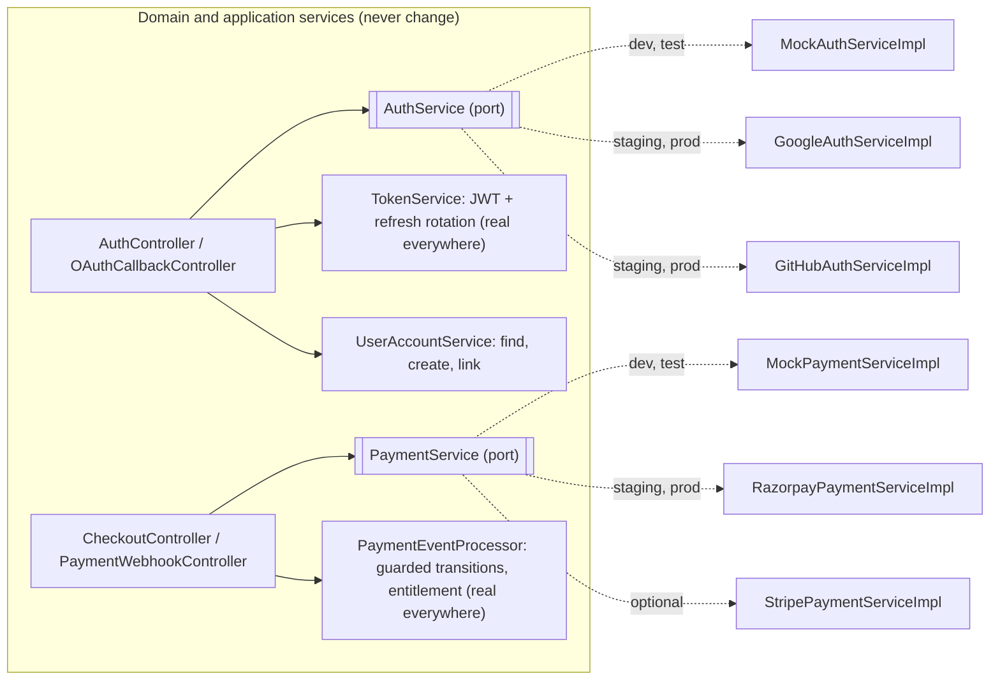
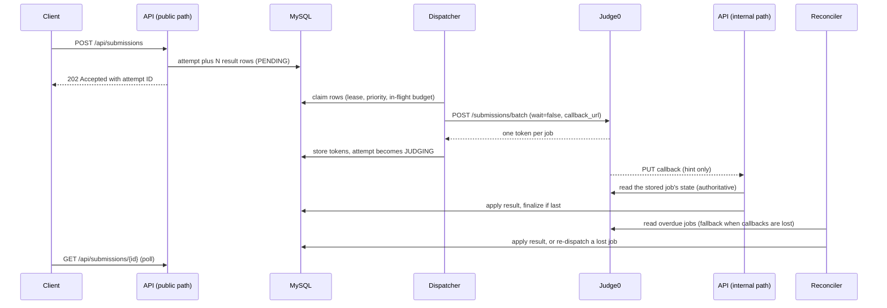

# Technical Requirements Document (TRD) — Semicolan

## 1. Frontend Architecture

**Stack**: React SPA with `@monaco-editor/react`.

**Component boundaries**: App shell (sidebar, top bar, search palette), Home dashboard, Sign-in (OAuth buttons, onboarding), Problem catalog, Knowledge hubs (topic grid, Theory, Quiz runner), Design modules (HLD/LLD list and viewer), Company pages, Projects, Community (feed, post, composer), Blog (list, article), Problem view (Description, Solution, Submissions tabs), Editor pane (language selector, toolbar), Result panel (with the Run / Submit footer), Leaderboard, Mock Test runner, Profile and Settings — each owns its own data fetching, composed on problem/test pages. The **admin panel** (`/admin/*`: overview, content tables and editors, review queue, test-case manager, gate report, moderation queue, users, audit log; [Admin_Panel_Strategy.md](Admin_Panel_Strategy.md) §1) is a separate lazy-loaded chunk, requested only when `GET /api/me` reports `role: "ADMIN"`. Visual tokens, components and page layouts: [UI_UX_Brief.md](UI_UX_Brief.md) §1–§2 and §8–§10.

**Monaco state management**: Editor state (selected language, code buffer) is kept separate from problem-metadata state. Switching language swaps the Monaco model/value without refetching or re-rendering the problem statement, leaderboard, or submission history.

**Handling code stubs**: Each problem defines a boilerplate code stub per supported language (C, C++, Java, Python 3), fetched from the backend when the problem loads and seeded as Monaco's initial value. User edits are held in-memory and debounce-saved (to local storage in MVP) so in-progress code survives navigation or refresh without a dedicated backend call per keystroke. Drafts are keyed by user ID, problem, and language, and cleared on explicit logout: many students work on shared lab machines.

**Route access**: The catalog, free problem statements, and the leaderboard are public routes (visitors can browse); Run/Submit, mock tests, billing, and account pages require login. A visitor who clicks Run or Submit gets the auth gate (a modal over the Workspace) and the action resumes after login; there is no guest execution. Signing in with Google or GitHub opens the provider in a **popup** started from the click (so the editor, draft and pending action stay on the page); the popup returns a one-time exchange code to the opener with `postMessage`, which the client checks against the SPA origin before calling `POST /api/auth/oauth/exchange`. When a popup is blocked, the client falls back to a full-page redirect with `returnTo`; the draft is already autosaved and the pending action is kept in `sessionStorage`, so it resumes after the redirect. The client reads the caller's plan and `activeTestSession` from `GET /api/me` only to drive UI (lock icons, paywall prompts, the "Test in progress" bar) — the backend independently enforces every entitlement check. In the same way `role` only decides whether the Admin entry and the `/admin/*` routes are mounted; a non-admin who reaches an admin URL sees "Page not found", and every `/api/admin/**` call is authorized on the server (§5). The blog (`/blog`, `/blog/:slug`) is public.

**Responsive scope**: The Workspace is desktop-class and has three tiers by viewport width (CSS px): 1024 and wider gets the full three-pane layout; 768 to 1023 gets a compact layout in which the problem pane collapses to a rail and opens as an overlay drawer (this keeps half-snapped windows, 150% display scaling and 200% zoom usable); under 768 the app shows read-only views — catalog, statements, leaderboard, results — and asks the user to switch to a larger screen to write code. A mock-test session in progress never swaps to the read-only fallback. Splitters use `react-resizable-panels`.

**Monaco delivery**: Monaco and the code fonts are self-hosted (no third-party CDN, for restrictive campus networks and a tight CSP) and lazy-loaded on the Workspace route only. If the editor has not loaded within 10 seconds or fails, the editor area becomes a plain `<textarea>` with the same buffer, autosave, Run and Submit, plus a "Retry full editor" action.

**Idempotent Run/Submit**: The client generates a `clientRequestId` (UUID) per click and reuses it for every retry of that click, so a dropped connection or a double submit returns the original attempt (§3 step 1).

**Token handling**: One shared API client owns every access-token decision.
- *Single-flight refresh*: at most one refresh request is in flight per browser profile. Requests within a tab await the same promise, and tabs coordinate through `navigator.locks` (or `BroadcastChannel`), so concurrent `401`s never present the same refresh token twice.
- *Proactive first, reactive as the fallback*: the token is refreshed at about 75% of its lifetime, measured with the monotonic clock from the moment it was received — never by comparing `exp` with the local wall clock. A `401` triggers one refresh and one retry of the original request.
- *Failure handling*: a network error or `5xx` during refresh is retried with backoff and never logs the user out. Only an explicit `401 INVALID_REFRESH_TOKEN` opens a login modal over the current page — no navigation, so the editor, countdown, and polling survive. Editor buffers are never discarded on an auth failure.

**Mock-test client**: The countdown is computed from timestamps, not by decrementing: the client measures its offset to the server (`serverNow` from the session response minus the local clock at receipt) and renders `endTime` minus the corrected clock, so a throttled background tab cannot drift. It re-syncs on load, about every 60 seconds, on `visibilitychange`, `focus`, and `online`, and after any `409` or `5xx`; until the first sync it shows "Syncing time…" rather than `00:00`. At local zero it syncs once more before locking the editor. The server stays authoritative: a request that races the deadline can still return `409 TEST_SESSION_CLOSED`. While a session is `IN_PROGRESS` the client forces a token refresh about 6 minutes before `endTime`; with the default 15-minute access token the new token outlives the deadline by 9 minutes, so no `401` lands near the deadline or during final result polling.

**Verdict polling**: `GET /api/submissions/{id}` is polled with backoff and stops at a terminal status (cadence defaults as in App_Flow §2.3: 1 s for the first 15 s, 2 s up to 60 s, then 5 s; slower in a hidden tab). Each poll is a primary-key read. Push via SSE/WebSocket is Future Scope (§7).

## 2. Backend Architecture

**Stack**: Spring Boot, layered Controller → Service → Repository.

**CQRS (lightweight)**: Command and Query responsibilities are split into separate service classes against the same MySQL database — not full event sourcing or a separate read store:
- Command services: `SubmissionCommandService` (creates attempts, finalizes verdicts, records first solves), `CheckoutService` (creates orders through `PaymentService`) and `PaymentEventProcessor` (applies verified payment events) — handle writes and side effects.
- Query services: `ProblemQueryService`, `LeaderboardQueryService` — handle reads only.

This separation keeps the query path free to move to a cache or read replica later without changing command/write logic (§7).

**Leaderboard reads**: `LeaderboardQueryService` reads only the `user_problem_solves` read model (one row per user and problem, written by the command side in the same transaction that finalizes a first accepted submission). The board is public, so the ranked list (a `GROUP BY`) and the viewer's rank (a window function over every user) must not run per request: reads are served from a 15–30 s in-process snapshot per window with single-flight refresh, so anonymous traffic never multiplies the aggregate. Read DTOs are storage-agnostic.

**Domain events**: Command services publish facts after commit — `SubmissionFinalized`, `SolveRecorded`, `MockSessionScored` — through Spring after-commit events. Analytics (PRD OPS-5) subscribes. Subscribers are idempotent and the derived data is rebuildable from MySQL, because an after-commit event is lost if the process dies between commit and dispatch.

**JWT authentication**: Spring Security filter chain. Access tokens are stateless JWTs with a 15-minute lifetime (default) carrying only the user ID (`sub`), `role` (`USER` or `ADMIN`) and the registered claims `iss`, `aud`, `iat`, `exp` — the plan is never a role or a claim, and no email or other personal data is in the token. The algorithm is pinned (no `none`, no negotiation), `iss`, `aud`, and `exp` are validated with at most 30 s of clock skew, and the signing key comes from secret storage with a `kid` so it can rotate without logging everyone out. Refresh tokens are opaque, stored hashed in `auth_tokens`, and single-use with rotation. Rotation tolerates the benign race: a refresh token consumed within the last 10 seconds (default leeway) that is presented again — a second tab, a retried request after a lost response — receives a fresh pair and does not trigger revocation. Reuse outside the leeway is treated as theft and revokes the user's refresh tokens. The leeway is a deliberate trade-off: a thief who replays inside it also gets a pair. The one-time OAuth exchange code (60-second lifetime) uses the same hashed single-use token mechanism. JWT issuance and refresh live in `TokenService`, which is never mocked: the development sign-in issues tokens through the same code as production. The `role` claim is mapped to one authority (`ROLE_USER` or `ROLE_ADMIN`); for `/api/admin/**` it is necessary but not sufficient, because the role is re-read from `users` on every admin request (§5).

**Authentication and payments behind interfaces (Dependency Inversion)**: The two external integrations whose real versions need accounts, KYC, registered domains and public callback URLs — identity providers and the payment provider — sit behind ports owned by the domain. Development and CI run against mock implementations; the real ones are written and switched on in the Production Readiness phase (Implementation_Plan Phase 10), with no change to controllers, services, schema or UI.



*`AuthService`* — turns an external sign-in into a verified identity; it never issues our tokens.

```java
public interface AuthService {
    AuthProvider provider();                                          // GOOGLE or GITHUB (a mock instance reports the one it stands in for)
    URI authorizationUrl(OAuthStart start);                           // state, PKCE challenge, redirect URI, returnTo
    VerifiedIdentity exchange(String code, OAuthStart start);         // code → identity; throws OAuthException
}
public record VerifiedIdentity(AuthProvider provider, String subject, String email,
                               boolean emailVerified, String displayName, URI avatarUrl) {}
```

- `GoogleAuthServiceImpl`: OpenID Connect authorization-code flow with PKCE (scopes `openid email profile`); validates the ID token (signature against Google's JWKS, `iss`, `aud`, `exp`, `nonce`) and requires `email_verified = true`.
- `GitHubAuthServiceImpl`: OAuth app authorization-code flow (scope `read:user user:email`, PKCE where the app supports it, `state` always); reads `GET /user` and `GET /user/emails` and uses the **primary, verified** email. No verified primary email → `OAuthException(EMAIL_NOT_VERIFIED)`, shown as "Add and verify an email on GitHub, or continue with Google".
- `MockAuthServiceImpl` (`dev` and `test` only): `authorizationUrl` points at the SPA's mock provider page (`/dev/mock-oauth?provider=google&state=…`), which lists the seeded test users; choosing one returns a mock code `mock:<userKey>` to the same callback. One instance is registered for each provider button (`google`, `github`), and `exchange` maps the key to a fixed `VerifiedIdentity` **for that provider** (`provider = GOOGLE` or `GITHUB`, subject `mock-<provider>-<userKey>`, email `<userKey>@semicolan.test`), so linking a second provider in development behaves exactly as in production. The same class backs `POST /api/auth/mock-login` (API_Contract §1), the one-call sign-in for scripts, Postman and E2E tests. The test users are `free`, `premium-active`, `premium-expired`, `revoked`, `admin`, `new-user` (no account yet, so it gets onboarding) and `github-unverified` (exercises the unverified-email error). In addition, a key of the form `e2e-…` creates an **ephemeral** user from one of those templates on first use, so parallel E2E specs each own a user and four-eyes tests have a second admin ([Agent_Testing_Environment.md](Agent_Testing_Environment.md) §7.4).
- *Seeding the test users*: `MockUserSeeder` (`@DevOnly`, an `ApplicationRunner`) upserts the five stateful users by email at every `dev` startup, with dates relative to the `Clock`: `free` (no plan), `premium-active` (`ACTIVE` until now + 30 days), `premium-expired` (`EXPIRED` since now − 1 day), `revoked` (`REVOKED`) and `admin` (`role = ADMIN`), all onboarded and each with its Google mock identity. Relative dates mean a seeded Premium never goes stale; the cost is that a restart resets those five users' plans, which is intended. `new-user` is never seeded and `github-unverified` never gets a row. Integration tests call `MockUserSeeder.reseed()` in their setup (Dev_to_Prod_Strategy.md §1).
- *Shared path*: whichever implementation produced the identity, `UserAccountService` finds the user by `(provider, subject)`; otherwise links by verified email to an existing account; otherwise creates one with `needsOnboarding = true`. `TokenService` then issues the real JWT pair. Every authorization rule, entitlement check and refresh rotation is therefore exercised in development exactly as in production.

*`PaymentService`* — the provider port; entitlement logic never sees a provider type.

```java
public interface PaymentService {
    PaymentProvider provider();                                       // RAZORPAY, STRIPE or MOCK
    GatewayOrder createOrder(Plan plan, Payment payment);             // provider order id + checkout payload for the SPA
    PaymentEvent verifyAndParse(byte[] rawBody, Map<String, String> headers); // signature check, then parse; throws on a bad signature
    GatewayOrderStatus fetchOrder(String providerOrderId);            // for reconciliation
}
```

- `RazorpayPaymentServiceImpl`: Orders API; checkout payload `{keyId, orderId, amount, currency}`; webhook signature is HMAC-SHA256 over the raw body with the webhook secret (`X-Razorpay-Signature`), event ID from `X-Razorpay-Event-Id`; maps `order.paid`, `payment.failed`, `refund.processed`, `payment.dispute.created` (API_Contract §4).
- `StripePaymentServiceImpl` (optional): Checkout Sessions; `Stripe-Signature` verification with the endpoint secret; maps `checkout.session.completed` (only when `payment_status = paid`) and `checkout.session.async_payment_succeeded` to paid, `checkout.session.async_payment_failed` to failed, `charge.refunded` (full) to refunded and `charge.dispute.created` to disputed — the same `PaymentEvent` types.
- `MockPaymentServiceImpl` (`dev` and `test` only): `createOrder` returns `mock_order_<uuid>` and a payload that sends the SPA to its mock checkout page (`/dev/mock-checkout?orderId=…`) with **Pay**, **Fail** and **Cancel**. The page calls `POST /api/dev/payments/{orderId}/simulate` with an outcome (`PAID`, `FAILED`, `REFUNDED`, `DISPUTED`), an optional `delaySeconds` and `deliver: false` (a lost webhook). The mock builds a provider-shaped event, signs it with a dev secret and hands it to the **same** `PaymentEventProcessor` the real webhook controller uses, after the same `verifyAndParse` step; `fetchOrder` reports the simulated state, so a lost webhook is recovered by the real reconciliation job. Duplicates are simulated by re-sending the same event ID.
- `PaymentEventProcessor` (real everywhere): idempotency by provider event ID, guarded state transitions under the `payments` row lock, amount and currency match, stacked expiry, `REVOKED` on refund or dispute — the rules below under *Webhook processing*.

*Wiring and the production guard*:
- One property per port — `semicolan.auth.mode` (`mock` | `oauth`) and `semicolan.payments.provider` (`mock` | `razorpay` | `stripe`) — selects the bean with `@ConditionalOnProperty`. The mock beans, `POST /api/auth/mock-login`, `/api/dev/**` and the SPA's `/dev/*` pages are additionally annotated / built only for the `dev` and `test` profiles, so they are not registered at all elsewhere (requests get `404`, not `403`).
- *Environments*: local (`dev`), CI (`test`) and the shared **preview** environment, which runs the `dev` profile behind an access gate (IP allowlist plus basic auth) with its own database and keys, use the mocks; `staging` and `prod` use the real providers (Implementation_Plan, Environments).
- **Fail closed**: an `ApplicationContextInitializer` refuses to start when the active profiles include `staging` or `prod` and either property is `mock`, `semicolan.execution.client` is `fake` (the in-process `FakeCodeExecutionClient` of §3, which would accept whatever it is told to), or any bean annotated `@DevOnly` is present. The production frontend build sets `VITE_ENABLE_DEV_TOOLS=false`, which tree-shakes the `/dev/*` routes and the E2E editor hook (`window.__semicolan_e2e__`).
- Tokens issued in development are signed with a development key that no other environment trusts, and mock identities (`user_identities.provider_subject` starting with `mock-`; real Google and GitHub subjects are numeric), `@semicolan.test` users and `payments.provider = 'MOCK'` rows exist only in development databases; a startup check in `staging`/`prod` fails if any exist.
- *Contract tests* run every real implementation against recorded provider fixtures (Google JWKS and token responses, GitHub user and emails responses, Razorpay and Stripe webhook payloads and signatures) and the mock against the same `PaymentEvent` expectations, so swapping implementations cannot change behavior unnoticed.
- *Swap procedure* (Phase 10): register the OAuth apps and webhook URLs, set the secrets, set `semicolan.auth.mode=oauth` and `semicolan.payments.provider=razorpay` on staging, run the provider drills, then promote the same image to production. No code path outside the adapters changes.

**Learning modules and community**: Content for the hubs, design modules, company pages, projects and the blog is authored in the admin panel or imported from versioned content packs (`content/hubs/`, `content/design/`, `content/companies/`, `content/projects/`), like problems, and reaches users only through the content workflow below (PRD OPS-1). Reads go through query services (`HubQueryService`, `DesignQueryService`, `CompanyQueryService`, `ProjectQueryService`) with the same entitlement check as problems; premium answers and editorials are stripped server-side, never hidden by the client. `QuizAttemptService` grades on the server: a question's correct option leaves the server only in the response to that question's answer, and an answer cannot be changed once given. `CommunityCommandService` (posts, comments, votes, reports, moderation) and `CommunityQueryService` (feeds) follow the same command/query split; vote counts are denormalized onto the post and comment rows and updated in the voting transaction, so feeds never aggregate votes.

**Content operations and the admin panel** (PRD ADM-1 to ADM-4; [Admin_Panel_Strategy.md](Admin_Panel_Strategy.md)): live content changes only by publishing a reviewed revision.
- `ContentRevisionService` owns drafts: one `content_revisions` row per revision with the item's JSON document (optimistic `version`, one open revision per item), the editors who changed it, and for problems a draft **test set** (Backend_Schema §6, §42–§44). Admin edits, content-pack imports (`scripts/content-import`) and the development seed all create revisions.
- `PublishGateService` runs OPS-2 for a problem revision through the real execution path as `VALIDATE` attempts (§3), and binds the result to a fingerprint of the effective limits, reference solutions and test digests, so any later change to those makes it stale.
- Review is four-eyes: the approver must not have edited the revision (`CONTENT_SELF_REVIEW_ALLOWED` relaxes this for a single-admin deployment and marks such reviews).
- `ContentPublisher` is the **only writer of live content tables**, the way `PaymentEventProcessor` is for payments: one transaction applies the approved revision, flips a problem's `live_test_set`, writes the editorial code from the gate-tested reference solutions, and records `CONTENT_PUBLISH`; an after-commit `ContentPublished` event evicts the in-process caches (catalog, topics, hub and design lists, companies, projects, blog, facets).
- Admin reads (`AdminMetricsQueryService`, the content tables, users, audit log) are query services like the rest; the overview metrics come from a 5-minute snapshot so the dashboard never aggregates per request.

**Entitlement (Free vs Premium)**: Derived server-side on every gated request from the user row: Premium access = `subscription_status = 'ACTIVE' AND subscription_expires_at > :now`, with `:now` from the application's UTC `Clock` (ad-hoc SQL uses `UTC_TIMESTAMP(3)`, never `NOW()`) (see [Backend_Schema.md](Backend_Schema.md)). Expiry takes effect at the timestamp itself with no dependency on a sweeper, `REVOKED` takes effect immediately, and there are no cached claims to go stale. A mock-test session is authorized against the session, so entitlement is checked once at session start and an in-progress test can finish after a lapse.

**Mock-test sessions and token lifetime**: The deadline is `mock_test_sessions.end_time`, computed by the server from one time source (NTP-synced if more than one node runs). It never depends on the validity of any token: authentication is still checked on every request, but a token that expires during a two-hour test can neither extend nor shorten the session, and a re-login resumes the same session from the server's remaining time. The clock is never paused for authentication problems.
- *Start is idempotent and serialized per user*: session creation locks the user's row and, under that lock, returns the user's `IN_PROGRESS` session if it is for the same test (resume — never a second clock), refuses a different test with `409 ACTIVE_SESSION_EXISTS`, and enforces the free test's single attempt. A double-click or retry therefore cannot create two sessions or burn the free attempt.
- *Deadline check*: an attempt is accepted only if the server received it at or before `end_time`, decided from `end_time` itself and never from the closer's status. Arrival is timestamped when the request enters the server, before any queueing or retry. Reads derive the effective state the same way, so a session past its deadline reads as `COMPLETED` immediately.
- *Closing is two-step*: reaching `end_time` stops new attempts; the `score` is computed only after every attempt received at or before `end_time` is terminal and a settle delay (default 10 s) has passed. Until then the session is `COMPLETED` with `score = NULL` and the report shows "finalizing". An attempt received before the deadline counts even if its verdict arrives after it. `closeIfDue(session)` is idempotent and is called by the scheduled closer and lazily on session and report reads; it takes the session row `FOR UPDATE` only when the session is actually due, so polling reads stay lock-free. Attempt creation reads the session row `FOR SHARE`, so scoring cannot slip past an attempt that is being created.
- *Early finish*: `POST /api/mock-test-sessions/{id}/finish` sets `end_time = LEAST(end_time, :now)`, so a late or repeated finish can never lengthen the session, and closes it through the same `closeIfDue` path.
- *Admin extension*: for a platform incident or an approved accommodation an admin extends a session with an audit-logged script that sets the trigger's extension flag for its transaction (Backend_Schema Triggers). There is no endpoint, and no session void or reset in MVP.
- *Infrastructure failures are not the user's*: in-session attempts get a longer judging timeout (default 30 minutes instead of 5) and the full recovery path in §3, and an alert fires when one stays non-terminal for more than 2 minutes. Re-judging an attempt that ended in `JUDGING_ERROR` is an audit-logged admin script.

**Webhook processing**: Dedicated controllers for Judge0 execution callbacks and payment webhooks (`/api/webhooks/razorpay`, and `/api/webhooks/stripe` if Stripe is enabled). The provider sits behind `PaymentService` (above), so a second provider is a new adapter, not a change to entitlement logic. Payment webhooks are signature-verified over the raw body and made idempotent by the unique gateway event ID in `payment_events`. Beyond the signature, the event's order ID must match a `payments` row, its amount and currency must equal that row's, the user comes from our row (never from webhook metadata), and access is granted only on the gateway's terminal captured/paid event. Judge0 callbacks are authenticated hints, not results: they trigger an authenticated read of the job's state from Judge0 (§3, §5).

**Scheduled and background work** (Spring `@Scheduled`; the MVP runs a single backend instance with recreate deploys, so singleton jobs need no lock; queue work is still claimed with `SELECT … FOR UPDATE SKIP LOCKED`, which MySQL 8 provides at no cost. Multi-instance deployment with ShedLock is Future Scope, §7):
- Judge dispatcher — sends `PENDING` jobs to Judge0 (§3); woken by an after-commit event and by a 1-second tick.
- Judge reconciler — every 10 seconds, reads the state of overdue jobs directly from Judge0, applies finished ones, and re-dispatches lost ones. It also performs the stuck-attempt sweep: attempts past the judging timeout (default 5 minutes; 30 for in-session attempts) become `JUDGING_ERROR`, but a dispatched job is read from Judge0 one last time before it is failed. A pass also runs at startup.
- Mock-test closer — every 15 seconds, calls `closeIfDue` for sessions past their deadline.
- Payment reconciliation — every few minutes, asks the gateway about orders still `CREATED`, so a missed webhook is recovered within 15 minutes through the same code path as the webhook.
- Subscription sweeper — relabels lapsed `ACTIVE` users as `EXPIRED` and sends the 7-day and 1-day expiry reminders.
- Run purge — deletes `RUN` attempts older than 24 hours in batches (for example 1,000 rows per transaction) to avoid long locks and replication lag.
- Judge0 retention purge — after a result is applied the backend deletes the finished job through Judge0's `DELETE /submissions/{token}` (needs `ENABLE_SUBMISSION_DELETE=true` and the authorization token), best-effort; a scheduled job deletes any finished job older than the retention window (default 2 hours) using the tokens stored in `submission_test_results` (§3). A database-level purge on Judge0's PostgreSQL is Future Scope (§7).

**Email**: Receipts, expiry reminders and moderation notices (an interview experience approved or rejected) go through an `EmailSender` interface (SMTP/provider implementation in production, Mailpit or log-only in local development). Sends run asynchronously on a bounded executor with retry, never inline on the request thread. There are no verification or password-reset emails: identity comes from the OAuth provider.

**Analytics**: Events (PRD OPS-5) go through an `AnalyticsPublisher` interface whose MVP implementation inserts into the MySQL `analytics_events` table asynchronously on a bounded executor; a failure is logged and never fails a request. Server-side events are published from the command services; client-originated events (`paywall_view`, `workspace_opened`, `auth_gate_view`, `editorial_view`) arrive through `POST /api/events`, which accepts an allowlist of event names and is rate-limited. Metrics such as Weekly Active Solvers and the Student split are saved SQL queries over this table and `submissions`.

## 3. Code Execution Flow

Run and Submit never block a request thread on Judge0, and no verdict depends on a single network message arriving. Judge0 evaluates one stdin/expected-output pair per job, so an attempt fans out into one job per test case: the sample test cases for `RUN`, every test case for `SUBMIT`. Four rules shape the design:

- **The database is the queue.** Jobs are durable rows before Judge0 hears about them, and a dispatcher pulls from those rows (outbox pattern).
- **Callbacks are hints, not facts.** A callback means "this job is probably finished". The result is read from Judge0 over the authenticated backend-to-Judge0 channel — the same read the reconciler uses — and the callback body is never trusted (§5).
- **One code path applies results.** `JudgeResultApplier` is the only writer of verdicts. Callback hints, the reconciler, and any future queue consumer all go through it, and it is idempotent.
- **Fail closed, and never blame the user for infrastructure.** Anything unknown or ambiguous becomes a retry or `JUDGING_ERROR`, never `ACCEPTED`; a job is declared failed only after the system has asked Judge0 for its state and retried lost work.



1. **Accept.** `POST /api/submissions` with `mode` `RUN` or `SUBMIT`. The API checks authentication, the rate limit and per-user in-flight cap (§5), request size, access (the problem is free, the caller has Premium entitlement, or an active mock-test session authorizes it and its deadline has not passed), and that the language is a launch language. A client-generated `clientRequestId` makes creation idempotent per user: a repeat returns the original attempt instead of a new one. If the dispatch backlog is over its limit (§6), attempts outside a session are refused with `503 EXECUTION_BUSY` and `Retry-After`; session attempts are always admitted.
2. **Persist.** In one transaction, `SubmissionCommandService` writes a `submissions` row (`PENDING`, with the problem's base time and memory limits copied onto it) and one `submission_test_results` row per test case of the problem's **live test set** (`PENDING`, eligible for dispatch immediately), then the API returns `202 Accepted` with the attempt ID. No Judge0 call happens on the request thread. Because the tests and limits are fixed at this point, publishing a new test set or new limits never changes an attempt already in flight (Backend_Schema §6, §10).
3. **Dispatch.** The dispatcher claims eligible rows — in-session attempts first, then `SUBMIT`, then `RUN`, oldest first within each — up to the in-flight budget (§6). Publish-gate `VALIDATE` attempts (below) come last, at priority 3, within their own budget. A claim is a short transaction that sets a lease (`next_dispatch_at` pushed into the future); no database lock or transaction is held while talking to Judge0. Through the `CodeExecutionClient` port it sends up to 20 jobs per batch with `wait=false`; each job has its own `callback_url` (§5) and its own limits (see the Judge0 contract below). Items are handled one by one. A returned token is stored with `dispatched_at`, and the attempt becomes `JUDGING` when its first job is acknowledged. A connection error, timeout, `5xx`, or `503` queue-full sets `next_dispatch_at` to now plus capped exponential backoff (1 s up to 30 s), and the rows stay `PENDING` in MySQL, which absorbs the outage until the judging timeout. A per-item validation rejection is not retryable: that row becomes `JUDGING_ERROR` at once and an alert fires, because it signals a configuration bug, not load.
4. **Callback (fast path).** Judge0 `PUT`s a callback per finished job to `JudgeCallbackController` on the internal path (`/api/internal/**`, §5). After the signature check the controller asks `JudgeResultApplier` to read that row's stored job from Judge0 (3-second timeout, inside Judge0's own 5-second callback timeout) and apply it. If the row is already terminal, or has no stored token yet because the callback beat the dispatcher's bookkeeping, the hint is dropped; the reconciler recovers anything that matters. Every verified callback is answered `204`, and every verification failure `403`.
5. **Reconcile (fallback path).** Every 10 seconds the reconciler takes jobs dispatched more than 15 seconds ago that are still `PENDING` and reads them from Judge0 in batches of 20 (`GET /submissions/batch`). Finished jobs are applied. `In Queue` is left alone — that is backlog, not a fault. A job Judge0 no longer knows (`null`), or has held in `Processing` longer than the processing timeout (default 60 s), is lost and is re-dispatched with a fresh token, at most twice per job.
6. **Apply.** `JudgeResultApplier` runs one short transaction per outcome, after any network read has finished. It locks the parent `submissions` row (`SELECT … FOR UPDATE`; locks are always taken parent first, then result rows, and in ascending attempt ID when a transaction touches several attempts), updates the result row with a conditional `UPDATE … WHERE status = 'PENDING' AND judge0_token = <the token that was read>` (zero rows changed means a duplicate, a late delivery, or a stale job from before a re-dispatch, so stop), then finalizes if due. The parent lock serializes finalization per attempt — without it, two final results committing concurrently can each see the other as still pending under REPEATABLE READ, and the attempt never finalizes — and finalization is itself a conditional update, so it happens at most once.
7. **Finalize.** A `COMPILE_ERROR` from any job finalizes the attempt immediately as `COMPILE_ERROR`, with the compile output stored on the attempt; in the same transaction the attempt's other still-`PENDING` result rows become the terminal status `SKIPPED` (with `judged_at` set), so the dispatcher and reconciler never touch them and capacity is not wasted. A late Judge0 result for a skipped row changes zero rows in the conditional update and is dropped. `SKIPPED` rows are not returned by the API. Otherwise, once no result is `PENDING`: `ACCEPTED` if every test passed; else the status of the first failing test by `display_order`, where a genuine failure (wrong answer, time limit, runtime error) outranks `JUDGING_ERROR`; `failed_test_index` is that test's 1-based position; time and memory are the maximum across tests. A `SUBMIT` that finalizes as `ACCEPTED` inserts its `user_problem_solves` row in the same transaction if it is the user's first solve of that problem — as a duplicate-key no-op, not `INSERT IGNORE`, which also hides foreign-key and truncation errors — and `SubmissionFinalized` is published after commit.
8. **Poll.** The client polls `GET /api/submissions/{id}` until the status is terminal (§1).

**Publish-gate attempts** (PRD OPS-2): `PublishGateService` creates `mode = 'VALIDATE'` attempts — the reference solution in each launch language plus a negative control — against a problem revision's draft test set with the revision's base limits, and they run through exactly the steps above: dispatcher, callbacks, reconciler, `JudgeResultApplier`. They differ only in what surrounds the pipeline. They are created by the service, never through `POST /api/submissions`. They are dispatched at priority 3 after every user attempt, within `VALIDATION_MAX_INFLIGHT_JOBS`, and are excluded from the backlog count that answers users with `503` (§6). They record no solve, publish no analytics and are invisible to `/api/submissions`. They keep truncated output for hidden tests too, readable only through the admin API. A pipeline that accepted everything would accept the negative control, so the gate cannot pass on a broken judge ([Admin_Panel_Strategy.md](Admin_Panel_Strategy.md) §2.6).

**Delivery guarantees and recovery**: Judge0's own callback delivery is weak. It retries up to 3 times (`CALLBACKS_MAX_TRIES`) immediately, with no backoff, only when the HTTP call itself fails (connection refused, 5-second timeout), and it treats any HTTP response, even a `5xx`, as delivered. A callback sent while Spring Boot is restarting is therefore lost for good, which is why correctness never rests on it:

| What goes wrong | Detected by | Outcome |
|---|---|---|
| Spring Boot is down, restarting, or returns `5xx` when Judge0 calls back | Reconciler finds the job overdue; a pass also runs at startup | Result read from Judge0; delay of at most about 25 s; nothing lost |
| Callback arrives before the token is stored, or is duplicated, late, or out of order | No stored token; conditional update changes 0 rows | Hint dropped or no-op; the reconciler covers the first case |
| Forged, expired, or replayed callback URL | Signature or `exp` check → `403`; a validly signed replay only triggers a read | No verdict can be set through the request |
| Judge0 down, slow, or queue full at dispatch | Connection error, timeout, `5xx`, `503` | Capped backoff; rows wait as `PENDING` in MySQL until the judging timeout |
| Crash after commit, before dispatch | `PENDING` rows with no token | Dispatcher picks them up after restart |
| Crash after Judge0 accepted a batch, before tokens were stored | `PENDING` rows with no token; orphan jobs in Judge0 | Re-dispatched as new jobs; orphan results are never read because only the stored token is read; cost is wasted capacity |
| Judge0 rejects one item of a batch (`201` or `422` with per-item errors) | Array element without a `token` | Non-retryable: that row becomes `JUDGING_ERROR` and an alert fires; startup validation of limits is meant to make this impossible |
| Judge0 loses a job (worker crash, restart, wiped database) or reports Internal Error (`13`) | `null` from a batch read, `Processing` past the timeout, or status `13` | Re-dispatched, at most twice per job |
| Process dies mid-apply | Transaction rolls back | Reconciler re-reads and re-applies |
| Recovery exhausted, or the judging timeout reached | Reconciler | `JUDGING_ERROR` — counted against the PRD's < 1% guardrail and alerted |

**Judge0 contract** (all of this lives in the Judge0 adapter behind `CodeExecutionClient`; the domain sees only a vendor-neutral outcome: state, our verdict enum, time, memory, truncated output):
- *Encoding*: always `base64_encoded=true` when creating and reading jobs. Judge0's callback body is base64-encoded regardless, and without base64 any output that is not valid UTF-8 makes Judge0 fail the read. Decode leniently (replace invalid sequences), then truncate stdout, stderr, and compile output to 16 KB before persisting. An oversized value must never become a database error, because a failed apply is a lost callback.
- *Status mapping* (our verdict ← Judge0 status): `1` In Queue and `2` Processing → not terminal; `3` → `ACCEPTED` (only if time and memory are present); `4` → `WRONG_ANSWER`; `5` → `TIME_LIMIT_EXCEEDED`; `6` → `COMPILE_ERROR`; `7`–`12` and `14` → `RUNTIME_ERROR`, except that a Python run whose last stderr line is a `SyntaxError`, `IndentationError`, or `TabError` is reclassified as `COMPILE_ERROR` with the traceback stored as the compile output (Judge0 has no Python compile step); `13` Internal Error → lost job (retry, then `JUDGING_ERROR`); any other value → `JUDGING_ERROR`. The mapping never defaults to `ACCEPTED`.
- *Expected output is never absent*: Judge0 treats a job with no `expected_output` as correct whenever the program exits cleanly, so a missing value would turn every submission into `ACCEPTED`. The adapter refuses to build a job without it, and an empty expectation is sent as an empty string, pinned by a contract test against the deployed Judge0 version.
- *Comparison*: Judge0 compares stdout to the expected output after trimming trailing whitespace on each line and at the end. There are no custom checkers in MVP, so every problem must have a single correct output (checked by the OPS-2 publish gate).
- *Limits*: `cpu_time_limit` = the attempt's base time limit (copied from the problem, or from the revision for a `VALIDATE` attempt, when the attempt was created) × language multiplier; `wall_time_limit` = max(1 s, 2 × the CPU limit); `memory_limit` = the attempt's base memory limit × multiplier. Judge0 rejects values outside its caps (`MAX_CPU_TIME_LIMIT` 15 s, `MAX_WALL_TIME_LIMIT` 20 s, `MAX_MEMORY_LIMIT` 512,000 KB by default), so the adapter clamps them; startup validation fails if any published problem and language combination could exceed a cap, and a revision whose limits would exceed one fails the gate's static checks before it can be published. For example, the schema's default 262,144 KB with a ×2 multiplier is 524,288 KB and would be rejected.
- *Batches*: at most 20 jobs per create or read call (`MAX_SUBMISSION_BATCH_SIZE`); larger attempts are chunked.
- *Cost*: every job compiles and runs from scratch — Judge0 has no compile cache — so an attempt costs N × (compile + run); see §6.
- *Retention*: Judge0 keeps every finished job (source code, stdin, expected output, stdout) in its own PostgreSQL and has no built-in retention policy; deletion is opt-in (`ENABLE_SUBMISSION_DELETE=true`). The backend deletes a job through the `DELETE` API once its result is applied, and the retention purge (§2) removes any finished job left after the window; without it the disk eventually fills and Judge0 goes down.

**Hidden test data**: Inputs and expected outputs of hidden test cases live only in `test_cases`; they, and the program output for hidden tests, are never returned by any user-facing endpoint and never written to logs. For user attempts only status, time and memory are kept. The exceptions are admin-only: the admin content API returns test payloads to admins, and `VALIDATE` attempts keep truncated output for every test so the gate report can show expected against actual (§5). Judge0 necessarily holds a transient copy while a job exists, which is why its database is treated as sensitive (§5) and purged on the retention window. Sample test cases return full detail.

**Load note**: One attempt costs up to N Judge0 jobs, each compiled and run from scratch, which multiplies load on the Judge0 queue — hence the rate limits and in-flight caps in §5, the admission control and capacity model in §6, and the pre-launch load test required by the PRD.

The `CodeExecutionClient` port keeps Judge0 specifics inside its adapter; a message broker is Future Scope (§7).

## 4. Database & Storage Strategy

**MVP schema (MySQL)**: MySQL holds all data. See [Backend_Schema.md](Backend_Schema.md) for the full table set. Core entities: `Users` with `UserIdentities` (one per linked OAuth provider), `Problems`, `TestCases` (`MEDIUMTEXT` columns), `Submissions` with per-test `SubmissionTestResults` (output stored only for sample test cases), the `UserProblemSolves` leaderboard read model, and `AnalyticsEvents`; the learning modules (hub topics, theory questions, quizzes and attempts, design questions, companies and their tags, projects, per-user content progress), the community (posts, comments, votes, reports), the blog, and the content workflow (revisions, their editors, gate attempts). Structured editorial content (design solutions, quiz options, project checklists) is stored as MySQL `JSON` — MySQL's binary JSON type, the equivalent of PostgreSQL's `JSONB` — and long text as Markdown in `MEDIUMTEXT`; JSON is read whole and never filtered by an inner key (Backend_Schema §0.1).

**Test case access**: Test cases are read through the normal repository in batches — `TestCaseRepository.findAllByProblemIdAndTestSet` returns every test case of one test set in `display_order` — never one query per test case, because a `SUBMIT` reads all of them on the dispatch path. Judge0 takes stdin and expected output inline in the create request, so the backend is in the data path of every job.

**Bounded size**: each test input and each expected output is capped at 256 KB (`TEST_PAYLOAD_MAX_BYTES`) after normalization, enforced at ingestion by the admin API and the content-pack importer alike, so one attempt of N jobs stays well inside request limits.

**Published test data does not change in place**: a problem's tests are versioned as numbered **test sets** (Backend_Schema §6). A set that has been live is frozen; editing a published problem's tests means a revision with a new set, which must pass the OPS-2 gate and review before `ContentPublisher` makes it the live set in one transaction. Every past verdict therefore stays reproducible against the exact rows it was judged on.

Moving test data to object storage (S3/MinIO) is Future Scope (§7).

## 5. Security Requirements

**Trust boundaries**: Three zones: the public internet (browser to API), our private application network (API, MySQL), and the Judge0 zone (Judge0 server and workers, plus its own Redis and PostgreSQL — Judge0 internals that our code never touches). Judge0 runs arbitrary user code and is treated as an untrusted execution boundary. Sandbox isolation (cgroups/seccomp/resource limits) is Judge0's responsibility, but nothing Judge0 sends is trusted as authority, and compromising it must not give access to the application tier.

**Judge0 callback hardening** (the callback is a hint — §3):
- The `callback_url` is `/api/internal/judge0/callback?resultId=<id>&exp=<epoch seconds>&kid=<key id>&sig=<HMAC>`, with `sig = HMAC-SHA256(key[kid], "judge0-callback:v1|" + resultId + "|" + exp)`. The key is dedicated to this purpose (never shared with the JWT or payment-webhook secrets), comes from secret storage, and rotates through `kid`. `exp` is the dispatch time plus the callback TTL (default 15 minutes); an expired URL costs only latency, because the reconciler recovers the result. Every re-dispatch gets a fresh URL.
- Verification happens before any database or Judge0 access, compares in constant time, and answers every failure with the same `403`, so the endpoint reveals nothing about which results exist.
- **The body is never trusted.** No field in it — status, time, output, even Judge0's job token — is stored or used for a decision. A valid callback makes the backend read the stored job's state from Judge0, and the verdict always comes from that authenticated read. A leaked or replayed URL therefore cannot forge an `ACCEPTED`; at worst it triggers one redundant read, and none at all if the row is already terminal. Recording a token or a result from the callback would let whoever calls first with a valid URL decide the verdict.
- *Network placement*: the endpoint is served by the same application as the rest of the API, under `/api/internal/**`. The reverse proxy rejects that path from the public internet, and the firewall admits only the Judge0 hosts to it. Because a callback is only a hint, a proxy misconfiguration or a leaked URL costs at most one redundant read and can never forge a result. Use TLS on this hop or a private network, because the signature travels in the query string. A separate listener and port is Future Scope (§7).
- *Logging*: query strings of `/api/internal/**` are redacted in access logs, APM traces, and error reports.

**Judge0 hardening** (deployment checklist):
- Run a release with the 2024 sandbox-escape fixes (≥ 1.13.1). Three Critical advisories were published on 18 April 2024, including GHSA-q7vg-26pg-v5hr / CVE-2024-29021, in which sandboxed code with network access reached Judge0's own PostgreSQL and rewrote job rows. Pin the image by digest, subscribe to Judge0's security advisories, and upgrade through the canary (§6).
- In `judge0.conf`: `ENABLE_NETWORK=false` and `ALLOW_ENABLE_NETWORK=false`; `ENABLE_COMPILER_OPTIONS=false`, `ENABLE_COMMAND_LINE_ARGUMENTS=false`, `ENABLE_ADDITIONAL_FILES=false`, and `ENABLE_WAIT_RESULT=false`, because the backend sets every job parameter itself and never forwards user-controlled ones; `AUTHN_TOKEN` and `ALLOW_IP` (backend hosts only); every default password (PostgreSQL, Redis) changed; `MAX_FILE_SIZE` lowered toward the largest legitimate output; `MAX_QUEUE_SIZE` raised to match the in-flight budget in §6.
- Network: the Judge0 zone has no route to MySQL, secrets, or the internet. Ingress admits only the backend; egress admits only the backend's internal callback path. Judge0 workers need privileged containers for `isolate`, so they run on dedicated machines whose compromise stops at the zone boundary.
- Assume compromise is possible. Only the explicit result shape is accepted (§3 status mapping; `ACCEPTED` needs time and memory), the canary (§6) watches for verdict drift, and Judge0's database is treated as sensitive: private, disk-encrypted, and purged on the retention window.
- The backend validates and sanitizes all stdout/stderr before persisting or rendering it: no `eval`, React's default escaping, no `dangerouslySetInnerHTML`, problem Markdown sanitized, and a strict Content-Security-Policy.

**API rate limiting and request limits**: Run/Submit (PRD EXE-4), the auth endpoints (OAuth start, exchange, refresh; the development-only `mock-login` is deliberately not limited, API_Contract §14), checkout creation, quiz answers, community writes, and the client events endpoint are rate-limited per user/IP, implemented behind a `RateLimiter` interface with named policies (`auth`, `run`, `submit`, `run_session`, `submit_session`, `checkout`, `quiz`, `community_post`, `community_comment`, `community_vote`, `community_report`, `events`, `admin`). Attempts that carry a `testSessionId` use the `*_session` policies, which are configured separately so a mock test is not throttled like practice. Limits are configuration; exceeding one returns `429` with a `Retry-After` header. The MVP limiter is in-memory (Bucket4j); a Redis-backed limiter is Future Scope (§7).
- Run/Submit are keyed by user ID; auth endpoints by client IP, derived only from the trusted proxy hop (`ForwardedHeaderFilter` with known proxies), never from a raw `X-Forwarded-For`. Attempts that end in `JUDGING_ERROR`, and `5xx` or `503 EXECUTION_BUSY` responses, do not consume the allowance.
- Rate alone does not protect Judge0, because one attempt is up to N jobs. Each user therefore also has an in-flight cap (default 3 non-terminal attempts, counted from `submissions`; `429`), and global admission control applies (§6).
- Bodies are limited at the proxy and in Spring before any work is done: `POST /api/submissions` ≤ 128 KB and `sourceCode` ≤ 64 KB (`413` or `400`). Every Judge0 job carries a copy of the source, so an unbounded source is multiplied by N.
- The in-memory limiter is per instance and resets on restart; both are acceptable for the single MVP instance.

**OAuth sign-in**:
- `state` (random, single-use) and the PKCE verifier are kept in a signed, encrypted `HttpOnly; Secure; SameSite=Lax` cookie scoped to `/api/auth/oauth/` for 10 minutes; the callback rejects a missing, expired or mismatched `state` with `OAUTH_STATE_INVALID`. Redirect URIs are an exact allowlist per environment; `returnTo` is accepted only as a same-origin relative path.
- Google ID tokens are fully validated (JWKS signature, `iss`, `aud`, `exp`, `nonce`); GitHub identity comes from the API with the access token, which is discarded after the exchange. Provider access and refresh tokens are never stored.
- The callback never puts our tokens in a URL. It redirects to the SPA with a one-time exchange code (60 s, single-use, stored hashed in `auth_tokens`), which the SPA trades for the JWT pair with `POST /api/auth/oauth/exchange`. The popup hands the code to its opener with `postMessage` targeted at the SPA origin, and the opener checks `event.origin`.
- Account linking by email happens only when **both** sides assert a verified email; otherwise the sign-in fails with a message to sign in with the original provider and link from Settings.

**Mock integrations never reach production**: see §2, *Wiring and the production guard*. CI builds the production image, starts it with the `prod` profile against a throwaway database, and asserts that startup fails with `semicolan.auth.mode=mock` or `semicolan.execution.client=fake`, that `/api/auth/mock-login`, `/api/dev/**` and `/dev/*` return `404` with the real configuration, and that the frontend bundle contains no `/dev/` route and no `__semicolan_e2e__` hook.

**User-generated content**: community posts and comments are Markdown rendered through the same allowlist sanitizer as problem statements, with images, raw HTML and Mermaid disabled; links get `rel="nofollow ugc noopener"` and `target` is stripped. Mermaid diagrams render only for editor-authored content (design editorials and blog posts), with `securityLevel: 'strict'`. Bodies are size-capped (post 20 KB, comment 4 KB, design notes 64 KB). Editor-authored content — statements, editorials, theory, design, company, project and blog Markdown — is not trusted either: it goes through the statement sanitizer (no raw HTML, no inline images) wherever it renders, the admin panel's preview included, so a pasted script or a compromised admin account cannot reach users' browsers.

**Admin API** ([Admin_Panel_Strategy.md](Admin_Panel_Strategy.md) §4):
- Four layers on every `/api/admin/**` request: the `ROLE_ADMIN` authority from the token's `role` claim; `AdminAccessFilter`, which re-reads `users.role` and `deleted_at` by primary key so a demotion takes effect at once instead of when the access token expires; method security (`@PreAuthorize("hasRole('ADMIN')")`) on every admin application service; and the action's own rules (four-eyes review, the publish gate, state transitions). A visitor gets `401`, anyone else `403 FORBIDDEN`, before any lookup.
- No endpoint changes a role: `scripts/set-user-role` does, with an audit row and revocation of the user's refresh tokens. A stolen admin session therefore cannot create admins.
- Every write is rate-limited (policy `admin`) and audited; every response is `no-store`. Hidden test payloads are returned only by the admin test-case and validation endpoints and are never logged.
- The `/admin/*` routes and their chunk are UI only; hiding them protects nothing, and nothing relies on it.

**JWT and credentials**: Signed access tokens with short expiry (§2), carried in the `Authorization` header. `role` (`USER`/`ADMIN`) is enforced at the endpoint level, while Premium access is an entitlement check (§2), not a role. There are no passwords. Exchange codes and refresh tokens are random, stored only as SHA-256 hashes, single-use, and short-lived. The refresh token travels in the JSON body (API_Contract §1) and the client holds it in browser storage, so it is a script-readable, long-lived credential; the XSS controls above (strict Content-Security-Policy, no `dangerouslySetInnerHTML`, sanitized Markdown, escaped output) are therefore mandatory. An `HttpOnly; Secure; SameSite=Strict` refresh cookie is Future Scope (§7). CORS allows only the SPA origin.

**Hidden test data**: Inputs, expected outputs, and program output of hidden test cases never leave the server through any user-facing endpoint; only the admin API returns them, to admins (see §3).

## 6. Reliability, Capacity & Observability

**Capacity model**: A job costs compile plus run, and an attempt costs N jobs, so Judge0 throughput is roughly `workers ÷ mean job seconds` jobs per second, and a burst of A attempts drains in `A × N ÷ throughput` seconds. As an illustration with assumed numbers: 16 workers at 1.5 s per job sustain about 10 jobs/s, so 500 students each submitting a 30-test attempt within one minute is 15,000 jobs, about 23 minutes of work. The pre-launch load test (PRD §7.10) must replace the assumptions with measurements: mean job seconds per language, sustainable jobs per second at the chosen worker count, and the drain time for a full mock-test cohort starting together. Start with one worker per physical core and let the test justify more, because contention is what makes a correct solution fail with `TIME_LIMIT_EXCEEDED`. Capacity grows by adding Judge0 worker hosts; the server and workers are separable.

**Admission control and back-pressure** — three layers, all in MySQL and application code (no broker):
1. Per-user rate limit and in-flight cap (§5).
2. In-flight budget: the dispatcher never has more than `max-inflight-jobs` jobs dispatched and non-terminal, and that value plus one batch must stay at or below Judge0's `MAX_QUEUE_SIZE`. Judge0 rejects a whole batch with `503` if it would not fit, and its default of 100 is only about three 30-test attempts. Excess jobs wait as `PENDING` rows. Publish-gate jobs (§3) have a smaller budget of their own inside it (`VALIDATION_MAX_INFLIGHT_JOBS`) and are claimed only after every user job, so a 250-job gate run never takes capacity from students.
3. Backlog limit: when `PENDING` user jobs exceed `max-backlog-jobs`, `RUN` and `SUBMIT` requests outside a session get `503 EXECUTION_BUSY` with `Retry-After` instead of silently queueing for minutes. Gate jobs are not counted, so publishing content can never trigger the `503`. Session attempts are always admitted, and dispatch order favors them. This is internal ordering, not a user-visible priority tier (PRD §8 defers that).

**Observability**: Micrometer metrics and structured logs carrying `attemptId`, `resultId`, and `userId` — never source code, hidden test data, tokens, or callback query strings. The PRD guardrails must be measurable:

| Signal | Why |
|---|---|
| `verdict_latency_seconds` (submitted → judged) by mode; alert when P95 > 10 s for 5 minutes | PRD §9 guardrail |
| `judging_error_ratio`; alert at 1% | PRD §9 guardrail |
| `dispatch_backlog_jobs`, oldest pending age, `judge0_inflight_jobs`, dispatch failures by reason | Capacity and Judge0 health |
| `callbacks_received_total` against `reconciler_recovered_total` | The gap is the callback-loss rate; sustained recovery outside a deploy window means a network or Judge0 fault |
| `callback_rejected_total{reason}` and requests to `/api/internal/**` from non-Judge0 addresses | Probing or misconfiguration |
| Mock tests: any in-session attempt non-terminal for over 2 minutes; sessions with `score` still `NULL` past the in-session judging timeout; late attempts accepted (must be 0) | PRD §9 guardrail |
| Payments: webhook-to-access latency; orders `CREATED` for over 15 minutes | PRD §9 guardrail |
| Judge0 host: queue length, workers alive, PostgreSQL disk usage | Retention and capacity |

**Canary suite**: A test account submits, through the real pipeline, a known-correct and a known-wrong program per language plus one case with an empty expected output, and asserts the verdicts and the latency. It exercises the callback path, the reconciler, the verdict mapping, and the "everything is Accepted" failure mode at once. In the MVP it runs in the deploy smoke stage and gates every deploy and every Judge0 upgrade; running it continuously against production is Future Scope (§7). The publish gate (OPS-2) also runs a negative control — a trivial wrong solution must be rejected — so a broken pipeline cannot publish problems that accept anything.

**Deploys and restarts**: Graceful shutdown (`server.shutdown=graceful`, drain window of at least 30 s) with readiness failing first, and a reconciler pass at startup. Judge0 callbacks fired during a restart are lost by design and recovered by §3, so a deploy costs a short delay, never data.

## 7. Future Scope / Post-MVP

None of the items below is built in the MVP. Each is a later implementation behind a seam the MVP already has, or an operational change that adds DevOps weight the launch does not need. "Gate" is the observation that justifies starting it.

| Item | MVP behavior | Later | Gate to start |
|---|---|---|---|
| Redis leaderboard | SQL over `user_problem_solves` behind a 15–30 s in-process snapshot (§2) | Redis sorted sets fed by an idempotent projector driven by `SolveRecorded` and anonymization events; rebuildable from MySQL | The snapshot refresh stops fitting its interval, or leaderboard reads dominate database load |
| Redis rate limiter | In-memory Bucket4j behind `RateLimiter` | Bucket4j on Redis | More than one backend instance |
| Object storage for test data | Test cases in MySQL `MEDIUMTEXT`, read in batches (§4) | S3/MinIO behind a storage interface: batch reads, immutable content-addressed objects, a read-through cache, upload-then-reference writes with an orphan sweep, and a gradual per-row backfill | Test data volume makes MySQL storage or backups a problem |
| Message broker | DB-backed dispatcher behind `CodeExecutionClient` (§3) | RabbitMQ/Kafka producer and consumer, or another engine; delivery stays at-least-once through the idempotent `JudgeResultApplier` | The database queue cannot sustain peak dispatch, or priority tiers are needed |
| Transactional outbox | Spring after-commit events (§2) | Outbox table feeding a broker | A subscriber must not lose events across a crash |
| Multi-instance backend | One instance, recreate deploys; queue claims already use `SKIP LOCKED` | Several instances with ShedLock for singleton jobs and a Redis limiter | Availability or throughput needs more than one instance |
| Separate internal listener | `/api/internal/**` denied at the proxy, admitted only from Judge0 hosts (§5) | Additional connector and port on the private interface with its own thread pool and rate limit | Judge0 and the application are separated across less trusted networks |
| Continuous production canary | Canary suite in the deploy smoke stage (§6) | The same suite every minute against production, alerting on drift | Verdict drift is observed between deploys |
| HttpOnly refresh cookie | Refresh token in the JSON body, XSS controls mandatory (§5) | `HttpOnly; Secure; SameSite=Strict` cookie scoped to the refresh endpoint (app and API on one registrable domain; a contract change) | A security review or incident calls for it |
| Judge0 database-level purge | Per-job `DELETE` API plus a scheduled sweep (§2) | An operations job on Judge0's PostgreSQL: one statement instead of N calls | `DELETE` call volume becomes a load problem |
| Push for verdicts | Polling with backoff (§1) | SSE or WebSocket | Poll traffic becomes a measurable cost |
| Structured compile diagnostics | Compiler output as Console text | A backend `diagnostics` list and editor markers (UI_UX_Brief §7) | Users ask for inline error locations |
| Granular RBAC | `USER` and `ADMIN` only | Per-function admin roles | More than one admin function or operator |
| Second payment provider live | Razorpay live; `StripePaymentServiceImpl` built and contract-tested but disabled | Stripe enabled for international cards | International users become a segment and a Stripe account is available |
| Email + password sign-in | Google and GitHub only, behind `AuthService` | A `PasswordAuthService` adapter plus reset and verification flows | Sign-in drop-off traced to users without either account |
| SQL / data-frame execution engine | Not offered (PRD §4) | A second `CodeExecutionClient` implementation with per-job sandboxed databases | PRD §8 gate |

**Why a Redis feed is not `ZINCRBY`**: ranking is points descending with ties going to whoever reached the score first (API_Contract §5). A sorted-set score cannot express both through increments, because "reached at" is replaced on every solve rather than added, and a retried increment double counts. The projector would instead recompute the affected user's total and reach time per window from MySQL and write one composite score, `points * 2^32 + (2^32 - 1 - reachedAtEpochSeconds)`, with an idempotent `ZADD` into one sorted set per window, plus a periodic comparison against SQL to catch drift from lost events.
